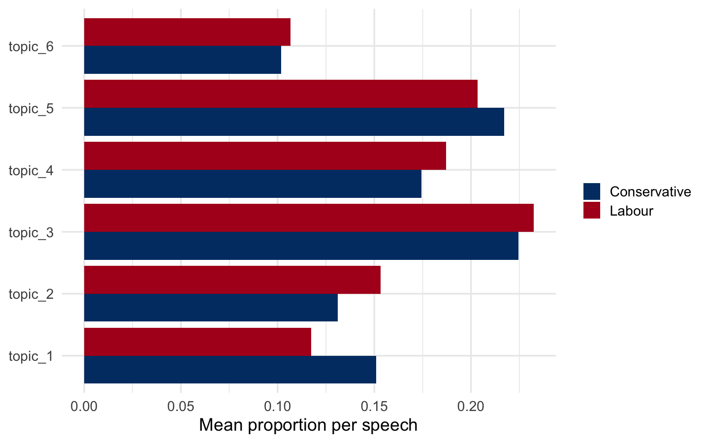
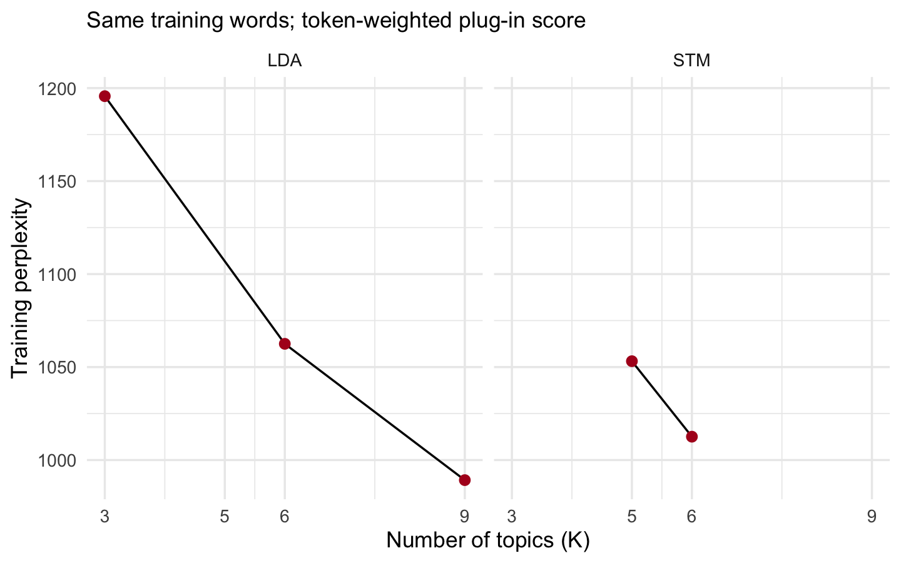
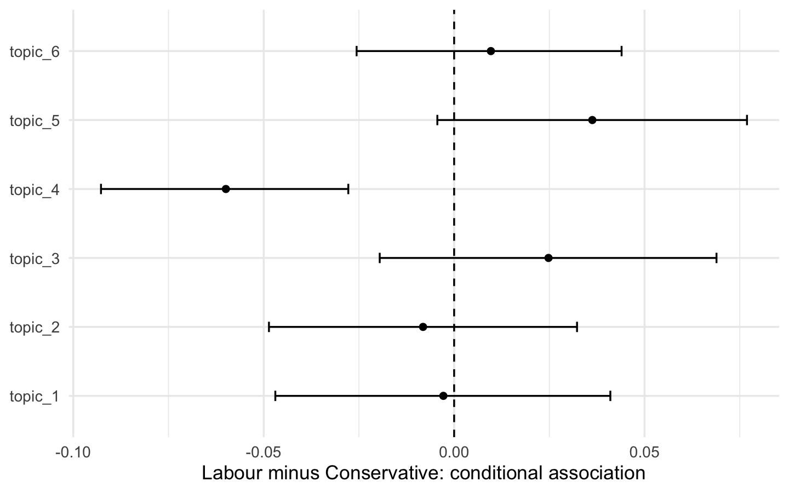

## Start here: RStudio and one R script

This lab runs entirely in **R**. We build one DFM, fit LDA and STM, read the original speeches and interpret party comparisons. The classroom route follows R01, R02, R03a–R03b and R05 on the same 719 speeches. R03c–R03d and the R04 K check are after-class work.

<div class="w8-learning-outcomes" data-w8-learning-outcomes="core-optional"><p><strong>What you should be able to explain</strong></p><p class="w8-analysis-mode" data-w8-analysis-mode="live-end-to-end">Build one count table from the same 719 speeches, fit LDA and check its topic labels, then fit STM and compare parties.</p><p><strong>Research question:</strong> Which issues do Conservative and Labour leaders discuss, and how does attention vary by party once we account for election period?</p><p><strong>By the end of the in-class route:</strong></p><ul><li>Define one document and explain what tokenization, cleaning and the count table change (R01 and its section check).</li><li>Fit LDA and read a complete topic mixture, explaining what a dominant-topic label leaves out (R02–R03a).</li><li>Support a provisional label with a document ID and quotation, and describe evidence that could challenge it (E02).</li><li>Fit STM with party and election period, report the comparison in percentage points, and explain its interval and causal limits (R05; E05).</li></ul><p><strong>Optional check after class:</strong></p><ul><li>Check how the same LDA and STM analyses change with topic resolution, using words, original texts and training fit; explain why the lowest training score cannot select a valid political measure (R04; E04).</li></ul></div>


**ESS adaptation.** R01–R05 adapt Martijn Schoonvelde’s ESS 2026 Day 7 lab and answers for the parliamentary-speech corpus, text preparation, LDA and STM. This W8 version uses a fixed sample of 719 speeches and categorical election periods. [Original ESS course](https://essexsummerschool.com/course/ess-2026-course-list/1k/).

1. Download and extract the [Student Lab ZIP](../downloads/week8-lab.zip). Keep the complete `W8` folder structure.
2. Open [W8_lab.Rproj](../W8_lab.Rproj) in RStudio, then open [classroom/W8.R](../classroom/W8.R).
3. Choose **Session → Restart R** and begin with R00. Run the current line or a complete selected block with **Ctrl+Enter** on Windows/Linux or **Cmd+Enter** on macOS. Select the complete expression when parentheses or function calls span multiple lines. Do not Source the entire script; this lab is designed for step-by-step execution.
4. After each step, inspect **Console, Environment, and Plots** and compare the result with the expected output. At the end of each R section, answer the short **Before you continue** questions. Keep the same R session throughout.

The project does not restore an old workspace automatically. If you see `object not found`, return to the preceding step. Do not rely on objects left from an earlier session.

**Class route, about 37 minutes:** Follow four sections: R01a–R01c → R02a–R02b → R03a–R03b → R05a–R05e. Read the data, LDA and original speeches and complete E02 (17 minutes); go directly to STM and E05 (15 minutes); then interpret the result (5 minutes). Complete R00 before class. R03c–R03d and R04a–R04c are after-class work, together with E01, E03 and E04. E02 and E05 are the in-class exercises. For independent practice, finish E01, E03 and the optional K check in E04 after the classroom route.

<div class="w8-class-route" data-w8-class-route="selected"><table><thead><tr><th>Route label</th><th>Steps</th><th>What to do</th></tr></thead><tbody><tr><td>Before class</td><td>R00a–R00b</td><td>Install packages, open the project and confirm the folders</td></tr><tr><td>Run together · 1</td><td>R01a–R01c</td><td>Read the file, clean words and create the count table</td></tr><tr><td>Run together · 2</td><td>R02a–R02b</td><td>Fit LDA, then read the words and complete topic mixtures</td></tr><tr><td>Run together · 3</td><td>R03a–R03b; E02</td><td>Read original speeches, support a label, then go directly to R05a</td></tr><tr><td>Run together · 4</td><td>R05a–R05e; E05</td><td>Fit STM, then interpret raw and conditional party comparisons</td></tr><tr><td>After class</td><td>R03c–R03d; R04a–R04c; E01, E03, E04</td><td>Compare party means and training diagnostics after completing the core route</td></tr></tbody></table></div>


The handout and R script use the same microsteps. Each step contains its purpose, runnable code, expected output, and interpretation. Each R section ends with one **Before you continue** check. E01–E05 use the objects created in the preceding sections. E02 follows R03b because it requires a quotation from the original text.

## Packages: install once before R00

On first use, install the core packages below in the R Console. Then return to R00. You do not need to reinstall them for every class.

```r
install.packages(c("quanteda", "quanteda.textstats", "seededlda", "stm", "dplyr", "tidyr", "ggplot2", "jsonlite"),
  repos = "https://cloud.r-project.org")
```

## Documents and the lab route

The fixed teaching sample contains **719 complete speeches**: 359 Conservative and 360 Labour speeches. From the original 6,548 speeches, the workflow retains 3,897 non-empty speeches with at least 80 source terms, then samples up to 30 speeches per party and election period. This nearly balanced teaching sample does not represent total parliamentary speaking volume.

The R DFM has **719 documents and 2,831 features**, with **70,813 retained tokens**. Encoding artefacts in the source text remain unchanged. LDA and STM are fitted to the counts built in R01, then interpreted with words, original texts, proportions and comparisons.

| Section | R task | Next exercise |
|---|---|---|
| R00 | Confirm the project and packages | — |
| R01 | Read speeches, clean words, and create a DFM | E01 (after class) |
| R02 | Fit LDA, read words and mixtures | Draft labels; complete E02 after R03b |
| R03 | In class: read speeches. After class: compare party means and plot | E02 in class; E03 after class |
| R04 | After class: compare LDA and STM training diagnostics | E04 (after class) |
| R05 | Fit STM and estimate raw and adjusted comparisons | E05 |

## R00 Start in RStudio

### R00a Load the R packages

<p class="w8-step-route" data-w8-step-route="R00a"><strong>Before class</strong></p>

**Purpose:** Load the packages for this lab in one R session. Before first use, follow the installation instructions and run install.packages().

**Run this R block:**

```r
required <- c("quanteda", "quanteda.textstats", "seededlda", "stm",
  "dplyr", "tidyr", "ggplot2", "jsonlite")
missing <- required[!vapply(required, requireNamespace,
  quietly = TRUE, FUN.VALUE = logical(1))]
if (length(missing)) stop("Install these packages first: ",
  paste(missing, collapse = ", "))
invisible(lapply(required, function(p)
  suppressPackageStartupMessages(library(p, character.only = TRUE))))
options(width = 100, seededlda_threads = 1)
cat("Packages loaded:", paste(required, collapse = ", "), "\n")
```

**Check the expected output** (recorded output from the verified live run):

```text
Packages loaded: quanteda, quanteda.textstats, seededlda, stm, dplyr, tidyr, ggplot2, jsonlite
```

**How to interpret:** A successful run lists the package names on the final line. Install packages once, but load them again in every new session.

### R00b Locate the speech input

<p class="w8-step-route" data-w8-step-route="R00b"><strong>Before class</strong></p>

**Purpose:** Locate the supplied speech sample and set the plotting colours.

**Run this R block:**

```r
lab_file <- function(name) file.path("analysis", "ess_lab", name)
if (!file.exists(lab_file("sample_raw.rds"))) {
  stop("Open W8_lab.Rproj, then run R00b again.")
}
party_colors <- c(Conservative = "#003B73", Labour = "#B00020")
cat("W8 speech input found. Ready to build and fit both models.\n")
```

**Check the expected output** (recorded output from the verified live run):

```text
W8 speech input found. Ready to build and fit both models.
```

**How to interpret:** lab_file() locates the speech input. We build the counts and fit both models in the following steps.

<!-- W8:GROUP-CHECK:R00 -->

::: {.w8-before-continue}
**Before you continue**

- The package list loads without an error.
- `lab_file("sample_raw.rds")` is found before you start R01.
:::

## R01 Read speeches, clean words, and create a count table

### R01a Read file

<p class="w8-step-route" data-w8-step-route="R01a"><strong>Run together</strong></p>

**Purpose:** Read the ESS speech table and create a quanteda corpus.

**Run this R block:**

```r
topic_docs <- readRDS(lab_file("sample_raw.rds"))
topic_corpus <- corpus(
  topic_docs, text_field = "text", docid_field = "doc_id")
print(topic_docs[1:3,
  c("doc_id", "leader", "party_family", "date")])
print(c(speeches = ndoc(topic_corpus)))
```

**Check the expected output** (recorded output from the verified live run):

```text
# A tibble: 3 × 4
  doc_id        leader            party_family date      
  <chr>         <chr>             <fct>        <date>    
1 ess_hoc_00002 Margaret Thatcher Conservative 1979-05-15
2 ess_hoc_00211 James Callaghan   Labour       1979-06-21
3 ess_hoc_00004 Margaret Thatcher Conservative 1979-06-26
speeches 
     719
```

**How to interpret:** A corpus is a collection of texts. Here, one document is one complete speech. The words have not been split or counted yet.

### R01b Split and clean the words

<p class="w8-step-route" data-w8-step-route="R01b"><strong>Run together</strong></p>

**Purpose:** Keep an unprocessed view of one speech, then clean the full corpus for both analyses.

**Run this R block:**

```r
id <- "ess_hoc_00004"
raw_tokens <- tokens(topic_corpus[id], what = "word")
parliamentary_stopwords <- c("hon", "member", "right", "friend", "sir",
  "gentleman", "lady", "house", "commons", "speaker", "minister",
  "secretary", "asked", "question", "mr", "mrs", "ms", "â", "ã")
clean_tokens <- tokens(topic_corpus, remove_punct = TRUE,
  remove_symbols = TRUE, remove_numbers = TRUE, remove_url = TRUE,
  remove_separators = TRUE, split_hyphens = FALSE) |>
  tokens_tolower() |> tokens_remove(stopwords("en")) |>
  tokens_remove(parliamentary_stopwords)
print(raw_tokens[[id]][1:21])
print(clean_tokens[[id]][1:8])
```

**Check the expected output** (recorded output from the verified live run):

```text
[1] "With"       "permission" ","          "Mr"         "."          "Speaker"    "I"         
 [8] "should"     "like"       "to"         "make"       "a"          "statement"  "on"        
[15] "the"        "European"   "Council"    "Meeting"    "at"         "Strasbourg" "."         
[1] "permission" "like"       "make"       "statement"  "european"   "council"    "meeting"   
[8] "strasbourg"
```

**How to interpret:** Tokenization splits speeches into word units. Cleaning removes punctuation, symbols, numbers, URLs, common English words and the listed parliamentary words. Each removal is a research choice.

### R01c Turn cleaned words into a DFM

<p class="w8-step-route" data-w8-step-route="R01c"><strong>Run together</strong></p>

**Purpose:** Combine common multiword expressions, count the words and trim one DFM for both LDA and STM.

**Run this R block:**

```r
collocations <- textstat_collocations(
  clean_tokens, min_count = 8, size = 2:3) |> arrange(desc(lambda))
model_tokens <- tokens_compound(clean_tokens,
  phrase(head(collocations$collocation, 30)))
topic_dfm <- dfm(model_tokens) |>
  dfm_trim(min_termfreq = 5, min_docfreq = 2) |>
  dfm_trim(max_docfreq = .75, docfreq_type = "prop")
topic_dfm <- topic_dfm[ntoken(topic_dfm) > 0, ]
topic_docs <- topic_docs[match(docnames(topic_dfm), topic_docs$doc_id), ]
topic_docs$retained_tokens <- as.numeric(ntoken(topic_dfm))
stopifnot(identical(topic_docs$doc_id, docnames(topic_dfm)))
print(c(speeches = ndoc(topic_dfm), features = nfeat(topic_dfm),
  tokens = sum(ntoken(topic_dfm))))
print(topfeatures(topic_dfm, 6))
```

**Check the expected output** (recorded output from the verified live run):

```text
speeches features   tokens 
     719     2831    70813 
     prime government     people        can        now    country 
       992        728        590        490        382        354
```

**How to interpret:** One DFM now contains 719 speeches, 2,831 features and 70,813 retained tokens. Rows are speeches, columns are words or compounded expressions, and cells are counts. Both models use these same counts.

<!-- W8:GROUP-CHECK:R01 -->

::: {.w8-before-continue}
**Before you continue**

- You have 719 speech documents.
- Confirm 2,831 features and 70,813 retained tokens. Explain one compounding or trimming choice.
:::

### E01 From speeches to word counts

<p class="w8-exercise-route" data-w8-exercise-route="E01"><strong>After class</strong></p>

Confirm that one document is one complete speech. Compare the raw and cleaned words for ess_hoc_00004, then report the DFM's documents, features and retained tokens. Explain how compounding common expressions and trimming the vocabulary change the input to both models.

Complete the matching section in the student R script, then write your interpretation.

```r
# E01: write your code here
```

**Your interpretation:**

<div class="answer-space">Write your explanation here.</div>

## R02 Fit a six-topic LDA and inspect topic words and proportions

### R02a Fit a six-topic LDA model

<p class="w8-step-route" data-w8-step-route="R02a"><strong>Run together</strong></p>

**Purpose:** Fit LDA to the DFM, then inspect the topic words and document-topic matrix.

**Run this R block:**

```r
set.seed(20260710)
lda_6 <- textmodel_lda(topic_dfm, k = 6, alpha = .5, beta = .1,
  max_iter = 500, auto_iter = FALSE, batch_size = 1, verbose = FALSE)
print(terms(lda_6, 10))
print(dim(lda_6$theta))
```

**Check the expected output** (recorded output from the verified live run):

```text
topic1      topic2       topic3       topic4         topic5    topic6         
 [1,] "european"  "government" "prime"      "government"   "people"  "united"       
 [2,] "council"   "state"      "people"     "people"       "can"     "must"         
 [3,] "community" "made"       "government" "unemployment" "country" "international"
 [4,] "countries" "members"    "said"       "economy"      "want"    "security"     
 [5,] "agreed"    "service"    "can"        "year"         "support" "nations"      
 [6,] "economic"  "shall"      "now"        "chancellor"   "sure"    "now"          
 [7,] "union"     "matter"     "us"         "per_cent"     "well"    "government"   
 [8,] "summit"    "report"     "country"    "budget"       "also"    "british"      
 [9,] "agreement" "public"     "last"       "million"      "work"    "action"       
[10,] "meeting"   "way"        "health"     "years"        "many"    "forces"       
[1] 719   6
```

**How to interpret:** The model estimates topic-word probabilities and a topic mixture for every speech. terms() lists the highest-probability words; theta has one row per speech and six topic columns. The seed and finite iteration budget support reproduction, not automatic validity.

### R02b Read complete topic mixtures

<p class="w8-step-route" data-w8-step-route="R02b"><strong>Run together</strong></p>

**Purpose:** Inspect the complete topic mixture for a speech, then examine what the dominant topic retains as a summary.

**Run this R block:**

```r
print(round(head(lda_6$theta, 3), 3))
print(range(rowSums(lda_6$theta)))
dominant_topic <- max.col(lda_6$theta, ties.method = "first")
names(dominant_topic) <- topic_docs$doc_id
print(head(dominant_topic, 5))
print(table(dominant_topic))
```

**Check the expected output** (recorded output from the verified live run):

```text
topic1 topic2 topic3 topic4 topic5 topic6
ess_hoc_00002  0.044  0.188  0.049  0.197  0.470  0.053
ess_hoc_00211  0.005  0.490  0.136  0.207  0.116  0.045
ess_hoc_00004  0.874  0.067  0.012  0.002  0.012  0.032
[1] 1 1
ess_hoc_00002 ess_hoc_00211 ess_hoc_00004 ess_hoc_00006 ess_hoc_00008 
            5             2             1             1             2 
dominant_topic
  1   2   3   4   5   6 
 91  80 193 143 145  67
```

**How to interpret:** Each complete theta row sums to one before rounding. dominant_topic keeps only the number with the largest share and takes the first in a tie. This fixed rule is easy to reproduce but retains less information than the complete mixture.

<!-- W8:GROUP-CHECK:R02 -->

::: {.w8-before-continue}
**Before you continue**

- Use a `theta` row, not `dominant_topic`, when you want to show that one speech can discuss several topics.
- Write two provisional topic labels to test against the original speeches in R03.
:::

## R03 Read representative speeches and describe party means

### R03a Retrieve concentrated and mixed speeches

<p class="w8-step-route" data-w8-step-route="R03a"><strong>Run together</strong></p>

**Purpose:** Use doc_id to retrieve a high-T1 speech and the speech with the most diffuse mixture.

**Run this R block:**

```r
theta <- lda_6$theta
high_i <- which.max(theta[, 1])
mixed_i <- which.min(apply(theta, 1, max))
print(topic_docs[c(high_i, mixed_i),
  c("doc_id", "leader", "party_family", "date")])
print(round(theta[c(high_i, mixed_i), ], 4))
print(rowSums(theta[c(high_i, mixed_i), , drop = FALSE]))
```

**Check the expected output** (recorded output from the verified live run):

```text
# A tibble: 2 × 4
  doc_id        leader            party_family date      
  <chr>         <chr>             <fct>        <date>    
1 ess_hoc_00004 Margaret Thatcher Conservative 1979-06-26
2 ess_hoc_05895 Jeremy Corbyn     Labour       2020-03-25
              topic1 topic2 topic3 topic4 topic5 topic6
ess_hoc_00004 0.8738 0.0668 0.0124 0.0025 0.0124 0.0322
ess_hoc_05895 0.0982 0.1339 0.2054 0.2232 0.2054 0.1339
ess_hoc_00004 ess_hoc_05895 
            1             1
```

**How to interpret:** These two examples were selected from model results for interpretation; they are not a random validation sample. The complete proportions reveal secondary issues.

### R03b Read the original speech

<p class="w8-step-route" data-w8-step-route="R03b"><strong>Run together</strong></p>

**Purpose:** Return to the complete text and check whether the word list and proportions support your proposed label.

**Run this R block:**

```r
cat("Document:", topic_docs$doc_id[high_i], "\n")
cat(topic_docs$text[high_i], "\n")
cat("Mixed document:", topic_docs$doc_id[mixed_i], "\n")
cat(topic_docs$text[mixed_i], "\n")
```

**Check the expected output excerpt** (long lines are wrapped; expand the full output below):

```text
Document: ess_hoc_00004 
With permission, Mr. Speaker I should like to make a statement on the European Council Meeting at
Strasbourg. With my noble Friend, the Foreign and Commonwealth Secretary I attended the European
Council in Strasbourg at the end of last week. Among the matters we discussed were, first,
contributions to the Community budget. I made our dissatisfaction with the results of the present
system very plain. The European Council called for action by the Commission to assess the facts
about how the budget transfers are likely to affect each member State in 1979 and 1980 and whether
and how the 1975 financial mechanism, intended to reduce our contribution, will work. That report
will go first to the Finance Council of Ministers, who will have the opportunity to put forward
practical ideas to solve the problem. Taking those views into account, the Commission has been asked
to formulate proposals in time for decisions to be taken at the next meeting of the European Council
in November, in Dublin. At last, therefore, we have an agreement to tackle the inequitably high
```

<details>
<summary>Show full output</summary>

```text
Document: ess_hoc_00004 
With permission, Mr. Speaker I should like to make a statement on the European Council Meeting at Strasbourg. With my noble Friend, the Foreign and Commonwealth Secretary I attended the European Council in Strasbourg at the end of last week. Among the matters we discussed were, first, contributions to the Community budget. I made our dissatisfaction with the results of the present system very plain. The European Council called for action by the Commission to assess the facts about how the budget transfers are likely to affect each member State in 1979 and 1980 and whether and how the 1975 financial mechanism, intended to reduce our contribution, will work. That report will go first to the Finance Council of Ministers, who will have the opportunity to put forward practical ideas to solve the problem. Taking those views into account, the Commission has been asked to formulate proposals in time for decisions to be taken at the next meeting of the European Council in November, in Dublin. At last, therefore, we have an agreement to tackle the inequitably high contribution that Britain at present makes to the European budget. The time for decisions will be at the next Council. Secondly on energy and the oil shortage, we agreed to reinforce our efforts to reduce consumption of oil and to achieve the objectives that the Community has set itself. We also emphasised the part that alternative sources of energy must play, nuclear power and coal in particular. We recognised the need for consumer and producer countries to work together to reduce demand and increase supply and made clear the readiness of the Community and member States to establish contacts with producer countries to that end. We had in mind the Tokyo economic summit meeting this week and that by showing that the Community was ready to shoulder its own responsibilities, we should be in a good position to call on other industrialised countries to make comparable efforts to reduce oil consumption and imports. We agreed that higher oil prices will adversely affect the outlook for growth, though prices will only steady if demand and supply balance. Thirdly, the Council reviewed the early operations of the European monetary system. I also told it of the Government's intention, about which the House has already been informed, to deposit part of our reserves against ECUs. Fourthly, the Council was anxious to help refugees from Vietnam and supported the proposals for an international conference. Finally, we noted with satisfaction the first direct elections to the European Assembly and welcome the intention of the Irish Prime Minister to represent the Council at the inaugural meeting of the new Assembly on 18 July. 
Mixed document: ess_hoc_05895 
My hon. Friend understands the issue and represents his constituency extremely well. I know that a lot of his constituents are in that situation. We have to have better regulation of the private rented sector, with security of tenure and realistic rent levels. We also have to have the spirit of what was said, which was that there would be protection for people in the future. The danger, as he points out, is the opposite: it will just put costs up in a few months’ time. Remember, if somebody has a mortgage and they rent privately, they will pass on the cost of the mortgage to the private renter. That is a problem he quite rightly emphasises. Shelter estimates that 20,000 eviction proceedings are already in progress and will go ahead over the next three months unless the Government act to stop them.
```

</details>

**How to interpret:** The R Console displays the complete speech. After finding topic-relevant passages, also check whether other passages change the interpretation of the whole speech.

### E02 Words and provisional labels

<p class="w8-exercise-route" data-w8-exercise-route="E02"><strong>In-class focus</strong></p>

Display the top ten words for the six-topic LDA. Propose two provisional labels. Support one with a document ID and an exact quotation, and describe a text that could challenge the label.

Complete the matching section in the student R script, then write your interpretation.

```r
# E02: write your code here
```

**Your interpretation:**

<div class="answer-space">Write your explanation here.</div>

**In class: continue directly to R05a after E02.** R03c–R03d and R04 are after-class work. R05 fits STM and its conditional comparison from the DFM built in R01, so it does not depend on those deferred steps.

### R03c Calculate party means

<p class="w8-step-route" data-w8-step-route="R03c"><strong>After class</strong></p>

**Purpose:** Reshape each speech's topic proportions to long form and calculate equal-weight party means.

**Run this R block:**

```r
lda_theta <- as.data.frame(theta)
colnames(lda_theta) <- paste0("topic_", seq_len(ncol(theta)))
lda_theta$doc_id <- topic_docs$doc_id
lda_theta$party_family <- topic_docs$party_family
lda_theta_long <- lda_theta |> pivot_longer(starts_with("topic_"),
  names_to = "topic", values_to = "proportion")
party_topic_means <- lda_theta_long |> group_by(party_family, topic) |>
  summarise(mean_proportion = mean(proportion), .groups = "drop")
print(as.data.frame(party_topic_means), row.names = FALSE)
```

**Check the expected output** (recorded output from the verified live run):

```text
party_family   topic mean_proportion
 Conservative topic_1       0.1509542
 Conservative topic_2       0.1311229
 Conservative topic_3       0.2244570
 Conservative topic_4       0.1745095
 Conservative topic_5       0.2170729
 Conservative topic_6       0.1018834
       Labour topic_1       0.1173659
       Labour topic_2       0.1532040
       Labour topic_3       0.2323498
       Labour topic_4       0.1870214
       Labour topic_5       0.2033525
       Labour topic_6       0.1067064
```

**How to interpret:** The denominator of each mean is the number of sampled speeches for that party. Every speech receives equal weight.

### R03d Plot the party means in R

<p class="w8-step-route" data-w8-step-route="R03d"><strong>After class</strong></p>

**Purpose:** Plot the values from the previous step and read the topic numbers alongside your provisional labels.

**Run this R block:**

```r
p_lda_party <- ggplot(party_topic_means,
  aes(topic, mean_proportion, fill = party_family)) +
  geom_col(position = "dodge") + coord_flip() +
  scale_fill_manual(values = party_colors) +
  labs(x = NULL, y = "Mean proportion per speech", fill = NULL) +
  theme_minimal(base_size = 16)
print(p_lda_party)
```

**Expected result:** The figure below appears in the RStudio Plots pane; this step produces no new Console table.

**How to interpret:** The RStudio Plots pane shows the mean proportions by party. The plot and table use the same party_topic_means object.



<!-- W8:GROUP-CHECK:R03 -->

::: {.w8-before-continue}
**Before you continue**

- Support one provisional label with an exact quotation.
- Report the two LDA Topic 1 party means and state whether they give equal weight to speeches or to words.
:::

### E03 Mixtures and party means

<p class="w8-exercise-route" data-w8-exercise-route="E03"><strong>After class</strong></p>

After class, retrieve Reading texts A and B by doc_id. Print all six topic proportions and their sums. Compare this information with keeping only the largest topic. Then use party_topic_means and its plot to compare LDA Topic 1 between parties. Report the two mean shares, state how speeches are weighted, and explain why the plot does not establish a causal party effect.

Complete the matching section in the student R script, then write your interpretation.

```r
# E03: write your code here
```

**Your interpretation:**

<div class="answer-space">Write your explanation here.</div>

## R04 Compare LDA and STM training diagnostics

### R04a Read alternative topic resolutions

<p class="w8-step-route" data-w8-step-route="R04a"><strong>After class</strong></p>

**Purpose:** Read the LDA K=3, 6, and 9 and STM K=5 and 6 models fitted to the same documents and vocabulary. First examine how the LDA word groups split or merge.

**Run this R block:**

```r
k_candidates <- c(3, 6, 9)
lda_models <- lapply(k_candidates, function(k_value)
  readRDS(lab_file(paste0("lda", k_value, ".rds"))))
names(lda_models) <- paste0("K", k_candidates)
stm_models <- lapply(c(5, 6), function(k_value)
  readRDS(lab_file(paste0("stm", k_value, ".rds"))))
print(lapply(lda_models, terms, 5))
```

**Check the expected output excerpt** (long lines are wrapped; expand the full output below):

```text
$K3
     topic1      topic2       topic3      
[1,] "european"  "prime"      "people"    
[2,] "council"   "government" "government"
[3,] "community" "said"       "prime"     
[4,] "countries" "one"        "country"   
[5,] "united"    "can"        "can"       

$K6
     topic1      topic2       topic3       topic4         topic5    topic6         
[1,] "european"  "government" "prime"      "government"   "people"  "united"       
[2,] "council"   "state"      "people"     "people"       "can"     "must"
```

<details>
<summary>Show full output</summary>

```text
$K3
     topic1      topic2       topic3      
[1,] "european"  "prime"      "people"    
[2,] "council"   "government" "government"
[3,] "community" "said"       "prime"     
[4,] "countries" "one"        "country"   
[5,] "united"    "can"        "can"       

$K6
     topic1      topic2       topic3       topic4         topic5    topic6         
[1,] "european"  "government" "prime"      "government"   "people"  "united"       
[2,] "council"   "state"      "people"     "people"       "can"     "must"         
[3,] "community" "made"       "government" "unemployment" "country" "international"
[4,] "countries" "members"    "said"       "economy"      "want"    "security"     
[5,] "agreed"    "service"    "can"        "year"         "support" "nations"      

$K9
     topic1      topic2     topic3     topic4       topic5      topic6    topic7       topic8      
[1,] "economic"  "people"   "european" "prime"      "council"   "also"    "government" "government"
[2,] "countries" "health"   "union"    "said"       "agreed"    "members" "people"     "made"      
[3,] "summit"    "can"      "deal"     "now"        "meeting"   "country" "chancellor" "state"     
[4,] "need"      "national" "europe"   "can"        "community" "one"     "per_cent"   "service"   
[5,] "world"     "support"  "future"   "government" "european"  "many"    "budget"     "matter"    
     topic9    
[1,] "united"  
[2,] "nations" 
[3,] "security"
[4,] "must"    
[5,] "british"
```

</details>

**How to interpret:** Each model has its own topic numbers; matching numbers do not identify the same issue. All five use the same DFM. The three LDA fits share priors and iteration budgets; STM uses party and period as prevalence covariates.

### R04b Calculate training perplexity

<p class="w8-step-route" data-w8-step-route="R04b"><strong>After class</strong></p>

**Purpose:** Apply one token-weighted word-probability calculation to the saved LDA and STM fits and the same training DFM.

**Run this R block:**

```r
training_perplexity <- function(model, data) {
  is_stm <- inherits(model, "STM")
  vocab <- if (is_stm) model$vocab else colnames(model$phi)
  phi <- if (is_stm) exp(model$beta$logbeta[[1]]) else model$phi
  counts <- as.matrix(data[, vocab])
  probabilities <- pmax(model$theta %*% phi, 1e-12)
  exp(-sum(counts * log(probabilities)) / sum(counts))
}
perplexity_results <- data.frame(Model = c("LDA", "LDA", "LDA", "STM", "STM"),
  k = c(3, 6, 9, 5, 6), perplexity = vapply(c(lda_models, stm_models),
    training_perplexity, numeric(1), data = topic_dfm))
print(perplexity_results, row.names = FALSE)
```

**Check the expected output** (recorded output from the verified live run):

```text
Model k perplexity
   LDA 3  1195.6619
   LDA 6  1062.4988
   LDA 9   989.2069
   STM 5  1053.1552
   STM 6  1012.5678
```

**How to interpret:** Lower means better reconstruction of these training word counts using fitted theta and phi. Both were estimated from these words: this is resubstitution, not held-out prediction. STM stores log word probabilities, so exp() converts them and vocab aligns the DFM columns. Neither STM has a content covariate. Within each fit, one topic-word matrix is shared across documents; the two fits have different matrices.

### R04c Plot training fit in R

<p class="w8-step-route" data-w8-step-route="R04c"><strong>After class</strong></p>

**Purpose:** Plot the five training diagnostics in separate LDA and STM panels while keeping their common evaluation definition visible.

**Run this R block:**

```r
p_perplexity <- ggplot(perplexity_results, aes(k, perplexity)) +
  geom_line() + geom_point(color = "#B00020", size = 3) +
  facet_wrap(~ Model) + scale_x_continuous(breaks = c(3, 5, 6, 9)) +
  labs(x = "Number of topics (K)", y = "Training perplexity",
    subtitle = "Same training words; token-weighted plug-in score") +
  theme_minimal(base_size = 16)
print(p_perplexity)
```

**Expected result:** The figure below appears in the RStudio Plots pane; this step produces no new Console table.

**How to interpret:** Each point corresponds to one row of perplexity_results. The panels use the same scale. Lower training perplexity alone cannot identify the best K or establish that LDA or STM is superior; the model structures and fitting procedures differ.



<!-- W8:GROUP-CHECK:R04 -->

::: {.w8-before-continue}
**Before you continue**

- All five scores reuse the same training word counts. A lower value cannot by itself identify the best K or a superior model family.
- Name one check using topic words or original speeches.
:::

### E04 K and diagnostic evidence

<p class="w8-exercise-route" data-w8-exercise-route="E04"><strong>After class</strong></p>

After class, run R04a–R04c and read the five LDA and STM training diagnostics. Within LDA, compare K=3, 6 and 9 using words and at least one shared document. Why does lower training perplexity not establish the best K or a superior model family for your political question? Propose a resolution and explain what additional evidence is needed.

Complete the matching section in the student R script, then write your interpretation.

```r
# E04: write your code here
```

**Your interpretation:**

<div class="answer-space">Write your explanation here.</div>

## R05 STM with party and categorical election period

### R05a Fit STM with party and period

<p class="w8-step-route" data-w8-step-route="R05a"><strong>Run together</strong></p>

**Purpose:** Add aligned document metadata and fit STM to the same DFM before comparing parties.

**Run this R block:**

```r
metadata <- data.frame(
  doc_id = topic_docs$doc_id,
  party_family = topic_docs$party_family,
  period = topic_docs$period)
design <- model.matrix(~ party_family + period, metadata)
stopifnot(qr(design)$rank == ncol(design))
stm_input <- convert(topic_dfm, to = "stm")
stm_6 <- stm(stm_input$documents, vocab = stm_input$vocab, K = 6,
  prevalence = ~ party_family + period, data = metadata,
  seed = 20260710, init.type = "Spectral", max.em.its = 100,
  emtol = 1e-4, verbose = FALSE)
print(labelTopics(stm_6, topics = 4, n = 5))
```

**Check the expected output** (recorded output from the verified live run):

```text
Topic 4 Top Words:
 	 Highest Prob: council, community, agreed, united, european 
 	 FREX: argentine, commonwealth, nations, agreed, meeting 
 	 Lift: dependencies, falklands, islanders, moore, shareholders 
 	 Score: names, argentine, council, islands, commonwealth
```

**How to interpret:** This STM has K=6 and uses party_family and categorical period as prevalence covariates, with no content covariate. STM topic 4 is not the same as LDA topic 4.

### R05b Calculate raw STM party differences

<p class="w8-step-route" data-w8-step-route="R05b"><strong>Run together</strong></p>

**Purpose:** Calculate unadjusted means within the same STM so differences between models are not mistaken for adjustment effects.

**Run this R block:**

```r
stm_theta <- as.data.frame(stm_6$theta)
colnames(stm_theta) <- paste0("topic_", seq_len(ncol(stm_theta)))
stm_theta$party_family <- topic_docs$party_family
stm_party_means <- stm_theta |> pivot_longer(starts_with("topic_"),
  names_to = "topic", values_to = "proportion") |>
  group_by(party_family, topic) |>
  summarise(mean = mean(proportion), .groups = "drop")
stm_raw_differences <- stm_party_means |>
  pivot_wider(id_cols = topic, names_from = party_family, values_from = mean) |>
  mutate(difference = Labour - Conservative)
print(stm_raw_differences[stm_raw_differences$topic == "topic_4", ])
```

**Check the expected output** (recorded output from the verified live run):

```text
# A tibble: 1 × 4
  topic   Conservative Labour difference
  <chr>          <dbl>  <dbl>      <dbl>
1 topic_4        0.137 0.0763    -0.0603
```

**How to interpret:** The difference is defined as Labour minus Conservative. The raw means and later adjusted comparison use the same STM.

### R05c Estimate the conditional comparison

<p class="w8-step-route" data-w8-step-route="R05c"><strong>Run together</strong></p>

**Purpose:** Estimate the party-and-period association and simulate its comparison intervals.

**Run this R block:**

```r
set.seed(20260710)
stm_party_effects <- estimateEffect(1:6 ~ party_family + period,
  stmobj = stm_6, metadata = metadata,
  uncertainty = "Global", nsims = 50)
set.seed(20260710)
adjusted_result <- plot(stm_party_effects,
  covariate = "party_family", method = "difference",
  cov.value1 = "Labour", cov.value2 = "Conservative",
  topics = 1:6, nsims = 1000, omit.plot = TRUE,
  labeltype = "numbers")
print(adjusted_result$means[4])
print(adjusted_result$cis[[4]])
```

**Check the expected output** (recorded output from the verified live run):

```text
[[1]]
[1] -0.05993053

       2.5%       97.5% 
-0.09272104 -0.02778845
```

**How to interpret:** estimateEffect uses the fitted STM with the same party and categorical-period variables. Global uncertainty uses 50 simulations; the contrast uses 1,000 simulations after resetting the seed. omit.plot returns the numbers for the next table and plot.

### R05d Create a comparison table

<p class="w8-step-route" data-w8-step-route="R05d"><strong>Run together</strong></p>

**Purpose:** Assemble the conditional differences for all six topics in a data frame, then inspect topic 4.

**Run this R block:**

```r
adjusted_differences <- data.frame(topic = paste0("topic_", 1:6),
  difference = unlist(adjusted_result$means),
  lower = vapply(adjusted_result$cis, `[`, numeric(1), 1),
  upper = vapply(adjusted_result$cis, `[`, numeric(1), 2))
print(adjusted_differences[adjusted_differences$topic == "topic_4", ],
  row.names = FALSE)
```

**Check the expected output** (recorded output from the verified live run):

```text
topic  difference       lower       upper
 topic_4 -0.05993053 -0.09272104 -0.02778845
```

**How to interpret:** lower and upper are endpoints of an approximate model-simulation interval. They do not identify a causal effect of party affiliation.

### R05e Plot the STM associations in R

<p class="w8-step-route" data-w8-step-route="R05e"><strong>Run together</strong></p>

**Purpose:** Plot adjusted_differences as points and intervals while preserving the direction of the difference.

**Run this R block:**

```r
p_stm_adjusted <- ggplot(adjusted_differences, aes(difference, topic)) +
  geom_vline(xintercept = 0, linetype = 2) + geom_point() +
  geom_errorbar(aes(xmin = lower, xmax = upper),
    orientation = "y", width = .15) +
  labs(x = "Labour minus Conservative: conditional association", y = NULL) +
  theme_minimal(base_size = 16)
print(p_stm_adjusted)
```

**Expected result:** The figure below appears in the RStudio Plots pane; this step produces no new Console table.

**How to interpret:** The vertical line marks zero difference, and the horizontal lines show the simulation intervals. The concepts represented by each topic still require interpretation from words and texts.



<!-- W8:GROUP-CHECK:R05 -->

::: {.w8-before-continue}
**Before you continue**

- State the direction of the comparison: Labour minus Conservative.
- Explain why the interval describes uncertainty within the fitted model, not a causal party effect.
:::

### E05 STM associations

<p class="w8-exercise-route" data-w8-exercise-route="E05"><strong>In-class focus</strong></p>

For STM topic 4, inspect probability and FREX words, raw party means and the adjusted Labour-minus-Conservative comparison. Report the direction and size of the adjusted difference in percentage points. State the covariates and the meaning of the interval. Write one conclusion the evidence supports and one causal claim it does not establish.

Complete the matching section in the student R script, then write your interpretation.

```r
# E05: write your code here
```

**Your interpretation:**

<div class="answer-space">Write your explanation here.</div>

## If you get an error

| Message or situation | What to do first |
|---|---|
| cannot open file | Reopen W8_lab.Rproj and confirm that the R script remains inside the complete folder structure. |
| object not found | Return to the step that creates the missing object and run the steps in order from R00. |
| The Console shows + and keeps waiting | The expression is incomplete. Press Esc, select the complete block including all parentheses, and run it again. Do not copy the + prompt into the script. |
| there is no package called … | Return to the Packages section, install the missing package, and load it again. |
| Document count or doc_id check fails | Stop the comparison. Use one complete speech sample and rerun preparation and model fitting in the same session. |
| No plot appears | Check the RStudio Plots pane and confirm that you ran the relevant print(p_…) line. |
| Values differ slightly in displayed decimal places | Check the data, model, and package versions first. Display rounding does not imply a different model. |

## Reproducibility and methods

Reading: *Text as Data*, chapter 13 and selected §§21.3–21.4.

This handout builds and fits the two models in one R session. R04 is an optional comparison with supplied alternative topic resolutions on the same DFM. The recorded step output comes from the current live run; historical reference-fit metadata is retained separately.

Methods: [LDA](https://www.jmlr.org/papers/v3/blei03a.html), [STM](https://doi.org/10.1111/ajps.12103), [LDA implementation](https://koheiw.github.io/seededlda/reference/textmodel_lda.html), [STM implementation](https://search.r-project.org/CRAN/refmans/stm/html/stm.html).

The versions below describe the current 19-step live capture. They do not establish semantic validity, causality, convergence or held-out predictive performance.

Earlier reference-fit metadata lists seededlda **1.4.3**; the current live capture uses **1.4.4**. Keep these software-version records separate.

| R package | Live capture version |
|---|---|
| quanteda | 4.3.1 |
| quanteda.textstats | 0.97.2 |
| seededlda | 1.4.4 |
| stm | 1.3.8 |
| dplyr | 1.2.0 |
| tidyr | 1.3.2 |
| ggplot2 | 4.0.2 |
| jsonlite | 2.0.0 |

