## Political positions and issue attention

:::::: {.slide-body .compact-table}

| Research task | Political question |
|---|---|
| W7: text scaling | Where does a speaker stand on a defined dimension? |
| W8: issue attention | What does a political actor choose to discuss? |

Campaign promises, newspaper frames, policy diffusion and social media show different uses of topic models.

We begin with each study's political puzzle.

::::::

::: {.source}

Reference: [W7 scaling](../../W7/slide/week7.html); [Grimmer, Roberts & Stewart (2022)](https://ingramacademic.com/products/text-as-data-9780691207551)

:::


## Research questions and model use

:::::: {.slide-body }

**Guiding question:** How do political scientists turn large text collections into evidence about political behavior and communication?

We first read seven political studies. Then we unpack how the models work and apply them to political speeches in R.

::::::

::: {.source}

Reference: [Grimmer, Roberts & Stewart (2022)](https://ingramacademic.com/products/text-as-data-9780691207551); [ESS course](https://essexsummerschool.com/course/ess-2026-course-list/1k/)

:::


<!-- W8:CASES:START -->

## Topic models in political research

:::::: {.slide-body .compact-table .w8-case-map}

| Case | Texts | How the model is used |
|---|---|---|
| **1 · Catalinac (2016)** | Japanese manifestos | Measure campaign promises |
| **2 · Gilardi et al. (2021)** | U.S. news paragraphs | Study policy diffusion and framing |
| **3 · Barberá et al. (2019)** | Tweets | Measure daily issue attention |
| **4 · Jiang et al. (2024)** | Hong Kong news | Develop and test a hypothesis |
| **5 · Roberts et al. (2014)** | Survey answers | Compare priorities with human coding |
| **6 · Mueller & Rauh (2018)** | Newspaper articles | Predict next-year conflict |

::::::

::: {.source}

Reference: [Catalinac (2016)](https://doi.org/10.1086/683073); [Gilardi, Shipan & Wüest (2021)](https://doi.org/10.1111/ajps.12521); [Barberá et al. (2019)](https://doi.org/10.1017/S0003055419000352); [Jiang, Xia & Zhang (2024)](https://doi.org/10.1007/s11109-023-09900-y); [Roberts et al. (2014)](https://doi.org/10.1111/ajps.12103); [Mueller & Rauh (2018)](https://doi.org/10.1017/S0003055417000570)

:::


## How we will read each case

:::::: {.slide-body .compact-table .w8-case-flow}

| What to find | Question for the reader |
|---|---|
| Political question | What puzzle does the study want to explain? |
| Texts and document unit | What counts as one document, and whose language appears? |
| Model contribution | What does the topic model discover or measure? |
| Evidence and limits | What comparison, dynamic model or experiment supports the claim? |

Use the same four questions when you design your own text research.

::::::

::: {.source}

Teaching guide for the six cases introduced on the previous page.

:::


## Electoral rules and campaign promises

:::::: {.slide-body }

<p class="w8-study-label"><strong>Case 1 · Campaign priorities</strong></p>

::::: {.columns .paper-intro-columns .w8-paper}

:::: {.column}

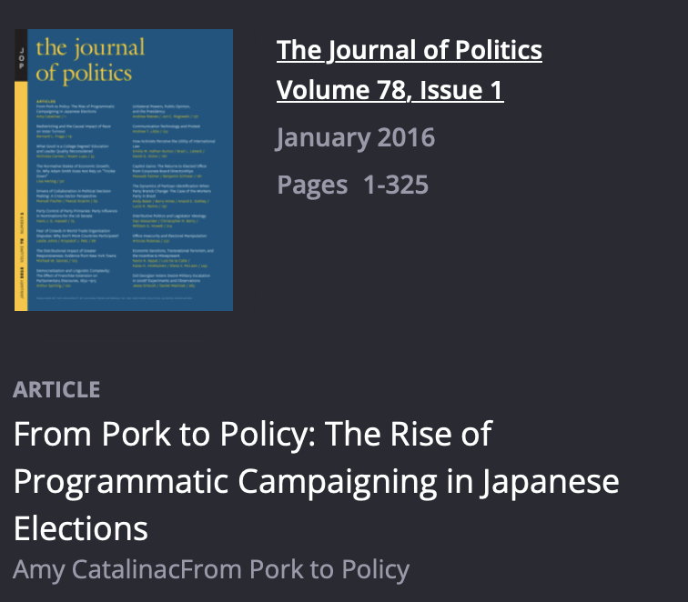{fig-alt="User-supplied Journal of Politics issue and article heading: From Pork to Policy, Amy Catalinac."}

::: {.caption}

**Amy Catalinac**

Journal of Politics, 2016

:::

::::

:::: {.column}

- **Puzzle:** the 1994 reform reduced same-party competition, but later studies still described campaigns as pork-oriented.
- **Question:** did candidates shift from benefits for small groups to broader public policies?
- **Evidence:** 7,497 candidate manifestos from eight elections, 1986–2009.

::::

:::::

::::::

::: {.source}

Reference: [Catalinac (2016)](https://doi.org/10.1086/683073)

:::


## Manifestos become campaign-priority measures

:::::: {.slide-body .compact-table .w8-case-flow .w8-workflow-stage}

<p class="w8-study-label"><strong>Case 1 · How LDA is used · 1/3</strong></p>

<div class="w8-workflow-stage-frame w8-workflow-safe"><table class="w8-workflow-table"><thead><tr><th>Research step</th><th>What Catalinac does</th></tr></thead><tbody><tr class="w8-workflow-active"><td>Discover topics</td><td>LDA identifies 69 recurring themes in 7,497 manifestos</td></tr><tr class="w8-workflow-active"><td><svg class="w8-workflow-gutter-arrow" viewBox="0 0 18 36" aria-hidden="true"><path d="M 9 2 V 30 M 3 24 L 9 30 L 15 24"/></svg>Read and check</td><td>Inspect 15 top words and 10 representative manifestos per topic</td></tr><tr><td>Define concepts</td><td>Use who benefits to classify 14 pork and 52 policy topics</td></tr><tr><td>Measure candidates</td><td>Sum each category&#x27;s topic shares within every manifesto</td></tr><tr><td>Test the puzzle</td><td>Compare those shares across elections and levels of same-party competition</td></tr></tbody></table></div>

<p class="w8-figure-stage-cue w8-workflow-stage-cue">LDA finds recurring themes; close reading gives them political meaning.</p>

::::::

::: {.source}

Reference: [Catalinac (2016)](https://doi.org/10.1086/683073)

:::


## Manifestos become campaign-priority measures

:::::: {.slide-body .compact-table .w8-case-flow .w8-workflow-stage}

<p class="w8-study-label"><strong>Case 1 · How LDA is used · 2/3</strong></p>

<div class="w8-workflow-stage-frame w8-workflow-safe"><table class="w8-workflow-table"><thead><tr><th>Research step</th><th>What Catalinac does</th></tr></thead><tbody><tr><td>Discover topics</td><td>LDA identifies 69 recurring themes in 7,497 manifestos</td></tr><tr><td>Read and check</td><td>Inspect 15 top words and 10 representative manifestos per topic</td></tr><tr class="w8-workflow-active"><td>Define concepts</td><td>Use who benefits to classify 14 pork and 52 policy topics</td></tr><tr class="w8-workflow-active"><td><svg class="w8-workflow-gutter-arrow" viewBox="0 0 18 36" aria-hidden="true"><path d="M 9 2 V 30 M 3 24 L 9 30 L 15 24"/></svg>Measure candidates</td><td>Sum each category&#x27;s topic shares within every manifesto</td></tr><tr><td>Test the puzzle</td><td>Compare those shares across elections and levels of same-party competition</td></tr></tbody></table></div>

<p class="w8-figure-stage-cue w8-workflow-stage-cue">Catalinac classifies interpreted topics by who benefits, creating pork and policy measures.</p>

::::::

::: {.source}

Reference: [Catalinac (2016)](https://doi.org/10.1086/683073)

:::


## Manifestos become campaign-priority measures

:::::: {.slide-body .compact-table .w8-case-flow .w8-workflow-stage}

<p class="w8-study-label"><strong>Case 1 · How LDA is used · 3/3</strong></p>

<div class="w8-workflow-stage-frame w8-workflow-safe"><table class="w8-workflow-table"><thead><tr><th>Research step</th><th>What Catalinac does</th></tr></thead><tbody><tr><td>Discover topics</td><td>LDA identifies 69 recurring themes in 7,497 manifestos</td></tr><tr><td>Read and check</td><td>Inspect 15 top words and 10 representative manifestos per topic</td></tr><tr><td>Define concepts</td><td>Use who benefits to classify 14 pork and 52 policy topics</td></tr><tr class="w8-workflow-active"><td>Measure candidates</td><td>Sum each category&#x27;s topic shares within every manifesto</td></tr><tr class="w8-workflow-active"><td><svg class="w8-workflow-gutter-arrow" viewBox="0 0 18 36" aria-hidden="true"><path d="M 9 2 V 30 M 3 24 L 9 30 L 15 24"/></svg>Test the puzzle</td><td>Compare those shares across elections and levels of same-party competition</td></tr></tbody></table></div>

<p class="w8-figure-stage-cue w8-workflow-stage-cue">Candidate-level shares are compared across elections and levels of same-party competition.</p>

::::::

::: {.source}

Reference: [Catalinac (2016)](https://doi.org/10.1086/683073)

:::


## Pork and policy across Japanese elections

:::::: {.slide-body .w8-figure-stage}

<p class="w8-study-label"><strong>Case 1 · The measure enters the result</strong></p>

<div class="w8-figure-stage-frame w8-figure-stage-portrait" style="--w8-stage-ratio: 0.9517543860">
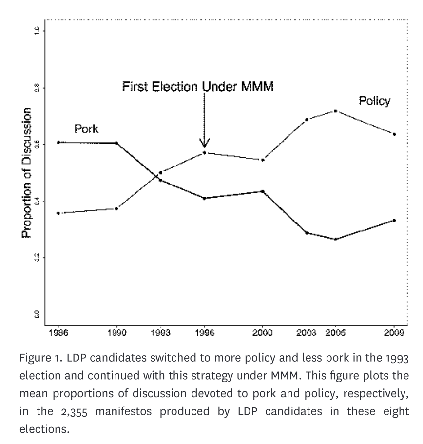
<svg class="w8-figure-stage-overlay" viewBox="0 0 868 912" role="img" aria-label="Red course annotation marks the part of the original figure discussed on this page.">
<ellipse class="w8-figure-stage-focus" cx="570" cy="318" rx="280" ry="114"></ellipse>
<path class="w8-figure-stage-pointer" d="M 295 402 L 335 355"></path>
<polygon class="w8-figure-stage-pointer-head" points="335,355 318,361 329,374"></polygon>
</svg>
</div>

<p class="w8-figure-stage-cue">Start with the red circle: <strong>broad policy promises</strong> rise before the new system is first used in 1996.</p>

::::::

::: {.source}

Reference: [Catalinac (2016)](https://doi.org/10.1086/683073)

:::


## Pork and policy across Japanese elections

:::::: {.slide-body .w8-figure-stage}

<p class="w8-study-label"><strong>Case 1 · The measure enters the result</strong></p>

<div class="w8-figure-stage-frame w8-figure-stage-portrait" style="--w8-stage-ratio: 0.9517543860">

<svg class="w8-figure-stage-overlay" viewBox="0 0 868 912" role="img" aria-label="Red course annotation marks the part of the original figure discussed on this page.">
<ellipse class="w8-figure-stage-focus" cx="480" cy="386" rx="365" ry="132"></ellipse>
<path class="w8-figure-stage-pointer" d="M 310 375 L 360 405"></path>
<polygon class="w8-figure-stage-pointer-head" points="360,405 342,404 350,389"></polygon>
</svg>
</div>

<p class="w8-figure-stage-cue">Now follow the lower line: <strong>local-benefit promises</strong> fall while broad policy promises rise.</p>

::::::

::: {.source}

Reference: [Catalinac (2016)](https://doi.org/10.1086/683073)

:::


## Competition and campaign priorities

:::::: {.slide-body .w8-figure-stage}

<p class="w8-study-label"><strong>Case 1 · A complementary comparison</strong></p>

<div class="w8-figure-stage-frame w8-figure-stage-landscape" style="--w8-stage-ratio: 1.7033398821">
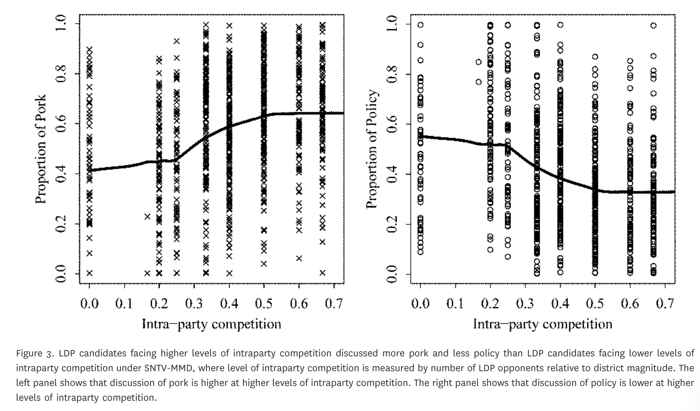
<svg class="w8-figure-stage-overlay" viewBox="0 0 1734 1018" role="img" aria-label="Red course annotation marks the part of the original figure discussed on this page.">
<rect class="w8-figure-stage-focus" x="180" y="25" width="685" height="750" rx="18"></rect>
<path class="w8-figure-stage-pointer" d="M 420 350 L 655 285"></path>
<polygon class="w8-figure-stage-pointer-head" points="655,285 633,283 641,303"></polygon>
</svg>
</div>

<p class="w8-figure-stage-cue">Left panel: more <strong>same-party rivals</strong> are linked to more local-benefit promises.</p>

::::::

::: {.source}

Reference: [Catalinac (2016)](https://doi.org/10.1086/683073)

:::


## Competition and campaign priorities

:::::: {.slide-body .w8-figure-stage}

<p class="w8-study-label"><strong>Case 1 · A complementary comparison</strong></p>

<div class="w8-figure-stage-frame w8-figure-stage-landscape" style="--w8-stage-ratio: 1.7033398821">

<svg class="w8-figure-stage-overlay" viewBox="0 0 1734 1018" role="img" aria-label="Red course annotation marks the part of the original figure discussed on this page.">
<rect class="w8-figure-stage-focus" x="1005" y="25" width="685" height="750" rx="18"></rect>
<path class="w8-figure-stage-pointer" d="M 1215 275 L 1460 430"></path>
<polygon class="w8-figure-stage-pointer-head" points="1460,430 1440,420 1448,405"></polygon>
</svg>
</div>

<p class="w8-figure-stage-cue">Right panel: more <strong>same-party rivals</strong> are linked to fewer broad policy promises.</p>

::::::

::: {.source}

Reference: [Catalinac (2016)](https://doi.org/10.1086/683073)

:::


## Opposition candidates emphasize policy

:::::: {.slide-body .w8-figure-stage}

<p class="w8-study-label"><strong>Case 1 · Opposition comparison</strong></p>

<div class="w8-figure-stage-frame w8-figure-stage-portrait" style="--w8-stage-ratio: 0.9404255319">
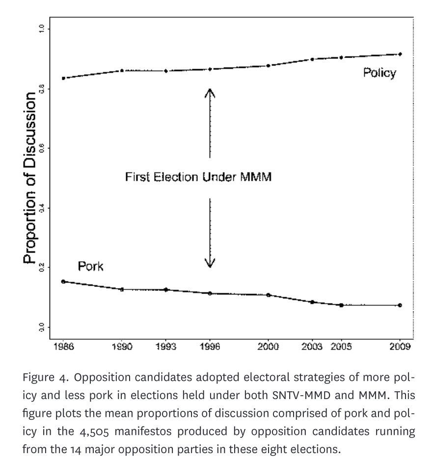
<svg class="w8-figure-stage-overlay" viewBox="0 0 884 940" role="img" aria-label="Red course annotation marks the part of the original figure discussed on this page.">
<ellipse class="w8-figure-stage-focus" cx="470" cy="135" rx="390" ry="80"></ellipse>
<path class="w8-figure-stage-pointer" d="M 426 300 L 426 185"></path>
<polygon class="w8-figure-stage-pointer-head" points="426,185 414,204 438,204"></polygon>
</svg>
</div>

<p class="w8-figure-stage-cue">The opposition already makes many <strong>broad policy promises</strong> before 1996, and the line stays high.</p>

::::::

::: {.source}

Reference: [Catalinac (2016)](https://doi.org/10.1086/683073)

:::


## Opposition candidates emphasize policy

:::::: {.slide-body .w8-figure-stage}

<p class="w8-study-label"><strong>Case 1 · Opposition comparison</strong></p>

<div class="w8-figure-stage-frame w8-figure-stage-portrait" style="--w8-stage-ratio: 0.9404255319">

<svg class="w8-figure-stage-overlay" viewBox="0 0 884 940" role="img" aria-label="Red course annotation marks the part of the original figure discussed on this page.">
<ellipse class="w8-figure-stage-focus" cx="470" cy="600" rx="390" ry="60"></ellipse>
<path class="w8-figure-stage-pointer" d="M 426 390 L 426 580"></path>
<polygon class="w8-figure-stage-pointer-head" points="426,580 414,561 438,561"></polygon>
</svg>
</div>

<p class="w8-figure-stage-cue">The opposition's <strong>local-benefit promises</strong> stay low. This observational comparison does not identify a causal effect.</p>

::::::

::: {.source}

Reference: [Catalinac (2016)](https://doi.org/10.1086/683073)

:::


## Policy diffusion before adoption

:::::: {.slide-body }

<p class="w8-study-label"><strong>Case 2 · Issue definition</strong></p>

::::: {.columns .paper-intro-columns .w8-paper}

:::: {.column}

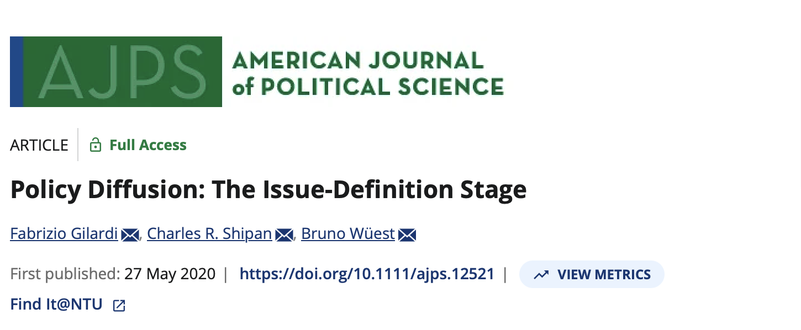{fig-alt="AJPS webpage heading for Policy Diffusion: The Issue-Definition Stage, by Fabrizio Gilardi, Charles R. Shipan and Bruno Wüest."}

::: {.caption}

**Fabrizio Gilardi, Charles R. Shipan and Bruno Wüest**

American Journal of Political Science, 2021

:::

::::

:::: {.column}

- **Puzzle:** diffusion research usually observes policy adoption after the debate has already begun.
- **Question:** do earlier smoking bans elsewhere change how a state's newspapers define the issue?
- **Evidence:** 52,675 paragraphs from 49 state newspapers, 1996–2013.

::::

:::::

::::::

::: {.source}

Reference: [Gilardi, Shipan & Wüest (2021)](https://doi.org/10.1111/ajps.12521)

:::


## News paragraphs become policy frames

:::::: {.slide-body .compact-table .w8-case-flow .w8-workflow-stage .w8-gilardi-workflow-stage}

<p class="w8-study-label"><strong>Case 2 · How STM is used · 1/3</strong></p>

<div class="w8-workflow-stage-frame w8-workflow-safe"><table class="w8-workflow-table"><thead><tr><th>Research step</th><th>What the researchers do</th></tr></thead><tbody><tr class="w8-workflow-active"><td>Collect reporting</td><td>Search 49 state newspapers, 1996–2013</td></tr><tr class="w8-workflow-active"><td><svg class="w8-workflow-gutter-arrow" viewBox="0 0 18 36" aria-hidden="true"><path d="M 9 2 V 30 M 3 24 L 9 30 L 15 24"/></svg>Keep relevant paragraphs</td><td>Use crowd labels to train an SVM relevance filter</td></tr><tr><td>Discover frames</td><td>Fit a 12-topic STM to 52,675 paragraphs</td></tr><tr><td>Measure issue definition</td><td>Estimate how common each frame is</td></tr><tr><td>Study diffusion</td><td>Relate frame prevalence to earlier adoptions in other states</td></tr></tbody></table></div>

<p class="w8-figure-stage-cue w8-workflow-stage-cue">First collect possible reports, then use human labels to keep relevant paragraphs.</p>

::::::

::: {.source}

Reference: [Gilardi, Shipan & Wüest (2021)](https://doi.org/10.1111/ajps.12521)

:::


## News paragraphs become policy frames

:::::: {.slide-body .compact-table .w8-case-flow .w8-workflow-stage .w8-gilardi-workflow-stage}

<p class="w8-study-label"><strong>Case 2 · How STM is used · 2/3</strong></p>

<div class="w8-workflow-stage-frame w8-workflow-safe"><table class="w8-workflow-table"><thead><tr><th>Research step</th><th>What the researchers do</th></tr></thead><tbody><tr><td>Collect reporting</td><td>Search 49 state newspapers, 1996–2013</td></tr><tr><td>Keep relevant paragraphs</td><td>Use crowd labels to train an SVM relevance filter</td></tr><tr class="w8-workflow-active"><td>Discover frames</td><td>Fit a 12-topic STM to 52,675 paragraphs</td></tr><tr class="w8-workflow-active"><td><svg class="w8-workflow-gutter-arrow" viewBox="0 0 18 36" aria-hidden="true"><path d="M 9 2 V 30 M 3 24 L 9 30 L 15 24"/></svg>Measure issue definition</td><td>Estimate how common each frame is</td></tr><tr><td>Study diffusion</td><td>Relate frame prevalence to earlier adoptions in other states</td></tr></tbody></table></div>

<p class="w8-figure-stage-cue w8-workflow-stage-cue">STM finds recurring frames; topic prevalence measures how common each frame is.</p>

::::::

::: {.source}

Reference: [Gilardi, Shipan & Wüest (2021)](https://doi.org/10.1111/ajps.12521)

:::


## News paragraphs become policy frames

:::::: {.slide-body .compact-table .w8-case-flow .w8-workflow-stage .w8-gilardi-workflow-stage}

<p class="w8-study-label"><strong>Case 2 · How STM is used · 3/3</strong></p>

<div class="w8-workflow-stage-frame w8-workflow-safe"><table class="w8-workflow-table"><thead><tr><th>Research step</th><th>What the researchers do</th></tr></thead><tbody><tr><td>Collect reporting</td><td>Search 49 state newspapers, 1996–2013</td></tr><tr><td>Keep relevant paragraphs</td><td>Use crowd labels to train an SVM relevance filter</td></tr><tr><td>Discover frames</td><td>Fit a 12-topic STM to 52,675 paragraphs</td></tr><tr class="w8-workflow-active"><td>Measure issue definition</td><td>Estimate how common each frame is</td></tr><tr class="w8-workflow-active"><td><svg class="w8-workflow-gutter-arrow" viewBox="0 0 18 36" aria-hidden="true"><path d="M 9 2 V 30 M 3 24 L 9 30 L 15 24"/></svg>Study diffusion</td><td>Relate frame prevalence to earlier adoptions in other states</td></tr></tbody></table></div>

<p class="w8-figure-stage-cue w8-workflow-stage-cue">The analysis relates frame prevalence to earlier policy adoptions in connected states.</p>

::::::

::: {.source}

Reference: [Gilardi, Shipan & Wüest (2021)](https://doi.org/10.1111/ajps.12521)

:::


## Practical policy frames change

:::::: {.slide-body .w8-figure-stage}

<p class="w8-study-label"><strong>Case 2 · Learning from other states</strong></p>

<div class="w8-figure-stage-frame w8-figure-stage-panorama" style="--w8-stage-ratio: 2.8571428571">
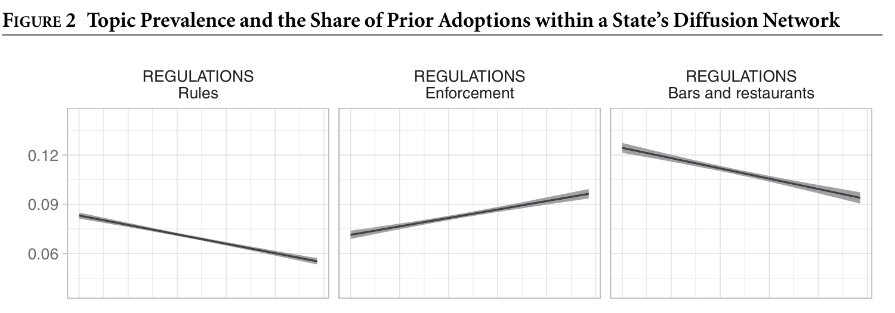
<svg class="w8-figure-stage-overlay" viewBox="0 0 1500 525" role="img" aria-label="Red course annotation marks the part of the original figure discussed on this page.">
<rect class="w8-figure-stage-focus" x="545" y="75" width="455" height="430" rx="12"></rect>
<rect class="w8-figure-stage-focus" x="1005" y="75" width="460" height="430" rx="12"></rect>
<path class="w8-figure-stage-pointer" d="M 620 380 L 930 315"></path>
<polygon class="w8-figure-stage-pointer-head" points="930,315 907,316 919,337"></polygon>
<path class="w8-figure-stage-pointer" d="M 1080 300 L 1390 410"></path>
<polygon class="w8-figure-stage-pointer-head" points="1390,410 1367,398 1374,379"></polygon>
</svg>
</div>

<p class="w8-figure-stage-cue">Moving right means more related states have adopted a ban. Restaurant concerns fall, while enforcement becomes more prominent.</p>

::::::

::: {.source}

Reference: [Gilardi, Shipan & Wüest (2021)](https://doi.org/10.1111/ajps.12521)

:::


## Some frames remain stable

:::::: {.slide-body .w8-figure-stage}

<p class="w8-study-label"><strong>Case 2 · Stable frame: Health</strong></p>

<div class="w8-figure-stage-frame w8-figure-stage-panorama" style="--w8-stage-ratio: 2.2992700730">
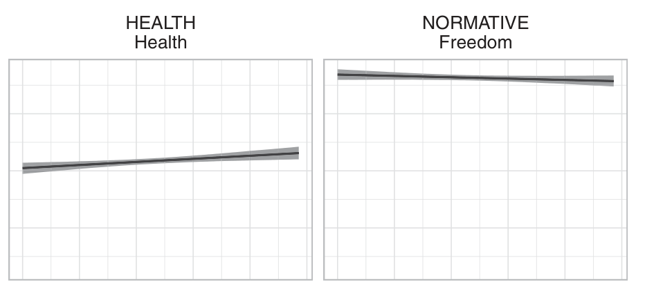
<svg class="w8-figure-stage-overlay" viewBox="0 0 945 411" role="img" aria-label="Red course annotation marks the part of the original figure discussed on this page.">
<path class="w8-figure-stage-pointer" d="M 255 340 L 255 228"></path>
<polygon class="w8-figure-stage-pointer-head" points="255,228 243,250 267,250"></polygon>
</svg>
</div>

<p class="w8-figure-stage-cue">Health changes little as prior adoption rises.</p>

::::::

::: {.source}

Reference: [Gilardi, Shipan & Wüest (2021)](https://doi.org/10.1111/ajps.12521)

:::


## Some frames remain stable

:::::: {.slide-body .w8-figure-stage}

<p class="w8-study-label"><strong>Case 2 · Stable frame: Freedom</strong></p>

<div class="w8-figure-stage-frame w8-figure-stage-panorama" style="--w8-stage-ratio: 2.2992700730">

<svg class="w8-figure-stage-overlay" viewBox="0 0 945 411" role="img" aria-label="Red course annotation marks the part of the original figure discussed on this page.">
<path class="w8-figure-stage-pointer" d="M 705 320 L 705 112"></path>
<polygon class="w8-figure-stage-pointer-head" points="705,112 693,134 717,134"></polygon>
</svg>
</div>

<p class="w8-figure-stage-cue">Freedom also stays nearly flat across adoption levels.</p>

::::::

::: {.source}

Reference: [Gilardi, Shipan & Wüest (2021)](https://doi.org/10.1111/ajps.12521)

:::


## Frames remain separate at lower adoption

:::::: {.slide-body .w8-figure-stage}

<p class="w8-study-label"><strong>Case 2 · Optional detail · lower adoption</strong></p>

<div class="w8-figure-stage-frame w8-figure-stage-landscape" style="--w8-stage-ratio: 1.3297872340">
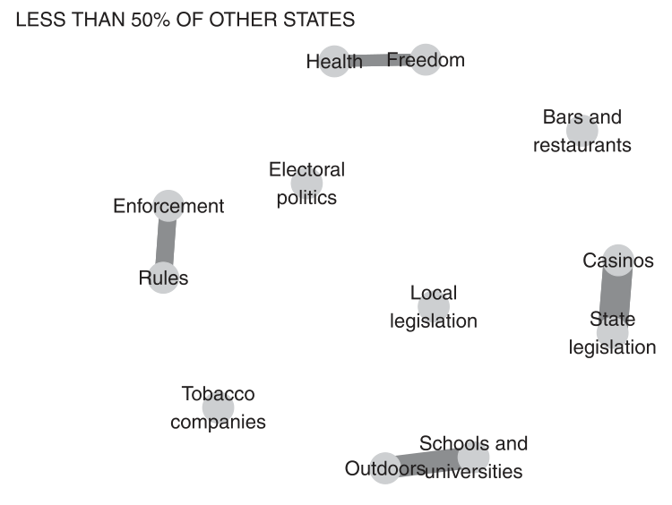
<svg class="w8-figure-stage-overlay" viewBox="0 0 750 564" role="img" aria-label="Red course annotation marks the part of the original figure discussed on this page.">
<ellipse class="w8-figure-stage-focus" cx="425" cy="70" rx="115" ry="45"></ellipse>
<ellipse class="w8-figure-stage-focus" cx="185" cy="270" rx="90" ry="115"></ellipse>
</svg>
</div>

<p class="w8-figure-stage-cue">At lower adoption, the Rules topic has few strong correlations with the other frames.</p>

::::::

::: {.source}

Reference: [Gilardi, Shipan & Wüest (2021)](https://doi.org/10.1111/ajps.12521)

:::


## A broader frame emerges at higher adoption

:::::: {.slide-body .w8-figure-stage}

<p class="w8-study-label"><strong>Case 2 · Optional detail · higher adoption</strong></p>

<div class="w8-figure-stage-frame w8-figure-stage-landscape" style="--w8-stage-ratio: 1.3157894737">
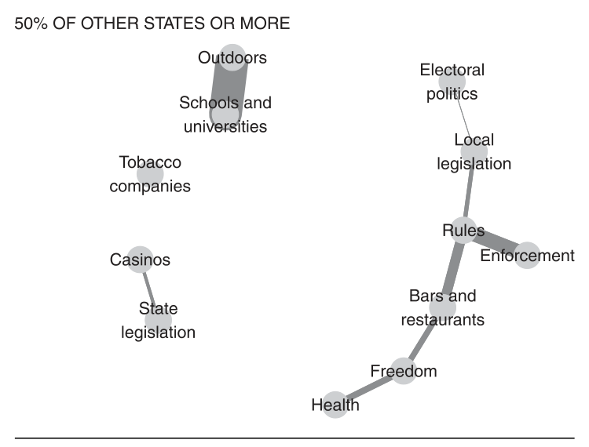
<svg class="w8-figure-stage-overlay" viewBox="0 0 750 570" role="img" aria-label="Red course annotation marks the part of the original figure discussed on this page.">
<rect class="w8-figure-stage-focus" x="370" y="42" width="410" height="505" rx="20"></rect>
<ellipse class="w8-figure-stage-focus" cx="590" cy="292" rx="36" ry="24"></ellipse>
</svg>
</div>

<p class="w8-figure-stage-cue">At higher adoption, Rules is correlated with several practical, value and political frames.</p>

::::::

::: {.source}

Reference: [Gilardi, Shipan & Wüest (2021)](https://doi.org/10.1111/ajps.12521)

:::


## Who leads? Who follows?

:::::: {.slide-body }

<p class="w8-study-label"><strong>Case 3 · Social media and issue attention</strong></p>

::::: {.columns .paper-intro-columns .w8-paper}

:::: {.column}

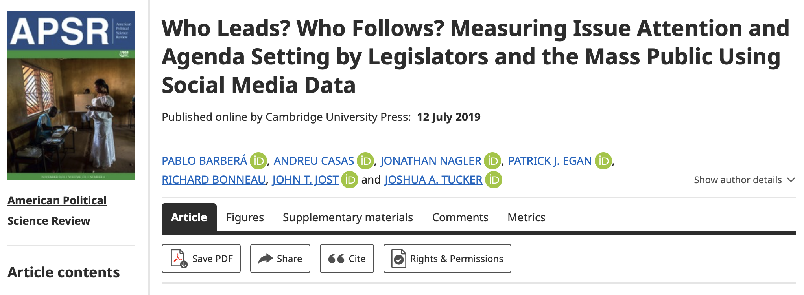{fig-alt="Cambridge Core article page for Who Leads? Who Follows?, including the APSR cover, title, publication date and seven authors."}

::: {.caption}

**Pablo Barberá and colleagues**

American Political Science Review, 2019

:::

::::

:::: {.column}

- **Question:** do politicians lead public attention, or follow it?
- **Texts:** Congress, public and media tweets, 2013–2014.
- **Use:** compare daily attention to shared issues.

::::

:::::

::::::

::: {.source}

Reference: [Barberá et al. (2019)](https://doi.org/10.1017/S0003055419000352)

:::


## Tweets become daily issue-attention measures

:::::: {.slide-body .compact-table .w8-case-flow .w8-workflow-stage}

<p class="w8-study-label"><strong>Case 3 · How the topic model is used · 1/3</strong></p>

<div class="w8-workflow-stage-frame w8-workflow-safe"><table class="w8-workflow-table"><thead><tr><th>Research step</th><th>What the researchers do</th></tr></thead><tbody><tr class="w8-workflow-active"><td>Define documents</td><td>Combine congressional tweets by day, party and chamber</td></tr><tr class="w8-workflow-active"><td><svg class="w8-workflow-gutter-arrow" viewBox="0 0 18 36" aria-hidden="true"><path d="M 9 2 V 30 M 3 24 L 9 30 L 15 24"/></svg>Discover shared themes</td><td>Fit a 100-topic LDA to the grouped congressional texts</td></tr><tr><td>Interpret issues</td><td>Read topic words and merge related political themes</td></tr><tr><td>Construct measures</td><td>Estimate daily issue attention for politicians, public samples and media</td></tr><tr><td>Analyse timing</td><td>Compare whose earlier attention predicts another group&#x27;s later attention</td></tr></tbody></table></div>

<p class="w8-figure-stage-cue w8-workflow-stage-cue">Tweets are grouped into comparable daily documents before LDA finds recurring themes.</p>

::::::

::: {.source}

Reference: [Barberá et al. (2019)](https://doi.org/10.1017/S0003055419000352)

:::


## Tweets become daily issue-attention measures

:::::: {.slide-body .compact-table .w8-case-flow .w8-workflow-stage}

<p class="w8-study-label"><strong>Case 3 · How the topic model is used · 2/3</strong></p>

<div class="w8-workflow-stage-frame w8-workflow-safe"><table class="w8-workflow-table"><thead><tr><th>Research step</th><th>What the researchers do</th></tr></thead><tbody><tr><td>Define documents</td><td>Combine congressional tweets by day, party and chamber</td></tr><tr><td>Discover shared themes</td><td>Fit a 100-topic LDA to the grouped congressional texts</td></tr><tr class="w8-workflow-active"><td>Interpret issues</td><td>Read topic words and merge related political themes</td></tr><tr class="w8-workflow-active"><td><svg class="w8-workflow-gutter-arrow" viewBox="0 0 18 36" aria-hidden="true"><path d="M 9 2 V 30 M 3 24 L 9 30 L 15 24"/></svg>Construct measures</td><td>Estimate daily issue attention for politicians, public samples and media</td></tr><tr><td>Analyse timing</td><td>Compare whose earlier attention predicts another group&#x27;s later attention</td></tr></tbody></table></div>

<p class="w8-figure-stage-cue w8-workflow-stage-cue">Researchers turn interpreted topics into comparable daily attention measures.</p>

::::::

::: {.source}

Reference: [Barberá et al. (2019)](https://doi.org/10.1017/S0003055419000352)

:::


## Tweets become daily issue-attention measures

:::::: {.slide-body .compact-table .w8-case-flow .w8-workflow-stage}

<p class="w8-study-label"><strong>Case 3 · How the topic model is used · 3/3</strong></p>

<div class="w8-workflow-stage-frame w8-workflow-safe"><table class="w8-workflow-table"><thead><tr><th>Research step</th><th>What the researchers do</th></tr></thead><tbody><tr><td>Define documents</td><td>Combine congressional tweets by day, party and chamber</td></tr><tr><td>Discover shared themes</td><td>Fit a 100-topic LDA to the grouped congressional texts</td></tr><tr><td>Interpret issues</td><td>Read topic words and merge related political themes</td></tr><tr class="w8-workflow-active"><td>Construct measures</td><td>Estimate daily issue attention for politicians, public samples and media</td></tr><tr class="w8-workflow-active"><td><svg class="w8-workflow-gutter-arrow" viewBox="0 0 18 36" aria-hidden="true"><path d="M 9 2 V 30 M 3 24 L 9 30 L 15 24"/></svg>Analyse timing</td><td>Compare whose earlier attention predicts another group&#x27;s later attention</td></tr></tbody></table></div>

<p class="w8-figure-stage-cue w8-workflow-stage-cue">Daily attention enters a time-series model that compares who moves first.</p>

::::::

::: {.source}

Reference: [Barberá et al. (2019)](https://doi.org/10.1017/S0003055419000352)

:::


## Who responds to whose attention?

:::::: {.slide-body .w8-figure-stage}

<p class="w8-study-label"><strong>Case 3 · Direction one</strong></p>

<div class="w8-figure-stage-frame w8-figure-stage-panorama" style="--w8-stage-ratio: 2.3940886700">
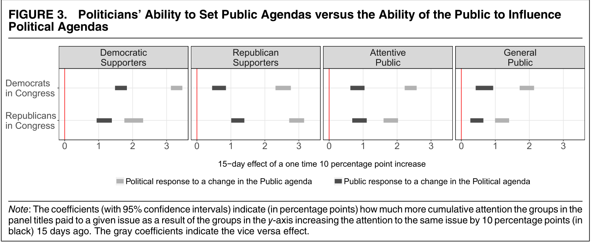
<svg class="w8-figure-stage-overlay" viewBox="0 0 1458 609" role="img" aria-label="Red course annotation marks the part of the original figure discussed on this page.">
<rect class="w8-figure-stage-focus" x="280" y="420" width="505" height="52" rx="10"></rect>
<path class="w8-figure-stage-pointer" d="M 480 418 L 435 235"></path>
<polygon class="w8-figure-stage-pointer-head" points="435,235 427,257 449,250"></polygon>
</svg>
</div>

<p class="w8-figure-stage-cue"><strong>Gray:</strong> when public attention rises, politicians often pay more attention later.</p>

::::::

::: {.source}

Reference: [Barberá et al. (2019)](https://doi.org/10.1017/S0003055419000352)

:::


## Who responds to whose attention?

:::::: {.slide-body .w8-figure-stage}

<p class="w8-study-label"><strong>Case 3 · Reverse direction and caveat</strong></p>

<div class="w8-figure-stage-frame w8-figure-stage-panorama" style="--w8-stage-ratio: 2.3940886700">

<svg class="w8-figure-stage-overlay" viewBox="0 0 1458 609" role="img" aria-label="Red course annotation marks the part of the original figure discussed on this page.">
<rect class="w8-figure-stage-focus" x="815" y="420" width="605" height="52" rx="10"></rect>
<path class="w8-figure-stage-pointer" d="M 1124 418 L 1124 330 L 930 330 L 885 315"></path>
<polygon class="w8-figure-stage-pointer-head" points="885,315 904,328 908,316"></polygon>
</svg>
</div>

<p class="w8-figure-stage-cue"><strong>Black:</strong> when politicians' attention rises, the public may pay more attention later.</p>

::::::

::: {.source}

Reference: [Barberá et al. (2019)](https://doi.org/10.1017/S0003055419000352)

:::


## Immigration and shared democratic values

:::::: {.slide-body }

<p class="w8-study-label"><strong>Case 4 · Topic models for theory building</strong></p>

::::: {.columns .paper-intro-columns .w8-paper}

:::: {.column}

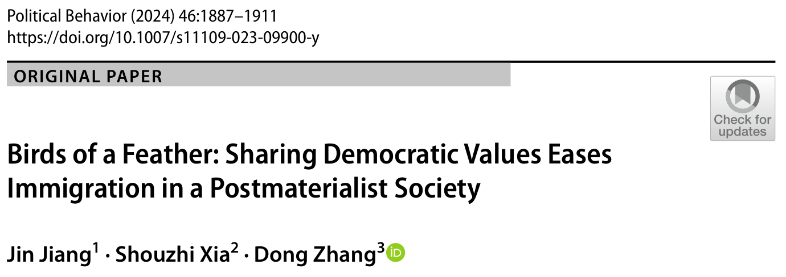{fig-alt="Original Political Behavior article heading: Birds of a Feather: Sharing Democratic Values Eases Immigration in a Postmaterialist Society, Jin Jiang, Shouzhi Xia and Dong Zhang."}

::: {.caption}

**Jin Jiang, Shouzhi Xia and Dong Zhang**

Political Behavior, 2024

:::

::::

:::: {.column}

- **Puzzle:** research emphasizes economic and cultural concerns more than shared political values.
- **Question:** can shared democratic values reduce support for restrictive immigration policy?
- **Evidence:** researchers use the STM results to develop the hypothesis. A preregistered experiment tests it.

::::

:::::

::::::

::: {.source}

Reference: [Jiang, Xia & Zhang (2024)](https://doi.org/10.1007/s11109-023-09900-y)

:::


## From news topics to a hypothesis

:::::: {.slide-body .compact-table .w8-case-flow .w8-workflow-stage .w8-jiang-workflow-stage}

<p class="w8-study-label"><strong>Case 4 · How STM supports theory building · 1/3</strong></p>

<div class="w8-workflow-stage-frame w8-workflow-safe"><table class="w8-workflow-table"><thead><tr><th>Research step</th><th>Use in this article</th></tr></thead><tbody><tr class="w8-workflow-active"><td>Discover concerns</td><td>STM identifies five topics in 4,453 news articles</td></tr><tr class="w8-workflow-active"><td><svg class="w8-workflow-gutter-arrow" viewBox="0 0 18 36" aria-hidden="true"><path d="M 9 2 V 30 M 3 24 L 9 30 L 15 24"/></svg>Read and label</td><td>Inspect characteristic words and representative news</td></tr><tr><td>Compare over time</td><td>Estimate changes in topic prevalence, 2003–2020</td></tr><tr><td>Build a hypothesis</td><td>Rising political attention motivates a shared-values argument</td></tr><tr><td>Test separately</td><td>Randomize messages in a preregistered experiment</td></tr></tbody></table></div>

<p class="w8-figure-stage-cue w8-workflow-stage-cue">STM finds recurring concerns; researchers read the texts and supply the labels.</p>

::::::

::: {.source}

Reference: [Jiang, Xia & Zhang (2024)](https://doi.org/10.1007/s11109-023-09900-y)

:::


## From news topics to a hypothesis

:::::: {.slide-body .compact-table .w8-case-flow .w8-workflow-stage .w8-jiang-workflow-stage}

<p class="w8-study-label"><strong>Case 4 · How STM supports theory building · 2/3</strong></p>

<div class="w8-workflow-stage-frame w8-workflow-safe"><table class="w8-workflow-table"><thead><tr><th>Research step</th><th>Use in this article</th></tr></thead><tbody><tr><td>Discover concerns</td><td>STM identifies five topics in 4,453 news articles</td></tr><tr><td>Read and label</td><td>Inspect characteristic words and representative news</td></tr><tr class="w8-workflow-active"><td>Compare over time</td><td>Estimate changes in topic prevalence, 2003–2020</td></tr><tr class="w8-workflow-active"><td><svg class="w8-workflow-gutter-arrow" viewBox="0 0 18 36" aria-hidden="true"><path d="M 9 2 V 30 M 3 24 L 9 30 L 15 24"/></svg>Build a hypothesis</td><td>Rising political attention motivates a shared-values argument</td></tr><tr><td>Test separately</td><td>Randomize messages in a preregistered experiment</td></tr></tbody></table></div>

<p class="w8-figure-stage-cue w8-workflow-stage-cue">Changes in topic attention motivate the shared-democratic-values hypothesis.</p>

::::::

::: {.source}

Reference: [Jiang, Xia & Zhang (2024)](https://doi.org/10.1007/s11109-023-09900-y)

:::


## From news topics to a hypothesis

:::::: {.slide-body .compact-table .w8-case-flow .w8-workflow-stage .w8-jiang-workflow-stage}

<p class="w8-study-label"><strong>Case 4 · How STM supports theory building · 3/3</strong></p>

<div class="w8-workflow-stage-frame w8-workflow-safe"><table class="w8-workflow-table"><thead><tr><th>Research step</th><th>Use in this article</th></tr></thead><tbody><tr><td>Discover concerns</td><td>STM identifies five topics in 4,453 news articles</td></tr><tr><td>Read and label</td><td>Inspect characteristic words and representative news</td></tr><tr><td>Compare over time</td><td>Estimate changes in topic prevalence, 2003–2020</td></tr><tr class="w8-workflow-active"><td>Build a hypothesis</td><td>Rising political attention motivates a shared-values argument</td></tr><tr class="w8-workflow-active"><td><svg class="w8-workflow-gutter-arrow" viewBox="0 0 18 36" aria-hidden="true"><path d="M 9 2 V 30 M 3 24 L 9 30 L 15 24"/></svg>Test separately</td><td>Randomize messages in a preregistered experiment</td></tr></tbody></table></div>

<p class="w8-figure-stage-cue w8-workflow-stage-cue">Researchers use the STM results to develop the hypothesis. Random assignment tests the message effect.</p>

::::::

::: {.source}

Reference: [Jiang, Xia & Zhang (2024)](https://doi.org/10.1007/s11109-023-09900-y)

:::


## Changing attention to mainland immigration

:::::: {.slide-body .w8-figure-stage}

<p class="w8-study-label"><strong>Case 4 · Theory-building evidence</strong></p>

<div class="w8-figure-stage-frame w8-figure-stage-panorama" style="--w8-stage-ratio: 4.7827586207">
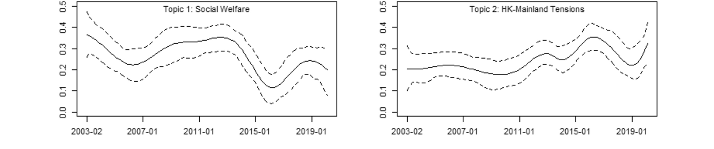
<svg class="w8-figure-stage-overlay" viewBox="0 0 1387 290" role="img" aria-label="Red course annotation marks the part of the original figure discussed on this page.">
<rect class="w8-figure-stage-focus" x="135" y="3" width="525" height="225" rx="8"></rect>
<path class="w8-figure-stage-pointer" d="M 375 85 L 505 152"></path>
<polygon class="w8-figure-stage-pointer-head" points="505,152 483,151 491,135"></polygon>
</svg>
</div>

<p class="w8-figure-stage-cue">News attention to social welfare falls after the mid-2010s. Dashed lines show 95% uncertainty.</p>

::::::

::: {.source}

Reference: [Jiang, Xia & Zhang (2024)](https://doi.org/10.1007/s11109-023-09900-y)

:::


## Changing attention to mainland immigration

:::::: {.slide-body .w8-figure-stage}

<p class="w8-study-label"><strong>Case 4 · Hypothesis development</strong></p>

<div class="w8-figure-stage-frame w8-figure-stage-panorama" style="--w8-stage-ratio: 4.7827586207">

<svg class="w8-figure-stage-overlay" viewBox="0 0 1387 290" role="img" aria-label="Red course annotation marks the part of the original figure discussed on this page.">
<rect class="w8-figure-stage-focus" x="765" y="3" width="520" height="225" rx="8"></rect>
<path class="w8-figure-stage-pointer" d="M 990 142 L 1135 80"></path>
<polygon class="w8-figure-stage-pointer-head" points="1135,80 1114,79 1122,97"></polygon>
</svg>
</div>

<p class="w8-figure-stage-cue">Attention to HK–Mainland tensions rises. This pattern motivates a shared-values hypothesis.</p>

::::::

::: {.source}

Reference: [Jiang, Xia & Zhang (2024)](https://doi.org/10.1007/s11109-023-09900-y)

:::


## National problems in respondents' own words

:::::: {.slide-body }

<p class="w8-study-label"><strong>Case 5 · Public issue priorities</strong></p>

::::: {.columns .paper-intro-columns .w8-paper}

:::: {.column}

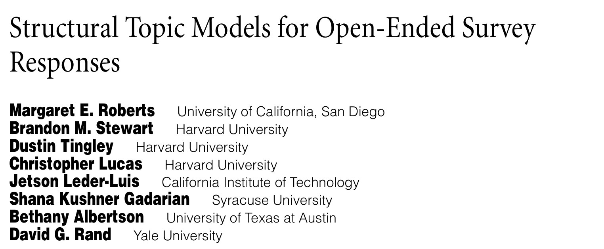{fig-alt="Original article heading: Structural Topic Models for Open-Ended Survey Responses."}

::: {.caption}

**Margaret E. Roberts and colleagues**

American Journal of Political Science, 2014

:::

::::

:::: {.column}

- **Question:** who names war as a national problem?
- **Document:** one ANES open-ended answer.
- **Comparison:** party identification and education.

::::

:::::

::::::

::: {.source}

Reference: [Roberts et al. (2014)](https://doi.org/10.1111/ajps.12103)

:::


## Survey answers become issue comparisons

:::::: {.slide-body .compact-table .w8-case-flow}

<p class="w8-study-label"><strong>Case 5 · How the model is used</strong></p>

| Step | Role in the research design |
|---|---|
| Texts | Answers to the most-important-national-problem question |
| Model inputs | 60-topic STM; party, education, age and party × education |
| Output used | Estimated war-related share in each answer |
| Political comparison | War-topic relationship with party and education |
| Check | Compare with ANES human-coded war categories |

**Human category codes provide a benchmark; they do not train this STM.**

::::::

::: {.source}

Reference: [Roberts et al. (2014)](https://doi.org/10.1111/ajps.12103)

:::


## Survey priorities and human-coded evidence

:::::: {.slide-body .w8-figure-stage}

<p class="w8-study-label"><strong>Case 5 · Human-coded benchmark</strong></p>

<div class="w8-figure-stage-frame w8-figure-stage-wide" style="--w8-stage-ratio: 1.9063829787">
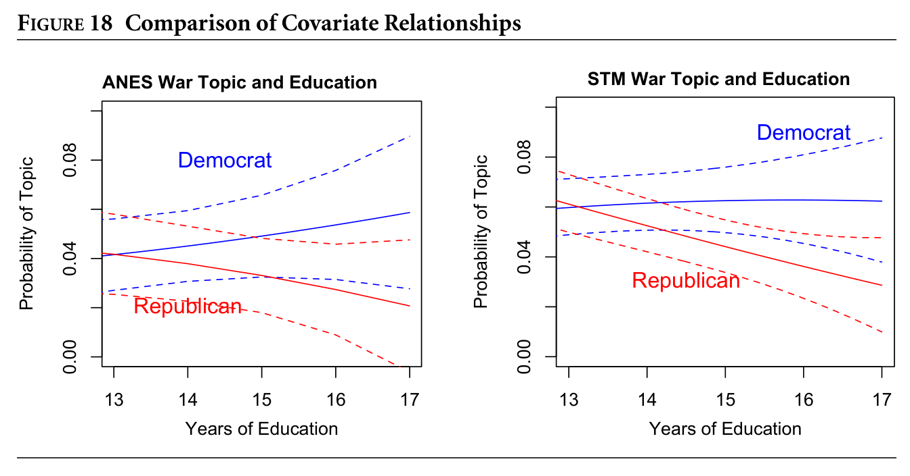
<svg class="w8-figure-stage-overlay" viewBox="0 0 1344 705" role="img" aria-label="Red course annotation marks the part of the original figure discussed on this page.">
<rect class="w8-figure-stage-focus" x="145" y="85" width="490" height="475" rx="14"></rect>
<path class="w8-figure-stage-pointer" d="M 500 339 L 500 422"></path>
<polygon class="w8-figure-stage-pointer-head" points="500,339 488,359 512,359"></polygon>
<polygon class="w8-figure-stage-pointer-head" points="500,422 488,402 512,402"></polygon>
</svg>
</div>

<p class="w8-figure-stage-cue">Left: the human-coded party gap is larger at higher education.</p>

::::::

::: {.source}

Reference: [Roberts et al. (2014)](https://doi.org/10.1111/ajps.12103)

:::


## Survey priorities and human-coded evidence

:::::: {.slide-body .w8-figure-stage}

<p class="w8-study-label"><strong>Case 5 · STM comparison</strong></p>

<div class="w8-figure-stage-frame w8-figure-stage-wide" style="--w8-stage-ratio: 1.9063829787">

<svg class="w8-figure-stage-overlay" viewBox="0 0 1344 705" role="img" aria-label="Red course annotation marks the part of the original figure discussed on this page.">
<rect class="w8-figure-stage-focus" x="805" y="85" width="530" height="475" rx="14"></rect>
<path class="w8-figure-stage-pointer" d="M 1205 304 L 1205 391"></path>
<polygon class="w8-figure-stage-pointer-head" points="1205,304 1193,324 1217,324"></polygon>
<polygon class="w8-figure-stage-pointer-head" points="1205,391 1193,371 1217,371"></polygon>
</svg>
</div>

<p class="w8-figure-stage-cue">Right: the STM also shows a wider party gap; the Democratic line is roughly flat.</p>

::::::

::: {.source}

Reference: [Roberts et al. (2014)](https://doi.org/10.1111/ajps.12103)

:::


## Predicting conflict from newspaper topics

:::::: {.slide-body .compact-table .w8-case-flow .w8-mueller-focus}

<p class="w8-study-label"><strong>Case 6 · Hannes Mueller and Christopher Rauh · APSR 2018</strong></p>

<p><strong>Puzzle:</strong> Slow-moving country indicators often show <em>where</em> conflict is common, but miss <em>when</em> risk rises. Can news language improve one-year-ahead forecasts?</p>
<table class="w8-focus-table"><thead><tr><th>Step</th><th>What they do</th></tr></thead><tbody><tr><td><span class="fragment current-visible w8-row-focus" data-fragment-index="0"></span>Corpus</td><td>More than 700,000 Economist, New York Times and Washington Post articles</td></tr><tr><td><span class="fragment current-visible w8-row-focus" data-fragment-index="1"></span>Measure</td><td>Article-level LDA, K = 15, aggregated to country-year topic shares</td></tr><tr><td><span class="fragment current-visible w8-row-focus" data-fragment-index="2"></span>Forecast</td><td>Re-estimate with text through year T; predict conflict onset at T + 1</td></tr><tr><td><span class="fragment current-visible w8-row-focus" data-fragment-index="3"></span>Evaluate</td><td>Repeat for 1996–2014; read ROC together with precision–recall</td></tr></tbody></table>
**What this supports:** predictive usefulness. Labels and causal claims need separate evidence.

::::::

::: {.source}

Reference: [Mueller & Rauh (2018)](https://doi.org/10.1017/S0003055417000570)

:::


## From topics to political evidence

:::::: {.slide-body .compact-table .w8-case-flow}

| Study | Model contribution | Next research step |
|---|---|---|
| Catalinac | Topic shares | Define pork/policy; compare candidates |
| Gilardi et al. | Frame proportions | Relate frames to prior policy adoption |
| Barberá et al. | Daily attention | Compare who moves first |
| Jiang et al. | Topic trends | Develop a hypothesis; test separately |
| Roberts et al. | Survey topic shares | Compare patterns with human coding |
| Mueller & Rauh | Country-year topic shares | Test next-year conflict forecasts |

**The research design determines what the evidence supports.**

::::::

::: {.source}

Reference: [Catalinac (2016)](https://doi.org/10.1086/683073); [Gilardi, Shipan & Wüest (2021)](https://doi.org/10.1111/ajps.12521); [Barberá et al. (2019)](https://doi.org/10.1017/S0003055419000352); [Jiang, Xia & Zhang (2024)](https://doi.org/10.1007/s11109-023-09900-y); [Roberts et al. (2014)](https://doi.org/10.1111/ajps.12103); [Mueller & Rauh (2018)](https://doi.org/10.1017/S0003055417000570)

:::


<!-- W8:CASES:END -->

## Applying topic models to political speeches

:::::: {.slide-body .w8-ess-step}

<p class="w8-study-label"><strong>Teacher demonstration · students repeat it in the Lab</strong></p>

**Political question:** Which issues do party leaders emphasize in their speeches?

<div class="w8-ess-pipeline" role="img" aria-label="A political question leads to documents, word counts, LDA or STM, interpretation and topic-number checks.">
  <div class="w8-ess-pipeline-node"><strong>Question</strong><span>what issues receive attention?</span></div>
  <div class="w8-ess-pipeline-arrow" aria-hidden="true">→</div>
  <div class="w8-ess-pipeline-node"><strong>Documents</strong><span>one complete speech each</span></div>
  <div class="w8-ess-pipeline-arrow" aria-hidden="true">→</div>
  <div class="w8-ess-pipeline-node"><strong>Word counts</strong><span>tokenize and clean</span></div>
  <div class="w8-ess-pipeline-arrow" aria-hidden="true">→</div>
  <div class="w8-ess-pipeline-node w8-ess-pipeline-result"><strong>Topic models</strong><span>LDA and STM</span></div>
  <div class="w8-ess-pipeline-arrow" aria-hidden="true">→</div>
  <div class="w8-ess-pipeline-node"><strong>Research use</strong><span>interpret, compare and check K</span></div>
</div>

We will explore themes with LDA, add document information with STM, then compare topic resolutions using perplexity and original texts.

<p class="w8-token-takeaway"><strong>One workflow:</strong> fit, interpret, compare and validate.</p>

::::::

::: {.source}

Data source: Essex Summer School 2026, Day 7; British House of Commons party-leader speeches. W8 fixed teaching sample: 719 speeches.

:::


## Step 1: Read the speeches

:::::: {.slide-body .w8-ess-step .compact-table}

<p class="w8-study-label"><strong>LDA application · 1/6</strong></p>

::::: {.columns .w8-ess-step-columns}

:::: {.column width="48%"}
```r
library(quanteda)

data_dir <- "analysis/ess_lab"
topic_docs <- readRDS(file.path(
  data_dir, "sample_raw.rds"))

topic_corpus <- corpus(
  topic_docs,
  text_field = "text",
  docid_field = "doc_id")
```
::::

:::: {.column width="47%"}
**Corpus = a collection of texts**

**719 complete speeches**

**The example used on all six pages**

| Field | Value |
|---|---|
| ID | `ess_hoc_00004` |
| Leader | Margaret Thatcher |
| Party | Conservative |
| Date | 1979-06-26 |
::::

:::::

<p class="w8-token-takeaway"><strong>Here, one document means one complete speech.</strong> The corpus keeps each speech together with its ID and background information.</p>

::::::

::: {.source}

Data source: Essex Summer School 2026, Day 7, British House of Commons party-leader speeches (p. 3). W8 fixed teaching sample: 719 speeches.

:::


## Step 2: Split one speech into words

:::::: {.slide-body .w8-ess-step}

<p class="w8-study-label"><strong>LDA application · 2/6</strong></p>

::::: {.columns .w8-ess-step-columns}

:::: {.column width="42%"}
```r
id <- "ess_hoc_00004"

raw_tokens <- tokens(
  topic_corpus[id],
  what = "word")

raw_tokens[[id]][1:21]
```
::::

:::: {.column width="53%"}
**Original sentence**

<p class="w8-token-before">“With permission, Mr. Speaker I should like to make a statement on the European Council Meeting at Strasbourg.”</p>

**First 21 raw tokens**

<p class="w8-token-output"><code>"With" "permission" "," "Mr" "." "Speaker"<br>"I" "should" "like" "to" "make" "a" "statement"<br>"on" "the" "European" "Council" "Meeting" "at" "Strasbourg" "."</code></p>
::::

:::::

<p class="w8-token-takeaway"><strong>Tokenization splits a speech into separate units.</strong> At this stage, punctuation and common words can still appear.</p>

::::::

::: {.source}

Data source: Essex Summer School 2026, Day 7; British House of Commons party-leader speeches. Example: speech `ess_hoc_00004`.

:::


## Step 3: Remove words that do not help

:::::: {.slide-body .w8-ess-step .compact-table}

<p class="w8-study-label"><strong>LDA application · 3/6</strong></p>

::::: {.columns .w8-ess-step-columns}

:::: {.column width="50%"}
```r
clean_tokens <- tokens(
  topic_corpus,
  remove_punct = TRUE,
  remove_numbers = TRUE) |>
  tokens_tolower() |>
  tokens_remove(c(
    stopwords("en"),
    "mr", "speaker"))

clean_tokens[[id]][1:8]
```
::::

:::: {.column width="45%"}
**First eight cleaned tokens**

<p class="w8-token-output"><code>"permission" "like" "make" "statement"<br>"european" "council" "meeting" "strasbourg"</code></p>

Remove punctuation  
Use lowercase  
Remove very common words
::::

:::::

<p class="w8-token-takeaway"><strong>Cleaning keeps the words that the model will compare.</strong> Every removal rule needs a reason.</p>

::::::

::: {.source}

Data source: Essex Summer School 2026, Day 7; British House of Commons party-leader speeches. W8 fixed teaching sample: 719 speeches.

:::


## Step 4: Fit the LDA model

:::::: {.slide-body .w8-ess-step .compact-table}

<p class="w8-study-label"><strong>LDA application · 4/6</strong></p>

::::: {.columns .w8-ess-step-columns}

:::: {.column width="52%"}
**Full DFM after cleaning: 719 × 2,831**

```r
# Use the DFM constructed in Lab R01c.
set.seed(20260710)
lda_6 <- seededlda::textmodel_lda(
  topic_dfm,
  k = 6,
  alpha = .5, beta = .1,
  max_iter = 500,
  auto_iter = FALSE,
  batch_size = 1,
  verbose = FALSE)
```
::::

:::: {.column width="43%"}
**What the fitted model stores**

| Output | Question it answers |
|---|---|
| Topic–word probabilities | Which words characterize each topic? |
| Document–topic proportions | Which topics appear in each speech? |

A speech can mix topics; each topic favors different words. LDA estimates both from word patterns across the corpus.
::::

:::::

<p class="w8-token-takeaway"><strong>This fit uses the full DFM built in the Lab.</strong> The short cleaning example on the previous page is for illustration.</p>

::::::

::: {.source}

Data source: Essex Summer School 2026, Day 7, British House of Commons party-leader speeches (p. 21). [seededlda documentation](https://koheiw.github.io/seededlda/reference/textmodel_lda.html).

:::


## Step 5: Topic words

:::::: {.slide-body .w8-ess-step .compact-table .w8-topic-table}

<p class="w8-study-label"><strong>LDA application · 5/6</strong></p>

`terms(lda_6, 5)` shows the five highest-probability words in each topic.

| Topic | Highest-probability words | Provisional reading |
|---|---|---|
| T1 | european, council, community, countries, agreed | European Council negotiations |
| T2 | government, state, made, members, service | Government and public service? |
| T3 | prime, people, government, said, can | General political leadership? |
| T4 | government, people, unemployment, economy, year | Economy and unemployment |
| T5 | people, can, country, want, support | Public appeals and support? |
| T6 | united, must, international, security, nations | International security |

<p class="w8-token-takeaway"><strong>Topic words suggest a provisional label.</strong> Original speeches show whether the label holds.</p>

::::::

::: {.source}

Data source: W8 six-topic LDA fitted to the fixed sample of 719 British House of Commons party-leader speeches. [Student Lab R02a](../lab/Lab_Session_W8.html#r02a-fit-a-six-topic-lda-model).

:::


## Step 6: One document's topics

:::::: {.slide-body .w8-ess-step .compact-table}

<p class="w8-study-label"><strong>LDA application · 6/6</strong></p>

::::: {.columns .w8-ess-step-columns}

:::: {.column width="52%"}
```r
topic_names <- c(
  "European Council negotiations",
  "Government and public service?",
  "General political leadership?",
  "Economy and unemployment",
  "Public appeals and support?",
  "International security")

id <- "ess_hoc_00004"
i <- match(id, topic_docs$doc_id)

doc_topics <- lda_6$theta[i, ]
round(doc_topics, 3)

dominant_topic <- which.max(doc_topics)
topic_names[dominant_topic]
```
::::

:::: {.column width="43%"}
**Document `ess_hoc_00004`**

| T1 | T2 | T3 | T4 | T5 | T6 |
|---:|---:|---:|---:|---:|---:|
| **.874** | .067 | .012 | .002 | .012 | .032 |

**Largest share:** T1  
**Provisional name:** European Council negotiations

> “...a statement on the European Council Meeting at Strasbourg.”
::::

:::::

<p class="w8-token-takeaway"><strong>The document keeps all six proportions.</strong> The dominant topic is a short summary of its largest share.</p>

::::::

::: {.source}

Data source: W8 six-topic LDA and original speech `ess_hoc_00004`. [Student Lab R02b–R03b](../lab/Lab_Session_W8.html#r02b-read-complete-topic-mixtures).

:::


<!-- W8:STM_APPLICATION:START -->

## Using STM to compare party attention

:::::: {.slide-body .compact-table}

**Question:** do Conservative and Labour leaders emphasize the same issues?

| Keep from the LDA example | Add for the STM example |
|---|---|
| The same 719 complete speeches | Party and election period for each speech |
| The same word-count matrix | A model of how topic shares vary with this information |

We will follow the same Thatcher speech, then compare one topic across parties.

**Focus: topic prevalence — how much a topic is discussed.**

::::::

::: {.source}

Reference: [Roberts et al. (2014)](https://doi.org/10.1111/ajps.12103)

:::


## STM Step 1: Add document information

:::::: {.slide-body .w8-ess-step .w8-stm-step .compact-table}

<p class="w8-study-label"><strong>STM application · 1/5 · Teacher demonstration</strong></p>

::::: {.columns .w8-ess-step-columns}

:::: {.column width="52%"}
```r
metadata <- data.frame(
  doc_id = topic_docs$doc_id,
  party_family = topic_docs$party_family,
  period = topic_docs$period)
i <- match("ess_hoc_00004", metadata$doc_id)
metadata[i, c("party_family", "period")]
```
::::

:::: {.column width="43%"}
**The same speech: `ess_hoc_00004`**

| Field | Stored value |
|---|---|
| Party | Conservative |
| Election period | 47th Parliament (1979-1983) |

**719 metadata rows**, in the same order as the 719 speech documents.

`period` is a category, not a numeric time trend.
::::

:::::

<p class="w8-token-takeaway"><strong>One speech, one metadata row.</strong> Party and period now accompany the word counts.</p>

::::::

::: {.source}

W8 teacher demonstration. Same 719 speeches and STM specification as [Lab R05](../lab/Lab_Session_W8.html#r05-stm-with-party-and-categorical-election-period).

:::


## STM Step 2: Specify the model

:::::: {.slide-body .w8-ess-step .w8-stm-step .compact-table}

<p class="w8-study-label"><strong>STM application · 2/5 · Teacher demonstration</strong></p>

::::: {.columns .w8-ess-step-columns}

:::: {.column width="52%"}
**Fit once · reference specification**

```r
stm_input <- convert(topic_dfm, to = "stm")
stm_6 <- stm::stm(
  documents = stm_input$documents,
  vocab = stm_input$vocab, K = 6,
  prevalence = ~ party_family + period,
  data = metadata, seed = 20260710,
  init.type = "Spectral", max.em.its = 100,
  emtol = 1e-4, verbose = FALSE)
```
::::

:::: {.column width="43%"}
**Read the fitted result**

```r
dim(stm_6$theta)
```

**Output:** 719 documents × 6 topics.

`prevalence = ~ party_family + period`

Party and period help model topic shares. Word choice within topics is shared in this example.
::::

:::::

<p class="w8-token-takeaway"><strong>Metadata enters topic estimation.</strong> R05a fits this specification in the Lab.</p>

::::::

::: {.source}

W8 teacher demonstration. Same 719 speeches and STM specification as [Lab R05](../lab/Lab_Session_W8.html#r05-stm-with-party-and-categorical-election-period). [stm reference](https://search.r-project.org/CRAN/refmans/stm/help/stm.html).

:::


## STM Step 3: Read one topic

:::::: {.slide-body .w8-ess-step .w8-stm-step .compact-table}

<p class="w8-study-label"><strong>STM application · 3/5 · Teacher demonstration</strong></p>

::::: {.columns .w8-ess-step-columns}

:::: {.column width="52%"}
```r
stm::labelTopics(
  stm_6, topics = 4, n = 5)

round(stm_6$theta[i, 4], 3)
```
::::

:::: {.column width="43%"}
**STM Topic 4**

| Word summary | Five characteristic words |
|---|---|
| Probability | council, community, agreed, united, european |
| FREX | argentine, commonwealth, nations, agreed, meeting |

**Provisional label:** International affairs?

The same Thatcher speech has **97.9%** in this STM topic.
::::

:::::

<p class="w8-token-takeaway"><strong>Read words and original text together.</strong> Topic numbers belong to their own fitted model.</p>

::::::

::: {.source}

W8 teacher demonstration. Same 719 speeches and STM specification as [Lab R05](../lab/Lab_Session_W8.html#r05-stm-with-party-and-categorical-election-period). Selected probability/FREX words from R05a; original speech ess_hoc_00004.

:::


## STM Step 4: Compare party averages

:::::: {.slide-body .w8-ess-step .w8-stm-step .compact-table}

<p class="w8-study-label"><strong>STM application · 4/5 · Teacher demonstration</strong></p>

::::: {.columns .w8-ess-step-columns}

:::: {.column width="52%"}
```r
party_means <- tapply(
  stm_6$theta[, 4],
  metadata$party_family, mean)

round(100 * party_means, 2)
```
::::

:::: {.column width="43%"}
**Mean share of STM Topic 4**

| Party | Mean topic share |
|---|---:|
| Conservative | 13.66% |
| Labour | 7.63% |

**Raw Labour − Conservative:** -6.03 percentage points.

Each sampled speech has equal weight.
::::

:::::

<p class="w8-token-takeaway"><strong>These are descriptive averages.</strong> The speeches come from different election periods.</p>

::::::

::: {.source}

W8 teacher demonstration. Same 719 speeches and STM specification as [Lab R05](../lab/Lab_Session_W8.html#r05-stm-with-party-and-categorical-election-period). Same unadjusted means as R05b.

:::


## STM Step 5: Account for election period

:::::: {.slide-body .w8-ess-step .w8-stm-step .compact-table}

<p class="w8-study-label"><strong>STM application · 5/5 · Teacher demonstration</strong></p>

::::: {.columns .w8-ess-step-columns}

:::: {.column width="52%"}
```r
set.seed(20260710)
party_effects <- stm::estimateEffect(
  1:6 ~ party_family + period,
  stm_6, metadata, uncertainty = "Global", nsims = 50)
set.seed(20260710)
z <- plot(party_effects, covariate = "party_family",
  method = "difference", cov.value1 = "Labour",
  cov.value2 = "Conservative", topics = 1:6,
  nsims = 1000, omit.plot = TRUE, labeltype = "numbers")
round(100 * c(z$means[[4]], z$cis[[4]]), 2)
```
::::

:::: {.column width="43%"}
**Adjusted comparison · Topic 4**

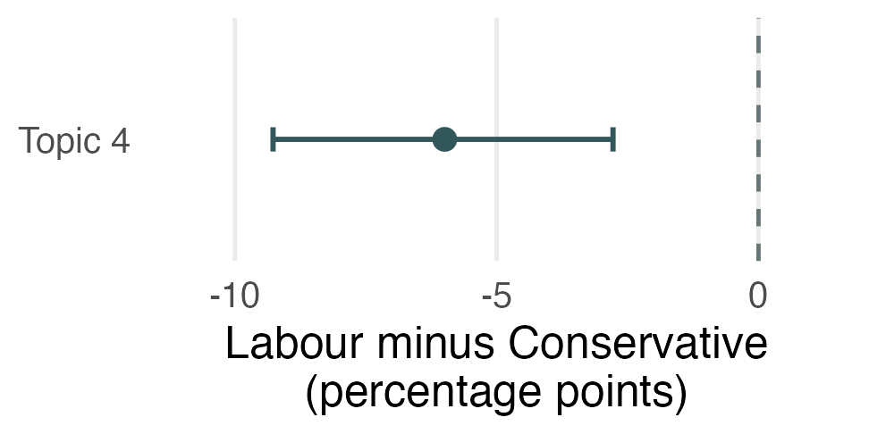{fig-alt="Same R05 conditional Topic 4 association: Labour minus Conservative, with a 95 percent simulation interval."}

| Quantity | Percentage points |
|---|---:|
| Labour − Conservative | -5.99 |
| 95% interval | [-9.27, -2.78] |
::::

:::::

<p class="w8-token-takeaway"><strong>The comparison accounts for election period.</strong> It describes a conditional association.</p>

::::::

::: {.source}

W8 teacher demonstration. Same 719 speeches and STM specification as [Lab R05](../lab/Lab_Session_W8.html#r05-stm-with-party-and-categorical-election-period). Exact R05c–R05d conditional difference; plot selects Topic 4 only.

:::


<!-- W8:STM_APPLICATION:END -->

## Assumptions and document boundaries

:::::: {.slide-body .compact-table}

| Modelling choice | Question for the researcher |
|---|---|
| Bag of words | Does word order carry information we need? |
| A common set of topics | Are language and topic meanings comparable across the corpus? |
| Document boundaries | Does one speech contain enough context for a mixture? |
| Vocabulary selection | Which distinctions survive cleaning and trimming? |
| K | Which issues split or merge when the number of topics changes? |
| Alpha and initialization | Are mixtures and results stable across reasonable settings? |

**These choices shape the topics before researchers name or compare them.**

::::::

::: {.source}

Reference: [Blei, Ng & Jordan (2003)](https://www.jmlr.org/papers/v3/blei03a.html); [ESS course](https://essexsummerschool.com/course/ess-2026-course-list/1k/); [Grimmer, Roberts & Stewart (2022)](https://ingramacademic.com/products/text-as-data-9780691207551)

:::


## Topic validation asks different questions

:::::: {.slide-body .compact-table .w8-validation-focus}

<table class="w8-focus-table"><thead><tr><th>Check</th><th>Question</th></tr></thead><tbody><tr><td><span class="fragment current-visible w8-row-focus" data-fragment-index="0"></span>Held-out word fit</td><td>Can the model account for unseen words?</td></tr><tr><td><span class="fragment current-visible w8-row-focus" data-fragment-index="1"></span>Words and documents</td><td>Does the label describe the content?</td></tr><tr><td><span class="fragment current-visible w8-row-focus" data-fragment-index="2"></span>Coherence and exclusivity</td><td>Are prominent words related and distinctive?</td></tr><tr><td><span class="fragment current-visible w8-row-focus" data-fragment-index="3"></span>Sensitivity</td><td>Does the interpretation survive reasonable choices?</td></tr><tr><td><span class="fragment current-visible w8-row-focus" data-fragment-index="4"></span>External prediction</td><td>Do topic shares predict an outcome outside estimation?</td></tr></tbody></table>

**Mueller & Rauh (2018):** predict next-year conflict from newspaper topics.

::::::

::: {.source}

Reference: [ESS course](https://essexsummerschool.com/course/ess-2026-course-list/1k/); [Grimmer, Roberts & Stewart (2022)](https://ingramacademic.com/products/text-as-data-9780691207551); [Mueller & Rauh (2018)](https://doi.org/10.1017/S0003055417000570)

:::


## Checking a topic label

:::::: {.slide-body .compact-table .w8-label-focus}

**STM Topic 4 · provisional label: “International affairs”**
<table class="w8-focus-table"><thead><tr><th>Evidence</th><th>What to check</th></tr></thead><tbody><tr><td><span class="fragment current-visible w8-row-focus" data-fragment-index="0"></span>Probability words</td><td>council, community, agreed, united, european</td></tr><tr><td><span class="fragment current-visible w8-row-focus" data-fragment-index="1"></span>FREX words</td><td>argentine, commonwealth, nations, agreed, meeting</td></tr><tr><td><span class="fragment current-visible w8-row-focus" data-fragment-index="2"></span>Same Thatcher speech</td><td>European Council meeting in Strasbourg; T4 = 97.9%</td></tr><tr><td><span class="fragment current-visible w8-row-focus" data-fragment-index="3"></span>Other speeches</td><td>Read high-share texts and possible counterexamples</td></tr></tbody></table>

**Decision:** retain, narrow, broaden or reject the label.

One speech supports a label; validate it on other texts.

::::::

::: {.source}

Reference: [Ying, Montgomery & Stewart (2022)](https://doi.org/10.1017/pan.2021.33)

:::


<!-- W8:PERPLEXITY_GUIDE:START -->

## Reading perplexity

:::::: {.slide-body .compact-table .w8-perplexity}

**Question:** how well does the model reconstruct the observed words?

::::: {.w8-perplexity-formula-frame}

$$\mathrm{perplexity}=\exp\!\left(-\frac{\sum_{d,v}x_{dv}\log p_{dv}}{\sum_{d,v}x_{dv}}\right),\qquad p_{dv}=\sum_k\theta_{dk}\beta_{kv}$$

<svg class="w8-perplexity-overlay" viewBox="0 0 986 142" role="img" aria-label="Four sequential annotation steps follow the formula explanation: word probability, count-weighted log probability, total tokens, then the negative average and exponential.">
  <g class="fragment current-visible w8-perplexity-annotation" data-fragment-index="0">
    <ellipse cx="714" cy="51" rx="98" ry="38"/>
    <path d="M 842 109 L 815 92 L 802 78"/>
    <polygon points="802,78 807,91 815,83"/>
    <text x="493" y="134">1 · Probability of a word in a document</text>
  </g>
  <g class="fragment current-visible w8-perplexity-annotation" data-fragment-index="1">
    <ellipse cx="465" cy="27" rx="95" ry="22"/>
    <path d="M 582 5 L 556 20"/>
    <polygon points="556,20 570,18 564,8"/>
    <text x="493" y="134">2 · Weight each log probability by its word count</text>
  </g>
  <g class="fragment current-visible w8-perplexity-annotation" data-fragment-index="2">
    <ellipse cx="465" cy="73" rx="55" ry="19"/>
    <path d="M 552 111 L 529 96 L 514 84"/>
    <polygon points="514,84 520,97 529,88"/>
    <text x="493" y="134">3 · Divide by all retained tokens</text>
  </g>
  <g class="fragment current-visible w8-perplexity-annotation" data-fragment-index="3">
    <ellipse cx="335" cy="51" rx="25" ry="19"/>
    <ellipse cx="380" cy="51" rx="13" ry="13"/>
    <path d="M 276 110 L 310 85 L 326 69"/>
    <polygon points="326,69 312,75 321,84"/>
    <text x="493" y="134">4 · Negate the average, then exponentiate</text>
  </g>
</svg>

:::::

| Read the statistic | Classroom interpretation |
|---|---|
| **Lower perplexity is better** | Same data, vocabulary and calculation. |
| LDA and STM | Same documents, vocabulary and token-weighted formula |
| Lab R04b–R04c | Estimation words are reused: **training / in-sample fit** |

**Training fit does not measure prediction of unseen words.**

::::::

::: {.source}

Reference: [Blei, Ng & Jordan (2003)](https://www.jmlr.org/papers/v3/blei03a.html); [Wallach et al. (2009)](https://doi.org/10.1145/1553374.1553515); [Roberts, Stewart & Tingley (2019)](https://doi.org/10.18637/jss.v091.i02)

:::


## Held-out prediction and topic meaning

:::::: {.slide-body .compact-table .w8-heldout-focus}

<table class="w8-focus-table"><thead><tr><th>Evidence</th><th>How to read it</th></tr></thead><tbody><tr><td><span class="fragment current-visible w8-row-focus" data-fragment-index="0"></span>Training perplexity ↓</td><td>Better reconstruction of the estimation words</td></tr><tr><td><span class="fragment current-visible w8-row-focus" data-fragment-index="1"></span>Held-out prediction</td><td>Hide evaluation words before fitting, then score them</td></tr><tr><td><span class="fragment current-visible w8-row-focus" data-fragment-index="2"></span>STM workflow</td><td><code>make.heldout()</code> → fit → <code>eval.heldout()</code>; compare K with <code>searchK()</code></td></tr><tr><td><span class="fragment current-visible w8-row-focus" data-fragment-index="3"></span>Topic meaning</td><td>Read texts; check stability and independent evidence</td></tr></tbody></table>

**STM held-out log probability: higher is better.** Perplexity: **lower is better.**

**Chang et al. (2009): predictive fit and human interpretation can diverge.**

::::::

::: {.source}

Reference: [Blei, Ng & Jordan (2003)](https://www.jmlr.org/papers/v3/blei03a.html); [Wallach et al. (2009)](https://doi.org/10.1145/1553374.1553515); [Roberts, Stewart & Tingley (2019)](https://doi.org/10.18637/jss.v091.i02); [Chang et al. (2009)](https://proceedings.neurips.cc/paper/2009/hash/f92586a25bb3145facd64ab20fd554ff-Abstract.html)

:::


<!-- W8:PERPLEXITY_GUIDE:END -->

<!-- W8:PERPLEXITY_EXAMPLE:START -->

## Perplexity in a three-word example

:::::: {.slide-body .w8-ppl-example}

<p class="w8-ppl-example-label"><strong>Illustration:</strong> compare probabilities for the same hidden words.</p>
<div class="w8-ppl-flow" role="group" aria-label="Flow chart: the same held-out text goes to two models; word probabilities are combined by a geometric mean and inverted to obtain perplexity.">
<div class="w8-ppl-input w8-ppl-node">
<div class="w8-ppl-node-label"><span class="fragment current-visible w8-ppl-focus" data-fragment-index="0" aria-hidden="true"></span>Held-out text</div>
<div class="w8-ppl-input-tokens"><span>tax</span><span>tax</span><span>jobs</span></div>
</div>
<svg class="w8-ppl-branch" viewBox="0 0 40 310" aria-hidden="true">
<path d="M 0 155 H 16 V 74 H 36 M 16 155 V 236 H 36"/>
<path d="M 29 68 L 36 74 L 29 80 M 29 230 L 36 236 L 29 242"/>
</svg>
<div class="w8-ppl-lanes">
<div class="w8-ppl-lane w8-ppl-green">
<div class="w8-ppl-node w8-ppl-predictions-node">
<div class="w8-ppl-node-label"><span class="fragment current-visible w8-ppl-focus" data-fragment-index="1" aria-hidden="true"></span><strong>Model A</strong> predictions</div>
<div class="w8-ppl-word-predictions"><div class="w8-ppl-word"><span class="w8-ppl-probability">0.50</span><span class="w8-ppl-bar-space"><span class="w8-ppl-bar" style="height: 40px"></span></span><span class="w8-ppl-token">tax</span></div><div class="w8-ppl-word"><span class="w8-ppl-probability">0.50</span><span class="w8-ppl-bar-space"><span class="w8-ppl-bar" style="height: 40px"></span></span><span class="w8-ppl-token">tax</span></div><div class="w8-ppl-word"><span class="w8-ppl-probability">0.25</span><span class="w8-ppl-bar-space"><span class="w8-ppl-bar" style="height: 20px"></span></span><span class="w8-ppl-token">jobs</span></div></div>
</div>
<div class="w8-ppl-calculation">
<div class="w8-ppl-flow-arrow" aria-label="then">→</div>
<div class="w8-ppl-node w8-ppl-mean-node">
<div class="w8-ppl-node-label"><span class="fragment current-visible w8-ppl-focus" data-fragment-index="2" aria-hidden="true"></span>Combine 3 predictions</div>
<div class="w8-ppl-formula">∛0.0625 ≈</div>
<div class="w8-ppl-value">0.39685</div>
<div class="w8-ppl-quantity">Geometric mean</div>
</div>
<div class="w8-ppl-flow-arrow" aria-label="then">→</div>
<div class="w8-ppl-node w8-ppl-score-node">
<div class="w8-ppl-node-label"><span class="fragment current-visible w8-ppl-focus" data-fragment-index="3" aria-hidden="true"></span>Take the inverse</div>
<div class="w8-ppl-formula">1 ÷ 0.39685 ≈</div>
<div class="w8-ppl-value">2.52</div>
<div class="w8-ppl-quantity">Perplexity</div>
</div>
</div>
</div>
<div class="w8-ppl-lane w8-ppl-blue">
<div class="w8-ppl-node w8-ppl-predictions-node">
<div class="w8-ppl-node-label"><span class="fragment current-visible w8-ppl-focus" data-fragment-index="4" aria-hidden="true"></span><strong>Model B</strong> predictions</div>
<div class="w8-ppl-word-predictions"><div class="w8-ppl-word"><span class="w8-ppl-probability">0.25</span><span class="w8-ppl-bar-space"><span class="w8-ppl-bar" style="height: 20px"></span></span><span class="w8-ppl-token">tax</span></div><div class="w8-ppl-word"><span class="w8-ppl-probability">0.25</span><span class="w8-ppl-bar-space"><span class="w8-ppl-bar" style="height: 20px"></span></span><span class="w8-ppl-token">tax</span></div><div class="w8-ppl-word"><span class="w8-ppl-probability">0.125</span><span class="w8-ppl-bar-space"><span class="w8-ppl-bar" style="height: 10px"></span></span><span class="w8-ppl-token">jobs</span></div></div>
</div>
<div class="w8-ppl-calculation">
<div class="w8-ppl-flow-arrow" aria-label="then">→</div>
<div class="w8-ppl-node w8-ppl-mean-node">
<div class="w8-ppl-node-label"><span class="fragment current-visible w8-ppl-focus" data-fragment-index="5" aria-hidden="true"></span>Combine 3 predictions</div>
<div class="w8-ppl-formula">∛0.0078125 ≈</div>
<div class="w8-ppl-value">0.19843</div>
<div class="w8-ppl-quantity">Geometric mean</div>
</div>
<div class="w8-ppl-flow-arrow" aria-label="then">→</div>
<div class="w8-ppl-node w8-ppl-score-node">
<div class="w8-ppl-node-label"><span class="fragment current-visible w8-ppl-focus" data-fragment-index="6" aria-hidden="true"></span>Take the inverse</div>
<div class="w8-ppl-formula">1 ÷ 0.19843 ≈</div>
<div class="w8-ppl-value">5.04</div>
<div class="w8-ppl-quantity">Perplexity</div>
</div>
</div>
</div>
</div>
</div>
<p class="w8-ppl-takeaway"><span class="fragment current-visible w8-ppl-focus" data-fragment-index="7" aria-hidden="true"></span><strong>Higher word probabilities give lower perplexity.</strong><br>Here, 2× the probability gives ½ the perplexity. Topic labels still need checking.</p>

::::::

::: {.source}

Reference: [Blei, Ng & Jordan (2003)](https://www.jmlr.org/papers/v3/blei03a.html); [Wallach et al. (2009)](https://doi.org/10.1145/1553374.1553515)

:::


<!-- W8:PERPLEXITY_EXAMPLE:END -->

<!-- W8:K_DIAGNOSTIC:START -->

## Checking the number of topics

:::::: {.slide-body .compact-table .w8-k-check}

<p class="w8-study-label"><strong>Teacher demonstration · Choosing a topic resolution</strong></p>

::::: {.columns .w8-k-check-columns}

:::: {.column width="60%"}
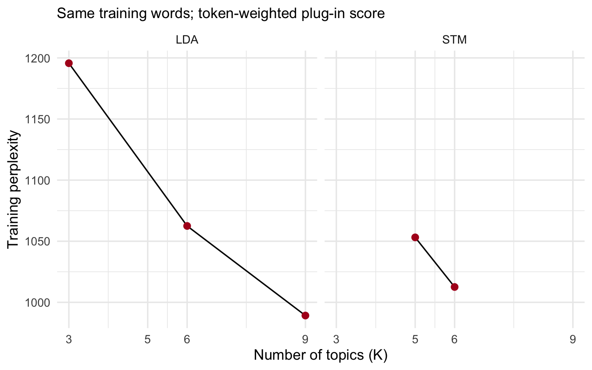{fig-alt="Actual training perplexity for LDA K=3,6,9 and STM K=5,6, calculated from the same training words."}
::::

:::: {.column width="36%"}
- **LDA, K=3/6/9:** 1195.7 → 1062.5 → 989.2.
- **STM, K=5/6:** 1053.2 → 1012.6.
- Read words and the same texts: does extra K add a useful distinction?
::::

:::::

**Lower perplexity means better fit, not proof of the best K.**

K=6 is our teaching resolution. [R04b calculation](../lab/Lab_Session_W8.html#r04b-calculate-training-perplexity) · [R04c plot](../lab/Lab_Session_W8.html#r04c-plot-training-fit-in-r).

::::::

::: {.source}

Reference: [Blei, Ng & Jordan (2003)](https://www.jmlr.org/papers/v3/blei03a.html); [Chang et al. (2009)](https://proceedings.neurips.cc/paper/2009/hash/f92586a25bb3145facd64ab20fd554ff-Abstract.html)

:::


<!-- W8:K_DIAGNOSTIC:END -->

<!-- W8:KEYWORD_METHODS:START -->

## Keyword-assisted topic models

:::::: {.slide-body .compact-table}

<p class="w8-study-label"><strong>Another modelling choice · keyATM</strong></p>

::::: {.columns .w8-keyatm-method}

:::: {.column width="48%"}
**Method paper**

[{fig-alt="Original title of Keyword-Assisted Topic Models, AJPS."}](https://doi.org/10.1111/ajps.12779)

Eshima, Imai & Sasaki · AJPS 2024
::::

:::: {.column width="48%"}
**R package**

[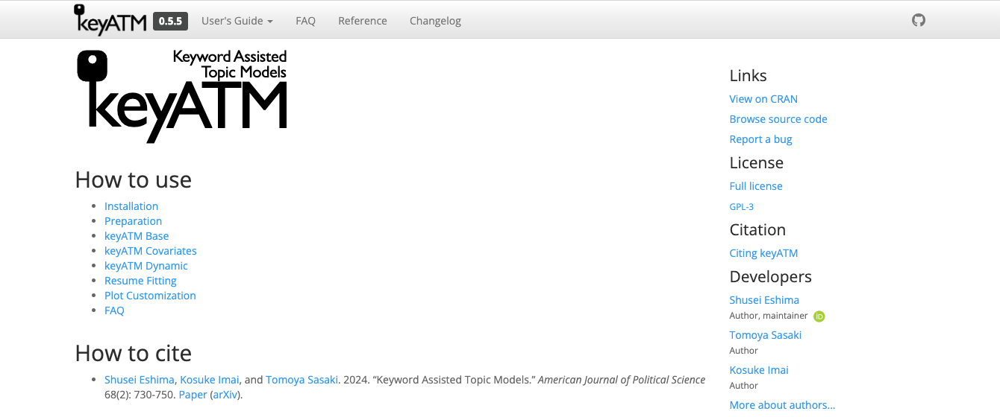{fig-alt="Unchanged screenshot of the official keyATM R package homepage."}](https://keyatm.github.io/keyATM/)

`install.packages("keyATM")`
::::

:::::

Researchers supply a few keywords for concepts they want to measure. The model estimates topics and document mixtures, including topics without keywords.

::::::

::: {.source}

Reference: [Eshima, Imai & Sasaki (2024)](https://doi.org/10.1111/ajps.12779)

:::


<!-- W8:KEYWORD_METHODS:END -->

<!-- W8:KEYWORD_COMPARISON:START -->

## Extension · Keyword guidance in two models

:::::: {.slide-body .compact-table}

| Method | Researcher input | W8 use |
|---|---|---|
| keyATM | Keywords for defined topics, plus topics without keywords | Method and package overview |
| Seeded LDA | Seed dictionary, pseudo-count weight and residual topics | Independent extension |

Both use substantive information to guide topic discovery.

The models and outputs differ; interpret and validate each fit.

::::::

::: {.source}

[keyATM](https://keyatm.github.io/keyATM/) and [seededlda](https://koheiw.github.io/seededlda/reference/textmodel_seededlda.html). ESS Day 7's runnable example uses `textmodel_seededlda()`.

:::


<!-- W8:KEYWORD_COMPARISON:END -->

## More applications in political research

:::::: {.slide-body .w8-applications}

::::: {.w8-applications-grid}

:::: {.w8-application-shot .w8-wratil}
[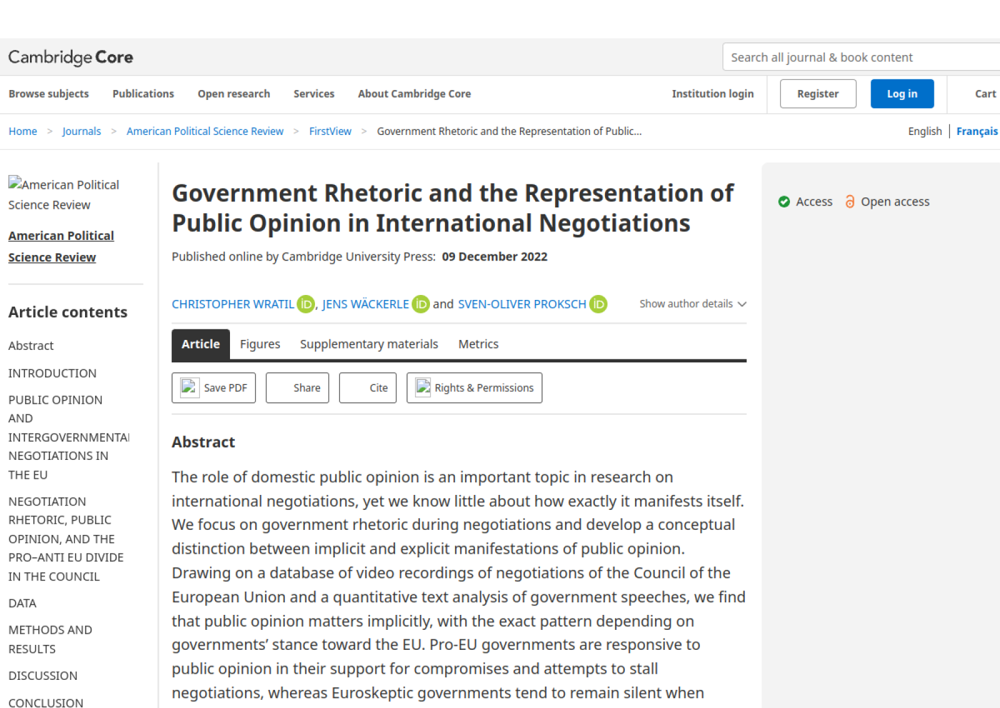{fig-alt="Original publisher article heading: Government Rhetoric and the Representation of Public Opinion in International Negotiations."}](https://doi.org/10.1017/S0003055422001198)

[**Wratil et al. (2023)**](https://doi.org/10.1017/S0003055422001198)

<span class="fragment current-visible w8-application-focus" data-fragment-index="0" aria-hidden="true"></span>
::::

:::: {.w8-application-shot .w8-motolinia}
[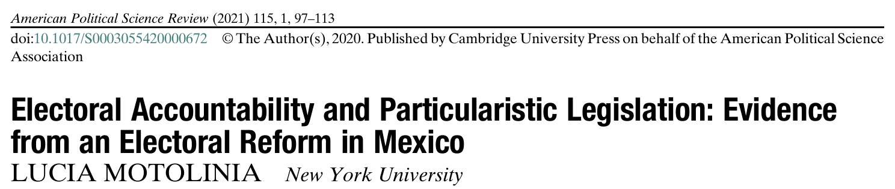{fig-alt="Original publisher article heading: Electoral Accountability and Particularistic Legislation: Evidence from an Electoral Reform in Mexico."}](https://doi.org/10.1017/S0003055420000672)

[**Motolinia (2021)**](https://doi.org/10.1017/S0003055420000672)

<span class="fragment current-visible w8-application-focus" data-fragment-index="1" aria-hidden="true"></span>
::::

:::: {.w8-application-shot .w8-mueller}
[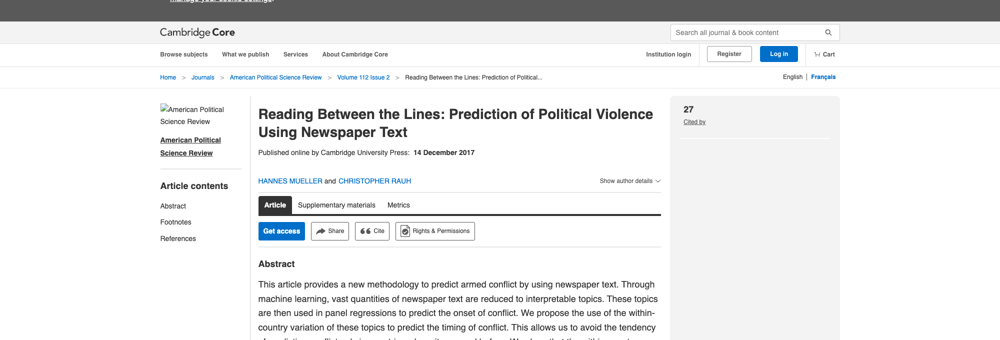{fig-alt="Original publisher article heading: Reading Between the Lines: Prediction of Political Violence Using Newspaper Text."}](https://doi.org/10.1017/S0003055417000570)

[**Mueller & Rauh (2018)**](https://doi.org/10.1017/S0003055417000570)

<span class="fragment current-visible w8-application-focus" data-fragment-index="2" aria-hidden="true"></span>
::::

:::: {.w8-application-shot .w8-kraft}
[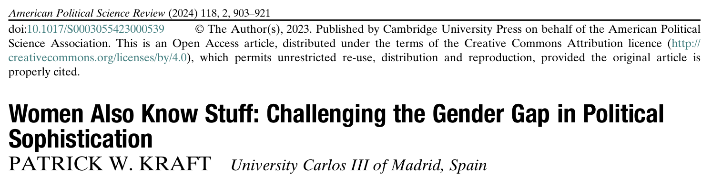{fig-alt="Original publisher article heading: Women Also Know Stuff: Challenging the Gender Gap in Political Sophistication."}](https://doi.org/10.1017/S0003055423000539)

[**Kraft (2024)**](https://doi.org/10.1017/S0003055423000539)

<span class="fragment current-visible w8-application-focus" data-fragment-index="3" aria-hidden="true"></span>
::::

:::::

::::::

::: {.source}

Reference: [Wratil et al. (2023)](https://doi.org/10.1017/S0003055422001198); [Motolinia (2021)](https://doi.org/10.1017/S0003055420000672); [Mueller & Rauh (2018)](https://doi.org/10.1017/S0003055417000570); [Kraft (2024)](https://doi.org/10.1017/S0003055423000539)

:::


<!-- W8:OPTIONAL_METHODS:START -->

## Extension · Correlated topics and change over time

:::::: {.slide-body .compact-table .w8-model-options}

| Model | Research question | What the analyst supplies |
|---|---|---|
| Correlated Topic Model | Which issues tend to appear together in documents? | Text counts and a chosen topic resolution |
| Dynamic Topic Model | How does the language of an issue change across periods? | Comparable texts and ordered time periods |

CTM estimates which issues appear together. DTM tracks how topic vocabulary changes across ordered periods.

::::::

::: {.source}

Reference: [Blei & Lafferty (2007)](https://doi.org/10.1214/07-AOAS114); [Blei & Lafferty (2006)](https://doi.org/10.1145/1143844.1143859)

:::


<!-- W8:OPTIONAL_METHODS:END -->

<!-- W8:SHORT_TEXT_METHOD:START -->

## Extension · Short texts with a biterm model

:::::: {.slide-body .compact-table .w8-btm-package}

<p class="w8-study-label"><strong>Short-text applications · R package BTM</strong></p>

::::: {.columns .w8-btm-method-columns}

:::: {.column .w8-btm-original-paper}

**Original paper · WWW 2013**

[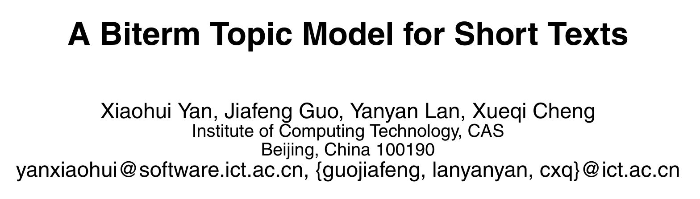{fig-alt="Original first-page title and authors: A Biterm Topic Model for Short Texts, by Xiaohui Yan, Jiafeng Guo, Yanyan Lan and Xueqi Cheng."}](https://doi.org/10.1145/2488388.2488514)

- **Texts:** short survey answers, posts or headlines.
- **BTM:** pools unordered word pairs across short texts.

::::

:::: {.column .w8-btm-r-example}

**R package example**

[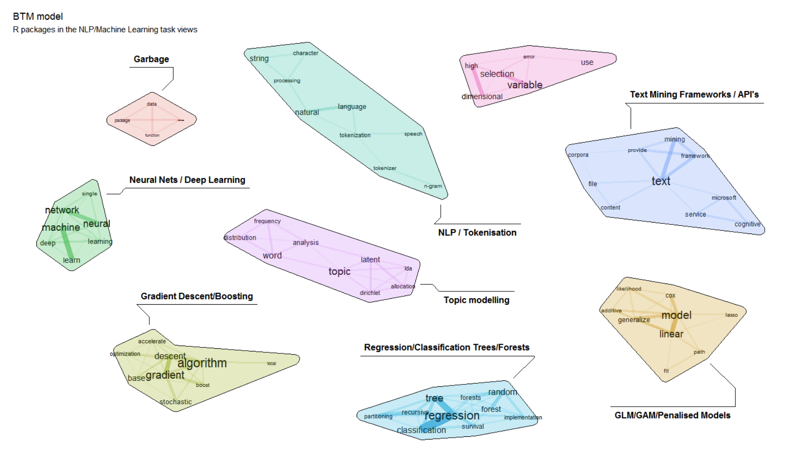{fig-alt="User-supplied BTM package example: short R package descriptions in NLP and machine learning are grouped into topics such as topic modelling and neural networks."}](https://www.bnosac.be/blog/98-biterm-topic-modelling-for-short-texts)

<p class="w8-btm-example-caption">R package descriptions, grouped into topics.</p>

::::

:::::

**Your extension:** compare BTM with LDA and check labels against the original texts.

::::::

::: {.source}

Reference: [Yan et al. (2013)](https://doi.org/10.1145/2488388.2488514); [BTM documentation](https://www.bnosac.be/blog/98-biterm-topic-modelling-for-short-texts); [official R package documentation](https://cran.r-project.org/web/packages/BTM/index.html)

:::


<!-- W8:SHORT_TEXT_METHOD:END -->

## Break

:::::: {.slide-body}

**Back at 17:36.**

Next: the RStudio project, complete topic mixtures and party comparisons.

[Student Lab ZIP](../downloads/week8-lab.zip) includes the RStudio project, step-by-step R script, data and saved models.

::::::

::: {.source}

W8 classroom materials. Run the R script one checkpoint at a time and keep the original speeches available.

:::


## One speech as one document

:::::: {.slide-body .compact-table}

| Corpus choice | Shared classroom input |
|---|---|
| Source | Commons leader speeches from two parties |
| Eligible source texts | 3,897 nonempty speeches, source terms ≥ 80 |
| Fixed teaching sample | 719 complete speeches, up to 30 per party-period |
| Sample dates | 15 May 1979 to 17 December 2025 |
| Model input | Same document IDs across the fitted R models |

**Discuss:** what changes if every party's speeches become one document?

::::::

::: {.source}

Data source: Essex Summer School 2026, Day 7; British House of Commons party-leader speeches. W8 sampling seed 20261028. Nearly balanced party-period sample, not parliamentary word volume.

:::


## R workflow and model objects

:::::: {.slide-body .compact-table .w8-case-flow .w8-lab-route}

| Class stage | Steps | What you should explain |
|---|---|---|
| 1 · Read and prepare | R01a–R01c | Define a document; explain what cleaning changes |
| 2 · Fit and read LDA | R02a–R02b | Read a complete topic mixture |
| 3 · Check a label | R03a–R03b; E02 | Support a label with text and name a challenge |
| 4 · Compare with STM | R05a–R05e; E05 | Interpret direction, percentage points and uncertainty |

**Same texts:** LDA uses counts; STM adds metadata.

**Before class:** R00 packages and project setup. Open `W8_lab.Rproj`, then `W8.R`.

**After class:** R03c–R04c compare party summaries and K diagnostics. The project plan and reading close the deck.

::::::

::: {.source}

[Student Lab](../lab/Lab_Session_W8.html) · [Student ZIP](../downloads/week8-lab.zip).

:::


<!-- W8:OPTIONAL_PREPARATION:START -->

## R00a: R packages

:::::: {.slide-body .w8-tab-step .w8-code-output-step}

**Before class** · Run **R00a** in `W8.R`.

::::: {.w8-code-output-tabs data-lab-step="R00a"}

<div class="w8-code-output-tablist" role="tablist" aria-label="R00a code and output">
<button type="button" id="w8-r00a-code-tab" class="w8-code-output-tab" role="tab" aria-selected="true" aria-controls="w8-r00a-code-panel" data-w8-tab="code">Code</button>
<button type="button" id="w8-r00a-output-tab" class="w8-code-output-tab" role="tab" aria-selected="false" aria-controls="w8-r00a-output-panel" tabindex="-1" data-w8-tab="output">Output</button>
</div>
<div class="fragment w8-code-output-trigger" data-fragment-index="0" aria-hidden="true"></div>

:::: {.w8-tab-panel .w8-tab-code .w8-code .w8-step-code id="w8-r00a-code-panel" role="tabpanel" aria-labelledby="w8-r00a-code-tab" aria-hidden="false"}

R packages add functions for text analysis, models and plotting.

```r
required <- c("quanteda", "quanteda.textstats", "seededlda", "stm",
  "dplyr", "tidyr", "ggplot2", "jsonlite")
missing <- required[!vapply(required, requireNamespace,
  quietly = TRUE, FUN.VALUE = logical(1))]
if (length(missing)) stop("Install these packages first: ",
  paste(missing, collapse = ", "))
invisible(lapply(required, function(p)
  suppressPackageStartupMessages(library(p, character.only = TRUE))))
options(width = 100, seededlda_threads = 1)
cat("Packages loaded:", paste(required, collapse = ", "), "\n")
```

::::

:::: {.w8-tab-panel .w8-tab-output .w8-step-output .w8-console id="w8-r00a-output-panel" role="tabpanel" aria-labelledby="w8-r00a-output-tab" aria-hidden="true"}

```text
Packages loaded: quanteda, quanteda.textstats, seededlda, stm, dplyr, tidyr, ggplot2, jsonlite
```

**Before class · Check:** If you see Install these packages first, install the listed packages and rerun this step.

::::

:::::


<script>
/* Keep the tab buttons and accessibility state in sync with Reveal fragments. */
(() => {
  if (window.__w8CodeOutputTabs) return;
  window.__w8CodeOutputTabs = true;
  const selector = '.w8-code-output-tabs';
  const sync = () => {
    document.querySelectorAll(selector).forEach(group => {
      const output = group.querySelector('.w8-code-output-trigger')?.classList.contains('visible');
      group.querySelectorAll('[data-w8-tab]').forEach(button => {
        const selected = (button.dataset.w8Tab === 'output') === output;
        button.setAttribute('aria-selected', String(selected));
        button.tabIndex = selected ? 0 : -1;
      });
      group.querySelector('.w8-tab-code')?.setAttribute('aria-hidden', String(output));
      group.querySelector('.w8-tab-output')?.setAttribute('aria-hidden', String(!output));
    });
  };
  const choose = (button, moveFocus = false) => {
    const group = button.closest(selector);
    const slide = group?.closest('section');
    if (!slide || !window.Reveal) return;
    const {h, v} = Reveal.getIndices(slide);
    Reveal.slide(h, v, button.dataset.w8Tab === 'output' ? 0 : -1);
    sync();
    if (moveFocus) button.focus();
  };
  document.addEventListener('click', event => {
    const button = event.target.closest?.(`${selector} [data-w8-tab]`);
    if (!button) return;
    event.preventDefault();
    event.stopPropagation();
    choose(button);
    button.blur(); // Keep presentation Next available after a pointer selection.
  });
  document.addEventListener('keydown', event => {
    const button = event.target.closest?.(`${selector} [data-w8-tab]`);
    if (!button) return;
    const group = button.closest(selector);
    let target;
    if (['ArrowLeft', 'Home'].includes(event.key)) target = group.querySelector('[data-w8-tab="code"]');
    else if (['ArrowRight', 'End'].includes(event.key)) target = group.querySelector('[data-w8-tab="output"]');
    else if (['Enter', ' '].includes(event.key)) target = button;
    else return;
    event.preventDefault();
    event.stopImmediatePropagation();
    choose(target, true);
  }, true);
  let attempts = 0;
  const bind = () => {
    if (!document.querySelector(selector)) return;
    if (!window.Reveal) {
      if (++attempts < 200) setTimeout(bind, 50);
      return;
    }
    ['ready', 'slidechanged', 'fragmentshown', 'fragmenthidden'].forEach(name => Reveal.on(name, sync));
    sync();
  };
  if (document.readyState === 'loading') document.addEventListener('DOMContentLoaded', bind, {once: true});
  else bind();
})();

</script>

::::::

::: {.source}

R step-by-step Lab R00a. Same 719 speeches. [Full step and output](../lab/Lab_Session_W8.html#r00a-load-the-r-packages). Executed Console output.

:::


## R00b: Project folders

:::::: {.slide-body .w8-tab-step .w8-code-output-step}

**Before class** · Run **R00b** in `W8.R`.

::::: {.w8-code-output-tabs data-lab-step="R00b"}

<div class="w8-code-output-tablist" role="tablist" aria-label="R00b code and output">
<button type="button" id="w8-r00b-code-tab" class="w8-code-output-tab" role="tab" aria-selected="true" aria-controls="w8-r00b-code-panel" data-w8-tab="code">Code</button>
<button type="button" id="w8-r00b-output-tab" class="w8-code-output-tab" role="tab" aria-selected="false" aria-controls="w8-r00b-output-panel" tabindex="-1" data-w8-tab="output">Output</button>
</div>
<div class="fragment w8-code-output-trigger" data-fragment-index="0" aria-hidden="true"></div>

:::: {.w8-tab-panel .w8-tab-code .w8-code .w8-step-code id="w8-r00b-code-panel" role="tabpanel" aria-labelledby="w8-r00b-code-tab" aria-hidden="false"}

```r
lab_file <- function(name) file.path("analysis", "ess_lab", name)
if (!file.exists(lab_file("sample_raw.rds"))) {
  stop("Open W8_lab.Rproj, then run R00b again.")
}
party_colors <- c(Conservative = "#003B73", Labour = "#B00020")
cat("W8 speech input found. Ready to build and fit both models.\n")
```

::::

:::: {.w8-tab-panel .w8-tab-output .w8-step-output .w8-console id="w8-r00b-output-panel" role="tabpanel" aria-labelledby="w8-r00b-output-tab" aria-hidden="true"}

```text
W8 speech input found. Ready to build and fit both models.
```

**Before class · Check:** If the file check fails, reopen W8_lab.Rproj and rerun R00b.

::::

:::::

::::::

::: {.source}

R step-by-step Lab R00b. Same 719 speeches. [Full step and output](../lab/Lab_Session_W8.html#r00b-locate-the-speech-input). Executed Console output.

:::


<!-- W8:OPTIONAL_PREPARATION:END -->

<!-- W8:PRACTICE:START -->

## R01a: Read file

:::::: {.slide-body .w8-tab-step .w8-code-output-step}

**Run together** · Run **R01a** in `W8.R`.

::::: {.w8-code-output-tabs data-lab-step="R01a"}

<div class="w8-code-output-tablist" role="tablist" aria-label="R01a code and output">
<button type="button" id="w8-r01a-code-tab" class="w8-code-output-tab" role="tab" aria-selected="true" aria-controls="w8-r01a-code-panel" data-w8-tab="code">Code</button>
<button type="button" id="w8-r01a-output-tab" class="w8-code-output-tab" role="tab" aria-selected="false" aria-controls="w8-r01a-output-panel" tabindex="-1" data-w8-tab="output">Output</button>
</div>
<div class="fragment w8-code-output-trigger" data-fragment-index="0" aria-hidden="true"></div>

:::: {.w8-tab-panel .w8-tab-code .w8-code .w8-step-code id="w8-r01a-code-panel" role="tabpanel" aria-labelledby="w8-r01a-code-tab" aria-hidden="false"}

```r
topic_docs <- readRDS(lab_file("sample_raw.rds"))
topic_corpus <- corpus(
  topic_docs, text_field = "text", docid_field = "doc_id")
print(topic_docs[1:3,
  c("doc_id", "leader", "party_family", "date")])
print(c(speeches = ndoc(topic_corpus)))
```

::::

:::: {.w8-tab-panel .w8-tab-output .w8-step-output .w8-topic-table .compact-table id="w8-r01a-output-panel" role="tabpanel" aria-labelledby="w8-r01a-output-tab" aria-hidden="true"}

| Document | Leader | Party | Date |
|---|---|---|---|
| ess_hoc_00002 | Margaret Thatcher | Conservative | 1979-05-15 |
| ess_hoc_00211 | James Callaghan | Labour | 1979-06-21 |
| ess_hoc_00004 | Margaret Thatcher | Conservative | 1979-06-26 |

Corpus: **719 complete speeches**.

**Run together · Check:** Confirm that the corpus contains 719 speeches and identify the document ID, leader, party, and date.

::::

:::::

::::::

::: {.source}

R step-by-step Lab R01a. Same 719 speeches. [Full step and output](../lab/Lab_Session_W8.html#r01a-read-file). Reformatted first three records and the executed corpus count.

:::


## R01b: Split and clean words

:::::: {.slide-body .w8-tab-step .w8-code-output-step}

**Run together** · Run **R01b** in `W8.R`.

::::: {.w8-code-output-tabs data-lab-step="R01b"}

<div class="w8-code-output-tablist" role="tablist" aria-label="R01b code and output">
<button type="button" id="w8-r01b-code-tab" class="w8-code-output-tab" role="tab" aria-selected="true" aria-controls="w8-r01b-code-panel" data-w8-tab="code">Code</button>
<button type="button" id="w8-r01b-output-tab" class="w8-code-output-tab" role="tab" aria-selected="false" aria-controls="w8-r01b-output-panel" tabindex="-1" data-w8-tab="output">Output</button>
</div>
<div class="fragment w8-code-output-trigger" data-fragment-index="0" aria-hidden="true"></div>

:::: {.w8-tab-panel .w8-tab-code .w8-code .w8-step-code id="w8-r01b-code-panel" role="tabpanel" aria-labelledby="w8-r01b-code-tab" aria-hidden="false"}

```r
id <- "ess_hoc_00004"
raw_tokens <- tokens(topic_corpus[id], what = "word")
parliamentary_stopwords <- c("hon", "member", "right", "friend", "sir",
  "gentleman", "lady", "house", "commons", "speaker", "minister",
  "secretary", "asked", "question", "mr", "mrs", "ms", "â", "ã")
clean_tokens <- tokens(topic_corpus, remove_punct = TRUE,
  remove_symbols = TRUE, remove_numbers = TRUE, remove_url = TRUE,
  remove_separators = TRUE, split_hyphens = FALSE) |>
  tokens_tolower() |> tokens_remove(stopwords("en")) |>
  tokens_remove(parliamentary_stopwords)
print(raw_tokens[[id]][1:21])
print(clean_tokens[[id]][1:8])
```

::::

:::: {.w8-tab-panel .w8-tab-output .w8-step-output .w8-console id="w8-r01b-output-panel" role="tabpanel" aria-labelledby="w8-r01b-output-tab" aria-hidden="true"}

**Raw tokens from `ess_hoc_00004`**

```text
"With" "permission" "," "Mr" "." "Speaker"
"I" "should" "like" "to" "make" "a"
"statement" "on" "the" "European" "Council" "Meeting"
"at" "Strasbourg" "."
```

**After corpus cleaning**

```text
"permission" "like" "make" "statement" "european" "council"
"meeting" "strasbourg"
```

**Run together · Check:** Explain the visible changes between the raw and cleaned words.

::::

:::::

::::::

::: {.source}

R step-by-step Lab R01b. Same 719 speeches. [Full step and output](../lab/Lab_Session_W8.html#r01b-split-and-clean-the-words). All executed raw and cleaned tokens from the same speech, reflowed six per line. Full Console formatting remains in the Lab.

:::


## R01c: Build the DFM

:::::: {.slide-body .w8-tab-step .w8-code-output-step}

**Run together** · Run **R01c** in `W8.R`.

::::: {.w8-code-output-tabs data-lab-step="R01c"}

<div class="w8-code-output-tablist" role="tablist" aria-label="R01c code and output">
<button type="button" id="w8-r01c-code-tab" class="w8-code-output-tab" role="tab" aria-selected="true" aria-controls="w8-r01c-code-panel" data-w8-tab="code">Code</button>
<button type="button" id="w8-r01c-output-tab" class="w8-code-output-tab" role="tab" aria-selected="false" aria-controls="w8-r01c-output-panel" tabindex="-1" data-w8-tab="output">Output</button>
</div>
<div class="fragment w8-code-output-trigger" data-fragment-index="0" aria-hidden="true"></div>

:::: {.w8-tab-panel .w8-tab-code .w8-code .w8-step-code id="w8-r01c-code-panel" role="tabpanel" aria-labelledby="w8-r01c-code-tab" aria-hidden="false"}

```r
collocations <- textstat_collocations(
  clean_tokens, min_count = 8, size = 2:3) |> arrange(desc(lambda))
model_tokens <- tokens_compound(clean_tokens,
  phrase(head(collocations$collocation, 30)))
topic_dfm <- dfm(model_tokens) |>
  dfm_trim(min_termfreq = 5, min_docfreq = 2) |>
  dfm_trim(max_docfreq = .75, docfreq_type = "prop")
topic_dfm <- topic_dfm[ntoken(topic_dfm) > 0, ]
topic_docs <- topic_docs[match(docnames(topic_dfm), topic_docs$doc_id), ]
topic_docs$retained_tokens <- as.numeric(ntoken(topic_dfm))
stopifnot(identical(topic_docs$doc_id, docnames(topic_dfm)))
print(c(speeches = ndoc(topic_dfm), features = nfeat(topic_dfm),
  tokens = sum(ntoken(topic_dfm))))
print(topfeatures(topic_dfm, 6))
```

::::

:::: {.w8-tab-panel .w8-tab-output .w8-step-output .w8-console id="w8-r01c-output-panel" role="tabpanel" aria-labelledby="w8-r01c-output-tab" aria-hidden="true"}

```text
speeches features   tokens 
     719     2831    70813 
     prime government     people        can        now    country 
       992        728        590        490        382        354
```

**Run together · Check:** Confirm the three DFM totals. Explain how compounding and frequency trimming change what the models can see.

::::

:::::

::::::

::: {.source}

R step-by-step Lab R01c. Same 719 speeches. [Full step and output](../lab/Lab_Session_W8.html#r01c-turn-cleaned-words-into-a-dfm). Executed DFM dimensions, retained-token total and all six most frequent retained features.

:::


## R02a: Fit six-topic LDA

:::::: {.slide-body .w8-tab-step .w8-code-output-step}

**Run together** · Run **R02a** in `W8.R`.

::::: {.w8-code-output-tabs data-lab-step="R02a"}

<div class="w8-code-output-tablist" role="tablist" aria-label="R02a code and output">
<button type="button" id="w8-r02a-code-tab" class="w8-code-output-tab" role="tab" aria-selected="true" aria-controls="w8-r02a-code-panel" data-w8-tab="code">Code</button>
<button type="button" id="w8-r02a-output-tab" class="w8-code-output-tab" role="tab" aria-selected="false" aria-controls="w8-r02a-output-panel" tabindex="-1" data-w8-tab="output">Output</button>
</div>
<div class="fragment w8-code-output-trigger" data-fragment-index="0" aria-hidden="true"></div>

:::: {.w8-tab-panel .w8-tab-code .w8-code .w8-step-code id="w8-r02a-code-panel" role="tabpanel" aria-labelledby="w8-r02a-code-tab" aria-hidden="false"}

```r
set.seed(20260710)
lda_6 <- textmodel_lda(topic_dfm, k = 6, alpha = .5, beta = .1,
  max_iter = 500, auto_iter = FALSE, batch_size = 1, verbose = FALSE)
print(terms(lda_6, 10))
print(dim(lda_6$theta))
```

::::

:::: {.w8-tab-panel .w8-tab-output .w8-step-output .w8-topic-table .compact-table id="w8-r02a-output-panel" role="tabpanel" aria-labelledby="w8-r02a-output-tab" aria-hidden="true"}

| LDA topic | First five of ten printed words |
|---|---|
| T1 | european, council, community, countries, agreed |
| T2 | government, state, made, members, service |
| T3 | prime, people, government, said, can |
| T4 | government, people, unemployment, economy, year |
| T5 | people, can, country, want, support |
| T6 | united, must, international, security, nations |

`theta` dimensions: **719 speeches × 6 topics**.

**Run together · Check:** Choose two topics and write provisional labels. Later, check those labels against actual speeches.

::::

:::::

::::::

::: {.source}

R step-by-step Lab R02a. Same 719 speeches. [Full step and output](../lab/Lab_Session_W8.html#r02a-fit-a-six-topic-lda-model). Selected first five words from each printed distribution. The Lab retains all ten.

:::


## R02b: Complete topic mixtures

:::::: {.slide-body .w8-tab-step .w8-code-output-step}

**Run together** · Run **R02b** in `W8.R`.

::::: {.w8-code-output-tabs data-lab-step="R02b"}

<div class="w8-code-output-tablist" role="tablist" aria-label="R02b code and output">
<button type="button" id="w8-r02b-code-tab" class="w8-code-output-tab" role="tab" aria-selected="true" aria-controls="w8-r02b-code-panel" data-w8-tab="code">Code</button>
<button type="button" id="w8-r02b-output-tab" class="w8-code-output-tab" role="tab" aria-selected="false" aria-controls="w8-r02b-output-panel" tabindex="-1" data-w8-tab="output">Output</button>
</div>
<div class="fragment w8-code-output-trigger" data-fragment-index="0" aria-hidden="true"></div>

:::: {.w8-tab-panel .w8-tab-code .w8-code .w8-step-code id="w8-r02b-code-panel" role="tabpanel" aria-labelledby="w8-r02b-code-tab" aria-hidden="false"}

```r
print(round(head(lda_6$theta, 3), 3))
print(range(rowSums(lda_6$theta)))
dominant_topic <- max.col(lda_6$theta, ties.method = "first")
names(dominant_topic) <- topic_docs$doc_id
print(head(dominant_topic, 5))
print(table(dominant_topic))
```

::::

:::: {.w8-tab-panel .w8-tab-output .w8-step-output .w8-topic-table .compact-table id="w8-r02b-output-panel" role="tabpanel" aria-labelledby="w8-r02b-output-tab" aria-hidden="true"}

| Speech | T1 | T2 | T3 | T4 | T5 | T6 |
|---|---|---|---|---|---|---|
| 00002 | 0.044 | 0.188 | 0.049 | 0.197 | 0.470 | 0.053 |
| 00211 | 0.005 | 0.490 | 0.136 | 0.207 | 0.116 | 0.045 |
| 00004 | 0.874 | 0.067 | 0.012 | 0.002 | 0.012 | 0.032 |

Dominant-topic counts (T1–T6): **91, 80, 193, 143, 145, 67**.

Full θ rows sum to **1**. Ties use the first index.

**Run together · Check:** Which output can answer: Which issues does one speech discuss as a mixture?

::::

:::::

::::::

::: {.source}

R step-by-step Lab R02b. Same 719 speeches. [Full step and output](../lab/Lab_Session_W8.html#r02b-read-complete-topic-mixtures). Reformatted first three θ rows and deterministic dominant-topic summary.

:::


## R03a: Two selected speeches

:::::: {.slide-body .w8-tab-step .w8-code-output-step}

**Run together** · Run **R03a** in `W8.R`.

::::: {.w8-code-output-tabs data-lab-step="R03a"}

<div class="w8-code-output-tablist" role="tablist" aria-label="R03a code and output">
<button type="button" id="w8-r03a-code-tab" class="w8-code-output-tab" role="tab" aria-selected="true" aria-controls="w8-r03a-code-panel" data-w8-tab="code">Code</button>
<button type="button" id="w8-r03a-output-tab" class="w8-code-output-tab" role="tab" aria-selected="false" aria-controls="w8-r03a-output-panel" tabindex="-1" data-w8-tab="output">Output</button>
</div>
<div class="fragment w8-code-output-trigger" data-fragment-index="0" aria-hidden="true"></div>

:::: {.w8-tab-panel .w8-tab-code .w8-code .w8-step-code id="w8-r03a-code-panel" role="tabpanel" aria-labelledby="w8-r03a-code-tab" aria-hidden="false"}

```r
theta <- lda_6$theta
high_i <- which.max(theta[, 1])
mixed_i <- which.min(apply(theta, 1, max))
print(topic_docs[c(high_i, mixed_i),
  c("doc_id", "leader", "party_family", "date")])
print(round(theta[c(high_i, mixed_i), ], 4))
print(rowSums(theta[c(high_i, mixed_i), , drop = FALSE]))
```

::::

:::: {.w8-tab-panel .w8-tab-output .w8-step-output .w8-topic-table .compact-table id="w8-r03a-output-panel" role="tabpanel" aria-labelledby="w8-r03a-output-tab" aria-hidden="true"}

**A:** `ess_hoc_00004`, Thatcher, 26 June 1979.

**B:** `ess_hoc_05895`, Corbyn, 25 March 2020.

| Speech | T1 | T2 | T3 | T4 | T5 | T6 |
|---|---|---|---|---|---|---|
| 00004 | 0.8738 | 0.0668 | 0.0124 | 0.0025 | 0.0124 | 0.0322 |
| 05895 | 0.0982 | 0.1339 | 0.2054 | 0.2232 | 0.2054 | 0.1339 |

Both complete mixtures sum to **1** before display rounding.

**Run together · Check:** How does retaining only the largest topic change the description compared with keeping all six proportions?

::::

:::::

::::::

::: {.source}

R step-by-step Lab R03a. Same 719 speeches. [Full step and output](../lab/Lab_Session_W8.html#r03a-retrieve-concentrated-and-mixed-speeches). Reformatted metadata and all six proportions from both selected speeches.

:::


## R03b: Original speech texts

:::::: {.slide-body .w8-tab-step .w8-code-output-step}

**Run together** · Run **R03b** in `W8.R`.

::::: {.w8-code-output-tabs data-lab-step="R03b"}

<div class="w8-code-output-tablist" role="tablist" aria-label="R03b code and output">
<button type="button" id="w8-r03b-code-tab" class="w8-code-output-tab" role="tab" aria-selected="true" aria-controls="w8-r03b-code-panel" data-w8-tab="code">Code</button>
<button type="button" id="w8-r03b-output-tab" class="w8-code-output-tab" role="tab" aria-selected="false" aria-controls="w8-r03b-output-panel" tabindex="-1" data-w8-tab="output">Output</button>
</div>
<div class="fragment w8-code-output-trigger" data-fragment-index="0" aria-hidden="true"></div>

:::: {.w8-tab-panel .w8-tab-code .w8-code .w8-step-code id="w8-r03b-code-panel" role="tabpanel" aria-labelledby="w8-r03b-code-tab" aria-hidden="false"}

```r
cat("Document:", topic_docs$doc_id[high_i], "\n")
cat(topic_docs$text[high_i], "\n")
cat("Mixed document:", topic_docs$doc_id[mixed_i], "\n")
cat(topic_docs$text[mixed_i], "\n")
```

::::

:::: {.w8-tab-panel .w8-tab-output .w8-step-output .w8-excerpt id="w8-r03b-output-panel" role="tabpanel" aria-labelledby="w8-r03b-output-tab" aria-hidden="true"}

::::: {.columns .w8-reading-columns}

:::: {.column}

**A: `ess_hoc_00004`**

> With permission, Mr. Speaker I should like to make a statement on the European Council Meeting at Strasbourg. With my…

::::

:::: {.column}

**B: `ess_hoc_05895`**

> My hon. Friend understands the issue and represents his constituency extremely well. I know that a lot of his constituents…

::::

:::::

**Run together · Check:** Find support and a possible challenge to the label. Complete E02; finish E03 after class.

::::

:::::

::::::

::: {.source}

R step-by-step Lab R03b. Same 719 speeches. [Full step and output](../lab/Lab_Session_W8.html#r03b-read-the-original-speech). Opening excerpts from the exact two printed source texts. Complete output in Lab.

:::


## R05a: Fit STM

:::::: {.slide-body .w8-tab-step .w8-code-output-step}

**Run together** · Run **R05a** in `W8.R`.

::::: {.w8-code-output-tabs data-lab-step="R05a"}

<div class="w8-code-output-tablist" role="tablist" aria-label="R05a code and output">
<button type="button" id="w8-r05a-code-tab" class="w8-code-output-tab" role="tab" aria-selected="true" aria-controls="w8-r05a-code-panel" data-w8-tab="code">Code</button>
<button type="button" id="w8-r05a-output-tab" class="w8-code-output-tab" role="tab" aria-selected="false" aria-controls="w8-r05a-output-panel" tabindex="-1" data-w8-tab="output">Output</button>
</div>
<div class="fragment w8-code-output-trigger" data-fragment-index="0" aria-hidden="true"></div>

:::: {.w8-tab-panel .w8-tab-code .w8-code .w8-step-code id="w8-r05a-code-panel" role="tabpanel" aria-labelledby="w8-r05a-code-tab" aria-hidden="false"}

```r
metadata <- data.frame(
  doc_id = topic_docs$doc_id,
  party_family = topic_docs$party_family,
  period = topic_docs$period)
design <- model.matrix(~ party_family + period, metadata)
stopifnot(qr(design)$rank == ncol(design))
stm_input <- convert(topic_dfm, to = "stm")
stm_6 <- stm(stm_input$documents, vocab = stm_input$vocab, K = 6,
  prevalence = ~ party_family + period, data = metadata,
  seed = 20260710, init.type = "Spectral", max.em.its = 100,
  emtol = 1e-4, verbose = FALSE)
print(labelTopics(stm_6, topics = 4, n = 5))
```

::::

:::: {.w8-tab-panel .w8-tab-output .w8-step-output .w8-topic-table .compact-table id="w8-r05a-output-panel" role="tabpanel" aria-labelledby="w8-r05a-output-tab" aria-hidden="true"}

**STM topic 4.** K=6, prevalence `~ party_family + period`.

| Word summary | Five printed words |
|---|---|
| Highest Prob | council, community, agreed, united, european  |
| FREX | argentine, commonwealth, nations, agreed, meeting  |
| Lift | dependencies, falklands, islanders, moore, shareholders  |
| Score | names, argentine, council, islands, commonwealth |

**Run together · Check:** Use the probability words and FREX words to assess the interpretation of the same STM topic.

::::

:::::

::::::

::: {.source}

R step-by-step Lab R05a. Same 719 speeches. [Full step and output](../lab/Lab_Session_W8.html#r05a-fit-stm-with-party-and-period). All four labelTopics summaries printed by this step.

:::


## R05b: Raw STM party means

:::::: {.slide-body .w8-tab-step .w8-code-output-step}

**Run together** · Run **R05b** in `W8.R`.

::::: {.w8-code-output-tabs data-lab-step="R05b"}

<div class="w8-code-output-tablist" role="tablist" aria-label="R05b code and output">
<button type="button" id="w8-r05b-code-tab" class="w8-code-output-tab" role="tab" aria-selected="true" aria-controls="w8-r05b-code-panel" data-w8-tab="code">Code</button>
<button type="button" id="w8-r05b-output-tab" class="w8-code-output-tab" role="tab" aria-selected="false" aria-controls="w8-r05b-output-panel" tabindex="-1" data-w8-tab="output">Output</button>
</div>
<div class="fragment w8-code-output-trigger" data-fragment-index="0" aria-hidden="true"></div>

:::: {.w8-tab-panel .w8-tab-code .w8-code .w8-step-code id="w8-r05b-code-panel" role="tabpanel" aria-labelledby="w8-r05b-code-tab" aria-hidden="false"}

```r
stm_theta <- as.data.frame(stm_6$theta)
colnames(stm_theta) <- paste0("topic_", seq_len(ncol(stm_theta)))
stm_theta$party_family <- topic_docs$party_family
stm_party_means <- stm_theta |> pivot_longer(starts_with("topic_"),
  names_to = "topic", values_to = "proportion") |>
  group_by(party_family, topic) |>
  summarise(mean = mean(proportion), .groups = "drop")
stm_raw_differences <- stm_party_means |>
  pivot_wider(id_cols = topic, names_from = party_family, values_from = mean) |>
  mutate(difference = Labour - Conservative)
print(stm_raw_differences[stm_raw_differences$topic == "topic_4", ])
```

::::

:::: {.w8-tab-panel .w8-tab-output .w8-step-output .w8-console id="w8-r05b-output-panel" role="tabpanel" aria-labelledby="w8-r05b-output-tab" aria-hidden="true"}

```text
# A tibble: 1 × 4
  topic   Conservative Labour difference
  <chr>          <dbl>  <dbl>      <dbl>
1 topic_4        0.137 0.0763    -0.0603
```

**Run together · Check:** State what positive and negative values mean before moving to the conditional comparison.

::::

:::::

::::::

::: {.source}

R step-by-step Lab R05b. Same 719 speeches. [Full step and output](../lab/Lab_Session_W8.html#r05b-calculate-raw-stm-party-differences). Executed Console output for this exact step.

:::


## R05c: Estimate party differences

:::::: {.slide-body .w8-tab-step .w8-code-output-step}

**Run together** · Run **R05c** in `W8.R`.

::::: {.w8-code-output-tabs data-lab-step="R05c"}

<div class="w8-code-output-tablist" role="tablist" aria-label="R05c code and output">
<button type="button" id="w8-r05c-code-tab" class="w8-code-output-tab" role="tab" aria-selected="true" aria-controls="w8-r05c-code-panel" data-w8-tab="code">Code</button>
<button type="button" id="w8-r05c-output-tab" class="w8-code-output-tab" role="tab" aria-selected="false" aria-controls="w8-r05c-output-panel" tabindex="-1" data-w8-tab="output">Output</button>
</div>
<div class="fragment w8-code-output-trigger" data-fragment-index="0" aria-hidden="true"></div>

:::: {.w8-tab-panel .w8-tab-code .w8-code .w8-step-code id="w8-r05c-code-panel" role="tabpanel" aria-labelledby="w8-r05c-code-tab" aria-hidden="false"}

```r
set.seed(20260710)
stm_party_effects <- estimateEffect(1:6 ~ party_family + period,
  stmobj = stm_6, metadata = metadata,
  uncertainty = "Global", nsims = 50)
set.seed(20260710)
adjusted_result <- plot(stm_party_effects,
  covariate = "party_family", method = "difference",
  cov.value1 = "Labour", cov.value2 = "Conservative",
  topics = 1:6, nsims = 1000, omit.plot = TRUE,
  labeltype = "numbers")
print(adjusted_result$means[4])
print(adjusted_result$cis[[4]])
```

::::

:::: {.w8-tab-panel .w8-tab-output .w8-step-output .w8-console id="w8-r05c-output-panel" role="tabpanel" aria-labelledby="w8-r05c-output-tab" aria-hidden="true"}

```text
[[1]]
[1] -0.05993053

       2.5%       97.5% 
-0.09272104 -0.02778845
```

**Run together · Check:** Which layer of uncertainty does this interval describe? Does it cover every vocabulary, sample, or naming choice?

::::

:::::

::::::

::: {.source}

R step-by-step Lab R05c. Same 719 speeches. [Full step and output](../lab/Lab_Session_W8.html#r05c-estimate-the-conditional-comparison). Executed Console output for this exact step.

:::


## R05d: Comparison table

:::::: {.slide-body .w8-tab-step .w8-code-output-step}

**Run together** · Run **R05d** in `W8.R`.

::::: {.w8-code-output-tabs data-lab-step="R05d"}

<div class="w8-code-output-tablist" role="tablist" aria-label="R05d code and output">
<button type="button" id="w8-r05d-code-tab" class="w8-code-output-tab" role="tab" aria-selected="true" aria-controls="w8-r05d-code-panel" data-w8-tab="code">Code</button>
<button type="button" id="w8-r05d-output-tab" class="w8-code-output-tab" role="tab" aria-selected="false" aria-controls="w8-r05d-output-panel" tabindex="-1" data-w8-tab="output">Output</button>
</div>
<div class="fragment w8-code-output-trigger" data-fragment-index="0" aria-hidden="true"></div>

:::: {.w8-tab-panel .w8-tab-code .w8-code .w8-step-code id="w8-r05d-code-panel" role="tabpanel" aria-labelledby="w8-r05d-code-tab" aria-hidden="false"}

```r
adjusted_differences <- data.frame(topic = paste0("topic_", 1:6),
  difference = unlist(adjusted_result$means),
  lower = vapply(adjusted_result$cis, `[`, numeric(1), 1),
  upper = vapply(adjusted_result$cis, `[`, numeric(1), 2))
print(adjusted_differences[adjusted_differences$topic == "topic_4", ],
  row.names = FALSE)
```

::::

:::: {.w8-tab-panel .w8-tab-output .w8-step-output .w8-console id="w8-r05d-output-panel" role="tabpanel" aria-labelledby="w8-r05d-output-tab" aria-hidden="true"}

```text
topic  difference       lower       upper
 topic_4 -0.05993053 -0.09272104 -0.02778845
```

**Run together · Check:** Check the topic 4 values before plotting them in R05e. Complete E05 after R05e by separating a supported association from a causal claim the data cannot identify.

::::

:::::

::::::

::: {.source}

R step-by-step Lab R05d. Same 719 speeches. [Full step and output](../lab/Lab_Session_W8.html#r05d-create-a-comparison-table). Executed Console output for this exact step.

:::


## R05e: STM interval plot

:::::: {.slide-body .w8-tab-step .w8-code-output-step}

**Run together** · Run **R05e** in `W8.R`.

::::: {.w8-code-output-tabs data-lab-step="R05e"}

<div class="w8-code-output-tablist" role="tablist" aria-label="R05e code and output">
<button type="button" id="w8-r05e-code-tab" class="w8-code-output-tab" role="tab" aria-selected="true" aria-controls="w8-r05e-code-panel" data-w8-tab="code">Code</button>
<button type="button" id="w8-r05e-output-tab" class="w8-code-output-tab" role="tab" aria-selected="false" aria-controls="w8-r05e-output-panel" tabindex="-1" data-w8-tab="output">Output</button>
</div>
<div class="fragment w8-code-output-trigger" data-fragment-index="0" aria-hidden="true"></div>

:::: {.w8-tab-panel .w8-tab-code .w8-code .w8-step-code id="w8-r05e-code-panel" role="tabpanel" aria-labelledby="w8-r05e-code-tab" aria-hidden="false"}

```r
p_stm_adjusted <- ggplot(adjusted_differences, aes(difference, topic)) +
  geom_vline(xintercept = 0, linetype = 2) + geom_point() +
  geom_errorbar(aes(xmin = lower, xmax = upper),
    orientation = "y", width = .15) +
  labs(x = "Labour minus Conservative: conditional association", y = NULL) +
  theme_minimal(base_size = 16)
print(p_stm_adjusted)
```

::::

:::: {.w8-tab-panel .w8-tab-output .w8-step-output .w8-step-plot id="w8-r05e-output-panel" role="tabpanel" aria-labelledby="w8-r05e-output-tab" aria-hidden="true"}

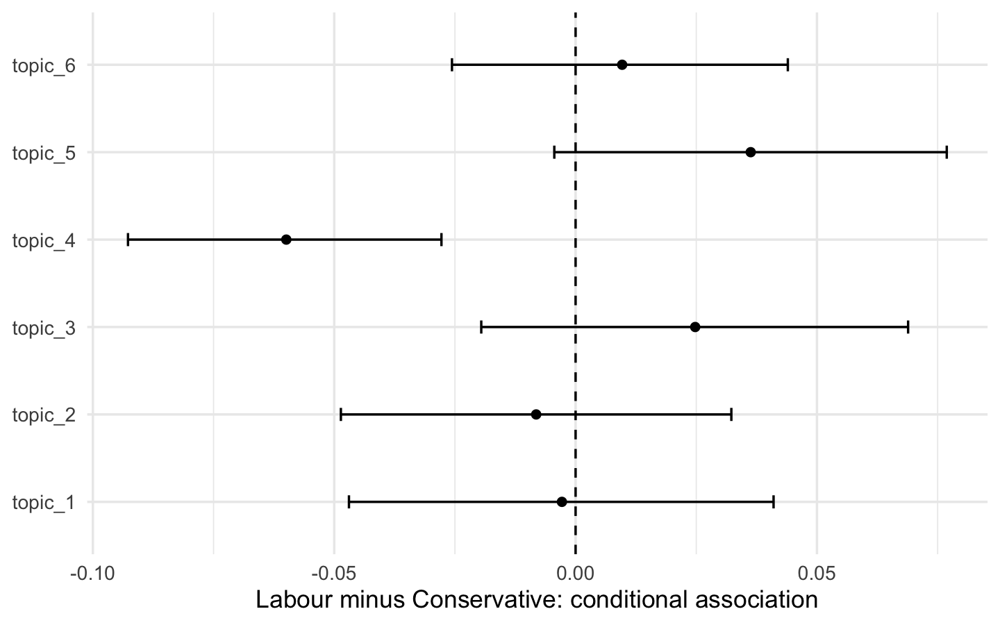{fig-alt="Actual R plot from Lab step R05e" height="420"}

**Run together · Check:** Intervals refer to the same fitted STM.

::::

:::::

::::::

::: {.source}

R step-by-step Lab R05e. Same 719 speeches. [Full step and output](../lab/Lab_Session_W8.html#r05e-plot-the-stm-associations-in-r). [Research design](#a-validation-plan-for-your-project). Actual R plot from the exact displayed step. Console values and the full plot are in the Lab.

:::


<!-- W8:PRACTICE:END -->

<!-- W8:OPTIONAL_DIAGNOSTICS:START -->

## R03c: LDA party means

:::::: {.slide-body .w8-tab-step .w8-code-output-step}

**After class** · Run **R03c** in `W8.R`.

::::: {.w8-code-output-tabs data-lab-step="R03c"}

<div class="w8-code-output-tablist" role="tablist" aria-label="R03c code and output">
<button type="button" id="w8-r03c-code-tab" class="w8-code-output-tab" role="tab" aria-selected="true" aria-controls="w8-r03c-code-panel" data-w8-tab="code">Code</button>
<button type="button" id="w8-r03c-output-tab" class="w8-code-output-tab" role="tab" aria-selected="false" aria-controls="w8-r03c-output-panel" tabindex="-1" data-w8-tab="output">Output</button>
</div>
<div class="fragment w8-code-output-trigger" data-fragment-index="0" aria-hidden="true"></div>

:::: {.w8-tab-panel .w8-tab-code .w8-code .w8-step-code id="w8-r03c-code-panel" role="tabpanel" aria-labelledby="w8-r03c-code-tab" aria-hidden="false"}

```r
lda_theta <- as.data.frame(theta)
colnames(lda_theta) <- paste0("topic_", seq_len(ncol(theta)))
lda_theta$doc_id <- topic_docs$doc_id
lda_theta$party_family <- topic_docs$party_family
lda_theta_long <- lda_theta |> pivot_longer(starts_with("topic_"),
  names_to = "topic", values_to = "proportion")
party_topic_means <- lda_theta_long |> group_by(party_family, topic) |>
  summarise(mean_proportion = mean(proportion), .groups = "drop")
print(as.data.frame(party_topic_means), row.names = FALSE)
```

::::

:::: {.w8-tab-panel .w8-tab-output .w8-step-output .w8-topic-table .compact-table id="w8-r03c-output-panel" role="tabpanel" aria-labelledby="w8-r03c-output-tab" aria-hidden="true"}

| LDA topic | Conservative | Labour |
|---|---|---|
| T1 | 0.1510 | 0.1174 |
| T2 | 0.1311 | 0.1532 |
| T3 | 0.2245 | 0.2323 |
| T4 | 0.1745 | 0.1870 |
| T5 | 0.2171 | 0.2034 |
| T6 | 0.1019 | 0.1067 |

**After class · Check:** What quantity would you estimate if speeches were weighted by retained_tokens?

::::

:::::

::::::

::: {.source}

R step-by-step Lab R03c. Same 719 speeches. [Full step and output](../lab/Lab_Session_W8.html#r03c-calculate-party-means). Same twelve printed means, reshaped to a wide table and rounded to four decimals.

:::


## R03d: LDA party plot

:::::: {.slide-body .w8-tab-step .w8-code-output-step}

**After class** · Run **R03d** in `W8.R`.

::::: {.w8-code-output-tabs data-lab-step="R03d"}

<div class="w8-code-output-tablist" role="tablist" aria-label="R03d code and output">
<button type="button" id="w8-r03d-code-tab" class="w8-code-output-tab" role="tab" aria-selected="true" aria-controls="w8-r03d-code-panel" data-w8-tab="code">Code</button>
<button type="button" id="w8-r03d-output-tab" class="w8-code-output-tab" role="tab" aria-selected="false" aria-controls="w8-r03d-output-panel" tabindex="-1" data-w8-tab="output">Output</button>
</div>
<div class="fragment w8-code-output-trigger" data-fragment-index="0" aria-hidden="true"></div>

:::: {.w8-tab-panel .w8-tab-code .w8-code .w8-step-code id="w8-r03d-code-panel" role="tabpanel" aria-labelledby="w8-r03d-code-tab" aria-hidden="false"}

```r
p_lda_party <- ggplot(party_topic_means,
  aes(topic, mean_proportion, fill = party_family)) +
  geom_col(position = "dodge") + coord_flip() +
  scale_fill_manual(values = party_colors) +
  labs(x = NULL, y = "Mean proportion per speech", fill = NULL) +
  theme_minimal(base_size = 16)
print(p_lda_party)
```

::::

:::: {.w8-tab-panel .w8-tab-output .w8-step-output .w8-r03d-reading id="w8-r03d-output-panel" role="tabpanel" aria-labelledby="w8-r03d-output-tab" aria-hidden="true"}

::::: {.columns .w8-plot-reading-columns}

:::: {.column width="60%"}
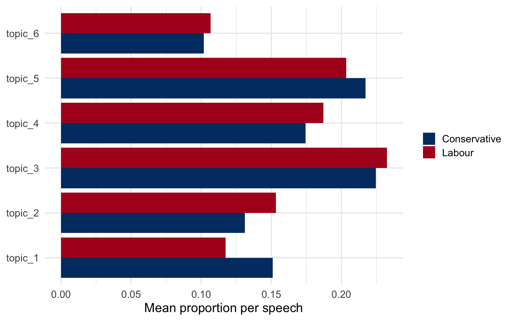{fig-alt="Actual R party-mean plot from Lab step R03d" height="400"}
::::

:::: {.column width="36%"}
- **Topic 1:** Conservative 15.1%; Labour 11.7%.
- Each sampled speech has equal weight.
- These means are unadjusted for period and do not identify a causal effect.
::::

:::::

::::

:::::

::::::

::: {.source}

R step-by-step Lab R03d. Same 719 speeches. [Full step and output](../lab/Lab_Session_W8.html#r03d-plot-the-party-means-in-r). Actual R03d plot; the Topic 1 percentages are the same party means calculated in R03c.

:::


## R04a: Alternative resolutions

:::::: {.slide-body .w8-tab-step .w8-code-output-step}

**After class** · Run **R04a** in `W8.R`.

::::: {.w8-code-output-tabs data-lab-step="R04a"}

<div class="w8-code-output-tablist" role="tablist" aria-label="R04a code and output">
<button type="button" id="w8-r04a-code-tab" class="w8-code-output-tab" role="tab" aria-selected="true" aria-controls="w8-r04a-code-panel" data-w8-tab="code">Code</button>
<button type="button" id="w8-r04a-output-tab" class="w8-code-output-tab" role="tab" aria-selected="false" aria-controls="w8-r04a-output-panel" tabindex="-1" data-w8-tab="output">Output</button>
</div>
<div class="fragment w8-code-output-trigger" data-fragment-index="0" aria-hidden="true"></div>

:::: {.w8-tab-panel .w8-tab-code .w8-code .w8-step-code id="w8-r04a-code-panel" role="tabpanel" aria-labelledby="w8-r04a-code-tab" aria-hidden="false"}

```r
k_candidates <- c(3, 6, 9)
lda_models <- lapply(k_candidates, function(k_value)
  readRDS(lab_file(paste0("lda", k_value, ".rds"))))
names(lda_models) <- paste0("K", k_candidates)
stm_models <- lapply(c(5, 6), function(k_value)
  readRDS(lab_file(paste0("stm", k_value, ".rds"))))
print(lapply(lda_models, terms, 5))
```

::::

:::: {.w8-tab-panel .w8-tab-output .w8-step-output .w8-topic-table .compact-table id="w8-r04a-output-panel" role="tabpanel" aria-labelledby="w8-r04a-output-tab" aria-hidden="true"}

| LDA topic | Five printed words |
|---|---|
| K=3, T1 | european, council, community, countries, united |
| K=6, T1 | european, council, community, countries, agreed |
| K=9, T3 | european, union, deal, europe, future |
| K=9, T5 | council, agreed, meeting, community, european |

**Check:** Match words before comparing topic numbers.

::::

:::::

::::::

::: {.source}

R step-by-step Lab R04a. Same 719 speeches. [Full step and output](../lab/Lab_Session_W8.html#r04a-read-alternative-topic-resolutions). Four selected columns from the printed K=3/6/9 word lists. All columns remain in Lab.

:::


## R04b: Training perplexity

:::::: {.slide-body .w8-tab-step .w8-code-output-step}

**After class** · Run **R04b** in `W8.R`.

::::: {.w8-code-output-tabs data-lab-step="R04b"}

<div class="w8-code-output-tablist" role="tablist" aria-label="R04b code and output">
<button type="button" id="w8-r04b-code-tab" class="w8-code-output-tab" role="tab" aria-selected="true" aria-controls="w8-r04b-code-panel" data-w8-tab="code">Code</button>
<button type="button" id="w8-r04b-output-tab" class="w8-code-output-tab" role="tab" aria-selected="false" aria-controls="w8-r04b-output-panel" tabindex="-1" data-w8-tab="output">Output</button>
</div>
<div class="fragment w8-code-output-trigger" data-fragment-index="0" aria-hidden="true"></div>

:::: {.w8-tab-panel .w8-tab-code .w8-code .w8-step-code id="w8-r04b-code-panel" role="tabpanel" aria-labelledby="w8-r04b-code-tab" aria-hidden="false"}

```r
training_perplexity <- function(model, data) {
  is_stm <- inherits(model, "STM")
  vocab <- if (is_stm) model$vocab else colnames(model$phi)
  phi <- if (is_stm) exp(model$beta$logbeta[[1]]) else model$phi
  counts <- as.matrix(data[, vocab])
  probabilities <- pmax(model$theta %*% phi, 1e-12)
  exp(-sum(counts * log(probabilities)) / sum(counts))
}
perplexity_results <- data.frame(Model = c("LDA", "LDA", "LDA", "STM", "STM"),
  k = c(3, 6, 9, 5, 6), perplexity = vapply(c(lda_models, stm_models),
    training_perplexity, numeric(1), data = topic_dfm))
print(perplexity_results, row.names = FALSE)
```

::::

:::: {.w8-tab-panel .w8-tab-output .w8-step-output .w8-topic-table .compact-table id="w8-r04b-output-panel" role="tabpanel" aria-labelledby="w8-r04b-output-tab" aria-hidden="true"}

| Model | K | Training perplexity |
|---|---|---|
| LDA | 3 | 1195.66 |
| LDA | 6 | 1062.50 |
| LDA | 9 | 989.21 |
| STM | 5 | 1053.16 |
| STM | 6 | 1012.57 |

**Lower:** better reconstruction of these training words.

Same DFM and token-weighted formula; check topic meaning separately.

::::

:::::

::::::

::: {.source}

R step-by-step Lab R04b. Same 719 speeches. [Full step and output](../lab/Lab_Session_W8.html#r04b-calculate-training-perplexity). All five executed scores, rounded to two decimals; full precision and the common formula remain in the Lab. Training fit does not establish a superior model family or the best K.

:::


## R04c: Training-fit plot

:::::: {.slide-body .w8-tab-step .w8-code-output-step}

**After class** · Run **R04c** in `W8.R`.

::::: {.w8-code-output-tabs data-lab-step="R04c"}

<div class="w8-code-output-tablist" role="tablist" aria-label="R04c code and output">
<button type="button" id="w8-r04c-code-tab" class="w8-code-output-tab" role="tab" aria-selected="true" aria-controls="w8-r04c-code-panel" data-w8-tab="code">Code</button>
<button type="button" id="w8-r04c-output-tab" class="w8-code-output-tab" role="tab" aria-selected="false" aria-controls="w8-r04c-output-panel" tabindex="-1" data-w8-tab="output">Output</button>
</div>
<div class="fragment w8-code-output-trigger" data-fragment-index="0" aria-hidden="true"></div>

:::: {.w8-tab-panel .w8-tab-code .w8-code .w8-step-code id="w8-r04c-code-panel" role="tabpanel" aria-labelledby="w8-r04c-code-tab" aria-hidden="false"}

```r
p_perplexity <- ggplot(perplexity_results, aes(k, perplexity)) +
  geom_line() + geom_point(color = "#B00020", size = 3) +
  facet_wrap(~ Model) + scale_x_continuous(breaks = c(3, 5, 6, 9)) +
  labs(x = "Number of topics (K)", y = "Training perplexity",
    subtitle = "Same training words; token-weighted plug-in score") +
  theme_minimal(base_size = 16)
print(p_perplexity)
```

::::

:::: {.w8-tab-panel .w8-tab-output .w8-step-output .w8-step-plot id="w8-r04c-output-panel" role="tabpanel" aria-labelledby="w8-r04c-output-tab" aria-hidden="true"}

{fig-alt="Actual R plot from Lab step R04c" height="420"}

**After class · Check:** Fit uses the same training DFM.

::::

:::::

::::::

::: {.source}

R step-by-step Lab R04c. Same 719 speeches. [Full step and output](../lab/Lab_Session_W8.html#r04c-plot-training-fit-in-r). Actual R plot from the exact displayed step. Console values and the full plot are in the Lab.

:::


<!-- W8:OPTIONAL_DIAGNOSTICS:END -->

<!-- W8:OPTIONAL_PRACTICE:START -->


<!-- W8:OPTIONAL_PRACTICE:END -->

<!-- W8:CASE_EXTENSIONS:START -->

## Extended comparison: Issue classification

:::::: {.slide-body .compact-table .w8-case-flow}

| Research step | How this study proceeds |
|---|---|
| Specify labels | Define the issue categories before fitting |
| Train and validate | Use separately labelled news and tweet samples |
| Measure attention | Aggregate classified texts to daily group shares |
| Compare timing | Model how groups' earlier attention predicts later attention |
| Interpret | Check differences across actors and issues |

**Compare:** Barberá et al. discover themes; this study starts with issue labels.

::::::

::: {.source}

Reference: [Gilardi, Gessler, Kubli & Müller (2022)](https://doi.org/10.1080/10584609.2021.1910390); [Barberá et al. (2019)](https://doi.org/10.1017/S0003055419000352)

:::


<!-- W8:CASE_EXTENSIONS:END -->

## A validation plan for your project

:::::: {.slide-body }

**Your research design · four minutes**

- Define the concept, population and one document.
- Choose LDA or STM; explain what information you supply.
- State the comparison, denominator and weighting.
- Specify a sensitivity check and independent evidence.

**Share one failure case:** what evidence would make you change the topic label or abandon the measure?

::::::

::: {.source}

Reference: [Grimmer, Roberts & Stewart (2022)](https://ingramacademic.com/products/text-as-data-9780691207551)

:::


## Reading and the next class

:::::: {.slide-body .compact-table .w8-case-flow}

**Core:** *Text as Data*, ch. 13; selected §§21.3–21.4.

| Further reading | Research use |
|---|---|
| [Wratil et al. (2023)](https://doi.org/10.1017/S0003055422001198) | Government rhetoric and public opinion |
| [Mueller & Rauh (2018)](https://doi.org/10.1017/S0003055417000570) | Next-year conflict prediction |
| [Roberts et al. (2014)](https://doi.org/10.1111/ajps.12103) | Survey answers and human coding |
| [Eshima et al. (2024)](https://doi.org/10.1111/ajps.12779) | Keyword-assisted measurement |
| [Gilardi et al. (2022)](https://doi.org/10.1080/10584609.2021.1910390) | Supervised issue classification |

**Practice:** [E01–E05](../lab/Lab_Session_W8.html). Optional diagnostics appear before these closing pages.

**Next:** readability, similarity and word embeddings.

::::::

::: {.source}

[Book contents](https://ingramacademic.com/products/text-as-data-9780691207551) · [ESS course](https://essexsummerschool.com/course/ess-2026-course-list/1k/).

:::


<!-- W8:APPENDIX:START -->

## References: Methods and validation

:::::: {.slide-body .w8-ref}

Catalinac, A. 2016. “From Pork to Policy: The Rise of Programmatic Campaigning in Japanese Elections.” *JOP* 78(1): 1–18. [DOI](https://doi.org/10.1086/683073).

Blei, D. M., A. Y. Ng, and M. I. Jordan. 2003. “Latent Dirichlet Allocation.” *JMLR* 3: 993–1022. [Article](https://www.jmlr.org/papers/v3/blei03a.html).

Roberts, M. E., et al. 2014. “Structural Topic Models for Open-Ended Survey Responses.” *AJPS* 58(4): 1064–1082. [DOI](https://doi.org/10.1111/ajps.12103).

Eshima, S., K. Imai, and T. Sasaki. 2024. “Keyword-Assisted Topic Models.” *AJPS* 68(2): 730–750. [DOI](https://doi.org/10.1111/ajps.12779).

::::::

::: {.source}

Original-study figures retain the source versions and page locators printed on their slides.

:::


## References: Readings and reproducibility

:::::: {.slide-body .w8-ref}

Mueller, H., and C. Rauh. 2018. “Reading Between the Lines: Prediction of Political Violence Using Newspaper Text.” *APSR* 112(2): 358–375. [DOI](https://doi.org/10.1017/S0003055417000570).

Ying, L., J. M. Montgomery, and B. M. Stewart. 2022. “Topics, Concepts, and Measurement.” *Political Analysis* 30(4): 570–589. [DOI](https://doi.org/10.1017/pan.2021.33).

Grimmer, J., M. E. Roberts, and B. M. Stewart. 2022. *Text as Data*. Princeton University Press. Ch. 13; selected §§21.3–21.4. [Contents](https://ingramacademic.com/products/text-as-data-9780691207551).

Schoonvelde, M. 2026. *Introduction to Quantitative Text Analysis*. Essex Summer School, Day 7 slides and lab. [ESS course](https://essexsummerschool.com/course/ess-2026-course-list/1k/).

W8 classroom practical: LDA and STM from texts to findings. [Full Lab](../lab/Lab_Session_W8.html) · [Student lab ZIP](../downloads/week8-lab.zip).

::::::

::: {.source}

W8 sources, model recipes and input metadata accompany the classroom materials. Presenter notes remain outside the student package.

:::


## References: Variants and model evaluation

:::::: {.slide-body .w8-ref}

Blei, D. M., and J. D. Lafferty. 2007. “A Correlated Topic Model of Science.” *Annals of Applied Statistics* 1(1): 17–35. [DOI](https://doi.org/10.1214/07-AOAS114).

Blei, D. M., and J. D. Lafferty. 2006. “Dynamic Topic Models.” *ICML*: 113–120. [DOI](https://doi.org/10.1145/1143844.1143859).

Chang, J., et al. 2009. “Reading Tea Leaves: How Humans Interpret Topic Models.” *NeurIPS 22*. [Paper](https://proceedings.neurips.cc/paper/2009/hash/f92586a25bb3145facd64ab20fd554ff-Abstract.html).

Wallach, H. M., et al. 2009. “Evaluation Methods for Topic Models.” *ICML*: 1105–1112. [DOI](https://doi.org/10.1145/1553374.1553515).

Roberts, M. E., B. M. Stewart, and D. Tingley. 2019. “stm: An R Package for Structural Topic Models.” *JSS* 91(2): 1–40. [DOI](https://doi.org/10.18637/jss.v091.i02).

::::::

::: {.source}

Original methods and maintained software documentation. Method choices and output definitions are separate from political identification.

:::


## References: Applications and developments

:::::: {.slide-body .w8-ref}

Gilardi, F., C. R. Shipan, and B. Wüest. 2021. “Policy Diffusion: The Issue-Definition Stage.” *AJPS* 65(1): 21–35. [DOI](https://doi.org/10.1111/ajps.12521).

Wratil, C., J. Wäckerle, and S.-O. Proksch. 2023. “Government Rhetoric and the Representation of Public Opinion in International Negotiations.” *APSR* 117(3): 1105–1122. [DOI](https://doi.org/10.1017/S0003055422001198).

Barberá, P., et al. 2019. “Who Leads? Who Follows?” *APSR* 113(4): 883–901. [DOI](https://doi.org/10.1017/S0003055419000352).

Bernhard-Harrer, J., et al. 2026. “Beyond Standardization: A Comprehensive Review of Topic Modeling Validation Methods for Computational Social Science Research.” *PSRM* 14(3): 833–851. [DOI](https://doi.org/10.1017/psrm.2025.10008).

::::::

::: {.source}

Issue publication years are shown. Follow the linked original articles for sources.

:::


<!-- W8:APPENDIX:END -->
