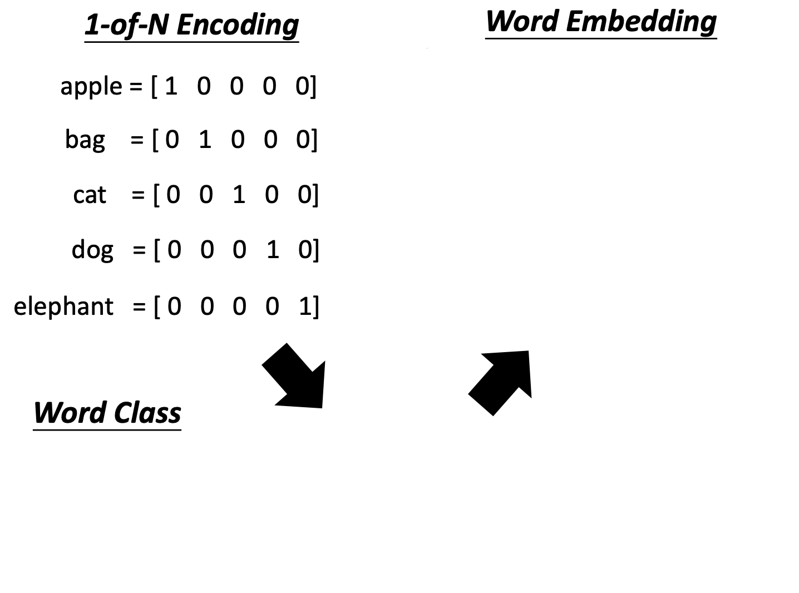
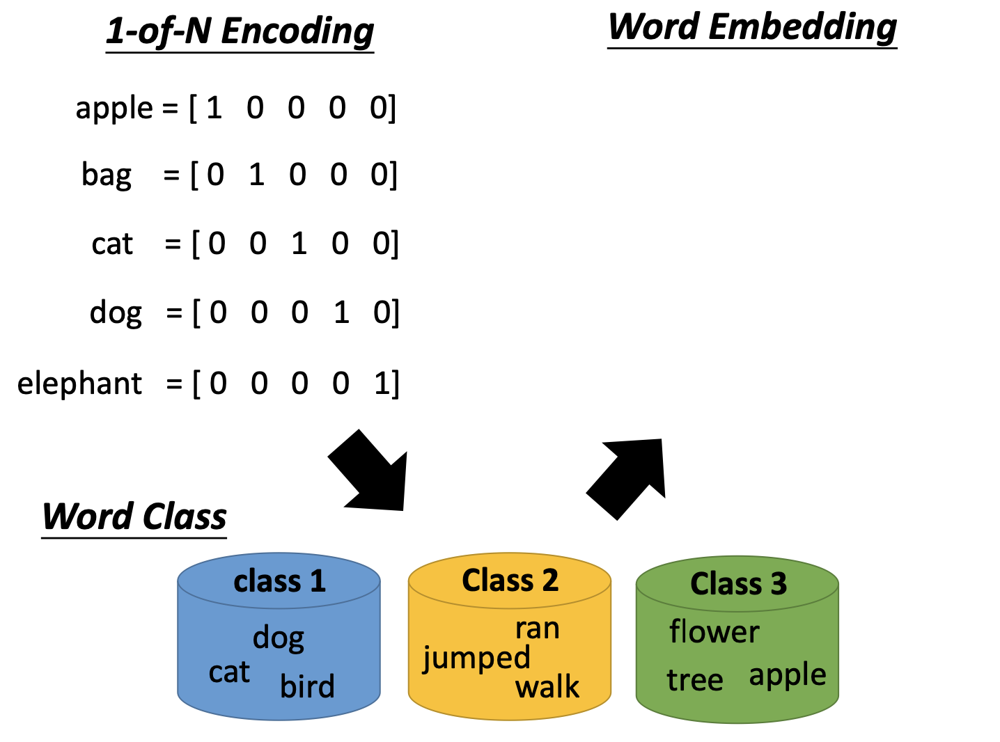
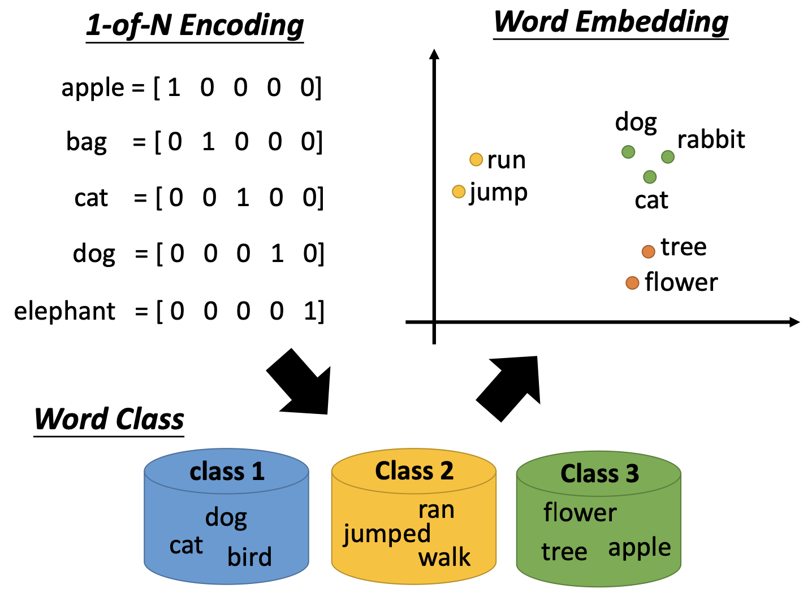
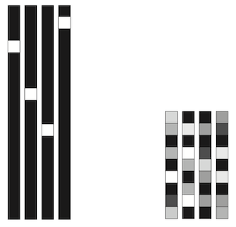
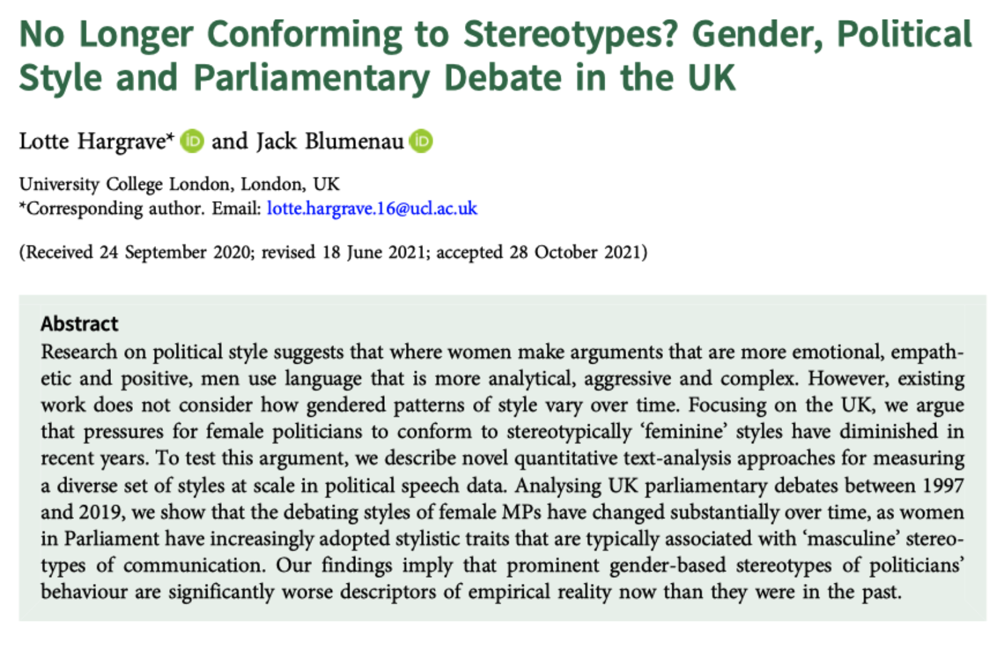
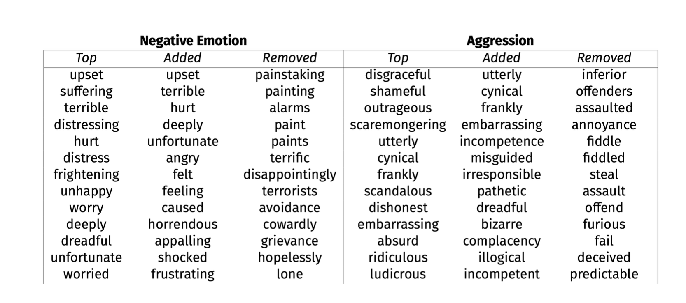
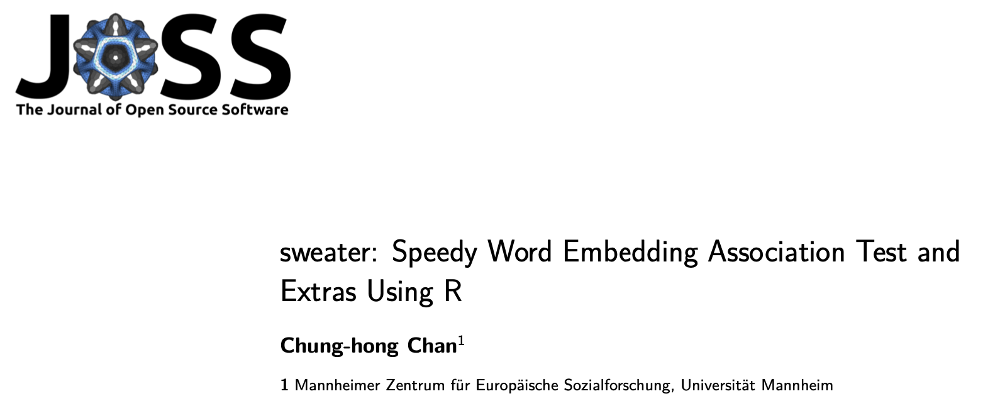
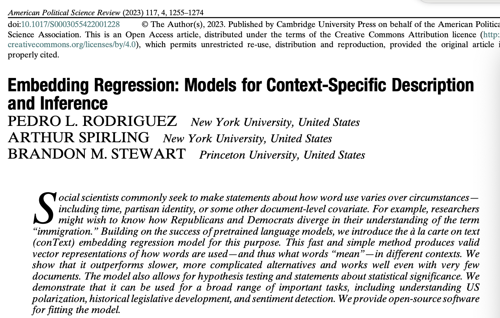
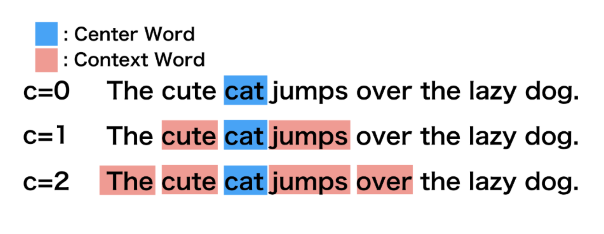
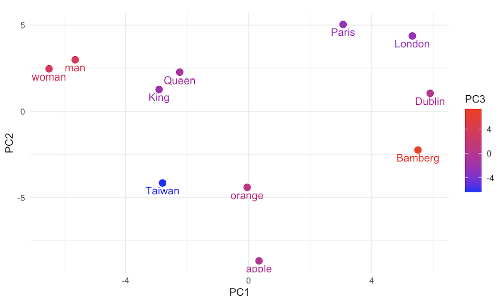

```{r setup, include = FALSE}
options(htmltools.dir.version = FALSE)
knitr::opts_chunk$set(fig.height = 3.5, fig.align = 'center',
                      dev = 'pdf') 
knitr::opts_chunk$set(cache = FALSE)
options(htmltools.dir.version = FALSE)

#ggplot2::theme_set(ggplot2::theme_bw(base_size = 8))
```


## Outline

\tableofcontents

# From Onehot and BoW to Word Embedding

## Bag of Words (BoW)
```{r include=FALSE}
library(quanteda)
txt <- c(d1 = "Shipment of gold damaged in a fire",
         d2 = "Delivery of silver arrived in a silver truck",
         d3 = "Shipment of gold arrived in a truck" )
dfmat <- txt |> 
    tokens() |> 
    dfm()
```

```{r echo=FALSE}
print(dfmat)
```

## One-Hot Encoding to Word Embeddings



---



---



Source: [Hung-yi Lee](https://speech.ee.ntu.edu.tw/~hylee/index.php)

---

## One-Hot Encoding vs. Vector Representation

<!--  -->

\begin{figure}[h]
    \centering
    \includegraphics[width=\textwidth]{images/onehot-embedding.png}
\end{figure}

Source: [François Chollet (2017)](https://www.manning.com/books/deep-learning-with-python)


## Applications in Natural Language Processing

- Machine Translation

- Text Classification: NER (sequence labeling), Part-of-Speech Tagging, Sentiment Analysis.

- Information Retrieval: Keyword Extraction, Document Summarization, Search Relevance Tuning.

## Word Embeddings for Dictionary Expansion



---

## Word Embeddings for Dictionary Expansion



- Source: [Supporting Information](https://static.cambridge.org/content/id/urn:cambridge.org:id:article:S0007123421000648/resource/name/S0007123421000648sup001.pdf) of Hargrave and Blumenau (2022)

- Blumenau, Jack E; Hargrave, Lotte, 2022, _Replication Data for: No Longer
Conforming to Stereotypes? Gender, Political Style, and Parliamentary
Debate in the UK_

## Word Embeddings and Biases

__Identify Biases:__

- Gender, Race, or Class

- Package: `sweater` (Speedy Word Embedding Association
Test & Extras using R)



## Recommendations for Political Science Research




# Word Embeddings

## General Concepts

- Learning from extensive textual information, with an emphasis on the relationships and contextual similarities between words.

<!--     -->
\begin{figure}[h]
    \centering
    \includegraphics[width=0.75\textwidth]{images/wordembedding.png}
\end{figure}


## General Concepts


\begin{figure}[h]
    \centering
    \includegraphics[width=0.75\textwidth]{images/wdeg.pdf}
\end{figure}

- Machine learn the meaning of words from reading a lot of documents without supervision

- A word can be understood by its context.

- Generating Word Vector is unsupervised.

## How to Exploit the Context?

__Count-based:__

- If two words $wi$ (dog) and $wj$ (cat) frequently co-occur, $V(wi)$ and $V(wj)$ 
would be close to each other.

- Word embeddings models take an entire corpus (either an existing one, or
our corpus) and encode relation between words into a multidimensional
space (100 or 300).

- Utilize matrix factorization techniques on matrices that represent word co-occurrences.

- Applicaitom: Glove (Global Vectors for Word Representation)  (Pennington, Socher Manning 2014)

---

## How to Exploit the Context?


__Problem for Count-based Models?__

- Fixed Word Representations

- Contextual Ambiguity

## How to Exploit the Context?

__Prediction-based Models__


\begin{figure}[h]
    \centering
    \includegraphics[width=0.95\textwidth]{images/pb-1.pdf}
\end{figure}


## How to Exploit the Context?

__Prediction-based Models__


\begin{figure}[h]
    \centering
    \includegraphics[width=0.95\textwidth]{images/pb-2.pdf}
\end{figure}

Source: [Hung-yi Lee](https://speech.ee.ntu.edu.tw/~hylee/index.php)


## How to Exploit the Context?

__Prediction-based Models__



Source: https://cbail.github.io/textasdata/word2vec/rmarkdown/word2vec.html


## How to Exploit the Context?

__Applications in Prediction-based Models__

- Word2Vec: Skip-gram CBOW (Continuous Bag of Words) 

- FastText, Flair embedding (contextual word embeddings)

---

## How to Exploit the Context?

__Problem in Prediction-based Model__

- Biases in the Training Data?

- Out-of-Vocabulary (OOV) Words Still

- Interpretability

# Word Embeddings: Application in FlaiR

## Flair NLP

__Variety of Embeddings__

- Supports multiple language embeddings and contextual Flair embeddings. 

- Easy to use, we have an flaiR package for handling same task in R.

| ID                            | Language | Embedding                                  |
|-------------------------------|----------|--------------------------------------------|
| 'en-glove' (or 'glove')       | English  | GloVe embeddings                           |
| 'en-extvec' (or 'extvec')     | English  | Komninos embeddings                        |
| 'en-crawl' (or 'crawl')       | English  | FastText embeddings over Web crawls        |
| 'en-twitter' (or 'twitter')   | English  | Twitter embeddings                         |
| 'en-turian' (or 'turian')     | English  | Turian embeddings (small)                  |
| 'en' (or 'en-news' or 'news') | English  | FastText embeddings over  wikipedia data   |

---

## Import `Sentence` and `WordEmbeddings` 

```{r include=FALSE}
library(flaiR)
```

__The Classes of `Sentence` and `WordEmbeddings`__

```{r echo=FALSE}
Sentence <- flair_data()$Sentence
WordEmbeddings <- flair_embeddings()$WordEmbeddings
```

__Download the Model__

```{r}
word2vec <- WordEmbeddings('en')
print(word2vec)
```

__Tokenize the Text__

```{r}
string <- "king queen man woman Paris London apple orange Taiwan Dublin Bamberg"
sentence <- Sentence(string)
```

---

## Embed Words in the Sentence
```{r}
word2vec$embed(sentence)
```


---

## Check Tokened Object
```{r}
sentence$tokens[1:7]
```

---

## Check the Vector of Embedding

__PyTorch Tensor__

```{r}
head(sentence$tokens[[1]]$embedding, 30)
```

__Convert the PyTorch Tensor to Vector__

```{r}
head(sentence$tokens[[1]]$embedding$numpy(), 30)
```

---

## Dimensional Reduction

__Principal Component Analysis (PCA)__
```{r echo=FALSE}
sen_list <- list()
for (i in seq_along(sentence$tokens)) {
  # store the tensor vectors to numeric vectors
  sen_list[[i]] <- as.vector(sentence$tokens[[i]]$embedding$numpy())
}
token_texts <- sapply(sentence$tokens, function(token) token$text)
sen_df <- do.call(rbind, lapply(sen_list, function(x) t(data.frame(x))))
sen_df <- as.data.frame(sen_df)
rownames(sen_df) <- token_texts
pca_result <- prcomp(sen_df, center = TRUE, scale. = TRUE)
word_embeddings_matrix <- as.data.frame(pca_result$x[,1:3] )
rownames(word_embeddings_matrix) <- token_texts
word_embeddings_matrix
```

---

## Visualize Each Word Vector on the 2D dimension

<!--  -->
\begin{figure}[h]
    \centering
    \includegraphics[width=0.95\textwidth]{images/pca.png}
\end{figure}

---

## Wrap-Up

__Reflection:__

- Do you think word embedding is outdated? If yes, can you share your thoughts?

- If not, what can we do with word embedding for social science?

__Resource:__

- Flair NLP (Python): https://flairnlp.github.io/flair/v0.13.1/

- FlaiR (R Wrapper): https://davidycliao.github.io/flaiR/


# Lab Session


## Lab Session: Tasks

- Read the instructions and install the flaiR   [documents](https://davidycliao.github.io/flaiR/index.html) for R user.

- Explore Flair NLP Official [documents](https://flairnlp.github.io/docs/intro).

- Run the code and replace it with your own text.

- Answer the final question.

<!-- ## References {.allowframebreaks} -->

\footnotesize


