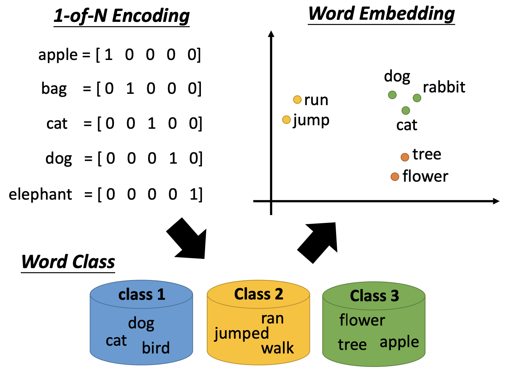
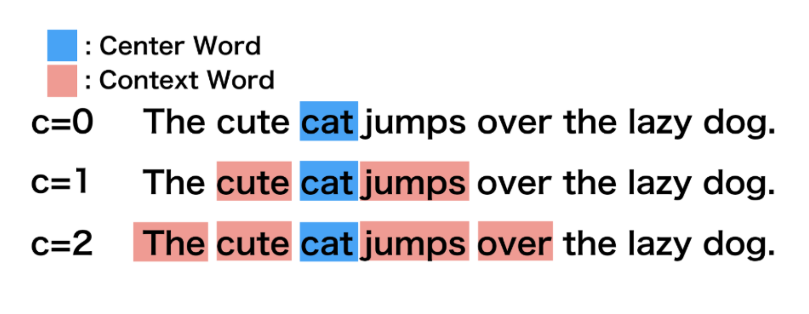
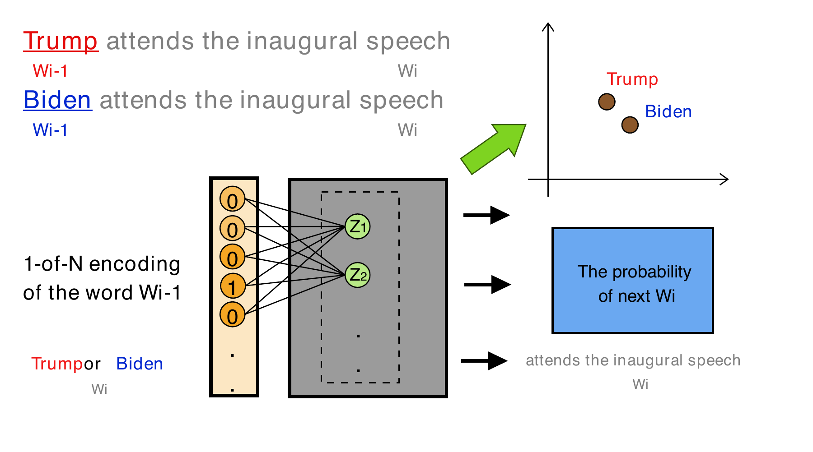
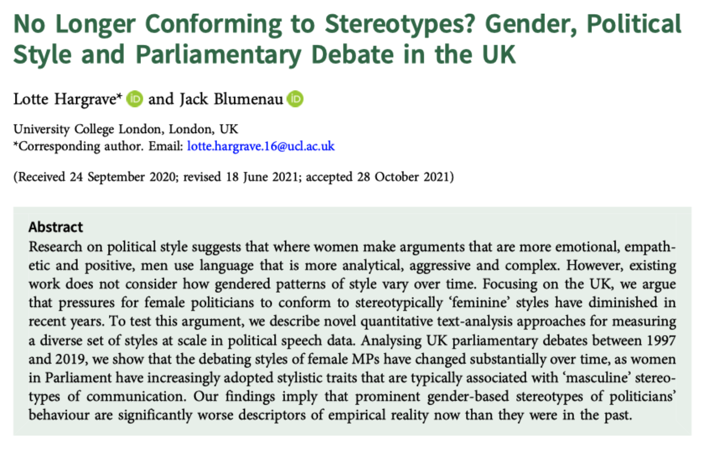
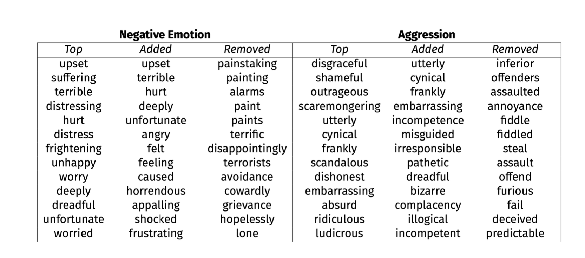

這份講義承接本課原有的 Week 11 詞嵌入講授與 Lab，補足表示單位、模型分類及讀圖所需的說明。可在 W9 課後對照閱讀，再完成[課後實作](../lab/After_Class_W9.html)。全套為 **主講 94 張、補充 18 張、四個案例、110 分鐘**；以下材料提供概念與實作延伸，Hargrave–Blumenau 是與 Case 3 對照的課後閱讀。

本頁程式均為課後閱讀範例，建立 HTML 時不執行。課堂 Lab 先沿[本課 2024 原 Lab](../lab/reference/2024_qta_lab_week_11.html)讀 Flair、詞向量與同次 PCA 圖，再接 conText 官方 Quick Start；本頁的字典權重、詞集合關聯與完整 A05 為延伸。當堂 Lab 採同頁 Code／Output 分頁，切換分頁或結果框選時，講詞也跟著同步；完整可執行程式可在 Lab 折疊區塊展開。安裝與模型快取依[本週 Flair 操作講義](../lab/Lab_Session_W9.html#flair-mini-lab)進行；離線分析使用[課後 R 腳本](../lab/after-class/after_class_lab.R)。

## 先確定：一列究竟代表什麼？ {#representation-unit}

### 文件的 BoW 與詞的 one-hot

本課原示範先把三份文件轉成 bag of words（BoW）：

```{r}
library(quanteda)
txt <- c(
  d1 = "Shipment of gold damaged in a fire",
  d2 = "Delivery of silver arrived in a silver truck",
  d3 = "Shipment of gold arrived in a truck"
)
dfmat <- dfm(tokens(txt))
dfmat
```

這個矩陣的**一列是一份文件，一欄是一個詞型**，格子記錄詞的次數。第二份文件的 `silver` 出現兩次，BoW 會保留這個次數，但不保留原來的詞序。

接著切換到詞向量時，觀察單位改變了。假設小詞表只有 `apple, bag, cat, dog, elephant`，`cat` 的 one-hot 是 `[0, 0, 1, 0, 0]`。它編碼一個詞的身分；它不是一篇文件的詞頻列。兩個不同詞的 one-hot 內積為 0，這種編碼本身沒有讓 `cat` 比 `bag` 更接近 `dog`。

| 表示 | 一列代表 | 一欄代表 | 格子或座標的意義 |
|---|---|---|---|
| 文件 BoW | 文件 | 詞型 | 詞頻，或依研究目的轉成二元值／TF–IDF |
| 詞 one-hot | 詞型 | 詞表位置 | 該詞的位置為 1，其餘為 0 |
| 靜態詞嵌入 | 詞型 | 學得的維度 | 在同一模型中，每個詞型有固定的一組連續座標 |
| 語境化 token 嵌入 | 某詞的一次出現 | 模型維度 | 座標依該次出現的輸入語境而定 |
| 平均詞向量 | 文件或指定語境 | 詞向量維度 | 把所選詞向量彙整後得到的表示 |

{fig-alt="左側以 apple、bag、cat、dog、elephant 的 one-hot 表示各詞身分；右側用示意座標讓動物、動作及植物詞形成相近位置，下方類別用來幫助理解。"}

圖中的 word classes 幫助我們理解「有關聯的用法可能對應接近的座標」。一般的詞嵌入訓練不需要先由教師把所有詞人工分成動物、動作、植物，再依這些類別配置座標。對照原書時，可讀《Text as Data》p. 78 的詞形與用法關係，以及 pp. 83–84 的訓練方式。 [原書授權預覽](https://books.google.com.tw/books?id=dL40EAAAQBAJ&pg=PA78)

**小練習。** 若把每篇演說的詞向量平均，一列又變成什麼？還有哪些資訊會在平均時消失？先寫出單位，再談「兩列很像」究竟表示什麼。

## 語境相似與直接共現是兩件事 {#distributional-context}

分布式的直覺是：**出現在相似語境的詞，可能具有相關的用法。** `cat` 和 `dog` 可以出現在相似的句法位置與周邊詞組合，即使它們不常在同一個視窗內一起出現。相反地，兩詞經常直接共現，也可能因為它們構成固定搭配、參與同一事件，或分別扮演互補角色。

因此，「A 和 B 很常一起出現」不能單獨保證它們的詞向量 cosine 很高。模型利用的是許多詞之間的整體語境關係；訓練目標和最後用來比較向量的指標也需要分開說明。GloVe 擬合經加權的詞與語境共現統計；詞向量間的 cosine 並不是某一格原始共現次數的直接重述。 [GloVe 原論文](https://aclanthology.org/D14-1162/)

{fig-alt="The cute cat jumps over the lazy dog：c為0時只有cat；c為1時加入cute與jumps；c為2時再加入The與over。"}

圖上從 *c* = 1 改為 *c* = 2，新增的是 `The` 與 `over`。這裡的寬度按 token 位置計算。研究實作還須說明是否保留句界、標點與被刪除詞的位置，因為這些決定會改變什麼算是「附近」。

**小練習。** 想像 `security` 附近常有 `Council`，另一些地方常有 `benefits`。列出原文片段可以支持的兩種用法，再說明單一靜態向量如何把這些語境彙整在一起。可接回 [W9 R05 的 KWIC](../lab/Lab_Session_W9_earlier.html#r05-static-word-vectors-and-original-contexts)。

## 模型要用兩條軸來分類 {#two-axes}

### 訓練訊號：count 與 prediction

Count-based 方法先彙整共現統計，再學出較低維度的表示。Prediction-based 方法把語境形成預測題，在反覆減少預測誤差時學出參數。兩類方法都從語料中的語境關係取得資訊；這個區分不是「使用詞頻」與「完全不使用詞頻」。

Word2Vec 的 CBOW 全名為 **Continuous Bag of Words（連續詞袋模型）**，用周邊詞預測中心詞；skip-gram 則用中心詞預測周邊詞。兩者在沒有人工逐筆語義標籤的語料上學習，預測目標由文本本身提供，亦可稱為自我監督。這不代表學得的表示已經通過政治學概念效度的檢查。 [Word2Vec 原論文](https://arxiv.org/abs/1301.3781)

### 輸出單位：static 與 contextual

| 方法／工具 | 主要訓練訊號或角色 | 這裡談的輸出 | 同一詞換句子時 |
|---|---|---|---|
| GloVe | 加權共現統計的擬合 | 靜態詞向量 | 固定模型與查詞規則下，沿用同一詞型向量 |
| Word2Vec CBOW／skip-gram | 預測中心詞／周邊詞 | 靜態詞向量 | 沿用同一詞型向量 |
| fastText 詞向量 | 預測並結合字元片段資訊 | 靜態詞向量 | 字元片段有助於構成詞的表示，並不因句中語境改成另一個向量 |
| `FlairEmbeddings` | 語言模型的語境訊號 | 語境化 token 向量 | 依該次出現的輸入語境計算 |
| Flair | NLP 工具套件 | 取決於載入的類別 | 要查看實際使用的是 `WordEmbeddings`、`FlairEmbeddings` 或其他類別 |

fastText 的 subword 設計有助於表示罕見詞及部分未見詞；能否在某個介面動態生成 OOV 向量，仍取決於保留的模型資訊。Flair 的 `WordEmbeddings` 查表介面和完整 subword 模型不可直接畫上等號。 [fastText 原論文](https://aclanthology.org/Q17-1010/) · [Flair 靜態詞向量文件](https://flairnlp.github.io/docs/tutorial-embeddings/classic-word-embeddings) · [Flair 語境化表示文件](https://flairnlp.github.io/docs/tutorial-embeddings/flair-embeddings)

固定表示、多義詞、偏見與 OOV 也不是只屬於 count-based 或 prediction-based 其中一類的問題。先認出這兩條分類軸，才能判斷某個模型是否回應了研究所需的語境差異。

### 從預測網路讀出什麼？

{fig-alt="簡化神經網路展示詞的輸入編碼，經過隱藏表示後形成詞預測；網路圖用來說明訓練機制。"}

讀圖時依序問：輸入是哪些詞？模型要預測什麼？哪一組參數會作為詞的表示？哪些資訊是訓練語料自己提供的？圖的少量節點方便我們追蹤計算；正式模型可以有不同的詞表大小、視窗與維度。圖上的節點位置、連線或示意分群本身不構成政治學發現。

政治學應用還要接上「表示哪個單位、比較誰、如何驗證」：例如 Case 1 才進一步加入政黨×屆期資訊，Case 4 則把單次用法的語境表示放入群體比較。這些研究設計步驟需由各原研究另外交代。

## NLP 的用途是一張工作地圖 {#nlp-tasks}

詞向量可作為多種 NLP 任務的表示或模型元件。下表用來辨認輸入和輸出，不表示抽出一組詞向量就已經完成任務。

| 任務 | 輸入與輸出 | 可想像的政治文本問題 | 還需要的檢查 |
|---|---|---|---|
| 機器翻譯 | 一種語言的序列→另一種語言的序列 | 如何讓跨國政綱進入共同分析語言？ | 翻譯是否保留政治概念與修辭差異 |
| 文本分類 | 句子／文件→類別或分數 | 一句政綱是否訴諸懷舊？ | 適用語料的標記資料與留出驗證 |
| 序列標記 | 每個 token→實體、詞性等標籤 | 哪些片語是人物、政黨、機構？ | 位置、邊界與標籤的正確性 |
| 資訊檢索 | 查詢→排序後的文本片段 | 哪些發言值得回讀來理解移民用法？ | 排名是否找得到相關片段，有沒有遺漏不同用法 |
| 摘要與關鍵詞 | 文件→濃縮內容或詞組 | 如何整理議題論述以協助閱讀？ | 是否忠實保留原文主張和例外 |

Named entity recognition 與 part-of-speech tagging 通常屬於序列標記，與「整份文件只輸出一個類別」有不同的觀察單位。真正的應用要用相應的任務模型與評估資料；本週抽向量及 PCA 的操作練習，先處理其中的表示環節。

## 課後對照：從種子詞到連續字典權重 {#hargrave-blumenau}

### Hargrave 與 Blumenau 的政治問題

Hargrave 與 Blumenau（2022）研究英國國會 1997–2019 年的發言：性別化的政治風格差異是否隨時間改變？本課原圖帶出論文與字典表。這裡把它作為 **Case 3 的課後方法對照**，閱讀重點是風格量測怎麼形成。 [期刊原文](https://doi.org/10.1017/S0007123421000648)

{fig-alt="Hargrave與Blumenau論文標題、作者及摘要的原課件截圖，研究英國國會性別與政治風格的變化。"}

### 原方法如何計分？

作者用國會語料訓練 GloVe，對六種風格各設種子字典。把種子向量平均後，計算各詞與它的 cosine，再轉成連續詞權重：

$$
q_w^s=\frac{1}{1+\exp[-40(\cos(v_w,\bar v_s)-0.35)]}.
$$

詞權重與句內 TF–IDF 權重結合，得到句子風格分數；演說再以句長加權彙整。這條流程不是「先劃定新增詞清單，再把入選詞全部當成 1」。 [正文量測段落與式（1）](https://www.cambridge.org/core/journals/british-journal-of-political-science/article/no-longer-conforming-to-stereotypes-gender-political-style-and-parliamentary-debate-in-the-uk/90A859B95E11AF370728DC29B778891F) · [出版社附錄 S5–S7，式 S1–S2](https://static.cambridge.org/content/id/urn:cambridge.org:id:article:S0007123421000648/resource/name/S0007123421000648sup001.pdf#page=5)

### Top、Added、Removed 怎麼讀？

{fig-alt="Table S1截圖比較Negative Emotion與Aggression，分成Top、Added、Removed三欄，例如incompetence在Aggression的Added，assault在Removed。"}

| 原圖欄名 | 定義 |
|---|---|
| Top | 按模型詞權重排序的高分詞 |
| Added | 原種子字典沒有、但模型給高權重的詞 |
| Removed | 原種子字典有、但模型給低權重的詞 |

這些欄名描述模型權重與原種子字典的關係；**Removed 不表示作者逐詞人工否決**。原圖只截取表格前面部分；完整 Table S1 的詞級檢查之外，附錄另有句子與人工驗證。 [欄名定義 S8–S9](https://static.cambridge.org/content/id/urn:cambridge.org:id:article:S0007123421000648/resource/name/S0007123421000648sup001.pdf#page=8) · [Table S1 此面板 S11](https://static.cambridge.org/content/id/urn:cambridge.org:id:article:S0007123421000648/resource/name/S0007123421000648sup001.pdf#page=11)

| 對照問題 | Hargrave–Blumenau 課後閱讀 | Müller–Proksch，主講 Case 3 |
|---|---|---|
| 嵌入在做什麼？ | 將與種子概念的接近程度轉成詞權重 | 為擴充懷舊字典找候選項目 |
| 人的角色在哪裡？ | 定義種子與概念，另外驗證量測 | 定義種子，人工檢查候選是否適合收錄，再驗證量測 |
| 進入文本計分的是什麼？ | 連續詞權重與 TF–IDF | 各種方法形成的政綱懷舊分數；主講追蹤擴充字典方案 |

Case 3 的方法與驗證應依該原研究閱讀。這兩個流程都使用近鄰資訊，後續量測步驟卻不同。 [Müller–Proksch 原文](https://doi.org/10.1017/S0007123423000571)

**課後任務。** 在圖中找 `deeply`、`painting`、`terrorists`、`incompetence`、`frankly`、`assault`。先抄下它們的風格與欄位，再各寫一句可能符合、可能不符合該風格的國會發言。你的判斷能提出哪些語境證據？若要評估模型權重是否合理，還應抽讀什麼？學生在此進行的是效度檢查練習，不能將自己的判斷取代成作者曾做過的人工刪詞記錄。 [A01 完整作業](../lab/After_Class_W9.html#a01-dictionary-screening)

## Bias：先建立詞組關聯的比較設計 {#association-design}

本課原材料介紹 `sweater`，用來計算多種詞嵌入關聯量。首先需要指定**模型、目標詞、屬性詞及統計量**。例如，比較同一目標詞和兩組屬性詞的平均 cosine：

$$
s(w,A,B)=\frac{1}{|A|}\sum_{a\in A}\cos(v_w,v_a)
-\frac{1}{|B|}\sum_{b\in B}\cos(v_w,v_b).
$$

這是詞組關聯的基本量；完整 WEAT 還包括兩組目標詞的比較、效應量與相應檢定。只算一個 cosine 差，尚不能當成完成 WEAT。原課件的套件論文首頁及概念示意也不提供本班資料的新結果。 [sweater 軟體論文](https://doi.org/10.21105/joss.04036) · [套件的 query 設計說明](https://github.com/gesistsa/sweater#notation-of-a-query)

| 必須先寫下的選擇 | 要回答的問題 |
|---|---|
| 模型與語料 | 哪個時期、來源與語言的分布被編入向量？ |
| 目標詞與屬性詞組 | 詞組是否對應所要研究的概念，是否有多義詞或詞形混雜？ |
| 統計量與比較 | 比較單詞、詞組、模型或時期？單位是否一致？ |
| 敏感度與驗證 | 換合理的詞組、模型或取樣後，結論是否改變？原文支持哪種解釋？ |

得到的數值首先描述所選模型與詞組的關聯。要討論社會群體、個人的態度或歧視機制，還需要對應的資料、測量效度與識別設計。小型詞清單可以練習計算，研究推論的範圍須另外建立。 [A02 詞組關聯練習](../lab/After_Class_W9.html#a02-word-set-association)

## Flair：原講授與原 Lab 用了不同模型 {#flair-models}

### 兩份原材料各自在做什麼？

| 本課材料 | 實際載入 | 詞向量與詞清單 |
|---|---|---|
| 原 Week 11 講授 Rmd | `WordEmbeddings('en')` | 300 維靜態 FastText；開頭為小寫 `king queen` |
| 原 Week 11 Lab Qmd | `WordEmbeddings('glove')` | 100 維靜態 GloVe；開頭為 `King Queen` |
| W9 Flair 實作 | 已準備的 GloVe 快取 | 沿用原 Lab 的十一詞清單，另比較三個 `security` 語境 |

原講授將物件命名為 `word2vec`，這個變數名稱不會改變它實際載入的 FastText 模型。`WordEmbeddings('en')` 的模型對應可查 [Flair 官方程式中的載入設定](https://github.com/flairNLP/flair/blob/v0.15.1/flair/embeddings/token.py)；`glove` 的 100 維設定見[靜態詞向量文件](https://flairnlp.github.io/docs/tutorial-embeddings/classic-word-embeddings)。100 是本例所載入版本的維度，GloVe 方法本身不限定只有 100 維。

Flair 是 Python 工具，flaiR 是 R 介面。把字串交給 `Sentence` 會建立 token 物件，再由選定的 embedding 類別替各 token 加上向量；稱為 `Sentence` 的容器也可裝十一個練習單詞，不表示這串詞形成自然句子，更不表示使用的是句向量模型。 [flaiR 文件](https://davidycliao.github.io/flaiR/) · [W9 F00–F03](../lab/Lab_Session_W9.html#flair-mini-lab)

### 抽取 token 時保留位置

原材料的核心操作是逐 token 讀取 `.embedding` 並轉成 R 向量。研究文本可能在同一句中多次出現同一個詞；資料表應另外保留句子 ID、token 位置與原字串，不能只用詞當唯一列名。 [A03 抽取練習](../lab/After_Class_W9.html#a03-token-extraction)

本週用三句建構例句比較靜態查詞：`Social security supports households.`、`The United Nations Security Council met.`、`Energy security matters for jobs.`。這三句談不同事情；靜態 GloVe 對所查得的同一詞型沿用相同向量。要比較局部用法，必須再定義每次出現的語境表示與 metadata，或選擇適當的語境化模型。

### 安裝、環境與離線路線

原 2024 Lab 的安裝段落保留當時版本資訊。現在實作請用 W9 的 F00–F03：課前準備獨立 Python 環境與模型快取，保留核心 Lab session，另開乾淨 R session 嘗試 flaiR；必要時在同一 Python 環境改走 Python 路徑。只需離線分析時，可直接讀本週提供的向量 CSV，不必再次安裝套件或下載模型。 [目前操作步驟](../lab/Lab_Session_W9.html#f00-prepare-python-and-the-model) · [reticulate 選擇 Python 的官方說明](https://rstudio.github.io/reticulate/reference/use_python.html)

## PCA：表格與圖必須來自同一輪計算 {#pca-consistency}

原講授與原 Lab 都用 `prcomp(..., center = TRUE, scale. = TRUE)`，但模型、維度與詞的大小寫有差異。不能把其中一輪的 PCA 座標表，接到另一輪的圖來解釋。

```{r}
# 假設 vectors 是同一模型、同一批詞的數值矩陣。
# 這裡只展示流程；離線可執行版本見課後腳本。
fit <- prcomp(vectors, center = TRUE, scale. = TRUE)
coordinates <- fit$x[, 1:3, drop = FALSE]
variance_share <- fit$sdev^2 / sum(fit$sdev^2)
```

重新計算時，依序檢查：

1. 詞清單、大小寫、順序與 OOV 處理是否相同。
2. 向量是否來自同一個模型；一列是否對應同一單位。
3. 是否做單位長度正規化、中心化或逐維標準化。這些轉換的意義不同。
4. 表格、圖與保留變異比例是否取自同一個 `fit`。
5. 圖上的接近程度是否也得到完整空間 cosine 的支持。

`scale. = TRUE` 先改變各維的相對尺度，再做 PCA；二維投影會進一步丟掉資訊。PCA 軸的正負號可以翻轉，不能把軸的正負直接解釋為政治價值。選入不同詞也會改變估計投影的基準。先辨認這些改變，才能討論詞群是否在圖上接近。

原 Lab 的二維圖用 PC1、PC2 畫座標，以顏色表示 PC3；顏色是第三主成分，沒有事先指定為某個政治概念。原 Lab 的 bonus 則用 Plotly 畫同一輪 PC1–PC3 的可旋轉三維圖。三維圖多呈現一個方向，仍然只是原空間的投影；旋轉畫面不會恢復其餘維度。若要延續這項 bonus，請從同一份 `coordinates` 取前三欄，不要另配別輪結果。

課後腳本讀取 W9 已提供的 [GloVe 十一詞向量](../lab/flair/example-output/word-vectors.csv)，在同一輪分析中輸出 [cosine](../lab/after-class/example-output/word-cosine.csv)、[PCA 座標](../lab/after-class/example-output/word-pca.csv)與[圖](../lab/after-class/example-output/word-pca.png)。第 85 張課堂讀圖與課後檢查都使用這一輪保存向量的結果，二維 PC1 與 PC2 合計保留 38.24% 變異；完整 PCA 計算、選詞與模型比較留課後。使用其他模型或詞清單時，請把各項輸出一起重算。 [A04 PCA 敏感度與近鄰檢查](../lab/After_Class_W9.html#a04-pca-sensitivity) · [同次計算的檢查紀錄](../lab/after-class/example-output/pca-check.json)

## 從靜態查詞接回 Case 4：embedding regression {#embedding-regression-bridge}

同一詞型在靜態模型中只有一個向量；Case 4 要比較的是**同一目標詞的不同次用法**。先替每次出現保留周邊詞與黨別／性別，再將周邊詞向量平均，套用與模型維度相符的 à la carte（ALC）轉換，才得到可供回歸比較的語境向量。黨別與性別係數是 D 維差向量；其長度描述調整後差異的大小。

`conText(immigration ~ party + gender, data = toks, ...)` 的入口是清理後、帶有 party／gender docvars、尚未取目標詞視窗的 tokens。函式內部取窗，再經 `dfm()`、`dem()` 建立每次使用的向量並回歸。以課後 A05 的 D/F 參照為例，截距是 DF 的預測向量，RF 是「截距＋`party_R`」。取 `party_R` 的長度回答差多少；對這兩個群體向量找近鄰、回讀語境，才解釋差在哪裡。 [conText 官方 Quick Start](https://prodriguezsosa.r-universe.dev/conText/doc/quickstart.html)

conText 3 的 `normed.estimate.orig` 報告平方長度，另有偏誤修正的平方長度；2023 年論文 Figure 5 使用 L2 長度。A05 明確另算 `l2_length`，不將新版欄位或套件示例數值倒填成原圖結果。 [官方版本與距離更新說明](https://github.com/prodriguezsosa/conText/blob/master/updates/bias_in_distance_measures.md)

課堂 Lab 後十五分鐘依官方 Quick Start 讀 C00–C05；[課後 A05](../lab/Embedding_Regression_W9.html)再沿著這條路擴充實作。R 離線基準使用 conText 內附且互相配套的語料、300 維向量與轉換；Flair GloVe 延伸改用 100 維向量，並**重新估計 100×100 轉換**。不能把 300 維轉換套到 100 維資料，也不能用跨模型的係數長度大小判斷哪個模型較好。本課後延伸未做重抽樣，不報信賴區間或顯著性；教學輸出也不當成原論文 Figure 5 的重製。 [Case 4 原論文](https://doi.org/10.1017/S0003055422001228) · [flaiR 教學](https://davidycliao.github.io/flaiR/articles/tutorial.html#extending-contexts-embedding-regression)

## 課後路線與回到研究問題 {#after-class-route}

| 任務 | 從本講義帶走的概念 | 交付的判讀 |
|---|---|---|
| [A01 字典表](../lab/After_Class_W9.html#a01-dictionary-screening) | Top／Added／Removed 是模型權重與種子字典的關係 | 用語境說明一個高權重與一個低權重詞應如何驗證 |
| [A02 詞組關聯](../lab/After_Class_W9.html#a02-word-set-association) | 先設計詞組與比較，才解釋關聯量 | 說明一次合理的替代詞組檢查與推論範圍 |
| [A03 token 抽取](../lab/After_Class_W9.html#a03-token-extraction) | 詞型與一次出現需要不同索引 | 保留 token 位置、原字串及向量 |
| [A04 PCA](../lab/After_Class_W9.html#a04-pca-sensitivity) | 同一輪資料、轉換、表格與圖 | 對照完整空間與二維結果，指出資訊損失 |
| [A05 Embedding regression](../lab/Embedding_Regression_W9.html) | 用法向量、metadata 與配套 ALC 轉換 | 分別解釋差異大小、近鄰與語境證據 |

最後用自己的研究題目寫四句話：我要比較哪個政治現象？一列代表文件、詞型還是一次用法？哪個步驟把向量轉成可回答問題的量？什麼原文或外部資料可以檢查這個答案？可搭配 [W9 四案例對照](../reading/README.md#cases)與[研究設計投影片](../slide/week9.html#/design-an-embedding-study-in-one-paragraph)。

本課原來問「word embeddings 是否已經過時？」時，可以把回答拆成具體判準：靜態表示能否完成眼前的詞型關聯或字典任務？問題是否需要分辨一次出現的語境？換模型後能否以同一份驗證資料改善答案？先回答研究需求和驗證結果，再決定採用哪種表示。

## 本課材料與操作入口 {#course-materials}

原課件是本課教學材料，保留其版本供對照。正式研究及軟體來源另列於下節。

- [原 Week 11 講授 Rmd](../course-materials/qta-week11-original/qta_2024_week_11.Rmd)：BoW、one-hot、語境學習、NLP 用途、字典／bias 與 Flair。
- [原 Week 11 Lab Qmd](../course-materials/qta-week11-original/2024_qta_lab_week_11.qmd)：原 GloVe 抽取與 PCA 操作。
- [W9 主要 Lab](../lab/Lab_Session_W9.html)、[Flair 操作](../lab/Lab_Session_W9.html#flair-mini-lab)、[課後 Lab](../lab/After_Class_W9.html)、[離線 R 腳本](../lab/after-class/after_class_lab.R)。

## 研究與軟體來源 {#research-software-sources}

- Grimmer, Justin, Margaret E. Roberts, and Brandon M. Stewart. 2022. *Text as Data: A New Framework for Machine Learning and the Social Sciences*. Princeton University Press, Chapter 8。本講義使用可核對的 pp. 78、83–84。 [出版社](https://press.princeton.edu/books/paperback/9780691207551/text-as-data) · [授權預覽](https://books.google.com.tw/books?id=dL40EAAAQBAJ&pg=PA78)
- Mikolov, Tomas, Kai Chen, Greg Corrado, and Jeffrey Dean. 2013. “Efficient Estimation of Word Representations in Vector Space.” [作者原論文](https://arxiv.org/abs/1301.3781)
- Pennington, Jeffrey, Richard Socher, and Christopher D. Manning. 2014. “GloVe: Global Vectors for Word Representation.” *EMNLP*, 1532–1543. [原論文與 DOI](https://aclanthology.org/D14-1162/)
- Bojanowski, Piotr, Edouard Grave, Armand Joulin, and Tomas Mikolov. 2017. “Enriching Word Vectors with Subword Information.” *Transactions of the Association for Computational Linguistics* 5: 135–146. [原論文與 DOI](https://aclanthology.org/Q17-1010/)
- Hargrave, Lotte, and Jack Blumenau. 2022. “No Longer Conforming to Stereotypes? Gender, Political Style and Parliamentary Debate in the UK.” *British Journal of Political Science* 52(4): 1584–1601. [DOI](https://doi.org/10.1017/S0007123421000648) · [出版社附錄](https://static.cambridge.org/content/id/urn:cambridge.org:id:article:S0007123421000648/resource/name/S0007123421000648sup001.pdf)
- Müller, Stefan, and Sven-Oliver Proksch. 2024. “Nostalgia in European Party Politics: A Text-Based Measurement Approach.” *British Journal of Political Science* 54(3): 993–1005. [DOI](https://doi.org/10.1017/S0007123423000571)
- Chan, Chung-hong. 2022. “sweater: Speedy Word Embedding Association Test and Extras Using R.” *Journal of Open Source Software* 7(72): 4036. [DOI](https://doi.org/10.21105/joss.04036) · [軟體](https://github.com/gesistsa/sweater)
- Flair 官方文件：[Classic Word Embeddings](https://flairnlp.github.io/docs/tutorial-embeddings/classic-word-embeddings)、[FlairEmbeddings](https://flairnlp.github.io/docs/tutorial-embeddings/flair-embeddings)。[flaiR R 介面](https://davidycliao.github.io/flaiR/)及 [reticulate interpreter selection](https://rstudio.github.io/reticulate/reference/use_python.html)。軟體類別與載入設定核對日期：2026-11-11。
