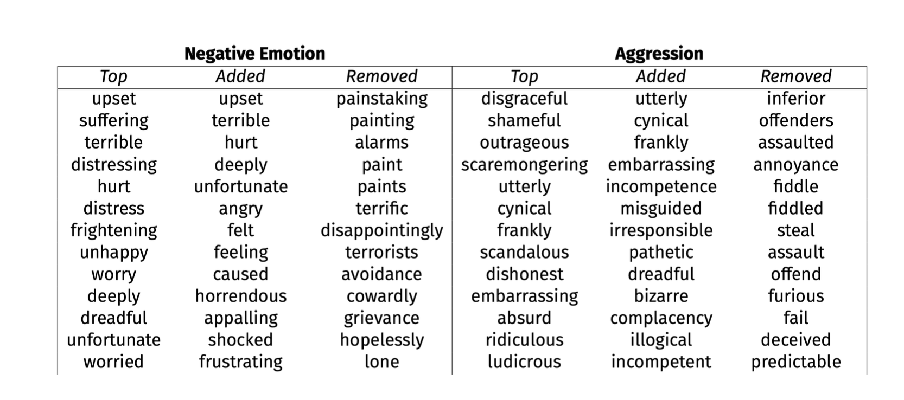
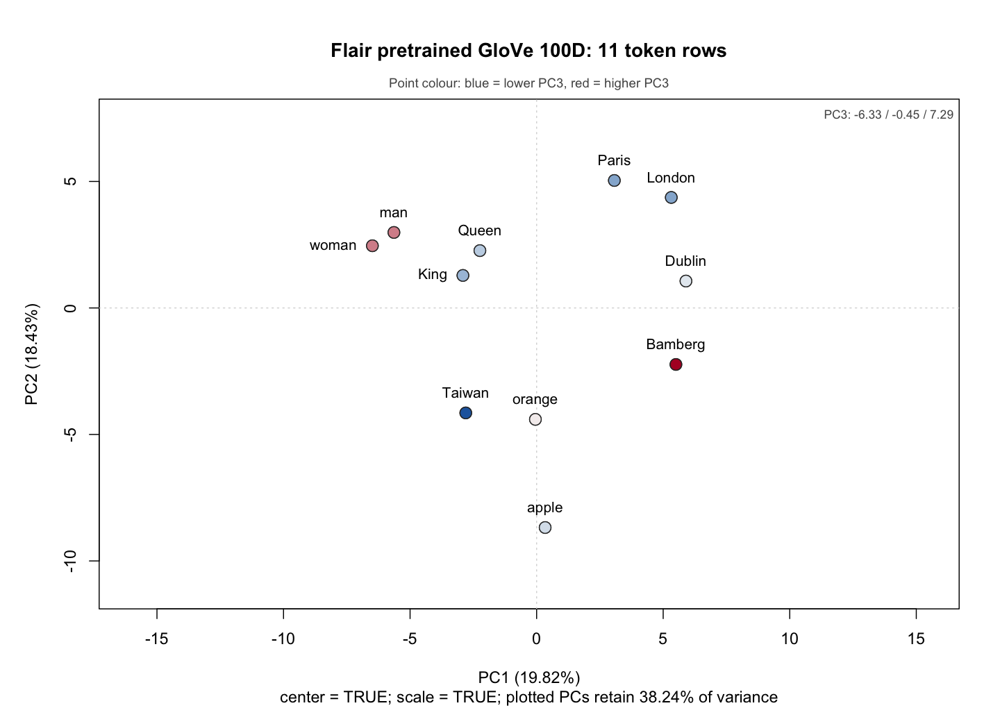

完成 [W9 課堂 Lab](Lab_Session_W9.html) 後，先讀[詞嵌入補充講義](../handout/Word_Embeddings_Supplement.html)，再依序完成 A01–A04。A03 的新句子、A04 的第二模型與 3D 圖需要已備妥的環境，可稍後補做。

課堂先在第 77–79 張用四分鐘導讀目的與兩段流程，接第 80 張五分鐘休息。三十分鐘 Lab 從 17:40 開始：第 81–85 張沿[本課 2024 原 Lab](reference/2024_qta_lab_week_11.html)讀 Flair、security／E06 與同輪 PCA 圖；17:55–18:10，第 86–91 張沿 conText 官方 Quick Start 讀 ALC、近鄰、語境與回歸／E04。18:10 進第 92 張研究設計。Lab 每一步在同頁切換 Code／Output，各分頁和結果框選都有對應講稿。完整 PCA 與進階 A05 留課後；先前 R00–R06 等練習保留在[先前版本講義](Lab_Session_W9_earlier.html)。

**先做離線部分。** [課後 R 腳本](after-class/after_class_lab.R)只使用 base R，讀取已保存的 [11 × 100 GloVe 向量](flair/example-output/word-vectors.csv)，不需載入 Flair 或下載模型。先做 A01 讀圖、A02 詞集合關聯和 A04 的原始向量重算。A03 則使用課堂已通過 F00 的 R 或 Python 環境。

| 任務 | 要交的觀察 | 驗收重點 |
|---|---|---|
| A01 字典權重與語境 | 六個詞的語境判讀表 | 分清原作者的模型詞權重與自己的人工效度判斷 |
| A02 詞集合關聯 | 覆蓋率、兩個關聯差、一道研究問題 | 由完整向量算 cosine，說明詞集合如何決定問題 |
| A03 自訂句子，選做 | 有重複詞的 token 向量 CSV | 每列保留 position、token、唯一 id，並報可用向量數 |
| A04 同次 PCA 與敏感度 | 座標表、圖、檢查紀錄、兩項比較 | 表圖同源；區分標準化、降維與選詞造成的變化 |

### 保存原課件，辨認這次使用的模型

模型設定可對照[原 Week 11 講授 Rmd](../course-materials/qta-week11-original/qta_2024_week_11.Rmd)、[原 Lab Qmd](../course-materials/qta-week11-original/2024_qta_lab_week_11.qmd)。先比較下表的模型、維度與詞表，再做 A03 的自訂句子、A04 的模型比較與 Bonus 3D plot。

| 來源 | 原來的呼叫與詞表 | 本頁如何承接 |
|---|---|---|
| 原講授 Rmd | `WordEmbeddings('en')`；300 維 FastText；`king queen` 小寫。物件雖命名 `word2vec`，載入的模型仍是 FastText。 | 核對實際載入的模型與維度；它的圖不能當成這份 GloVe 的重算結果。 |
| 原 Lab Qmd | `WordEmbeddings('glove')`；100 維 GloVe；`King Queen` 大寫。 | 使用 W9 已保存的同一組 11 × 100 向量；PCA 延續 `center = TRUE, scale. = TRUE`。 |
| W9 R05 | 719 篇教學演說所供應的 30 維靜態 GloVe | 它是另一個模型；原 R05 選做 PCA 從單位長度向量出發，變換方式也不同。 |

向量 CSV 的 token 標籤保留原來大小寫。讀取預訓練模型時如何處理大小寫或未收錄詞，取決於該模型的 lookup 規則；不能只看標籤就假定使用了兩個不同詞向量。安裝一律沿用 [W9 F00](Lab_Session_W9.html#f00-prepare-python-and-the-model)，不照搬原檔中的舊安裝版本或全域環境設定。

## A01 讀懂 Top、Added、Removed，再做語境效度判斷 {#a01-dictionary-screening}

先讀 Hargrave 與 Blumenau 附錄的 **S8–S9**，了解如何由詞嵌入產生字典權重，再看 **Table S1，印刷頁 S11** 的局部表格。 [研究原附錄](https://static.cambridge.org/content/id/urn:cambridge.org:id:article:S0007123421000648/resource/name/S0007123421000648sup001.pdf)

{fig-alt="Hargrave 與 Blumenau 附錄 Table S1 的局部表格，列出 Negative Emotion 與 Aggression 兩種測量的 Top、Added、Removed 詞。這些欄位依模型詞權重分類。"}

**先確定三欄的定義。** Top 顯示模型權重最高的 30 個詞；Added 顯示高權重而不在種子字典中的詞；Removed 顯示原本在種子字典中、模型卻給低權重的詞。這些欄名描述**連續模型權重與種子字典的關係**。表中的 Removed 並不表示作者看過每個詞後人工否決。

這個方法先以種子詞向量的平均表示概念，再由 cosine 經 sigmoid 轉成連續詞權重；原附錄設定為 150 維 GloVe、sigmoid 的 `a = 40, c = .35`。詞權重配合 TF–IDF 計算句子分數，再依句長加權彙整成文件分數。 [附錄 S5–S8](https://static.cambridge.org/content/id/urn:cambridge.org:id:article:S0007123421000648/resource/name/S0007123421000648sup001.pdf)

### 任務與驗收

取六個可見詞：Negative Emotion 的 Added `upset`、`deeply`，Removed `painting`、`terrorists`；Aggression 的 Added `incompetence`，Removed `assault`。

1. 每詞寫兩個議會發言式的句子，一句可能反映該概念，另一句可能不反映；說明同一個詞在兩句中的判讀為何不同。
2. 在表中記錄「原表欄位／你要測的概念／兩個語境／是否需要更多上下文／判斷理由」。例如討論反恐政策的 `terrorists`，是否等同發言者表達負面情緒？`deeply` 是單獨提供情緒，還是需要後面的詞才能判定？
3. 對照 W9 Case 3：Müller 與 Proksch 使用近鄰詞產生候選，再由人工篩選擴充字典。寫兩句說明它和此處「連續詞權重」的測量流程差別。

**驗收。** 六詞都有兩個語境與理由，並註明這是你對語境的效度判斷。保留原表分類，勿將自己的判斷寫成作者的人工接受或刪除紀錄。依附錄 S9，分清句子是在討論某個政策領域，還是發言者在表達情緒。

## A02 由完整向量計算一個詞集合關聯差 {#a02-word-set-association}

使用已保存的向量，設定兩個目標詞 `King`、`Queen`；參照詞集合 A 為 `{man}`，B 為 `{woman}`。對每個目標詞 $w$ 計算

$$
s(w;A,B)=\operatorname{mean}_{a\in A}\cos(w,a)
-\operatorname{mean}_{b\in B}\cos(w,b).
$$

這個值回答：「在這份模型中，該目標詞與 A 的平均 cosine，比與 B 的平均 cosine 高多少？」再比較 $s(\text{King})-s(\text{Queen})$。它使用原來的 100 維向量，沒有經過 PCA 或逐維標準化。

### 執行與預期輸出

在課程根目錄開啟 R。以下範例共用 `after_dir`、`d`。

```{r}
after_dir <- "W9/lab/after-class"
source(file.path(after_dir, "after_class_lab.R"))
d <- read_token_vectors("W9/lab/flair/example-output/word-vectors.csv")
dim(d$vectors)                      # 11 100
d$rows                             # position / token / id
a <- word_set_association(d)
a$coverage
a$scores
a$first_minus_second
```

四個詞應全部 `covered`。輸出四捨五入如下：

```text
token   mean_cosine_A  mean_cosine_B  association_difference
King          0.5119         0.3657                  0.1461
Queen         0.4740         0.5095                 -0.0355
King minus Queen association difference: 0.1816
```

**怎麼解讀？** 在這組選定詞與模型中，`King` 相對 `{man}`／`{woman}` 的關聯差，大於 `Queen` 的關聯差。這四個詞有直接語意關係；這項計算用來練習關聯差，不能據此推論社會偏誤或人群態度。這裡沒有標準化效應量、置換分布或 p 值，也沒有執行 WEAT 檢定。

### 改寫成一個研究設計

提出一個與姓名、職業或政治群體有關的問題，**先列出**目標詞與兩組參照詞、集合選擇理由、模型語料、語言與時間範圍，以及需要的人工作業或外部驗證。確認向量 CSV 包含所選詞後，用 `word_set_association()` 代入三個集合。若缺詞，先記錄覆蓋問題，待相應向量備妥後再執行。

**驗收。** 交兩個目標詞的平均 cosine、差值與完整 coverage 表。再交研究問題和至少一個詞集合替代方案。缺詞、零向量或重複詞標籤有歧義時，函數會回傳 `incomplete_coverage`，不計算關聯差；先處理覆蓋問題。非零向量只表示有可計算的向量，不能單獨保證詞義或領域符合研究。

```{r}
# 故意使用未收錄於這份小 CSV 的詞，觀察 guard：
guard <- word_set_association(d, targets = c("King", "nurse"))
guard$coverage
guard$status                       # "incomplete_coverage"
guard$first_minus_second            # NA
```

## A03 換自己的句子，安全保留重複 token，選做 {#a03-token-extraction}

使用**已通過 F00、已備妥模型**的環境，依 [R 物件抽取](Lab_Session_W9.html#flair-r-vectors)或 [Python token 抽取](Lab_Session_W9.html#flair-python-vectors)擇一完成。R 另開乾淨 session，避免在已連接另一個 Python 的 session 重綁環境。

使用句子 `Energy security and social security both matter.`。同一個詞會出現兩次；每個 token occurrence 應有自己的列 ID。分詞器也可能把標點切成獨立 token，所以以實際 token 清單核對列數，不能直接用空格數猜測。

### R 路線：沿用已建立的 Sentence 與 embedding

先依上述 R 物件抽取段落建立 `Sentence` 和指向**本機模型檔**的 `embedding`，再執行：

```{r}
sentence <- Sentence("Energy security and social security both matter.")
embedding$embed(sentence)
token_texts <- vapply(sentence$tokens, function(token) token$text, character(1))
vectors <- do.call(rbind, lapply(sentence$tokens, function(token) {
  as.numeric(token$embedding$detach()$cpu()$numpy())
}))
colnames(vectors) <- paste0("dim", seq_len(ncol(vectors)))
rows <- data.frame(position = seq_along(token_texts), token = token_texts,
                   id = sprintf("row_%04d", seq_along(token_texts)))
dir.create("W9/lab/after-class/my-output", showWarnings = FALSE)
write.csv(cbind(rows, vectors),
          "W9/lab/after-class/my-output/my-tokens.csv", row.names = FALSE)
```

### Python 路線：同一個 CPU tensor 轉換

在課程根目錄，使用已通過 F00 的 Python 執行。`model_path` 指向已備妥的 GloVe；路徑不符時，指定正確的本機檔案。若缺少快取，先完成 A01、A02 及 A04 的離線部分，模型備妥後再回來做 A03，不在執行中下載。

```python
from pathlib import Path
import csv
import flair
from flair.data import Sentence
from flair.embeddings import WordEmbeddings
import numpy as np

model_path = flair.cache_root / "embeddings" / "glove.gensim"
if not model_path.is_file():
    raise FileNotFoundError("Use the model prepared in W9 F00.")
embedding = WordEmbeddings(str(model_path), force_cpu=True)
sentence = Sentence("Energy security and social security both matter.")
embedding.embed(sentence)
vectors = np.stack([token.embedding.detach().cpu().numpy() for token in sentence])
output = Path("W9/lab/after-class/my-output/my-tokens.csv")
output.parent.mkdir(parents=True, exist_ok=True)
with output.open("w", newline="", encoding="utf-8") as handle:
    writer = csv.writer(handle)
    writer.writerow(["position", "token", "id"] +
                    [f"dim{i+1}" for i in range(vectors.shape[1])])
    for position, (token, vector) in enumerate(zip(sentence, vectors), start=1):
        writer.writerow([position, token.text, f"row_{position:04d}"] + vector.tolist())
```

### 讀回任意向量 CSV

回到課程根目錄的 R session。先載入以下分析函數，再讀取 R 或 Python 產生的 CSV；這段不依賴剛才的 Flair session。

```{r}
source("W9/lab/after-class/after_class_lab.R")
mine <- read_token_vectors("W9/lab/after-class/my-output/my-tokens.csv")
mine$rows
dim(mine$vectors)
which(rowSums(mine$vectors^2) == 0)  # 標記不能算 cosine 的列
full_cosine(mine$vectors)
```

`read_token_vectors()` 可指定 `token_column`、`id_column` 和 `dimension_columns`。預設找 `token` 或 `word`，再找 `dim1...dimN`；沒有這些維度名稱時，使用其他數值欄，排除 position 與 id。若 CSV 還有年齡、年份等數值 metadata，應明確指定座標欄位。已有 id 必須唯一；未提供時依**列位置**生成 `row_0001...`。重複 token 可以保留，不能拿詞本身作唯一 row name。

**驗收。** 交 token CSV、矩陣維度、可用／零向量列數，以及兩次 `security` 出現的 position、token、id。檢查靜態 lookup 是否給相同向量，並說明為何兩次出現會取得同一個詞型表示。若要對重複詞的**特定一次出現**做 A02，設定 `match_by = "id"`，用列 ID 指定集合。

## A04 同一次計算的 PCA 表、圖與敏感度 {#a04-pca-sensitivity}

課堂第 85 張先讀同一輪保存向量的 2D／3D PCA 圖；這裡再完成離線重算，接著做選詞、標準化、模型比較。PCA 只處理已保存的座標，不重新訓練詞嵌入。

### 1. 一個指令，同時重算並檢查

在課程根目錄的 Terminal 執行。

```bash
Rscript W9/lab/after-class/after_class_lab.R
```

不論 Terminal 目前的資料夾在哪裡，腳本的預設輸入與輸出都以**腳本位置**解析。指令中的腳本路徑仍須指向實際檔案。也可指定自己的 CSV，避免覆蓋教師輸出：

```bash
Rscript W9/lab/after-class/after_class_lab.R \
  --input W9/lab/after-class/my-output/my-tokens.csv \
  --output-dir W9/lab/after-class/my-output/pca \
  --model-label "My sentence, cached GloVe 100D"
```

| 輸出檔 | 內容 |
|---|---|
| [word-pca.csv](after-class/example-output/word-pca.csv) | position、token、id 與同次 PC1–PC3 座標，保留可用精度 |
| [word-pca-table.md](after-class/example-output/word-pca-table.md) | 從相同 scores 生成的四位小數閱讀表 |
| [word-pca.png](after-class/example-output/word-pca.png) | 相同 scores 的 PC1／PC2，點色使用 PC3 |
| [word-cosine.csv](after-class/example-output/word-cosine.csv) | 原始完整向量的 cosine 矩陣，列／欄 ID 對應 PCA 表的 id |
| [pca-check.json](after-class/example-output/pca-check.json) | 輸入 MD5、列與維度、PCA 設定、排除項、變異比例、表圖檢查與輸出 MD5 |

本頁下方的表與圖由腳本的同一次輸出提供。重新執行腳本後，可直接開 CSV／PNG 檢查新結果；本 HTML 是教師建置時的快照，必須重新 render 才會更新嵌入的表圖。

### 2. 從同源表格讀座標，再對照圖



{fig-alt="11 個 GloVe 詞向量的標準化 PCA。PC1 為橫軸，保留19.82%變異；PC2為縱軸，保留18.43%變異。King與Queen在左中，man與woman更靠左；Paris、London、Dublin在右側；apple與orange在下方。每個標籤的座標與上方表格來自同一份 scores，點色表示PC3。"}

**依序讀。** 先在表中找 `King` 的 PC1、PC2，對照圖上的左、上位置；再找 `Taiwan` 的座標。PC3 不出現在平面軸上，而是用點色顯示。PC1、PC2 合計保留 **38.2444%** 的逐維標準化座標變異；其餘方向仍有資訊。PC1 與 PC2 的符號可能整軸翻轉，這不會改變同一次圖中各點的相對距離。

`scale. = TRUE` 先把各座標除以其標準差，之後 PCA 只保留少數方向。圖上距離與原始 100 維 cosine 的差別，可能同時來自**尺度變換**與**捨去方向**。納入哪些詞也會改變標準差與主成分，不能單憑軸上的遠近稱它為「政治立場」。

### 3. 檢查同源與兩項敏感度

以下先重新載入函數與原始十一詞資料，因此不依賴 A02 或 Flair session 中留下的物件：

```{r}
source("W9/lab/after-class/after_class_lab.R")
d <- read_token_vectors("W9/lab/flair/example-output/word-vectors.csv")
p <- fit_token_pca(d, center = TRUE, scale. = TRUE)
p$variance_share[1:3]
p$zero_vector_ids
p$dropped_constant_dimensions

# 先讀完整空間，再看投影；比較近鄰名次，不直接比較兩種數值。
cosine <- full_cosine(d$vectors)
i <- match("Taiwan", d$rows$token)
full_neighbours <- sort(setNames(cosine[i, -i], d$rows$token[-i]), decreasing = TRUE)
xy <- as.matrix(p$scores[c("PC1", "PC2")])
map_distance <- as.matrix(dist(xy))
map_neighbours <- sort(setNames(map_distance[i, -i], p$scores$token[-i]))
head(full_neighbours, 3)
head(map_neighbours, 3)

# 敏感度一：同樣11詞，改為只中心化，先不覆蓋canonical輸出。
unscaled <- fit_token_pca(d, center = TRUE, scale. = FALSE)
c(standardized = sum(p$variance_share[1:2]),
  centered_only = sum(unscaled$variance_share[1:2]))

# 敏感度二：改變納入詞集合，仍採逐維標準化。
subset_d <- d
keep <- !d$rows$token %in% c("apple", "orange")
subset_d$rows <- d$rows[keep, , drop = FALSE]
subset_d$vectors <- d$vectors[keep, , drop = FALSE]
subset_pca <- fit_token_pca(subset_d, center = TRUE, scale. = TRUE)
subset_pca$scores
```

**資料不足時。** 零向量的 cosine 為 `NA`，PCA 排除該列並記錄 id；PCA 也記錄並略過固定維度。只有兩個可用 token 時，中心化 PCA 只有一個有效主成分，腳本輸出 1D 圖，不索取 PC2／PC3。少於兩列或所有維度都固定時，仍輸出列資訊、完整 cosine 與檢查紀錄，圖中顯示無法做 PCA 的原因。圖只呈現實際有效的主成分。

**驗收。** 交同一次輸出的表、圖和 JSON；確認輸入 11 × 100、`center` 與 `scale` 都為 true、`table_plot_same_score_object` 為 true，並核對三個詞的表格位置。再交完整 cosine 與平面近鄰比較，以及「選詞」與「是否標準化」各一項觀察。說明為何不能只憑圖上遠近判斷政治文本的詞義。

### 4. 換兩個已準備模型，選做

**先在課前或課後備妥模型與 CSV**，再做離線比較；這一步使用既有向量，不需下載或重新訓練。每份 CSV 用相同 token 清單與大小寫，保留模型名稱、訓練語料、維度與 lookup 規則。`en`／FastText 300 維與 `glove`／GloVe 100 維是兩個不同選項，請核對實際載入的模型。

```{r}
# 只有兩份檔案已備妥才執行；路徑由你填寫。
comparison <- compare_prepared_models(
  "prepared/model-a.csv", "prepared/model-b.csv",
  requested_tokens = d$rows$token
)
comparison$coverage
comparison$common_tokens
comparison$models$A$cosine
comparison$models$B$cosine
comparison$models$A$pca$scores
comparison$models$B$pca$scores
```

先報每個模型對原清單的覆蓋率，接著在**兩邊都有的相同詞集合**計算各模型自己的 full-space cosine，再讀各自的 PCA。若沒有共同覆蓋詞，函數保留 coverage 而不生成比較座標。缺詞時不能把不同的納入詞集合造成的圖形變化全算成模型差異。

不同模型的維度、方向與尺度未必對齊。不要跨模型直接計算原始座標的 cosine，也不要把兩張圖上某個詞的 PC1 數字相減當成語意變化。較合適的觀察是同一對詞的**模型內 cosine／近鄰名次**如何改變，再用原語料或人工判讀解釋。

### 5. Bonus：同一份 scores 的 3D，選做

只有已安裝 `plotly`、且至少有三個有效主成分時才執行：

```{r}
plot_pca_3d(p)
```

這個函數讀取上面的 `p$scores`，讓你旋轉 PC1、PC2、PC3 的圖。套件未安裝或主成分不足時，它顯示原因並停止這項選做，不會安裝套件。第三軸增加了一個觀察方向，仍未呈現完整的 100 維空間；比較詞的相似度時，仍須查看完整向量的 cosine。

## A05 進階：把語境向量接到 embedding regression {#a05-embedding-regression}

完成 A01–A04 後，可做課後的[進階 embedding regression](Embedding_Regression_W9.html)，對照 W9 Case 4。先確定一列代表哪個詞的哪次語境，再用語境向量比較政治群體的用法。
