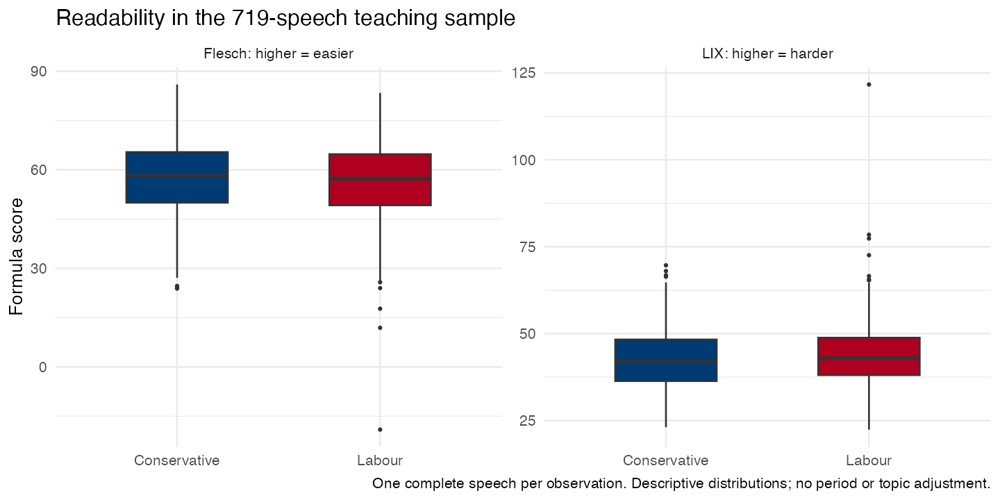
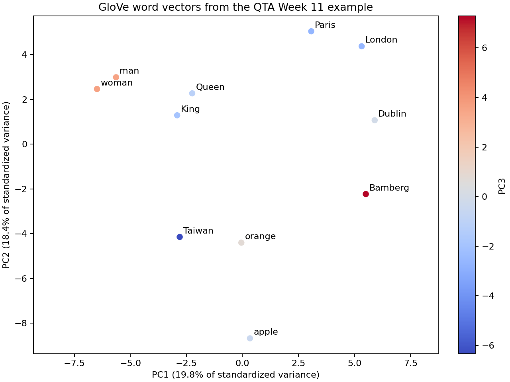

::: {.callout-note title="Lab slides · start at slide 42"}

For the current classroom route, open [student Lab slides](../slide/week9.html#/work-with-719-parliamentary-speeches). Slides 77–79 introduce the plan; slides 81–91 contain Flair and conText. This earlier handout preserves the optional R00–R06 exercises.

:::

## Purpose and 30-minute plan {#lab-purpose-and-plan}

**Goal:** Find security neighbours, check the original sentences, and compare three security vectors in Flair. Identify what each vector represents, read cosine similarity, and support an interpretation with a source passage.

| Time | What you will do | Your result |
|---|---|---|
| **5 min · 17:40–17:45** | Load speeches and keep their IDs; view brief saved readability and count/TF–IDF examples. | Find a speech and its ID. |
| **10 min · 17:45–17:55** | Load word vectors → find security neighbours → read KWIC. | **E04:** a neighbour, a supporting phrase and another use of security. |
| **15 min · 17:55–18:10** | Flair: load the model, get vectors, compare security. | **E06:** matrix sizes and an explanation of why the security vectors are identical; record your R/Python route and versions. |

This earlier handout preserves optional R00–R06 exercises. The current classroom Lab uses Flair and conText; its E04 and E06 checks are in the current handout.

### Start with the overview, then the code

This is an archived set of optional R00–R06 exercises. For the current class, open the [Lab guide on slides 77–79](../slide/week9.html#/work-with-719-parliamentary-speeches): Flair is on slides 81–85 and conText on slides 86–91. Use the [current Lab handout](Lab_Session_W9.html) for that route. The R00–R06 code and tables below belong to these earlier exercises.

Open the [R script](../classroom/W9.R) from the course repository root or W9 folder. Install the R packages and prepare the Python environment and GloVe cache before class.

**Student route: [R00](#r00-packages-and-files) → [R05](#r05-static-word-vectors-and-original-contexts) → [Flair](#flair-mini-lab).** R00 creates the speech corpus and raw tokens needed by R05. Keep this R session; use a separate clean R session for Flair, or the prepared Python route. During the warm-up, read the teacher's saved results rather than running R01–R03.

At **18:10**, return to [slide 54, research design](../slide/week9.html#/design-an-embedding-study-in-one-paragraph). The full readability and document-similarity exercises, keyness, PCA and [embedding regression](Embedding_Regression_W9.html) follow in the after-class section.

**Follow the W8-style small steps: Run together → Code → Output → Check.** Slides 44–46 each show one R05 operation: load vectors, find neighbours, read KWIC. Press Right/Space for that step's Output, then again to advance; use the footer on slide 46 to skip slide 47 and reach slide 48. Slide 48 is E04 Check, with three frames: Matrix, Neighbours, KWIC. Slides 50 and 51 show Flair model loading and extraction; slide 52 frames the security matrix, three sentences, then E06. At 18:10 click Research design to skip slide 53 and reach slide 54. Left reviews; clicking Output returns to its first frame.

The teaching sample contains 359 Conservative and 360 Labour speeches, selected approximately evenly by party and election period. Each document contains a complete speech and its metadata. R05 uses a 30-dimensional GloVe model trained on these speeches; Flair uses pretrained 100-dimensional GloVe. Compare what each vector represents and check its source text. A larger dimension alone does not show better performance.


## R00 Packages and files

**17:40–17:45.** Read the standalone overview on slide 42 for thirty seconds. On slide 43, run R00 for ninety seconds, then use its two Output frames to check the speech and party totals and the first three metadata records. Read the saved-preview table below at 17:42–17:45, keeping slide 43 open. Find the speech IDs and dates, and keep raw_tokens for the later KWIC search.

```{r}
required <- c("quanteda", "quanteda.textstats")
missing <- required[!vapply(required, requireNamespace, logical(1), quietly = TRUE)]
if (length(missing)) stop("Install before class: ", paste(missing, collapse = ", "))
suppressPackageStartupMessages({library(quanteda); library(quanteda.textstats)})
quanteda_options(threads = 1)
options(width = 100)
w9_root <- if (dir.exists("W9/classroom")) normalizePath("W9") else if (dir.exists("classroom/Data")) normalizePath(".") else stop("Run from the course repository root or W9.")
speeches <- readRDS(file.path(w9_root, "classroom/Data/w9_speeches.rds"))
speech_corpus <- corpus(speeches, text_field = "text", docid_field = "doc_id")
raw_tokens <- tokens(speech_corpus) # Preserve original contexts for R05 without running R02.
stopifnot(!anyDuplicated(speeches$doc_id), !anyNA(speeches$text), all(nzchar(speeches$text)))
print(c(speeches = ndoc(speech_corpus)))
print(table(speeches$party_family))
print(speeches[1:3, c("doc_id", "leader", "party_family", "date")], row.names = FALSE)
# One row is one complete speech. This is a nearly balanced teaching sample, not all speech volume.
```

### Captured output {#captured-output}

```text
speeches 
     719 

Conservative       Labour 
         359          360 
# A tibble: 3 × 4
  doc_id        leader            party_family date      
  <chr>         <chr>             <fct>        <date>    
1 ess_hoc_00002 Margaret Thatcher Conservative 1979-05-15
2 ess_hoc_00211 James Callaghan   Labour       1979-06-21
3 ess_hoc_00004 Margaret Thatcher Conservative 1979-06-26
```

### Teacher preview only: readability and document similarity {#teacher-preview-only-readability-and-document-similarity}

At 17:42–17:45, stay on slide 43 and open this saved table with the teacher. At 17:45, go to R05 and slide 44. The full R01–R03 code and E01/E02 are below, in the after-class section.

| Recorded example | Result to notice |
|---|---|
| Speech 00002 versus 00004 | LIX 35.8 versus 54.2; Flesch 68.0 versus 38.4, with opposite score directions |
| Nearest speech to 00004 | Counts: 00174, cosine 0.519; TF–IDF: 00006, cosine 0.380 |
| Return to the text | Both 00004 and its TF–IDF neighbour 00006 ask the Speaker's permission and report international meetings. Read the passages to explain the match. |

[After-class R01](#r01-readability-from-original-text) · [After-class R02](#r02-one-count-vocabulary-and-tf-idf-weighting) · [After-class R03](#r03-compare-nearest-speeches-and-read-their-words)


## R05 Static word vectors and original contexts

**17:45–17:55.** After R00, run the three short blocks below in order. Check the 1,653 × 30 matrix (17:45–17:47), read the security neighbours (17:47–17:50), then find the welfare and UN uses in KWIC (17:50–17:53). Complete E04 by 17:55. The supplied GloVe model was trained for five iterations and assigns one vector to each word type. Try immigration after class.

### Step 1: Load the word vectors

Load the supplied model. Each row represents a word type; each of its 30 columns is a learned coordinate.

```{r}
embedding <- readRDS(file.path(w9_root, "classroom/Data/w9_glove.rds"))
word_vectors <- embedding$vectors
print(dim(word_vectors))
```

#### Captured output {#captured-output-1}

```text
[1] 1653   30
```

### Step 2: Find security neighbours

Divide each vector by its length. The inner product of two unit-length vectors is their cosine similarity. Exclude security itself, then sort the scores to find eight neighbours.

```{r}
word_unit <- word_vectors / sqrt(rowSums(word_vectors ^ 2))
security_cosine <- drop(word_unit %*% word_unit["security", ])
security_cosine["security"] <- NA_real_
top <- head(sort(security_cosine, decreasing = TRUE), 8)
security_neighbours <- data.frame(word = names(top), cosine = unname(top))
print(security_neighbours, row.names = FALSE)
```

#### Captured output {#r05-neighbours-output}

```text
        word    cosine
  resolution 0.6612895
     council 0.6608147
    national 0.5949308
      system 0.5732534
   ministers 0.5551598
 conclusions 0.5483960
   discussed 0.5130478
    together 0.5054836
```

### Step 3: Read the original contexts

Read security in the original speeches. Join the pre, keyword and post columns to distinguish the welfare and UN Security Council uses.

```{r}
security_contexts <- kwic(raw_tokens, pattern = "security",
  valuetype = "fixed", window = 7)
print(head(as.data.frame(security_contexts), 3), row.names = FALSE)
# Every occurrence of security receives the SAME learned vector.
```

#### Captured output {#r05-contexts-output}

```text
       docname from   to                                       pre  keyword
 ess_hoc_00308 1876 1876 than unemployed people in terms of social security
 ess_hoc_00308 1916 1916              . When we look at the social security
 ess_hoc_00085  585  585    by the President of the United Nations Security
                                     post  pattern
      benefits . [ Interruption . ] Maybe security
    benefits paid to a striker's family , security
 Council in support of the United Nations security
```

::: {.callout-note title="E04 · In-class interpretation"}
**E04 · Context and meaning.** Choose one security neighbour and quote a KWIC phrase that helps explain it. Then name another use of security that this neighbour misses. Use the welfare and Security Council passages to explain what one static vector combines.
:::

::: {.callout-tip title="Continue in class · Flair at 17:55"}

After E04, open [F00–F03](#flair-mini-lab). Confirm F00, prepare the R connection and load GloVe at 17:55–17:58; switch to Python and load the same model at 17:58–18:00 if needed. At 18:00–18:03, extract and check the 11 × 100 matrix; at 18:03–18:07, compare security vectors and read the sentences. Record E06 at 18:07–18:10, then return to slide 54.

:::

## F00–F03 Flair with R or Python {#flair-mini-lab}

Work in pairs at **17:55–18:10, after R05 and E04**. Install the packages and cache GloVe before class. Start in a separate clean R session; if its interpreter check fails, switch to Python with the same environment, GloVe model and examples. Follow the checkpoints below.

Follow **W9 slides 49–52**: preparation, load the model, get word vectors, compare security. Each practical slide shows the corresponding native operations. [Open the Flair slides](../slide/week9.html#/flair-setup)

Use F00 below to prepare the W9 environment. The [earlier course handout](reference/2024_qta_lab_week_11.html) contains the original word-vector and PCA exercise.

| Step | Slide | Time and checkpoint |
|---|---|---|
| F00 | 49 | Prepare before class. At 17:55, briefly confirm imports and the cached GloVe model. |
| F01 | 49–50 | Complete R preparation and Step 1: load GloVe by 17:58, including F00 confirmation. |
| F02 | 49–51 | If R fails, prepare the Python interpreter and load the same model at 17:58–18:00. |
| F03 | 50–52 | Step 1: load; Step 2: get 11 × 100 vectors at 18:00–18:03; Step 3: compare security at 18:03–18:07; E06 at 18:07–18:10. |

At **18:10**, return to slide 54 for research design. R01–R04, R06, E01/E02/E03/E05, PCA and embedding regression are after-class work. E04 and E06 are the classroom exercises.

Keep the [R preparation](flair/flair_prepare.R), [R three-step script](flair/flair_steps.R), [Python preparation](flair/flair_prepare.py), [Python three-step script](flair/flair_steps.py), [original R helper](flair/flair_lab.R), [original Python helper](flair/flair_lab.py) and [requirements](flair/requirements.txt) together in `W9/lab/flair/`. Open a three-step script and execute one section at a time, or copy the matching blocks below.

### F00 Prepare Python and the model

Use **Python 3.10 or 3.11** for this exercise. Flair 0.15.1 supports Python 3.9 and later. Its `word-embeddings` extra supplies gensim for the GloVe loader. The scripts select the CPU. [Flair installation](https://pypi.org/project/flair/) · [Classic embeddings](https://flairnlp.github.io/docs/tutorial-embeddings/classic-word-embeddings)

On macOS or Linux, open Terminal at the course repository root:

```bash
cd W9/lab/flair
python3.10 -m venv .venv
.venv/bin/python -m pip install -r requirements.txt
.venv/bin/python flair_lab.py --check
```

Use `python3.11` in the environment-creation command if that is your installed version.

On Windows, use PowerShell at the course repository root:

```powershell
cd W9/lab/flair
py -3.10 -m venv .venv
.\.venv\Scripts\python.exe -m pip install -r requirements.txt
.\.venv\Scripts\python.exe flair_lab.py --check
```

Use `py -3.11` to select Python 3.11. The direct executable paths work without activating the environment.

**Check the result.** The script prints the Python executable and package versions, followed by `Imports OK. Device: CPU.`.

**Preload GloVe before class.** From the same Terminal directory:

```bash
.venv/bin/python flair_lab.py --download-glove
```

On Windows, replace `.venv/bin/python` with `.\.venv\Scripts\python.exe`. The first download uses the internet and disk space, and may take longer than the exercise. The embedding run reads the cached model. If the teacher supplies a cache copy, keep `glove.gensim` and `glove.gensim.vectors.npy` in the same folder.

### F01 Try the R route

Before class, install the R interface:

```r
install.packages(c("reticulate", "remotes"))
remotes::install_github(
  "davidycliao/flaiR@e812c6192714c9252d0feb83408b5459bbcccdfc"
)
```

Open a **separate clean R session** for Flair and set its working directory to the course root or W9. Keep the original R00/R05 session for the after-class extensions. If you restart it, rerun R00 and R05 before R05 PCA; R06 also requires R02 and R03.

The script selects the `.venv` beside it. If a teacher prepared another environment, set its executable **before the first Python import** in the new session:

```r
Sys.setenv(W9_FLAIR_PYTHON = "/absolute/path/to/environment/bin/python")
```

On Windows, an example value is `C:/path/to/environment/Scripts/python.exe`. Choose the environment that passed F00, then run the check:

```r
flair_dir <- if (dir.exists("W9/lab/flair")) "W9/lab/flair" else "lab/flair"
source(file.path(flair_dir, "flair_prepare.R"))
```

Complete preparation within **17:55–17:58**, including F00 confirmation. Look for the Python path, versions, `Import check passed`, the cached model path and `Ready for Step 1: load the model.` Preparation exposes `Sentence`, `WordEmbeddings` and `glove_path`; it does not load the model or compute embeddings. Continue to [R Step 1](#flair-r-load). If R is not ready at 17:58, use [F02](#f02-python-fallback). [flaiR](https://davidycliao.github.io/flaiR/)

For a teacher-supplied cache, set `W9_FLAIR_GLOVE_PATH` to its `glove.gensim` file before sourcing the preparation script.

### F02 Python fallback

If R is unavailable at 17:58, use the environment that passed F00. In Terminal, from `W9/lab/flair`, start an interactive Python session:

```bash
.venv/bin/python -i flair_prepare.py
```

On Windows PowerShell:

```powershell
.\.venv\Scripts\python.exe -i flair_prepare.py
```

Look for `Imports OK. Device: CPU.`, the cached path, `Ready for Step 1: load the model.` and the `>>>` prompt. Preparation imports `Sentence`, `WordEmbeddings` and numpy as `np`, and defines `glove_path`. It does not load a model. At the prompt, run [Python Step 1](#flair-python-load), then Steps 2 and 3 in the same session. Use **17:58–18:00** to switch and load; both routes reach the word matrix at 18:00–18:03. Do not type R code at the Python prompt.

### F03 Three steps: load, get vectors, compare {#f03-read-the-outputs}

Choose **one language** and run its three blocks in order, keeping that session open. The slides show the R operations; the Python blocks do the same task.

| Step | Slide | Read the result |
|---|---|---|
| 1 · Load the model | 50 | GloVe has 100 coordinates per word type |
| 2 · Get word vectors | 51 | 11 word-list tokens × 100 coordinates |
| 3 · Compare security | 52 | 3 occurrences × 100 coordinates; all three pairwise cosines are 1 |

#### R · Step 1: Load the model {#flair-r-load}

Run after F01. `glove_path` is the cached file found during preparation. `WordEmbeddings()` loads the trained model; it does not train a new one.

```r
embedding <- WordEmbeddings(glove_path)
print(embedding$embedding_length)
```

**Checkpoint:** the printed embedding length is **100**. Continue with Step 2 at 18:00.

#### R · Step 2: Get word vectors {#flair-r-vectors}

At **18:00–18:03**, `Sentence()` tokenizes the eleven-word list. `embed()` attaches a vector to each token. The small `lapply()` reads each token's coordinates; `rbind` stacks those rows. `tolist()` converts the tensor's coordinates to ordinary numbers.

```r
word_list <- paste("King Queen man woman Paris London",
  "apple orange Taiwan Dublin Bamberg")
word_sentence <- Sentence(word_list)
embedding$embed(word_sentence)
word_vectors <- do.call(rbind, lapply(word_sentence$tokens,
  function(token) as.numeric(token$embedding$tolist())))
print(dim(word_vectors))
```

**Checkpoint:** `dim(word_vectors)` prints **11 × 100**. Each row is a token in the listed order. These are static GloVe coordinates. [Flair classic embeddings](https://flairnlp.github.io/docs/tutorial-embeddings/classic-word-embeddings) · [Tensor tolist](https://docs.pytorch.org/docs/stable/generated/torch.Tensor.tolist.html)

#### R · Step 3: Compare security {#flair-r-security}

At **18:03–18:07**, attach vectors to the three sentences. `Filter()` finds the security token in each sentence without depending on its position or capitalization. Stack only those three vectors, normalize their lengths, then take their inner products to obtain cosine similarity, just as in R05.

```r
security_texts <- c("Social security supports households.",
  "The United Nations Security Council met.",
  "Energy security matters for jobs.")
sentences <- lapply(security_texts, Sentence)
embedding$embed(sentences)
security_vectors <- do.call(rbind, lapply(sentences, function(sentence) {
  token <- Filter(function(t) tolower(t$text) == "security",
    sentence$tokens)[[1]]
  as.numeric(token$embedding$tolist())
}))
print(dim(security_vectors))
unit <- security_vectors / sqrt(rowSums(security_vectors ^ 2))
security_cosine <- tcrossprod(unit)
print(round(security_cosine, 6))
```

**Checkpoint:** `dim(security_vectors)` is **3 × 100**. The cosine matrix is **3 × 3**, and every pair is 1 after rounding. Continue to [interpretation and E06](#flair-results).

#### Python · Step 1: Load the model {#flair-python-load}

Run after F02 at the same `>>>` prompt. `glove_path` points to the cached model; loading it does not train new vectors.

```python
embedding = WordEmbeddings(str(glove_path), force_cpu=True)
print(embedding.embedding_length)
```

**Checkpoint:** the embedding length is **100**.

#### Python · Step 2: Get word vectors {#flair-python-vectors}

At **18:00–18:03**, tokenize the same list, attach vectors with `embed()`, then stack each token's coordinates into a numpy array.

```python
word_list = ("King Queen man woman Paris London "
             "apple orange Taiwan Dublin Bamberg")
word_sentence = Sentence(word_list)
embedding.embed(word_sentence)
word_vectors = np.array([token.embedding.tolist() for token in word_sentence])
print(word_vectors.shape)
```

**Checkpoint:** `word_vectors.shape` is **(11, 100)**.

#### Python · Step 3: Compare security {#flair-python-security}

At **18:03–18:07**, find security in each sentence, stack its three vectors, and compute their cosine matrix.

```python
security_texts = ["Social security supports households.",
                 "The United Nations Security Council met.",
                 "Energy security matters for jobs."]
sentences = [Sentence(text) for text in security_texts]
embedding.embed(sentences)
security_vectors = np.array([
    next(token for token in sentence if token.text.lower() == "security")
    .embedding.tolist() for sentence in sentences])
print(security_vectors.shape)
unit = security_vectors / np.linalg.norm(
    security_vectors, axis=1, keepdims=True)
security_cosine = unit @ unit.T
print(np.round(security_cosine, 6))
```

**Checkpoint:** `security_vectors.shape` is **(3, 100)**. The **3 × 3** cosine matrix contains ones. Continue to interpretation and E06 below.

#### Read the results and explain them {#flair-results}

Slide 50 compares the model-loading code with its 100-dimensional result. Slide 51 compares token extraction with the 11 × 100 matrix. On slide 52, press Right/Space to frame the separate **security matrix**, then the **three-sentence comparison**, then **E06**. Clicking Output returns to the first frame. At 18:10, click Research design to skip slide 53 and go to slide 54.

Read the original sentences:

```text
Social security supports households.
The United Nations Security Council met.
Energy security matters for jobs.
```

| Teacher checkpoint | Result |
|---|---|
| Loaded model | Cached pretrained GloVe, 100 coordinates |
| Word-list matrix | 11 × 100 |
| Security matrix | 3 × 100 |
| Maximum coordinate difference among the three security vectors | 0 |
| Three pairwise security cosines | 1.000000 each |

The new three-step R and Python paths are checked against the same [saved word vectors](flair/example-output/word-vectors.csv) and [security comparisons](flair/example-output/security-comparison.csv). See the [three-step runtime record](flair/flair_steps_runtime.json) for the tested versions and cross-language checks. The [earlier runtime record](flair/example-output/runtime.json) belongs to the original complete helper. Run F00 on your computer to confirm your own environment.

Welfare, an international institution and energy are different uses of security, but static lookup returns the same word-type vector. Comparing political usage requires each occurrence's surrounding text and group metadata, as in Case 4. R05's local 30-dimensional model and Flair's pretrained 100-dimensional model have different sources; dimensions alone do not rank their quality.

::: {.callout-note title="E06 · Installation and interpretation"}

At **18:07–18:10**, submit:

1. Your successful **R or Python** route, model and package versions. If you used a partner's or teacher's output, record that your installation was not verified and label the versions as theirs.
2. The two matrix sizes: **11 × 100** words and **3 × 100** security occurrences.
3. All three pairwise security cosines (**1**) and a 1–2 sentence explanation of why they are identical. State which surrounding texts, document IDs, party labels and dates you would need to compare political groups' uses.

At **18:10**, return to slide 54. PCA and embedding regression are after-class work.

:::

### If a check fails

Use this table to prepare before class or repair the environment afterward. If yours is still unavailable at 18:00, read the teacher output with a partner who passed F00. Continue execution and interpretation at 18:00–18:07, then complete E06 at 18:07–18:10; record that you used the teacher example.

| Where it stops | Next action |
|---|---|
| Python command not found | Install/select Python 3.10 or 3.11, then create the exercise environment. |
| F00 import failure | Run pip with that `.venv` executable and the provided requirements, then repeat `--check`. |
| F00 works, F01 fails | Use F02. For R, restart and verify the executable selected before any import. |
| Cached model not found | Preload with `--download-glove`, or provide the gensim file and its companion vectors file. |

This exercise uses Flair's **classic static word embeddings**. Flair also offers contextual embeddings for a later comparison. [Flair framework](https://doi.org/10.18653/v1/N19-4010) · [GloVe](https://doi.org/10.3115/v1/D14-1162)


## After-class exercises and complete comparison code {#after-class-comparisons}

Work through these sections after class: R01–R04 and R06, E01/E02/E03/E05, a second R05 query, and PCA. The [supplement](../handout/Word_Embeddings_Supplement.html) explains the methods; the [after-class lab](After_Class_W9.html) contains A01–A05, including embedding regression.

### After class: change the R05 query to immigration

After the three R05 blocks, run this separate query. It leaves the security results available for E04 and the optional PCA. Read several KWIC passages and check how often immigration appears. Which neighbours can you explain from those passages? To try defence or energy, change only `query` in this block.

```{r}
query <- "immigration"
query_cosine <- drop(word_unit %*% word_unit[query, ])
query_cosine[query] <- NA
head(sort(query_cosine, decreasing = TRUE), 8)
head(as.data.frame(kwic(raw_tokens, pattern = query,
  valuetype = "fixed", window = 7)), 6)
```

### Keep the measurement tasks separate

LIX uses sentence length and the percentage of words longer than six characters; higher values indicate harder reading under the formula. Flesch Reading Ease uses sentence length and estimated English syllables; higher values indicate easier reading. Neither directly measures reader comprehension. Count/TF–IDF similarity depends on the representation, and keyness needs an explicit target and reference. These are the after-class E01–E03 comparisons.

## R01 Readability from original text

**After class: E01.** Calculate the scores from the original sentences, including punctuation. The party summaries report speech-level medians; they do not adjust for period, speaker or debate topic.

```{r}
# After class: full code and E01. In class, the teacher briefly previews saved output.
readability <- textstat_readability(speech_corpus, measure = "Flesch",
  remove_hyphens = TRUE, min_sentence_length = 1, max_sentence_length = 10000,
  intermediate = TRUE)
readability$words_per_sentence <- readability$W / readability$St
# Installed quanteda.textstats 0.97.2 has no named LIX measure. W7C is its
# intermediate count of words of at least seven characters (= more than six).
readability$LIX <- readability$words_per_sentence + 100 * readability$W7C / readability$W
# Cross-check the implementation's historical LIW label against the transparent formula.
lix_check <- textstat_readability(speech_corpus, measure = "LIW")
stopifnot(isTRUE(all.equal(readability$LIX, lix_check$LIW)))
readability$party <- speeches$party_family[match(readability$document, speeches$doc_id)]
print(head(readability[, c("document", "Flesch", "LIX", "W", "St", "words_per_sentence")], 4), row.names = FALSE)
readability_summary <- aggregate(cbind(Flesch, LIX, words_per_sentence) ~ party,
  readability, FUN = median)
print(readability_summary, row.names = FALSE)
# Flesch uses sentence length and estimated English syllables. Higher scores indicate
# easier reading under this formula; they do not measure reader comprehension directly.
# LIX = words/sentences + 100*(words with more than six characters)/words.
# Higher LIX indicates harder reading under this formula. LIX connects to the
# Bischof & Senninger (2018) assigned study; Flesch is a teaching comparison.
```

### Captured output {#captured-output-2}

```text
      document   Flesch      LIX   W St words_per_sentence
 ess_hoc_00002 67.95802 35.75018 603 42           14.35714
 ess_hoc_00211 69.10086 33.34576 322 21           15.33333
 ess_hoc_00004 38.39723 54.16042 445 18           24.72222
 ess_hoc_00006 44.02528 48.32183 712 28           25.42857
        party   Flesch      LIX words_per_sentence
 Conservative 58.21930 42.02824           20.46667
       Labour 57.24104 42.95662           21.75000
```

{fig-alt="Two boxplots compare Conservative and Labour speech scores: Flesch reading ease, where higher is easier, and LIX textual difficulty, where higher is harder."}

::: {.callout-note title="After-class interpretation"}
**E01 · Readability.** Read one high-LIX and one low-LIX speech. Point to a sentence or word choice that helps explain the scores. State which direction means easier reading for LIX and for Flesch, then name one part of comprehension that these formulas do not measure.
:::

## R02 One count vocabulary and TF-IDF weighting

**After class.** Run R00 first. Use the same speeches and vocabulary for both weightings. TF-IDF is count × log10(N/document frequency). The code excludes zero vectors because their cosine is undefined.

```{r}
# After class: full R02-R03 and E02. In class, the teacher previews the rank change only.
content_tokens <- tokens(speech_corpus, remove_punct = TRUE,
  remove_numbers = TRUE, remove_symbols = TRUE, remove_url = TRUE) |>
  tokens_tolower() |> tokens_keep("^[a-z]+$", valuetype = "regex") |>
  tokens_remove(stopwords("en"))
count_dfm <- dfm(content_tokens) |> dfm_trim(min_termfreq = 5, min_docfreq = 2)
tfidf_dfm <- dfm_tfidf(count_dfm, scheme_tf = "count", scheme_df = "inverse", base = 10)
# A zero count or zero TF-IDF norm makes cosine undefined. Keep the same eligible
# documents and identical vocabulary in both comparisons; report exclusions explicitly.
eligible <- ntoken(count_dfm) > 0 & Matrix::rowSums(tfidf_dfm ^ 2) > 0
excluded_ids <- docnames(count_dfm)[!eligible]
count_compare <- count_dfm[eligible, ]
tfidf_compare <- tfidf_dfm[eligible, ]
stopifnot(identical(dimnames(count_compare), dimnames(tfidf_compare)))
print(c(documents = ndoc(count_compare), features = nfeat(count_compare),
  excluded_zero_vectors = length(excluded_ids)))
print(topfeatures(count_compare, 8))
# TF-IDF here is count * log10(N/document_frequency). The document unit is a speech.
```

### Captured output {#captured-output-3}

```text
            documents              features excluded_zero_vectors 
                  719                  2788                     0 
     prime   minister        hon government      right     people      house        can 
       992        955        837        728        723        590        553        490 
```

## R03 Compare nearest speeches and read their words

**After class: E02.** Run R02 first. This block creates count_neighbours and tfidf_neighbours, excludes the query itself and prints opening excerpts. Open the complete speeches to explain the match.

```{r}
# After class: run R02 first. The live word-embedding route skips this block.
count_similarity <- as.matrix(textstat_simil(count_compare, method = "cosine", margin = "documents"))
tfidf_similarity <- as.matrix(textstat_simil(tfidf_compare, method = "cosine", margin = "documents"))
# Never retrieve a speech as its own neighbour. Ties are resolved by document order.
diag(count_similarity) <- NA_real_
diag(tfidf_similarity) <- NA_real_
query_id <- "ess_hoc_00004"
if (!query_id %in% rownames(count_similarity)) query_id <- rownames(count_similarity)[1]
count_rank <- order(count_similarity[query_id, ], decreasing = TRUE, na.last = NA)
tfidf_rank <- order(tfidf_similarity[query_id, ], decreasing = TRUE, na.last = NA)
count_neighbours <- data.frame(doc_id = colnames(count_similarity)[head(count_rank, 5)],
  cosine = count_similarity[query_id, head(count_rank, 5)], row.names = NULL)
tfidf_neighbours <- data.frame(doc_id = colnames(tfidf_similarity)[head(tfidf_rank, 5)],
  cosine = tfidf_similarity[query_id, head(tfidf_rank, 5)], row.names = NULL)
cat("Query:", query_id, "\nCount neighbours:\n")
print(count_neighbours, row.names = FALSE)
cat("TF-IDF neighbours:\n")
print(tfidf_neighbours, row.names = FALSE)
read_ids <- unique(c(query_id, tfidf_neighbours$doc_id[1]))
print(speeches[match(read_ids, speeches$doc_id), c("doc_id", "leader", "date", "agenda")], row.names = FALSE)
for (id in read_ids) {
  cat("\n", id, "— opening excerpt, not the complete speech:\n",
    substr(speeches$text[match(id, speeches$doc_id)], 1, 850), "\n", sep = "")
}
```

### Captured output {#captured-output-4}

```text
Query: ess_hoc_00004 
Count neighbours:
        doc_id    cosine
 ess_hoc_00174 0.5190820
 ess_hoc_00487 0.5075981
 ess_hoc_00042 0.5000308
 ess_hoc_00569 0.4827144
 ess_hoc_00583 0.4731058
TF-IDF neighbours:
        doc_id    cosine
 ess_hoc_00006 0.3801436
 ess_hoc_00042 0.3786094
 ess_hoc_00174 0.3661988
 ess_hoc_00569 0.3378440
 ess_hoc_00130 0.3364002
# A tibble: 2 × 4
  doc_id        leader            date       agenda                                         
  <chr>         <chr>             <date>     <chr>                                          
1 ess_hoc_00004 Margaret Thatcher 1979-06-26 EUROPEAN COMMUNITY COUNCIL (STRASBOURG MEETING)
2 ess_hoc_00006 Margaret Thatcher 1979-07-03 TOKYO SUMMIT MEETING                           

ess_hoc_00004— opening excerpt, not the complete speech:
With permission, Mr. Speaker I should like to make a statement on the European Council Meeting at Strasbourg. With my noble Friend, the Foreign and Commonwealth Secretary I attended the European Council in Strasbourg at the end of last week. Among the matters we discussed were, first, contributions to the Community budget. I made our dissatisfaction with the results of the present system very plain. The European Council called for action by the Commission to assess the facts about how the budget transfers are likely to affect each member State in 1979 and 1980 and whether and how the 1975 financial mechanism, intended to reduce our contribution, will work. That report will go first to the Finance Council of Ministers, who will have the opportunity to put forward practical ideas to solve the problem. Taking those views into account, the Co

ess_hoc_00006— opening excerpt, not the complete speech:
With permission, Mr. Speaker, I will make a statement about my visits to Tokyo and Canberra. On the way to Tokyo we refuelled in Moscow and the Soviet Prime Minister, Mr. Kosygin, came to the airport to meet us. We had about one-and-a-half hours' discussion, during the course of which I impressed on him our deep concern about refugees from Vietnam and asked him to intervene with the Government of Vietnam. He did not give us much encouragement in this respect, but I remain firmly of the view that the refugee problem must be tackled at its source as well as by resettlement. I also told Mr. Kosygin that Her Majesty's Government hoped that SALT II would be ratified. The Tokyo summit met against a background of rising inflation and higher oil prices, and this was underlined by the decision which OPEC made during the course of the Tokyo summit 
```

::: {.callout-note title="After-class interpretation"}
**E02 · Nearest texts.** Compare the two top-five lists. Read the complete nearest speech with `speeches$text[match(tfidf_neighbours$doc_id[1], speeches$doc_id)]`. What explains the similarity: topic, phrase reuse, parliamentary procedure or policy stance? Support your answer with original text.
:::

## R04 Keyness: Labour target, Conservative reference

**After class: E03.** Run R00 and R02 first. Compare Labour with the Conservative reference using signed chi-square with Yates correction. Longer speeches contribute more tokens. Consider period, leader and debate differences when reading the result.

```{r}
# After class, optional. The classroom route continues with R05.
party_dfm <- dfm_group(count_dfm, groups = docvars(count_dfm, "party_family"))
stopifnot(setequal(docnames(party_dfm), c("Labour", "Conservative")))
keyness <- textstat_keyness(party_dfm, target = "Labour", measure = "chi2", correction = "yates")
print(head(keyness, 6), row.names = FALSE)
print(tail(keyness, 6), row.names = FALSE)
# Positive signed chi-square: relatively more frequent in Labour's pooled tokens.
# Negative: relatively more frequent in the Conservative reference. Long speeches
# contribute more tokens. This descriptive comparison does not adjust for period,
# leader, debate topic, government status or repeated language.
```

### Captured output {#captured-output-5}

```text
      feature     chi2            p n_target n_reference
         lady 37.26756 1.029837e-09       86          19
        prime 36.57155 1.471638e-09      612         380
      workers 32.15323 1.424794e-08       41           2
       debate 24.18014 8.773218e-07       78          24
 conservative 23.26993 1.407838e-06       82          27
         cuts 22.95846 1.655405e-06       36           4
   feature      chi2            p n_target n_reference
  falkland -38.18657 6.429344e-10        0          35
    agreed -38.86560 4.540112e-10       37         105
    friend -51.59835 6.810108e-13       75         178
   islands -56.74711 4.951595e-14        0          52
 argentine -61.11552 5.329071e-15        0          56
   council -66.66895 3.330669e-16       68         187
```

::: {.callout-note title="After-class interpretation"}
**E03 · Distinctive terms.** Choose one positive and one negative keyness term. Inspect original KWIC, for example `kwic(raw_tokens, pattern = "workers", window = 7)`. Explain the target and reference, then propose an alternative explanation for the party difference.
:::

## R06 Average known word vectors and report coverage

**After class: E05.** Run R00, R02, R03 and R05 first. Average the known word vectors, counting repeated words each time they occur. Report coverage as covered token occurrences divided by all content-token occurrences before vocabulary trimming. The code excludes documents with no usable vector. The average loses word order, negation scope and differences between a word's uses.

```{r}
# After class, optional. Restore R00, R02, R03, R05 first if the R session was restarted.
# Match count columns to supplied vectors; unseen tokens contribute no vector.
# Repeated terms are weighted by their counts. This is a simple bag-of-vectors average.
embedding_counts <- dfm_match(dfm(content_tokens), features = rownames(word_vectors))
known_tokens <- as.numeric(ntoken(embedding_counts))
all_content_tokens <- as.numeric(ntoken(content_tokens))
embedding_coverage <- data.frame(doc_id = docnames(embedding_counts), known_tokens,
  content_tokens = all_content_tokens,
  coverage = ifelse(all_content_tokens > 0, known_tokens / all_content_tokens, NA_real_))
doc_vectors <- as.matrix(embedding_counts %*% word_vectors)
doc_vectors[known_tokens > 0, ] <- doc_vectors[known_tokens > 0, , drop = FALSE] / known_tokens[known_tokens > 0]
doc_norms <- sqrt(rowSums(doc_vectors ^ 2))
valid_embedding <- known_tokens > 0 & is.finite(doc_norms) & doc_norms > 0
doc_unit <- doc_vectors[valid_embedding, , drop = FALSE] / doc_norms[valid_embedding]
embedding_similarity <- tcrossprod(doc_unit)
diag(embedding_similarity) <- NA_real_
stopifnot(query_id %in% rownames(embedding_similarity))
embedding_rank <- order(embedding_similarity[query_id, ], decreasing = TRUE, na.last = NA)
embedding_neighbours <- data.frame(doc_id = colnames(embedding_similarity)[head(embedding_rank, 5)],
  cosine = embedding_similarity[query_id, head(embedding_rank, 5)], row.names = NULL)
embedding_neighbours$coverage <- embedding_coverage$coverage[match(embedding_neighbours$doc_id, embedding_coverage$doc_id)]
print(summary(embedding_coverage$coverage))
print(embedding_neighbours, row.names = FALSE)
cat("Excluded zero embedding documents:", sum(!valid_embedding), "\n")
# Word order and negation scope disappear in this average. These vectors are static,
# not contextual transformer embeddings or a conText/ALC estimate of contextual meaning.
```

### Captured output {#captured-output-6}

```text
   Min. 1st Qu.  Median    Mean 3rd Qu.    Max. 
 0.5185  0.7533  0.8025  0.7980  0.8491  1.0000 
        doc_id    cosine  coverage
 ess_hoc_00174 0.9018980 0.8191781
 ess_hoc_00042 0.9004335 0.8346667
 ess_hoc_01328 0.8860238 0.8160677
 ess_hoc_00430 0.8856149 0.7838710
 ess_hoc_02293 0.8826469 0.8145957
Excluded zero embedding documents: 0 
```

::: {.callout-note title="After-class interpretation"}
**E05 · Representation and coverage.** Compare count, TF-IDF and embedding neighbours for the same query. Support one interpretation with original text and report coverage. Why is high cosine insufficient to establish agreement, influence or a causal effect?
:::

## Optional: does the PCA map preserve the neighbours? {#r05-pca-check}

**After class, optional.** Run this block in the original R05 session. If you restarted R for Flair, rerun R00 and R05 first. Project the same unit-length word vectors onto two principal components and rank words by their Euclidean distance from `security` on that map. In the full space, the squared Euclidean distance between two unit vectors equals twice one minus their cosine similarity. Any change in the ranking here therefore comes from dropping dimensions.

```{r}
word_pca <- prcomp(word_unit, center = TRUE, scale. = FALSE, rank. = 2)
pc_scores <- word_pca$x
pc_offsets <- sweep(pc_scores, 2, pc_scores["security", ])
pc_distances <- sqrt(rowSums(pc_offsets ^ 2))
pc_distances["security"] <- NA_real_

full_neighbours <- names(head(sort(security_cosine,
  decreasing = TRUE, na.last = NA), 5))
map_neighbours <- names(head(sort(pc_distances, na.last = NA), 5))
print(data.frame(full_cosine = full_neighbours, two_pc_distance = map_neighbours),
      row.names = FALSE)

variance_share <- sum(word_pca$sdev[1:2] ^ 2) / sum(word_pca$sdev ^ 2)
cat(sprintf("Variance retained by PC1 and PC2: %.2f%%\n", 100 * variance_share))
cat("Shared top-five neighbours:", length(intersect(full_neighbours, map_neighbours)), "\n")
```

How many neighbours appear in both lists? Which list would you use to report cosine neighbours, and what would you check in the original speeches before interpreting them?

This course exercise uses the GloVe teaching model from W9 and the projection example in ESS 2026 Day 3, p. 19.

## After-class Flair extensions

### After class, optional: cosine and PCA

The [complete after-class lab](After_Class_W9.html#a04-pca-sensitivity) produces a coordinate table and plot from the same saved GloVe vectors, and extends this exercise to a new text or a prepared second model. Read the [model and method guide](../handout/Word_Embeddings_Supplement.html) alongside it.

Compare the full-space word cosine matrix before interpreting the projection. Check the reported zero-vector flags when choosing new words.

This PCA centers and standardizes each coordinate. **PC1 and PC2 retain 38.24%** of the variance in those standardized coordinates. R05's optional PCA starts from unit-length vectors. Both the transformation and the selected words can change the map. PCA axis signs may flip across software.

The classroom steps create `word_vectors` and `security_vectors`, without computing PCA. After class, run the complete helper to create a separate `result` object and draw the map:

```r
result <- run_w9_flair("embed")
plot(result$pca_scores[, 1:2], type = "n", xlab = "PC1", ylab = "PC2")
text(result$pca_scores[, 1:2], labels = rownames(result$pca_scores))
```

For Python, run the complete after-class helper from `W9/lab/flair`, then open `output/word-pca.png`:

```bash
.venv/bin/python flair_lab.py --run --output-dir output
```

{fig-alt="A PCA map labels the original eleven-word list, including person terms, cities and fruit. The coordinates are projected from standardized GloVe dimensions and colours encode the third principal component."}

#### Inspect the R objects after the check

After F01 passes, inspect the operations behind the exercise. `Sentence` holds tokens, `WordEmbeddings` loads the cached static model, and `embed()` attaches vectors to the tokens.

```r
Sentence <- flaiR::flair_data()$Sentence
WordEmbeddings <- flaiR::flair_embeddings()$WordEmbeddings
flair <- flaiR::import_flair()
model_path <- Sys.getenv("W9_FLAIR_GLOVE_PATH", unset = "")
if (!nzchar(model_path)) {
  model_path <- file.path(
    reticulate::py_str(flair$cache_root), "embeddings", "glove.gensim"
  )
}
embedding <- WordEmbeddings(path.expand(model_path))
sentence <- Sentence("Social security supports households.")
embedding$embed(sentence)

token_texts <- vapply(sentence$tokens, function(token) token$text, character(1))
vectors <- do.call(rbind, lapply(sentence$tokens, function(token) {
  as.numeric(token$embedding$detach()$cpu()$numpy())
}))
data.frame(position = seq_along(token_texts), word = token_texts)
dim(vectors)
```

Each row represents one token occurrence in that sentence. Retain the position and word separately when repeating the exercise with your own text. Use the full-space vectors for cosine, then inspect their PCA projection.

#### Inspect the Python token vectors

Extract one vector per token with the cached static model.

```python
from flair.data import Sentence
from flair.embeddings import WordEmbeddings
import flair
import numpy as np

model_path = flair.cache_root / "embeddings" / "glove.gensim"
embedding = WordEmbeddings(str(model_path), force_cpu=True)
sentence = Sentence("King Queen man woman Paris London apple orange Taiwan Dublin Bamberg")
embedding.embed(sentence)
vectors = np.stack([
    token.embedding.detach().cpu().numpy()
    for token in sentence
])
print(vectors.shape)
```

The scripts preserve token order. When trying a new sentence, retain each occurrence's position alongside its text so repeated words remain separate.

## Sources and next steps

The practical sequence adapts Martijn Schoonvelde's **ESS 2026 Introduction to QTA, Day 3**: text similarity, dense static vectors and contextual meaning. Keyness is an explicit extension connecting to earlier course work. The supplied corpus continues the W8 teaching sample drawn from the ESS material.

Compare these exercises with the W9 readings. Bischof and Senninger (2018) use readability scores; the embedding studies show how researchers evaluate vectors and estimate differences in word use. In [A05](Embedding_Regression_W9.html), build conText/ALC context vectors and return to Case 4's group comparison. W10 introduces transformer representations.

Software references checked 2026-11-07: [readability](https://quanteda.io/reference/textstat_readability.html), [TF-IDF](https://quanteda.io/reference/dfm_tfidf.html), [cosine similarity](https://quanteda.io/reference/textstat_simil.html), [keyness](https://quanteda.io/reference/textstat_keyness.html), [positional padding](https://quanteda.io/reference/tokens_select.html) and [GloVe in text2vec](https://text2vec.org/glove.html). Installed-version details and actual checkpoint output are retained in `W9/analysis/`.
