## Example: security in context {#read-security-in-context .w9-linear-slide}

```{=html}

<div class="slide-body case-split">
<div class="case-visual">
<p>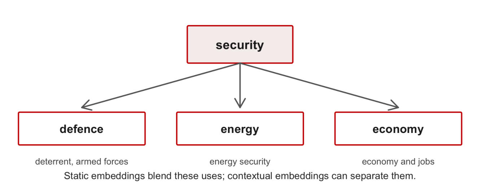</p>
</div>
<div class="case-reading">
<p>We see <em>security</em> used in defence, energy and economic contexts.</p>
<p>Which nearby words help us distinguish these uses?</p>
<p>How could we test whether these uses vary across parties or periods?</p>
</div>
</div>
<div class="source">
<p>Example · security in political language.</p>
</div>

```

## From topics to language representations {#word-vectors-capture-patterns-of-use .w9-linear-slide}

```{=html}

<div class="slide-body w9-opening">
<div class="case-workflow w9-opening-table">
<table>
<colgroup>
<col style="width: 50%"/>
<col style="width: 50%"/>
</colgroup>
<thead>
<tr>
<th>Research task</th>
<th>Political question</th>
</tr>
</thead>
<tbody>
<tr>
<td><span aria-hidden="true" class="w9-row-focus current-fragment visible w9-linear-current"><svg viewbox="0 0 18 18"><path d="M 2 9 H 15 M 9 3 L 15 9 L 9 15"></path></svg></span> <strong>W8 · Topic models</strong></td>
<td>What do actors discuss, and how much?</td>
</tr>
<tr>
<td> <strong>W9 · Word embeddings</strong></td>
<td>How can learned vectors describe and compare political language?</td>
</tr>
</tbody>
</table>
</div>
<div class="w9-opening-concept-grid">
<div class="case-visual">
<div class="w9-evidence-frame" style="--w9-evidence-ratio:1436 / 1066;--w9-evidence-max-height:300px;">
<p>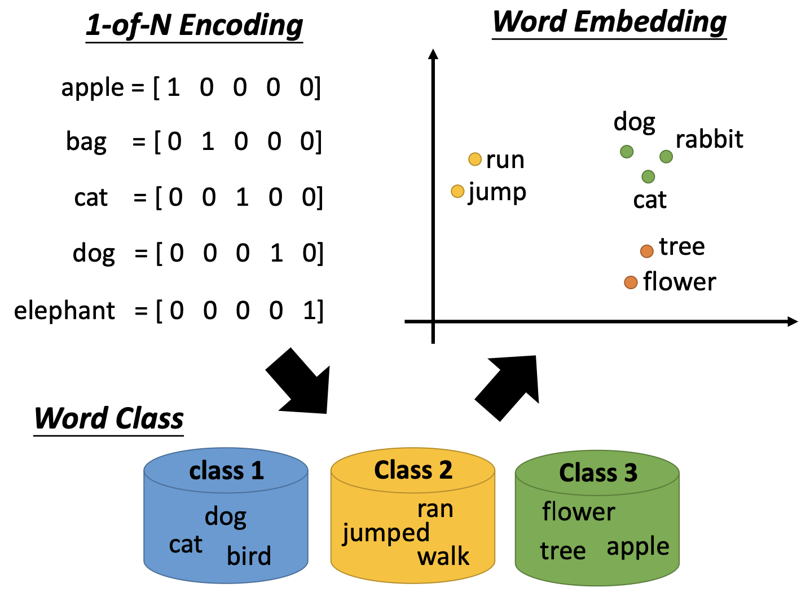 <svg aria-hidden="true" class="w9-evidence-overlay" viewbox="0 0 1436 1066"> </svg></p>
</div>
</div>
<div class="case-reading w9-concept-reading">
<div class="w9-reading-focus visible">
<p><strong>One-hot</strong> gives us one coordinate per word. Different words have cosine zero.</p>
</div>
<div class="w9-reading-focus visible">
<p><strong>Embeddings</strong> let us compare words using coordinates learned from their use.</p>
<p><em>Dog</em>, <em>cat</em> and <em>rabbit</em> can be close when they appear in similar contexts.</p>
</div>
</div>
</div>
</div>
<div class="source">
<p><a href="../../W8/slide/week8.html#/political-positions-and-issue-attention">W8: issue attention</a> · Teaching diagram after <a href="https://speech.ee.ntu.edu.tw/~hylee/index.php">Hung-yi Lee</a> · <a href="https://books.google.com.tw/books?id=dL40EAAAQBAJ&amp;pg=PA78">Grimmer, Roberts &amp; Stewart (2022), <em>Text as Data</em>, Ch. 8, p. 78</a></p>
</div>

```

## From topics to language representations {#word-vectors-capture-patterns-of-use-step-2 .w9-linear-slide}

```{=html}

<div class="slide-body w9-opening">
<div class="case-workflow w9-opening-table">
<table>
<colgroup>
<col style="width: 50%"/>
<col style="width: 50%"/>
</colgroup>
<thead>
<tr>
<th>Research task</th>
<th>Political question</th>
</tr>
</thead>
<tbody>
<tr>
<td> <strong>W8 · Topic models</strong></td>
<td>What do actors discuss, and how much?</td>
</tr>
<tr>
<td><span aria-hidden="true" class="w9-row-focus current-fragment visible w9-linear-current"><svg viewbox="0 0 18 18"><path d="M 2 9 H 15 M 9 3 L 15 9 L 9 15"></path></svg></span> <strong>W9 · Word embeddings</strong></td>
<td>How can learned vectors describe and compare political language?</td>
</tr>
</tbody>
</table>
</div>
<div class="w9-opening-concept-grid">
<div class="case-visual">
<div class="w9-evidence-frame" style="--w9-evidence-ratio:1436 / 1066;--w9-evidence-max-height:300px;">
<p> <svg aria-hidden="true" class="w9-evidence-overlay" viewbox="0 0 1436 1066"> </svg></p>
</div>
</div>
<div class="case-reading w9-concept-reading">
<div class="w9-reading-focus visible">
<p><strong>One-hot</strong> gives us one coordinate per word. Different words have cosine zero.</p>
</div>
<div class="w9-reading-focus visible">
<p><strong>Embeddings</strong> let us compare words using coordinates learned from their use.</p>
<p><em>Dog</em>, <em>cat</em> and <em>rabbit</em> can be close when they appear in similar contexts.</p>
</div>
</div>
</div>
</div>
<div class="source">
<p><a href="../../W8/slide/week8.html#/political-positions-and-issue-attention">W8: issue attention</a> · Teaching diagram after <a href="https://speech.ee.ntu.edu.tw/~hylee/index.php">Hung-yi Lee</a> · <a href="https://books.google.com.tw/books?id=dL40EAAAQBAJ&amp;pg=PA78">Grimmer, Roberts &amp; Stewart (2022), <em>Text as Data</em>, Ch. 8, p. 78</a></p>
</div>

```

## From topics to language representations {#word-vectors-capture-patterns-of-use-step-3 .w9-linear-slide}

```{=html}

<div class="slide-body w9-opening">
<div class="case-workflow w9-opening-table">
<table>
<colgroup>
<col style="width: 50%"/>
<col style="width: 50%"/>
</colgroup>
<thead>
<tr>
<th>Research task</th>
<th>Political question</th>
</tr>
</thead>
<tbody>
<tr>
<td> <strong>W8 · Topic models</strong></td>
<td>What do actors discuss, and how much?</td>
</tr>
<tr>
<td> <strong>W9 · Word embeddings</strong></td>
<td>How can learned vectors describe and compare political language?</td>
</tr>
</tbody>
</table>
</div>
<div class="w9-opening-concept-grid">
<div class="case-visual">
<div class="w9-evidence-frame" style="--w9-evidence-ratio:1436 / 1066;--w9-evidence-max-height:300px;">
<p> <svg aria-hidden="true" class="w9-evidence-overlay" viewbox="0 0 1436 1066"> <g class="current-fragment visible w9-linear-current"> <rect class="w9-evidence-focus" height="67" rx="8" width="485" x="100" y="118"></rect> <rect class="w9-evidence-focus" height="67" rx="8" width="467" x="118" y="317"></rect> <path class="w9-evidence-pointer" d="M 220 95 H 307 V 135"></path><polygon class="w9-evidence-pointer-head" points="299,131 315,131 307,145"></polygon> <path class="w9-evidence-pointer" d="M 220 403 H 431 V 371"></path><polygon class="w9-evidence-pointer-head" points="423,375 439,375 431,361"></polygon> </g> </svg></p>
</div>
</div>
<div class="case-reading w9-concept-reading">
<div class="w9-reading-focus current-fragment visible w9-linear-current">
<p><strong>One-hot</strong> gives us one coordinate per word. Different words have cosine zero.</p>
</div>
<div class="w9-reading-focus visible">
<p><strong>Embeddings</strong> let us compare words using coordinates learned from their use.</p>
<p><em>Dog</em>, <em>cat</em> and <em>rabbit</em> can be close when they appear in similar contexts.</p>
</div>
</div>
</div>
</div>
<div class="source">
<p><a href="../../W8/slide/week8.html#/political-positions-and-issue-attention">W8: issue attention</a> · Teaching diagram after <a href="https://speech.ee.ntu.edu.tw/~hylee/index.php">Hung-yi Lee</a> · <a href="https://books.google.com.tw/books?id=dL40EAAAQBAJ&amp;pg=PA78">Grimmer, Roberts &amp; Stewart (2022), <em>Text as Data</em>, Ch. 8, p. 78</a></p>
</div>

```

## From topics to language representations {#word-vectors-capture-patterns-of-use-step-4 .w9-linear-slide}

```{=html}

<div class="slide-body w9-opening">
<div class="case-workflow w9-opening-table">
<table>
<colgroup>
<col style="width: 50%"/>
<col style="width: 50%"/>
</colgroup>
<thead>
<tr>
<th>Research task</th>
<th>Political question</th>
</tr>
</thead>
<tbody>
<tr>
<td> <strong>W8 · Topic models</strong></td>
<td>What do actors discuss, and how much?</td>
</tr>
<tr>
<td> <strong>W9 · Word embeddings</strong></td>
<td>How can learned vectors describe and compare political language?</td>
</tr>
</tbody>
</table>
</div>
<div class="w9-opening-concept-grid">
<div class="case-visual">
<div class="w9-evidence-frame" style="--w9-evidence-ratio:1436 / 1066;--w9-evidence-max-height:300px;">
<p> <svg aria-hidden="true" class="w9-evidence-overlay" viewbox="0 0 1436 1066"> <g class="current-fragment visible w9-linear-current"> <rect class="w9-evidence-focus" height="202" rx="15" width="260" x="1080" y="185"></rect> <path class="w9-evidence-pointer" d="M 970 192 H 1052 L 1092 237"></path><polygon class="w9-evidence-pointer-head" points="1080,232 1098,244 1092,223"></polygon> </g> </svg></p>
</div>
</div>
<div class="case-reading w9-concept-reading">
<div class="w9-reading-focus visible">
<p><strong>One-hot</strong> gives us one coordinate per word. Different words have cosine zero.</p>
</div>
<div class="w9-reading-focus current-fragment visible w9-linear-current">
<p><strong>Embeddings</strong> let us compare words using coordinates learned from their use.</p>
<p><em>Dog</em>, <em>cat</em> and <em>rabbit</em> can be close when they appear in similar contexts.</p>
</div>
</div>
</div>
</div>
<div class="source">
<p><a href="../../W8/slide/week8.html#/political-positions-and-issue-attention">W8: issue attention</a> · Teaching diagram after <a href="https://speech.ee.ntu.edu.tw/~hylee/index.php">Hung-yi Lee</a> · <a href="https://books.google.com.tw/books?id=dL40EAAAQBAJ&amp;pg=PA78">Grimmer, Roberts &amp; Stewart (2022), <em>Text as Data</em>, Ch. 8, p. 78</a></p>
</div>

```

## Learn from context and compare vectors {#learn-from-context-and-compare-vectors .w9-linear-slide}

```{=html}

<div class="slide-body case-split">
<div class="case-visual">
<div class="w9-evidence-frame" style="--w9-evidence-ratio:1716 / 666;">
<p>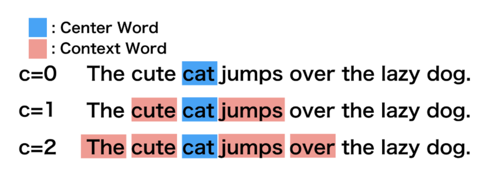 <svg aria-hidden="true" class="w9-evidence-overlay" viewbox="0 0 1716 666"> <g class="current-fragment visible w9-linear-current"> <rect class="w9-evidence-focus" height="97" rx="10" width="165" x="48" y="335"></rect> <rect class="w9-evidence-focus" height="99" rx="10" width="553" x="451" y="335"></rect> <path class="w9-evidence-pointer" d="M 300 305 H 480 L 516 335"></path><polygon class="w9-evidence-pointer-head" points="504,331 523,340 518,320"></polygon> </g> </svg></p>
</div>
</div>
<div class="case-reading w9-concept-reading">
<div class="w9-reading-focus current-fragment visible w9-linear-current">
<p><strong>Window · c = 1:</strong> We take <em>cute</em> and <em>jumps</em> around <em>cat</em>.</p>
</div>
<div class="w9-reading-focus visible">
<p><strong>Window · c = 2:</strong> We also include <em>The</em> and <em>over</em>.</p>
</div>
<div class="w9-reading-focus visible">
<p><strong>Learn:</strong> CBOW (<strong>Continuous Bag of Words</strong>) predicts <em>cat</em> from context. Skip-gram predicts context from <em>cat</em>.</p>
</div>
<div class="w9-reading-focus visible">
<p><strong>Compare:</strong> We use cosine to compare the directions of the learned vectors.</p>
</div>
</div>
</div>
<div class="source">
<p><a href="https://cbail.github.io/textasdata/word2vec/rmarkdown/word2vec.html#the-context-window">Context window diagram</a> · <a href="https://books.google.com.tw/books?id=dL40EAAAQBAJ&amp;pg=PA83"><em>Text as Data</em>, §8.2.4, p. 83</a> · <a href="https://press.princeton.edu/books/paperback/9780691207551/text-as-data">Cosine, §7.1</a></p>
</div>

```

## Learn from context and compare vectors {#learn-from-context-and-compare-vectors-step-2 .w9-linear-slide}

```{=html}

<div class="slide-body case-split">
<div class="case-visual">
<div class="w9-evidence-frame" style="--w9-evidence-ratio:1716 / 666;">
<p> <svg aria-hidden="true" class="w9-evidence-overlay" viewbox="0 0 1716 666"> <g class="current-fragment visible w9-linear-current"> <rect class="w9-evidence-focus" height="97" rx="10" width="165" x="48" y="467"></rect> <rect class="w9-evidence-focus" height="100" rx="10" width="168" x="278" y="463"></rect> <rect class="w9-evidence-focus" height="100" rx="10" width="170" x="1008" y="463"></rect> <path class="w9-evidence-pointer" d="M 235 511 H 277"></path><polygon class="w9-evidence-pointer-head" points="265,503 265,519 281,511"></polygon> <path class="w9-evidence-pointer" d="M 1220 511 H 1180"></path><polygon class="w9-evidence-pointer-head" points="1192,503 1192,519 1176,511"></polygon> </g> </svg></p>
</div>
</div>
<div class="case-reading w9-concept-reading">
<div class="w9-reading-focus visible">
<p><strong>Window · c = 1:</strong> We take <em>cute</em> and <em>jumps</em> around <em>cat</em>.</p>
</div>
<div class="w9-reading-focus current-fragment visible w9-linear-current">
<p><strong>Window · c = 2:</strong> We also include <em>The</em> and <em>over</em>.</p>
</div>
<div class="w9-reading-focus visible">
<p><strong>Learn:</strong> CBOW (<strong>Continuous Bag of Words</strong>) predicts <em>cat</em> from context. Skip-gram predicts context from <em>cat</em>.</p>
</div>
<div class="w9-reading-focus visible">
<p><strong>Compare:</strong> We use cosine to compare the directions of the learned vectors.</p>
</div>
</div>
</div>
<div class="source">
<p><a href="https://cbail.github.io/textasdata/word2vec/rmarkdown/word2vec.html#the-context-window">Context window diagram</a> · <a href="https://books.google.com.tw/books?id=dL40EAAAQBAJ&amp;pg=PA83"><em>Text as Data</em>, §8.2.4, p. 83</a> · <a href="https://press.princeton.edu/books/paperback/9780691207551/text-as-data">Cosine, §7.1</a></p>
</div>

```

## Learn from context and compare vectors {#learn-from-context-and-compare-vectors-step-3 .w9-linear-slide}

```{=html}

<div class="slide-body case-split">
<div class="case-visual">
<div class="w9-evidence-frame" style="--w9-evidence-ratio:1716 / 666;">
<p> <svg aria-hidden="true" class="w9-evidence-overlay" viewbox="0 0 1716 666"> <g class="current-fragment visible w9-linear-current"> <rect class="w9-evidence-focus" height="97" rx="10" width="165" x="48" y="335"></rect> <rect class="w9-evidence-focus" height="97" rx="10" width="134" x="630" y="337"></rect> <path class="w9-evidence-pointer" d="M 535 322 V 306 H 680 V 336"></path><polygon class="w9-evidence-pointer-head" points="672,324 688,324 680,340"></polygon> <path class="w9-evidence-pointer" d="M 876 322 V 306 H 720 V 336"></path><polygon class="w9-evidence-pointer-head" points="712,324 728,324 720,340"></polygon> </g> </svg></p>
</div>
</div>
<div class="case-reading w9-concept-reading">
<div class="w9-reading-focus visible">
<p><strong>Window · c = 1:</strong> We take <em>cute</em> and <em>jumps</em> around <em>cat</em>.</p>
</div>
<div class="w9-reading-focus visible">
<p><strong>Window · c = 2:</strong> We also include <em>The</em> and <em>over</em>.</p>
</div>
<div class="w9-reading-focus current-fragment visible w9-linear-current">
<p><strong>Learn:</strong> CBOW (<strong>Continuous Bag of Words</strong>) predicts <em>cat</em> from context. Skip-gram predicts context from <em>cat</em>.</p>
</div>
<div class="w9-reading-focus visible">
<p><strong>Compare:</strong> We use cosine to compare the directions of the learned vectors.</p>
</div>
</div>
</div>
<div class="source">
<p><a href="https://cbail.github.io/textasdata/word2vec/rmarkdown/word2vec.html#the-context-window">Context window diagram</a> · <a href="https://books.google.com.tw/books?id=dL40EAAAQBAJ&amp;pg=PA83"><em>Text as Data</em>, §8.2.4, p. 83</a> · <a href="https://press.princeton.edu/books/paperback/9780691207551/text-as-data">Cosine, §7.1</a></p>
</div>

```

## Learn from context and compare vectors {#learn-from-context-and-compare-vectors-step-4 .w9-linear-slide}

```{=html}

<div class="slide-body case-split">
<div class="case-visual">
<div class="w9-evidence-frame" style="--w9-evidence-ratio:1716 / 666;">
<p> <svg aria-hidden="true" class="w9-evidence-overlay" viewbox="0 0 1716 666"> </svg></p>
</div>
</div>
<div class="case-reading w9-concept-reading">
<div class="w9-reading-focus visible">
<p><strong>Window · c = 1:</strong> We take <em>cute</em> and <em>jumps</em> around <em>cat</em>.</p>
</div>
<div class="w9-reading-focus visible">
<p><strong>Window · c = 2:</strong> We also include <em>The</em> and <em>over</em>.</p>
</div>
<div class="w9-reading-focus visible">
<p><strong>Learn:</strong> CBOW (<strong>Continuous Bag of Words</strong>) predicts <em>cat</em> from context. Skip-gram predicts context from <em>cat</em>.</p>
</div>
<div class="w9-reading-focus current-fragment visible w9-linear-current">
<p><strong>Compare:</strong> We use cosine to compare the directions of the learned vectors.</p>
</div>
</div>
</div>
<div class="source">
<p><a href="https://cbail.github.io/textasdata/word2vec/rmarkdown/word2vec.html#the-context-window">Context window diagram</a> · <a href="https://books.google.com.tw/books?id=dL40EAAAQBAJ&amp;pg=PA83"><em>Text as Data</em>, §8.2.4, p. 83</a> · <a href="https://press.princeton.edu/books/paperback/9780691207551/text-as-data">Cosine, §7.1</a></p>
</div>

```

## Training choices shape the available vectors {#training-choices-shape-the-available-vectors .w9-linear-slide}

```{=html}

<div class="slide-body compact-table case-workflow">
<table>
<colgroup>
<col style="width: 33%"/>
<col style="width: 33%"/>
<col style="width: 33%"/>
</colgroup>
<thead>
<tr>
<th>Method or interface</th>
<th>Learning signal</th>
<th>Representation</th>
</tr>
</thead>
<tbody>
<tr>
<td><span aria-hidden="true" class="w9-row-focus current-fragment visible w9-linear-current"><svg viewbox="0 0 18 18"><path d="M 2 9 H 15 M 9 3 L 15 9 L 9 15"></path></svg></span> <strong>Word2Vec</strong></td>
<td>CBOW: context → word.<br/>Skip-gram: word → context.</td>
<td>Static word vector</td>
</tr>
<tr>
<td> <strong>GloVe</strong><br/>Global Vectors for Word Representation</td>
<td>Fit corpus-wide word co-occurrence statistics.</td>
<td>Static word vector</td>
</tr>
<tr>
<td> <strong>fastText</strong></td>
<td>Predict from context with character n-grams.</td>
<td>Static word vector</td>
</tr>
<tr>
<td> <strong>FlairEmbeddings</strong></td>
<td>Character language models use surrounding text.</td>
<td>Contextual token vector</td>
</tr>
</tbody>
</table>
<div class="w9-lab-focus-target">
<p> <strong>Lab choice:</strong> We use Flair’s <code>WordEmbeddings("glove")</code> to load <strong>static GloVe</strong>.</p>
</div>
</div>
<div class="source">
<p><a href="https://books.google.com.tw/books?id=dL40EAAAQBAJ&amp;pg=PA83">Text as Data, pp. 83–84</a> · <a href="https://aclanthology.org/D14-1162/">GloVe</a> · <a href="https://aclanthology.org/Q17-1010/">fastText</a> · <a href="https://flairnlp.github.io/docs/tutorial-embeddings/flair-embeddings">Flair contextual embeddings</a></p>
</div>

```

## Training choices shape the available vectors {#training-choices-shape-the-available-vectors-step-2 .w9-linear-slide}

```{=html}

<div class="slide-body compact-table case-workflow">
<table>
<colgroup>
<col style="width: 33%"/>
<col style="width: 33%"/>
<col style="width: 33%"/>
</colgroup>
<thead>
<tr>
<th>Method or interface</th>
<th>Learning signal</th>
<th>Representation</th>
</tr>
</thead>
<tbody>
<tr>
<td> <strong>Word2Vec</strong></td>
<td>CBOW: context → word.<br/>Skip-gram: word → context.</td>
<td>Static word vector</td>
</tr>
<tr>
<td><span aria-hidden="true" class="w9-row-focus current-fragment visible w9-linear-current"><svg viewbox="0 0 18 18"><path d="M 2 9 H 15 M 9 3 L 15 9 L 9 15"></path></svg></span> <strong>GloVe</strong><br/>Global Vectors for Word Representation</td>
<td>Fit corpus-wide word co-occurrence statistics.</td>
<td>Static word vector</td>
</tr>
<tr>
<td> <strong>fastText</strong></td>
<td>Predict from context with character n-grams.</td>
<td>Static word vector</td>
</tr>
<tr>
<td> <strong>FlairEmbeddings</strong></td>
<td>Character language models use surrounding text.</td>
<td>Contextual token vector</td>
</tr>
</tbody>
</table>
<div class="w9-lab-focus-target">
<p> <strong>Lab choice:</strong> We use Flair’s <code>WordEmbeddings("glove")</code> to load <strong>static GloVe</strong>.</p>
</div>
</div>
<div class="source">
<p><a href="https://books.google.com.tw/books?id=dL40EAAAQBAJ&amp;pg=PA83">Text as Data, pp. 83–84</a> · <a href="https://aclanthology.org/D14-1162/">GloVe</a> · <a href="https://aclanthology.org/Q17-1010/">fastText</a> · <a href="https://flairnlp.github.io/docs/tutorial-embeddings/flair-embeddings">Flair contextual embeddings</a></p>
</div>

```

## Training choices shape the available vectors {#training-choices-shape-the-available-vectors-step-3 .w9-linear-slide}

```{=html}

<div class="slide-body compact-table case-workflow">
<table>
<colgroup>
<col style="width: 33%"/>
<col style="width: 33%"/>
<col style="width: 33%"/>
</colgroup>
<thead>
<tr>
<th>Method or interface</th>
<th>Learning signal</th>
<th>Representation</th>
</tr>
</thead>
<tbody>
<tr>
<td> <strong>Word2Vec</strong></td>
<td>CBOW: context → word.<br/>Skip-gram: word → context.</td>
<td>Static word vector</td>
</tr>
<tr>
<td> <strong>GloVe</strong><br/>Global Vectors for Word Representation</td>
<td>Fit corpus-wide word co-occurrence statistics.</td>
<td>Static word vector</td>
</tr>
<tr>
<td><span aria-hidden="true" class="w9-row-focus current-fragment visible w9-linear-current"><svg viewbox="0 0 18 18"><path d="M 2 9 H 15 M 9 3 L 15 9 L 9 15"></path></svg></span> <strong>fastText</strong></td>
<td>Predict from context with character n-grams.</td>
<td>Static word vector</td>
</tr>
<tr>
<td> <strong>FlairEmbeddings</strong></td>
<td>Character language models use surrounding text.</td>
<td>Contextual token vector</td>
</tr>
</tbody>
</table>
<div class="w9-lab-focus-target">
<p> <strong>Lab choice:</strong> We use Flair’s <code>WordEmbeddings("glove")</code> to load <strong>static GloVe</strong>.</p>
</div>
</div>
<div class="source">
<p><a href="https://books.google.com.tw/books?id=dL40EAAAQBAJ&amp;pg=PA83">Text as Data, pp. 83–84</a> · <a href="https://aclanthology.org/D14-1162/">GloVe</a> · <a href="https://aclanthology.org/Q17-1010/">fastText</a> · <a href="https://flairnlp.github.io/docs/tutorial-embeddings/flair-embeddings">Flair contextual embeddings</a></p>
</div>

```

## Training choices shape the available vectors {#training-choices-shape-the-available-vectors-step-4 .w9-linear-slide}

```{=html}

<div class="slide-body compact-table case-workflow">
<table>
<colgroup>
<col style="width: 33%"/>
<col style="width: 33%"/>
<col style="width: 33%"/>
</colgroup>
<thead>
<tr>
<th>Method or interface</th>
<th>Learning signal</th>
<th>Representation</th>
</tr>
</thead>
<tbody>
<tr>
<td> <strong>Word2Vec</strong></td>
<td>CBOW: context → word.<br/>Skip-gram: word → context.</td>
<td>Static word vector</td>
</tr>
<tr>
<td> <strong>GloVe</strong><br/>Global Vectors for Word Representation</td>
<td>Fit corpus-wide word co-occurrence statistics.</td>
<td>Static word vector</td>
</tr>
<tr>
<td> <strong>fastText</strong></td>
<td>Predict from context with character n-grams.</td>
<td>Static word vector</td>
</tr>
<tr>
<td><span aria-hidden="true" class="w9-row-focus current-fragment visible w9-linear-current"><svg viewbox="0 0 18 18"><path d="M 2 9 H 15 M 9 3 L 15 9 L 9 15"></path></svg></span> <strong>FlairEmbeddings</strong></td>
<td>Character language models use surrounding text.</td>
<td>Contextual token vector</td>
</tr>
</tbody>
</table>
<div class="w9-lab-focus-target">
<p> <strong>Lab choice:</strong> We use Flair’s <code>WordEmbeddings("glove")</code> to load <strong>static GloVe</strong>.</p>
</div>
</div>
<div class="source">
<p><a href="https://books.google.com.tw/books?id=dL40EAAAQBAJ&amp;pg=PA83">Text as Data, pp. 83–84</a> · <a href="https://aclanthology.org/D14-1162/">GloVe</a> · <a href="https://aclanthology.org/Q17-1010/">fastText</a> · <a href="https://flairnlp.github.io/docs/tutorial-embeddings/flair-embeddings">Flair contextual embeddings</a></p>
</div>

```

## Training choices shape the available vectors {#training-choices-shape-the-available-vectors-step-5 .w9-linear-slide}

```{=html}

<div class="slide-body compact-table case-workflow">
<table>
<colgroup>
<col style="width: 33%"/>
<col style="width: 33%"/>
<col style="width: 33%"/>
</colgroup>
<thead>
<tr>
<th>Method or interface</th>
<th>Learning signal</th>
<th>Representation</th>
</tr>
</thead>
<tbody>
<tr>
<td> <strong>Word2Vec</strong></td>
<td>CBOW: context → word.<br/>Skip-gram: word → context.</td>
<td>Static word vector</td>
</tr>
<tr>
<td> <strong>GloVe</strong><br/>Global Vectors for Word Representation</td>
<td>Fit corpus-wide word co-occurrence statistics.</td>
<td>Static word vector</td>
</tr>
<tr>
<td> <strong>fastText</strong></td>
<td>Predict from context with character n-grams.</td>
<td>Static word vector</td>
</tr>
<tr>
<td> <strong>FlairEmbeddings</strong></td>
<td>Character language models use surrounding text.</td>
<td>Contextual token vector</td>
</tr>
</tbody>
</table>
<div class="w9-lab-focus-target">
<p><span aria-hidden="true" class="w9-row-focus current-fragment visible w9-linear-current"><svg viewbox="0 0 18 18"><path d="M 2 9 H 15 M 9 3 L 15 9 L 9 15"></path></svg></span> <strong>Lab choice:</strong> We use Flair’s <code>WordEmbeddings("glove")</code> to load <strong>static GloVe</strong>.</p>
</div>
</div>
<div class="source">
<p><a href="https://books.google.com.tw/books?id=dL40EAAAQBAJ&amp;pg=PA83">Text as Data, pp. 83–84</a> · <a href="https://aclanthology.org/D14-1162/">GloVe</a> · <a href="https://aclanthology.org/Q17-1010/">fastText</a> · <a href="https://flairnlp.github.io/docs/tutorial-embeddings/flair-embeddings">Flair contextual embeddings</a></p>
</div>

```

## How four journal articles use embeddings {#how-four-journal-articles-use-embeddings .w9-linear-slide}

```{=html}

<div class="slide-body compact-table">
<table>
<colgroup>
<col style="width: 33%"/>
<col style="width: 33%"/>
<col style="width: 33%"/>
</colgroup>
<thead>
<tr>
<th>Case</th>
<th>Texts</th>
<th>How embeddings are used</th>
</tr>
</thead>
<tbody>
<tr>
<td><a href="#can-parliamentary-language-reveal-party-positions"><strong>Case 1 · Rheault &amp; Cochrane</strong></a></td>
<td>Parliamentary speech</td>
<td>Estimate party positions</td>
</tr>
<tr>
<td><a href="#has-equality-meant-the-same-thing-over-time"><strong>Case 2 · Rodman</strong></a></td>
<td>News about <em>equality</em></td>
<td>Track a concept across eras</td>
</tr>
<tr>
<td><a href="#which-parties-appeal-to-a-better-past"><strong>Case 3 · Müller &amp; Proksch</strong></a></td>
<td>European party manifestos</td>
<td>Find candidates for a nostalgia dictionary</td>
</tr>
<tr>
<td><a href="#do-parties-use-immigration-in-the-same-way"><strong>Case 4 · Rodriguez et al.</strong></a></td>
<td>U.S. Congressional Record</td>
<td>Compare party and gender differences in word use</td>
</tr>
</tbody>
</table>
<p>We follow four studies, asking what gets a vector and how each result helps answer the research question.</p>
</div>
<div class="source">
<p><a href="https://doi.org/10.1017/pan.2019.26">Rheault &amp; Cochrane (2020)</a> · <a href="https://doi.org/10.1017/pan.2019.23">Rodman (2020)</a> · <a href="https://doi.org/10.1017/S0003055422001228">Rodriguez et al. (2023)</a> · <a href="https://doi.org/10.1017/S0007123423000571">Müller &amp; Proksch (2024)</a></p>
</div>

```

## Case 1 · Party positions in parliament {#can-parliamentary-language-reveal-party-positions .w9-linear-slide}

```{=html}

<p class="w9-study-label">
<strong>Case 1 · Party positions</strong>
</p>
<div class="slide-body">
<div class="case-split case-intro-grid">
<div class="case-visual paper-heading">
<p>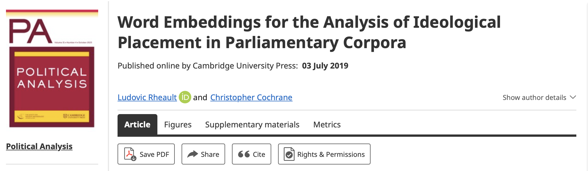</p>
<p class="case-paper-authors">
<strong>Ludovic Rheault and Christopher Cochrane</strong>
</p>
<p class="case-paper-journal">
<em>Political Analysis</em>, 2020 · Cambridge article page
</p>
</div>
<div class="case-reading">
<ul>
<li><strong>Background</strong> Roll-call votes offer one way to locate parties on a political scale.</li>
<li><strong>Question</strong> Can speeches also reveal party positions and how they change between terms?</li>
<li><strong>Texts</strong> Parliamentary debates from the United States, Britain and Canada. The model represents each party in each legislative term.</li>
</ul>
</div>
</div>
</div>
<div class="source">
<p><a href="https://doi.org/10.1017/pan.2019.26">Rheault &amp; Cochrane (2020), <em>Political Analysis</em> 28(1), 112–133</a> · <a href="https://lrheault.github.io/downloads/rheaultcochrane2019_pa.pdf">Author preprint</a></p>
</div>

```

## Learn party embeddings with political metadata {#learn-party-embeddings-with-political-metadata .w9-linear-slide}

```{=html}

<p class="w9-study-label">
<strong>Case 1 · Party positions</strong>
</p>
<div class="slide-body">
<p class="case-label">
How embeddings are used
</p>
<div class="case-split case-flow-split">
<div class="case-visual">
<div class="w9-evidence-frame" style="--w9-evidence-ratio: 1280 / 846; --w9-evidence-max-height: 370px;">
<p>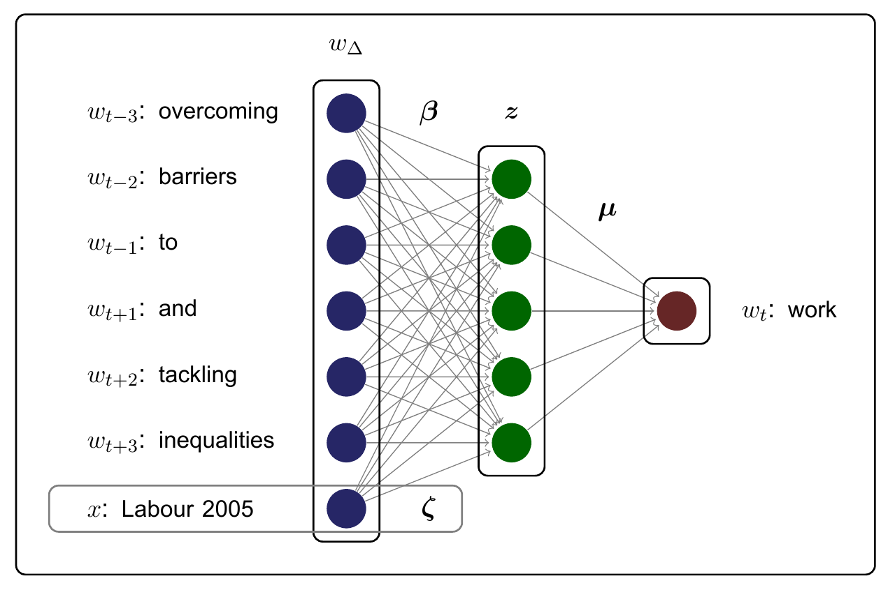 <svg aria-hidden="true" class="w9-evidence-overlay" viewbox="0 0 1280 846"> <g class="current-fragment visible w9-linear-current"> <rect class="w9-evidence-focus" height="538" rx="12" width="300" x="113" y="124"></rect> <rect class="w9-evidence-focus" height="62" rx="9" width="163" x="1047" y="413"></rect> <path class="w9-evidence-pointer" d="M 1122 322 V 399"></path> <polygon class="w9-evidence-pointer-head" points="1122,399 1111,379 1133,379"></polygon> </g> </svg></p>
</div>
</div>
<div class="case-reading">
<div class="w9-reading-focus current-fragment visible w9-linear-current">
<p><strong>1. Predict:</strong> The model predicts <em>work</em> from context and the party-term label.</p>
</div>
<div class="w9-reading-focus visible">
<p><strong>2. Represent:</strong> Each party in each term receives a vector, here <strong>Labour 2005</strong>.</p>
</div>
<div class="w9-reading-focus visible">
<p><strong>3. Project:</strong> We use PCA to compare the party-term vectors on PC1, shown next.</p>
</div>
</div>
</div>
</div>
<div class="source">
<p><a href="https://lrheault.github.io/downloads/rheaultcochrane2019_pa.pdf#page=9">Rheault and Cochrane (2020), author preprint Figure 1, p. 8</a>.</p>
</div>

```

## Learn party embeddings with political metadata {#learn-party-embeddings-with-political-metadata-step-2 .w9-linear-slide}

```{=html}

<p class="w9-study-label">
<strong>Case 1 · Party positions</strong>
</p>
<div class="slide-body">
<p class="case-label">
How embeddings are used
</p>
<div class="case-split case-flow-split">
<div class="case-visual">
<div class="w9-evidence-frame" style="--w9-evidence-ratio: 1280 / 846; --w9-evidence-max-height: 370px;">
<p> <svg aria-hidden="true" class="w9-evidence-overlay" viewbox="0 0 1280 846"> <g class="current-fragment visible w9-linear-current"> <rect class="w9-evidence-focus" height="84" rx="13" width="610" x="61" y="687"></rect> <path class="w9-evidence-pointer" d="M 264 795 V 778"></path> <polygon class="w9-evidence-pointer-head" points="264,778 254,795 274,795"></polygon> </g> </svg></p>
</div>
</div>
<div class="case-reading">
<div class="w9-reading-focus visible">
<p><strong>1. Predict:</strong> The model predicts <em>work</em> from context and the party-term label.</p>
</div>
<div class="w9-reading-focus current-fragment visible w9-linear-current">
<p><strong>2. Represent:</strong> Each party in each term receives a vector, here <strong>Labour 2005</strong>.</p>
</div>
<div class="w9-reading-focus visible">
<p><strong>3. Project:</strong> We use PCA to compare the party-term vectors on PC1, shown next.</p>
</div>
</div>
</div>
</div>
<div class="source">
<p><a href="https://lrheault.github.io/downloads/rheaultcochrane2019_pa.pdf#page=9">Rheault and Cochrane (2020), author preprint Figure 1, p. 8</a>.</p>
</div>

```

## Learn party embeddings with political metadata {#learn-party-embeddings-with-political-metadata-step-3 .w9-linear-slide}

```{=html}

<p class="w9-study-label">
<strong>Case 1 · Party positions</strong>
</p>
<div class="slide-body">
<p class="case-label">
How embeddings are used
</p>
<div class="case-split case-flow-split">
<div class="case-visual">
<div class="w9-evidence-frame" style="--w9-evidence-ratio: 1280 / 846; --w9-evidence-max-height: 370px;">
<p> <svg aria-hidden="true" class="w9-evidence-overlay" viewbox="0 0 1280 846"> <g class="current-fragment visible w9-linear-current"> <rect class="w9-evidence-focus" height="84" rx="12" width="223" x="437" y="687"></rect> <path class="w9-evidence-pointer" d="M 790 738 H 679"></path> <polygon class="w9-evidence-pointer-head" points="679,738 700,727 700,749"></polygon> </g> </svg></p>
</div>
</div>
<div class="case-reading">
<div class="w9-reading-focus visible">
<p><strong>1. Predict:</strong> The model predicts <em>work</em> from context and the party-term label.</p>
</div>
<div class="w9-reading-focus visible">
<p><strong>2. Represent:</strong> Each party in each term receives a vector, here <strong>Labour 2005</strong>.</p>
</div>
<div class="w9-reading-focus current-fragment visible w9-linear-current">
<p><strong>3. Project:</strong> We use PCA to compare the party-term vectors on PC1, shown next.</p>
</div>
</div>
</div>
</div>
<div class="source">
<p><a href="https://lrheault.github.io/downloads/rheaultcochrane2019_pa.pdf#page=9">Rheault and Cochrane (2020), author preprint Figure 1, p. 8</a>.</p>
</div>

```

## From party vectors to a political dimension {#from-party-vectors-to-a-political-dimension .w9-linear-slide}

```{=html}

<p class="w9-study-label">
<strong>Case 1 · Party positions</strong>
</p>
<div class="slide-body">
<div class="case-split">
<div class="case-visual">
<div class="w9-evidence-frame" style="--w9-evidence-ratio: 715 / 567;">
<p>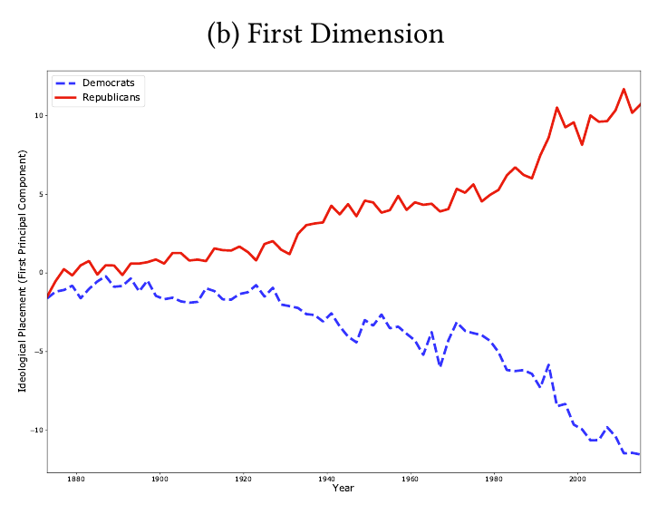 <svg aria-hidden="true" class="w9-evidence-overlay" viewbox="0 0 715 567"> <g class="current-fragment visible w9-linear-current"> <rect class="w9-evidence-focus" height="297" rx="5" width="30" x="8" y="153"></rect> <rect class="w9-evidence-focus" height="18" rx="4" width="40" x="359" y="530"></rect> </g> </svg></p>
</div>
</div>
<div class="case-reading">
<div class="w9-reading-focus current-fragment visible w9-linear-current">
<p><strong>Read the axes:</strong> We compare years horizontally and PC1 vertically. PC1 captures the greatest variation across party-term vectors.</p>
</div>
<div class="w9-reading-focus visible">
<p><strong>1920 bracket:</strong> We see a small gap: Democrats are dashed blue; Republicans solid red.</p>
</div>
<div class="w9-reading-focus visible">
<p><strong>Answer:</strong> By <strong>2000</strong>, we see the parties much farther apart on this speech-based scale.</p>
</div>
</div>
</div>
</div>
<div class="source">
<p><a href="https://lrheault.github.io/downloads/rheaultcochrane2019_pa.pdf#page=16">Rheault and Cochrane (2020), author preprint Figure 2b, p. 15</a>.</p>
</div>

```

## From party vectors to a political dimension {#from-party-vectors-to-a-political-dimension-step-2 .w9-linear-slide}

```{=html}

<p class="w9-study-label">
<strong>Case 1 · Party positions</strong>
</p>
<div class="slide-body">
<div class="case-split">
<div class="case-visual">
<div class="w9-evidence-frame" style="--w9-evidence-ratio: 715 / 567;">
<p> <svg aria-hidden="true" class="w9-evidence-overlay" viewbox="0 0 715 567"> <g class="current-fragment visible w9-linear-current"> <path class="w9-evidence-focus" d="M 282 275 H 269 V 322 H 282"></path> <path class="w9-evidence-pointer" d="M 192 230 L 256 283"></path> <polygon class="w9-evidence-pointer-head" points="256,283 238,277 248,264"></polygon> </g> </svg></p>
</div>
</div>
<div class="case-reading">
<div class="w9-reading-focus visible">
<p><strong>Read the axes:</strong> We compare years horizontally and PC1 vertically. PC1 captures the greatest variation across party-term vectors.</p>
</div>
<div class="w9-reading-focus current-fragment visible w9-linear-current">
<p><strong>1920 bracket:</strong> We see a small gap: Democrats are dashed blue; Republicans solid red.</p>
</div>
<div class="w9-reading-focus visible">
<p><strong>Answer:</strong> By <strong>2000</strong>, we see the parties much farther apart on this speech-based scale.</p>
</div>
</div>
</div>
</div>
<div class="source">
<p><a href="https://lrheault.github.io/downloads/rheaultcochrane2019_pa.pdf#page=16">Rheault and Cochrane (2020), author preprint Figure 2b, p. 15</a>.</p>
</div>

```

## From party vectors to a political dimension {#from-party-vectors-to-a-political-dimension-step-3 .w9-linear-slide}

```{=html}

<p class="w9-study-label">
<strong>Case 1 · Party positions</strong>
</p>
<div class="slide-body">
<div class="case-split">
<div class="case-visual">
<div class="w9-evidence-frame" style="--w9-evidence-ratio: 715 / 567;">
<p> <svg aria-hidden="true" class="w9-evidence-overlay" viewbox="0 0 715 567"> <g class="current-fragment visible w9-linear-current"> <path class="w9-evidence-focus" d="M 282 275 H 269 V 322 H 282"></path> <path class="w9-evidence-focus" d="M 664 151 H 650 V 468 H 664"></path> <path class="w9-evidence-pointer" d="M 563 293 H 636"></path> <polygon class="w9-evidence-pointer-head" points="636,293 617,283 617,303"></polygon> </g> </svg></p>
</div>
</div>
<div class="case-reading">
<div class="w9-reading-focus visible">
<p><strong>Read the axes:</strong> We compare years horizontally and PC1 vertically. PC1 captures the greatest variation across party-term vectors.</p>
</div>
<div class="w9-reading-focus visible">
<p><strong>1920 bracket:</strong> We see a small gap: Democrats are dashed blue; Republicans solid red.</p>
</div>
<div class="w9-reading-focus current-fragment visible w9-linear-current">
<p><strong>Answer:</strong> By <strong>2000</strong>, we see the parties much farther apart on this speech-based scale.</p>
</div>
</div>
</div>
</div>
<div class="source">
<p><a href="https://lrheault.github.io/downloads/rheaultcochrane2019_pa.pdf#page=16">Rheault and Cochrane (2020), author preprint Figure 2b, p. 15</a>.</p>
</div>

```

## Validate the positions outside the model {#validate-the-positions-outside-the-model .w9-linear-slide}

```{=html}

<p class="w9-study-label">
<strong>Case 1 · Party positions</strong>
</p>
<div class="slide-body">
<div class="case-split">
<div class="case-visual">
<div class="w9-evidence-frame" style="--w9-evidence-ratio: 1384 / 738;">
<p>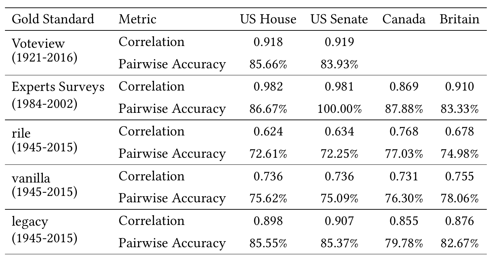 <svg aria-hidden="true" class="w9-evidence-overlay" viewbox="0 0 1384 738"> <g class="current-fragment visible w9-linear-current"> <rect class="w9-evidence-focus" height="115" rx="10" width="183" x="664" y="28"></rect> <path class="w9-evidence-pointer" d="M 613 115 H 687"></path> <polygon class="w9-evidence-pointer-head" points="687,115 664,104 664,126"></polygon> </g> </svg></p>
</div>
</div>
<div class="case-reading">
<div class="w9-reading-focus current-fragment visible w9-linear-current">
<p><strong>U.S. House</strong> Speech-based PC1 correlates <strong>0.918</strong> with Voteview party averages (1921–2016).</p>
</div>
<div class="w9-reading-focus visible">
<p><strong>Next row:</strong> We read <strong>85.66%</strong> agreement on party-term pair orderings.</p>
</div>
<div class="w9-reading-focus visible">
<p><strong>Answer:</strong> We can read PC1 as a left–right scale in this overlapping period. Agreement varies across benchmarks.</p>
</div>
</div>
</div>
</div>
<div class="source">
<p><a href="https://lrheault.github.io/downloads/rheaultcochrane2019_pa.pdf#page=21">Rheault and Cochrane (2020), author preprint Table 2, p. 20</a>.</p>
</div>

```

## Validate the positions outside the model {#validate-the-positions-outside-the-model-step-2 .w9-linear-slide}

```{=html}

<p class="w9-study-label">
<strong>Case 1 · Party positions</strong>
</p>
<div class="slide-body">
<div class="case-split">
<div class="case-visual">
<div class="w9-evidence-frame" style="--w9-evidence-ratio: 1384 / 738;">
<p> <svg aria-hidden="true" class="w9-evidence-overlay" viewbox="0 0 1384 738"> <g class="current-fragment visible w9-linear-current"> <rect class="w9-evidence-focus" height="47" rx="9" width="142" x="687" y="155"></rect> <path class="w9-evidence-pointer" d="M 613 178 H 672"></path> <polygon class="w9-evidence-pointer-head" points="672,178 649,167 649,189"></polygon> </g> </svg></p>
</div>
</div>
<div class="case-reading">
<div class="w9-reading-focus visible">
<p><strong>U.S. House</strong> Speech-based PC1 correlates <strong>0.918</strong> with Voteview party averages (1921–2016).</p>
</div>
<div class="w9-reading-focus current-fragment visible w9-linear-current">
<p><strong>Next row:</strong> We read <strong>85.66%</strong> agreement on party-term pair orderings.</p>
</div>
<div class="w9-reading-focus visible">
<p><strong>Answer:</strong> We can read PC1 as a left–right scale in this overlapping period. Agreement varies across benchmarks.</p>
</div>
</div>
</div>
</div>
<div class="source">
<p><a href="https://lrheault.github.io/downloads/rheaultcochrane2019_pa.pdf#page=21">Rheault and Cochrane (2020), author preprint Table 2, p. 20</a>.</p>
</div>

```

## Validate the positions outside the model {#validate-the-positions-outside-the-model-step-3 .w9-linear-slide}

```{=html}

<p class="w9-study-label">
<strong>Case 1 · Party positions</strong>
</p>
<div class="slide-body">
<div class="case-split">
<div class="case-visual">
<div class="w9-evidence-frame" style="--w9-evidence-ratio: 1384 / 738;">
<p> <svg aria-hidden="true" class="w9-evidence-overlay" viewbox="0 0 1384 738"> <g class="current-fragment visible w9-linear-current"> <rect class="w9-evidence-focus" height="108" rx="9" width="142" x="687" y="94"></rect> </g> </svg></p>
</div>
</div>
<div class="case-reading">
<div class="w9-reading-focus visible">
<p><strong>U.S. House</strong> Speech-based PC1 correlates <strong>0.918</strong> with Voteview party averages (1921–2016).</p>
</div>
<div class="w9-reading-focus visible">
<p><strong>Next row:</strong> We read <strong>85.66%</strong> agreement on party-term pair orderings.</p>
</div>
<div class="w9-reading-focus current-fragment visible w9-linear-current">
<p><strong>Answer:</strong> We can read PC1 as a left–right scale in this overlapping period. Agreement varies across benchmarks.</p>
</div>
</div>
</div>
</div>
<div class="source">
<p><a href="https://lrheault.github.io/downloads/rheaultcochrane2019_pa.pdf#page=21">Rheault and Cochrane (2020), author preprint Table 2, p. 20</a>.</p>
</div>

```

## Case 2 · The changing meaning of equality {#has-equality-meant-the-same-thing-over-time .w9-linear-slide}

```{=html}

<p class="w9-study-label">
<strong>Case 2 · Semantic change</strong>
</p>
<div class="slide-body">
<div class="case-split case-intro-grid">
<div class="case-visual paper-heading">
<p>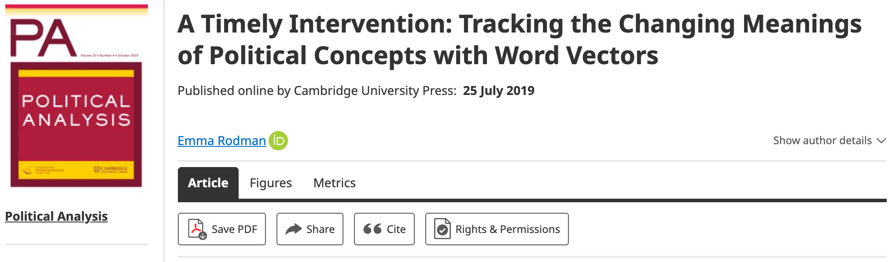</p>
<p class="case-paper-authors">
<strong>Emma Rodman</strong>
</p>
<p class="case-paper-journal">
<em>Political Analysis</em>, 2020 · Cambridge article page
</p>
</div>
<div class="case-reading">
<ul>
<li><strong>Background</strong> The word <em>equality</em> persists while debates about it change.</li>
<li><strong>Question</strong> Which groups and issues are associated with <em>equality</em> in different eras?</li>
<li><strong>Texts</strong> 3,105 news items from the New York Times Article API with <em>equality</em> in the headline, 1855–2016.</li>
</ul>
</div>
</div>
</div>
<div class="source">
<p><a href="https://doi.org/10.1017/pan.2019.23">Rodman (2020), <em>Political Analysis</em> 28(1), 87–111</a> · <a href="https://emmarodman.com/s/Diachronic_Word_Vectors___Political_Analysis_Final_Version.pdf">Author manuscript</a></p>
</div>

```

## Newspaper contexts become historical evidence {#newspaper-contexts-become-historical-evidence .w9-linear-slide}

```{=html}

<p class="w9-study-label">
<strong>Case 2 · Semantic change</strong>
</p>
<div class="slide-body compact-table case-workflow">
<p class="case-label">
How embeddings are used
</p>
<table>
<colgroup>
<col style="width: 50%"/>
<col style="width: 50%"/>
</colgroup>
<thead>
<tr>
<th>Research step</th>
<th>What Rodman does</th>
</tr>
</thead>
<tbody>
<tr>
<td><span aria-hidden="true" class="w9-row-focus current-fragment visible w9-linear-current"><svg viewbox="0 0 18 18"><path d="M 2 9 H 15 M 9 3 L 15 9 L 9 15"></path></svg></span><strong>Collect contexts</strong></td>
<td>Use headlines, abstracts and first paragraphs when available. Group the items into seven eras.</td>
</tr>
<tr>
<td><strong>Estimate embeddings</strong></td>
<td>Compare four Word2Vec training schemes. Each produces word vectors by era.</td>
</tr>
<tr>
<td><strong>Track associations</strong></td>
<td>Compute cosine between <em>equality</em> and selected words within each era. Follow those scores across eras.</td>
</tr>
</tbody>
</table>
</div>
<div class="source">
<p><a href="https://emmarodman.com/s/Diachronic_Word_Vectors___Political_Analysis_Final_Version.pdf#page=18">Rodman (2020), author manuscript §§5.2, 5.4</a>.</p>
</div>

```

## Newspaper contexts become historical evidence {#newspaper-contexts-become-historical-evidence-step-2 .w9-linear-slide}

```{=html}

<p class="w9-study-label">
<strong>Case 2 · Semantic change</strong>
</p>
<div class="slide-body compact-table case-workflow">
<p class="case-label">
How embeddings are used
</p>
<table>
<colgroup>
<col style="width: 50%"/>
<col style="width: 50%"/>
</colgroup>
<thead>
<tr>
<th>Research step</th>
<th>What Rodman does</th>
</tr>
</thead>
<tbody>
<tr>
<td><strong>Collect contexts</strong></td>
<td>Use headlines, abstracts and first paragraphs when available. Group the items into seven eras.</td>
</tr>
<tr>
<td><span aria-hidden="true" class="w9-row-focus current-fragment visible w9-linear-current"><svg viewbox="0 0 18 18"><path d="M 2 9 H 15 M 9 3 L 15 9 L 9 15"></path></svg></span><strong>Estimate embeddings</strong></td>
<td>Compare four Word2Vec training schemes. Each produces word vectors by era.</td>
</tr>
<tr>
<td><strong>Track associations</strong></td>
<td>Compute cosine between <em>equality</em> and selected words within each era. Follow those scores across eras.</td>
</tr>
</tbody>
</table>
</div>
<div class="source">
<p><a href="https://emmarodman.com/s/Diachronic_Word_Vectors___Political_Analysis_Final_Version.pdf#page=18">Rodman (2020), author manuscript §§5.2, 5.4</a>.</p>
</div>

```

## Newspaper contexts become historical evidence {#newspaper-contexts-become-historical-evidence-step-3 .w9-linear-slide}

```{=html}

<p class="w9-study-label">
<strong>Case 2 · Semantic change</strong>
</p>
<div class="slide-body compact-table case-workflow">
<p class="case-label">
How embeddings are used
</p>
<table>
<colgroup>
<col style="width: 50%"/>
<col style="width: 50%"/>
</colgroup>
<thead>
<tr>
<th>Research step</th>
<th>What Rodman does</th>
</tr>
</thead>
<tbody>
<tr>
<td><strong>Collect contexts</strong></td>
<td>Use headlines, abstracts and first paragraphs when available. Group the items into seven eras.</td>
</tr>
<tr>
<td><strong>Estimate embeddings</strong></td>
<td>Compare four Word2Vec training schemes. Each produces word vectors by era.</td>
</tr>
<tr>
<td><span aria-hidden="true" class="w9-row-focus current-fragment visible w9-linear-current"><svg viewbox="0 0 18 18"><path d="M 2 9 H 15 M 9 3 L 15 9 L 9 15"></path></svg></span><strong>Track associations</strong></td>
<td>Compute cosine between <em>equality</em> and selected words within each era. Follow those scores across eras.</td>
</tr>
</tbody>
</table>
</div>
<div class="source">
<p><a href="https://emmarodman.com/s/Diachronic_Word_Vectors___Political_Analysis_Final_Version.pdf#page=18">Rodman (2020), author manuscript §§5.2, 5.4</a>.</p>
</div>

```

## Compare time-sensitive word vectors {#compare-time-sensitive-word-vectors .w9-linear-slide}

```{=html}

<p class="w9-study-label">
<strong>Case 2 · Semantic change</strong>
</p>
<div class="slide-body">
<div class="case-split">
<div class="case-visual">
<div class="w9-evidence-frame" style="--w9-evidence-ratio: 1300 / 270;">
<p>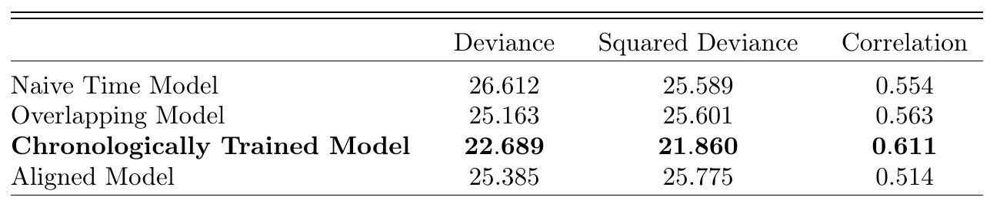 <svg aria-hidden="true" class="w9-evidence-overlay" viewbox="0 0 1300 270"> <g class="current-fragment visible w9-linear-current"> <rect class="w9-evidence-focus" height="46" rx="8" width="702" x="571" y="28"></rect> </g> </svg></p>
</div>
</div>
<div class="case-reading">
<div class="w9-reading-focus current-fragment visible w9-linear-current">
<p><strong>Read the columns:</strong> We look for lower deviations and higher correlation with the benchmark.</p>
</div>
<div class="w9-reading-focus visible">
<p><strong>Compare the row:</strong> The chronological row has the highest correlation (<strong>0.611</strong>) and lowest deviations.</p>
</div>
<div class="w9-reading-focus visible">
<p><strong>Choose a model:</strong> This model most closely matches five human-coded topic trends. Rodman then traces a new word pair.</p>
</div>
</div>
</div>
</div>
<div class="source">
<p><a href="https://emmarodman.com/s/Diachronic_Word_Vectors___Political_Analysis_Final_Version.pdf#page=25">Rodman (2020), author manuscript Table 2, p. 25</a>.</p>
</div>

```

## Compare time-sensitive word vectors {#compare-time-sensitive-word-vectors-step-2 .w9-linear-slide}

```{=html}

<p class="w9-study-label">
<strong>Case 2 · Semantic change</strong>
</p>
<div class="slide-body">
<div class="case-split">
<div class="case-visual">
<div class="w9-evidence-frame" style="--w9-evidence-ratio: 1300 / 270;">
<p> <svg aria-hidden="true" class="w9-evidence-overlay" viewbox="0 0 1300 270"> <g class="current-fragment visible w9-linear-current"> <rect class="w9-evidence-focus" height="42" rx="9" width="1264" x="8" y="169"></rect> <path class="w9-evidence-pointer" d="M 1051 148 L 1113 178"></path> <polygon class="w9-evidence-pointer-head" points="1113,178 1090,177 1100,160"></polygon> </g> </svg></p>
</div>
</div>
<div class="case-reading">
<div class="w9-reading-focus visible">
<p><strong>Read the columns:</strong> We look for lower deviations and higher correlation with the benchmark.</p>
</div>
<div class="w9-reading-focus current-fragment visible w9-linear-current">
<p><strong>Compare the row:</strong> The chronological row has the highest correlation (<strong>0.611</strong>) and lowest deviations.</p>
</div>
<div class="w9-reading-focus visible">
<p><strong>Choose a model:</strong> This model most closely matches five human-coded topic trends. Rodman then traces a new word pair.</p>
</div>
</div>
</div>
</div>
<div class="source">
<p><a href="https://emmarodman.com/s/Diachronic_Word_Vectors___Political_Analysis_Final_Version.pdf#page=25">Rodman (2020), author manuscript Table 2, p. 25</a>.</p>
</div>

```

## Compare time-sensitive word vectors {#compare-time-sensitive-word-vectors-step-3 .w9-linear-slide}

```{=html}

<p class="w9-study-label">
<strong>Case 2 · Semantic change</strong>
</p>
<div class="slide-body">
<div class="case-split">
<div class="case-visual">
<div class="w9-evidence-frame" style="--w9-evidence-ratio: 1300 / 270;">
<p> <svg aria-hidden="true" class="w9-evidence-overlay" viewbox="0 0 1300 270"> <g class="current-fragment visible w9-linear-current"> <rect class="w9-evidence-focus" height="42" rx="9" width="528" x="9" y="169"></rect> <rect class="w9-evidence-focus" height="42" rx="9" width="153" x="1103" y="169"></rect> </g> </svg></p>
</div>
</div>
<div class="case-reading">
<div class="w9-reading-focus visible">
<p><strong>Read the columns:</strong> We look for lower deviations and higher correlation with the benchmark.</p>
</div>
<div class="w9-reading-focus visible">
<p><strong>Compare the row:</strong> The chronological row has the highest correlation (<strong>0.611</strong>) and lowest deviations.</p>
</div>
<div class="w9-reading-focus current-fragment visible w9-linear-current">
<p><strong>Choose a model:</strong> This model most closely matches five human-coded topic trends. Rodman then traces a new word pair.</p>
</div>
</div>
</div>
</div>
<div class="source">
<p><a href="https://emmarodman.com/s/Diachronic_Word_Vectors___Political_Analysis_Final_Version.pdf#page=25">Rodman (2020), author manuscript Table 2, p. 25</a>.</p>
</div>

```

## Read semantic change with historical evidence {#read-semantic-change-with-historical-evidence .w9-linear-slide}

```{=html}

<p class="w9-study-label">
<strong>Case 2 · Semantic change</strong>
</p>
<div class="slide-body">
<div class="case-split">
<div class="case-visual">
<div class="w9-evidence-frame" style="--w9-evidence-ratio: 876 / 550;">
<p>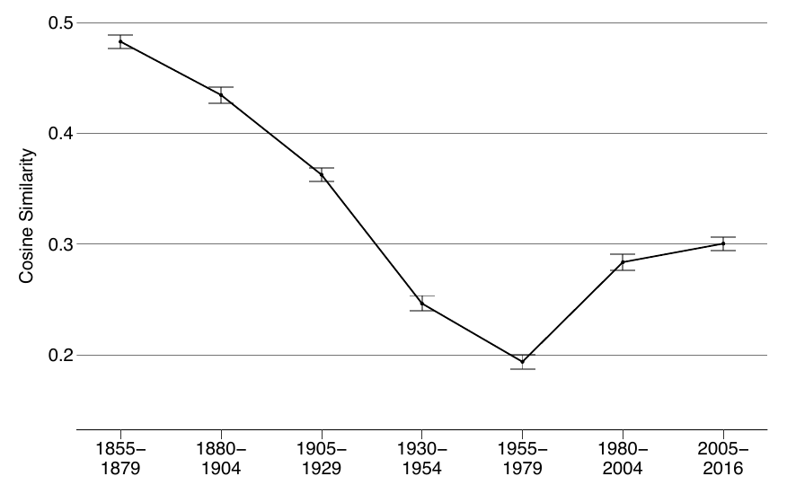 <svg aria-hidden="true" class="w9-evidence-overlay" viewbox="0 0 876 550"> <g class="current-fragment visible w9-linear-current"> <ellipse class="w9-evidence-focus" cx="134" cy="46" rx="25" ry="21"></ellipse> <path class="w9-evidence-pointer" d="M 207 39 H 170"></path> <polygon class="w9-evidence-pointer-head" points="170,39 188,30 188,48"></polygon> </g> </svg></p>
</div>
</div>
<div class="case-reading">
<div class="w9-reading-focus current-fragment visible w9-linear-current">
<p><strong>Read:</strong> We start with a <em>social</em>–<em>equality</em> cosine of <strong>.48</strong> in 1855–1879.</p>
</div>
<div class="w9-reading-focus visible">
<p><strong>Discuss:</strong> We see a fall to <strong>.19</strong>, then a rebound to <strong>.30</strong>. Does the rebound show the earlier use continues?</p>
</div>
</div>
</div>
</div>
<div class="source">
<p><a href="https://emmarodman.com/s/Diachronic_Word_Vectors___Political_Analysis_Final_Version.pdf#page=29">Rodman (2020), author manuscript Figure 4, p. 29</a>.</p>
</div>

```

## Read semantic change with historical evidence {#read-semantic-change-with-historical-evidence-step-2 .w9-linear-slide}

```{=html}

<p class="w9-study-label">
<strong>Case 2 · Semantic change</strong>
</p>
<div class="slide-body">
<div class="case-split">
<div class="case-visual">
<div class="w9-evidence-frame" style="--w9-evidence-ratio: 876 / 550;">
<p> <svg aria-hidden="true" class="w9-evidence-overlay" viewbox="0 0 876 550"> <g class="current-fragment visible w9-linear-current"> <ellipse class="w9-evidence-focus" cx="134" cy="46" rx="25" ry="21"></ellipse> <ellipse class="w9-evidence-focus" cx="582" cy="402" rx="25" ry="21"></ellipse> <ellipse class="w9-evidence-focus" cx="805" cy="272" rx="25" ry="21"></ellipse> <path class="w9-evidence-pointer" d="M 491 423 L 548 406"></path> <polygon class="w9-evidence-pointer-head" points="548,406 534,421 528,402"></polygon> </g> </svg></p>
</div>
</div>
<div class="case-reading">
<div class="w9-reading-focus visible">
<p><strong>Read:</strong> We start with a <em>social</em>–<em>equality</em> cosine of <strong>.48</strong> in 1855–1879.</p>
</div>
<div class="w9-reading-focus current-fragment visible w9-linear-current">
<p><strong>Discuss:</strong> We see a fall to <strong>.19</strong>, then a rebound to <strong>.30</strong>. Does the rebound show the earlier use continues?</p>
</div>
</div>
</div>
</div>
<div class="source">
<p><a href="https://emmarodman.com/s/Diachronic_Word_Vectors___Political_Analysis_Final_Version.pdf#page=29">Rodman (2020), author manuscript Figure 4, p. 29</a>.</p>
</div>

```

## Read semantic change with historical evidence {#read-semantic-change-with-historical-evidence-step-3 .w9-linear-slide}

```{=html}

<p class="w9-study-label">
<strong>Case 2 · Semantic change</strong>
</p>
<div class="slide-body">
<div class="case-split">
<div class="case-visual">
<div class="w9-evidence-frame" style="--w9-evidence-ratio: 876 / 550;">
<p> <svg aria-hidden="true" class="w9-evidence-overlay" viewbox="0 0 876 550"> <g class="current-fragment visible w9-linear-current"> <ellipse class="w9-evidence-focus" cx="582" cy="402" rx="25" ry="21"></ellipse> <ellipse class="w9-evidence-focus" cx="805" cy="272" rx="25" ry="21"></ellipse> <path class="w9-evidence-pointer" d="M 764 361 L 794 306"></path> <polygon class="w9-evidence-pointer-head" points="794,306 793,328 776,318"></polygon> </g> </svg></p>
</div>
</div>
<div class="case-reading">
<div class="w9-reading-focus visible">
<p><strong>Read:</strong> We start with a <em>social</em>–<em>equality</em> cosine of <strong>.48</strong> in 1855–1879.</p>
</div>
<div class="w9-reading-focus visible">
<p><strong>Discuss:</strong> We see a fall to <strong>.19</strong>, then a rebound to <strong>.30</strong>. Does the rebound show the earlier use continues?</p>
</div>
<div class="w9-reading-focus w9-reading-answer current-fragment visible w9-linear-current">
<p><strong>Check passages</strong> Early uses could oppose interracial intimacy. Later news also connects <em>social equality</em> to social justice and institutional access.</p>
</div>
</div>
</div>
</div>
<div class="source">
<p><a href="https://emmarodman.com/s/Diachronic_Word_Vectors___Political_Analysis_Final_Version.pdf#page=29">Rodman (2020), author manuscript Figure 4, p. 29</a>.</p>
</div>

```

## Case 3 · Nostalgia in party manifestos {#which-parties-appeal-to-a-better-past .w9-linear-slide}

```{=html}

<p class="w9-study-label">
<strong>Case 3 · Nostalgia</strong>
</p>
<div class="slide-body">
<div class="case-split case-intro-grid">
<div class="case-visual paper-heading">
<p>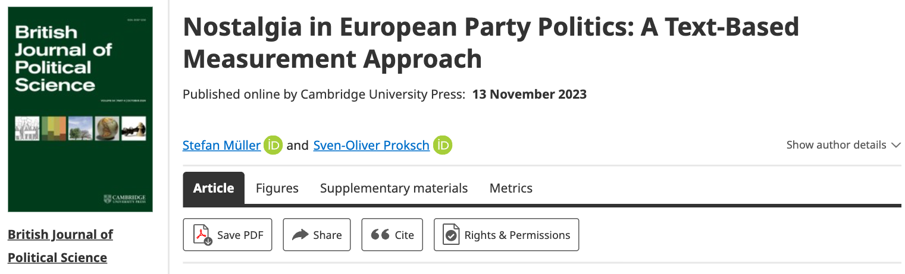</p>
<p class="case-paper-authors">
<strong>Stefan Müller and Sven-Oliver Proksch</strong>
</p>
<p class="case-paper-journal">
<em>British Journal of Political Science</em>, 2024 · Cambridge article page
</p>
</div>
<div class="case-reading">
<ul>
<li><strong>Background</strong> A reference to the past can express praise, criticism or nostalgia.</li>
<li><strong>Question</strong> Do culturally conservative parties appeal more to a better past?</li>
<li><strong>Texts</strong> 1,648 manifestos from 24 European countries, 1946–2018.</li>
</ul>
</div>
</div>
</div>
<div class="source">
<p>W10 supplementary reading · <a href="https://doi.org/10.1017/S0007123423000571">Müller &amp; Proksch (2024), <em>BJPS</em> 54(3), 993–1005</a></p>
</div>

```

## From word neighbours to a nostalgia measure {#from-word-neighbours-to-a-nostalgia-measure .w9-linear-slide}

```{=html}

<p class="w9-study-label">
<strong>Case 3 · Nostalgia</strong>
</p>
<div class="slide-body">
<p class="case-label">
How embeddings are used
</p>
<div class="case-split case-flow-split">
<div class="case-visual">
<div class="w9-evidence-frame" style="--w9-evidence-ratio: 1214 / 638;">
<p>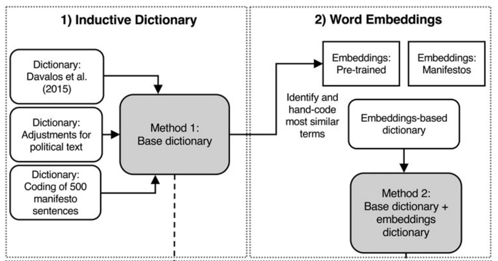 <svg aria-hidden="true" class="w9-evidence-overlay" viewbox="0 0 1214 638"> <g class="current-fragment visible w9-linear-current"> <rect class="w9-evidence-focus" height="134" rx="9" width="418" x="773" y="89"></rect> </g> </svg></p>
</div>
</div>
<div class="case-reading">
<div class="w9-reading-focus current-fragment visible w9-linear-current">
<p><strong>1. Find candidates</strong> Search for neighbours of seed terms in pretrained GloVe and vectors trained on manifestos.</p>
</div>
<div class="w9-reading-focus visible">
<p><strong>2. Screen candidates</strong> Three coders review the neighbours. Accepted terms form an embeddings-based dictionary.</p>
</div>
<div class="w9-reading-focus visible">
<p><strong>3. Score manifestos</strong> The bottom box combines both dictionaries. Flagged sentences per 1,000 become the outcome for comparing parties.</p>
</div>
</div>
</div>
</div>
<div class="source">
<p><a href="https://doi.org/10.1017/S0007123423000571">Müller &amp; Proksch (2024), Figure 1, panels 1–2, p. 996</a> · <a href="https://static.cambridge.org/content/id/urn:cambridge.org:id:article:S0007123423000571/resource/name/S0007123423000571sup001.pdf">Supplement, §B.2</a></p>
</div>

```

## From word neighbours to a nostalgia measure {#from-word-neighbours-to-a-nostalgia-measure-step-2 .w9-linear-slide}

```{=html}

<p class="w9-study-label">
<strong>Case 3 · Nostalgia</strong>
</p>
<div class="slide-body">
<p class="case-label">
How embeddings are used
</p>
<div class="case-split case-flow-split">
<div class="case-visual">
<div class="w9-evidence-frame" style="--w9-evidence-ratio: 1214 / 638;">
<p> <svg aria-hidden="true" class="w9-evidence-overlay" viewbox="0 0 1214 638"> <g class="current-fragment visible w9-linear-current"> <rect class="w9-evidence-focus" height="123" rx="9" width="151" x="692" y="224"></rect> <rect class="w9-evidence-focus" height="139" rx="12" width="288" x="841" y="235"></rect> </g> </svg></p>
</div>
</div>
<div class="case-reading">
<div class="w9-reading-focus visible">
<p><strong>1. Find candidates</strong> Search for neighbours of seed terms in pretrained GloVe and vectors trained on manifestos.</p>
</div>
<div class="w9-reading-focus current-fragment visible w9-linear-current">
<p><strong>2. Screen candidates</strong> Three coders review the neighbours. Accepted terms form an embeddings-based dictionary.</p>
</div>
<div class="w9-reading-focus visible">
<p><strong>3. Score manifestos</strong> The bottom box combines both dictionaries. Flagged sentences per 1,000 become the outcome for comparing parties.</p>
</div>
</div>
</div>
</div>
<div class="source">
<p><a href="https://doi.org/10.1017/S0007123423000571">Müller &amp; Proksch (2024), Figure 1, panels 1–2, p. 996</a> · <a href="https://static.cambridge.org/content/id/urn:cambridge.org:id:article:S0007123423000571/resource/name/S0007123423000571sup001.pdf">Supplement, §B.2</a></p>
</div>

```

## From word neighbours to a nostalgia measure {#from-word-neighbours-to-a-nostalgia-measure-step-3 .w9-linear-slide}

```{=html}

<p class="w9-study-label">
<strong>Case 3 · Nostalgia</strong>
</p>
<div class="slide-body">
<p class="case-label">
How embeddings are used
</p>
<div class="case-split case-flow-split">
<div class="case-visual">
<div class="w9-evidence-frame" style="--w9-evidence-ratio: 1214 / 638;">
<p> <svg aria-hidden="true" class="w9-evidence-overlay" viewbox="0 0 1214 638"> <g class="current-fragment visible w9-linear-current"> <rect class="w9-evidence-focus" height="215" rx="16" width="299" x="841" y="410"></rect> </g> </svg></p>
</div>
</div>
<div class="case-reading">
<div class="w9-reading-focus visible">
<p><strong>1. Find candidates</strong> Search for neighbours of seed terms in pretrained GloVe and vectors trained on manifestos.</p>
</div>
<div class="w9-reading-focus visible">
<p><strong>2. Screen candidates</strong> Three coders review the neighbours. Accepted terms form an embeddings-based dictionary.</p>
</div>
<div class="w9-reading-focus current-fragment visible w9-linear-current">
<p><strong>3. Score manifestos</strong> The bottom box combines both dictionaries. Flagged sentences per 1,000 become the outcome for comparing parties.</p>
</div>
</div>
</div>
</div>
<div class="source">
<p><a href="https://doi.org/10.1017/S0007123423000571">Müller &amp; Proksch (2024), Figure 1, panels 1–2, p. 996</a> · <a href="https://static.cambridge.org/content/id/urn:cambridge.org:id:article:S0007123423000571/resource/name/S0007123423000571sup001.pdf">Supplement, §B.2</a></p>
</div>

```

## Validate the measurement before comparing parties {#validate-the-measurement-before-comparing-parties .w9-linear-slide}

```{=html}

<p class="w9-study-label">
<strong>Case 3 · Nostalgia</strong>
</p>
<div class="slide-body case-split">
<div class="case-visual">
<div class="w9-evidence-frame" style="--w9-evidence-ratio: 1014 / 1004;">
<p>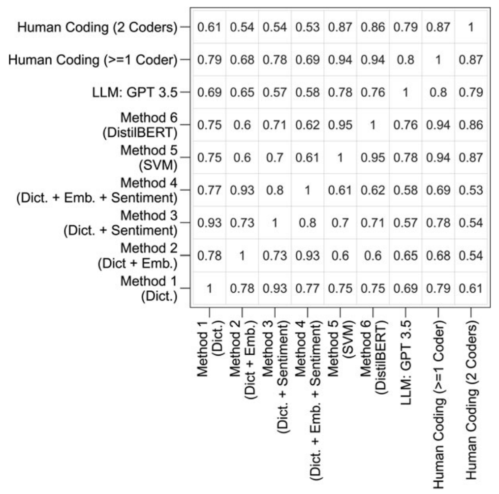 <svg aria-hidden="true" class="w9-evidence-overlay" viewbox="0 0 1014 1004"> <g class="current-fragment visible w9-linear-current"> <rect class="w9-evidence-focus" height="53" rx="8" width="341" x="26" y="28"></rect> <rect class="w9-evidence-focus" height="401" rx="8" width="341" x="26" y="218"></rect> </g> </svg></p>
</div>
</div>
<div class="case-reading">
<div class="w9-reading-focus current-fragment visible w9-linear-current">
<p><strong>Methods.</strong> We compare manifesto scores from dictionaries (M1–M4) and sentence classifiers (M5–M6), using <strong>50 manifestos</strong>.</p>
</div>
<div class="w9-reading-focus visible">
<p><strong>Discuss.</strong> We compare base <strong>.61</strong> with expanded <strong>.54</strong> against two coders. Which agrees more closely?</p>
</div>
</div>
</div>
<div class="source">
<p><a href="https://doi.org/10.1017/S0007123423000571">Müller &amp; Proksch (2024), Figure 2, p. 998. Sentence validation on p. 997.</a></p>
</div>

```

## Validate the measurement before comparing parties {#validate-the-measurement-before-comparing-parties-step-2 .w9-linear-slide}

```{=html}

<p class="w9-study-label">
<strong>Case 3 · Nostalgia</strong>
</p>
<div class="slide-body case-split">
<div class="case-visual">
<div class="w9-evidence-frame" style="--w9-evidence-ratio: 1014 / 1004;">
<p> <svg aria-hidden="true" class="w9-evidence-overlay" viewbox="0 0 1014 1004"> <g class="current-fragment visible w9-linear-current"> <rect class="w9-evidence-focus" height="53" rx="8" width="341" x="26" y="28"></rect> <rect class="w9-evidence-focus" height="59" rx="8" width="134" x="391" y="26"></rect> </g> </svg></p>
</div>
</div>
<div class="case-reading">
<div class="w9-reading-focus visible">
<p><strong>Methods.</strong> We compare manifesto scores from dictionaries (M1–M4) and sentence classifiers (M5–M6), using <strong>50 manifestos</strong>.</p>
</div>
<div class="w9-reading-focus current-fragment visible w9-linear-current">
<p><strong>Discuss.</strong> We compare base <strong>.61</strong> with expanded <strong>.54</strong> against two coders. Which agrees more closely?</p>
</div>
</div>
</div>
<div class="source">
<p><a href="https://doi.org/10.1017/S0007123423000571">Müller &amp; Proksch (2024), Figure 2, p. 998. Sentence validation on p. 997.</a></p>
</div>

```

## Validate the measurement before comparing parties {#validate-the-measurement-before-comparing-parties-step-3 .w9-linear-slide}

```{=html}

<p class="w9-study-label">
<strong>Case 3 · Nostalgia</strong>
</p>
<div class="slide-body case-split">
<div class="case-visual">
<div class="w9-evidence-frame" style="--w9-evidence-ratio: 1014 / 1004;">
<p> <svg aria-hidden="true" class="w9-evidence-overlay" viewbox="0 0 1014 1004"> <g class="current-fragment visible w9-linear-current"> <rect class="w9-evidence-focus" height="53" rx="8" width="341" x="26" y="28"></rect> <rect class="w9-evidence-focus" height="59" rx="8" width="134" x="391" y="26"></rect> <rect class="w9-evidence-focus" height="59" rx="8" width="128" x="661" y="26"></rect> </g> </svg></p>
</div>
</div>
<div class="case-reading">
<div class="w9-reading-focus visible">
<p><strong>Methods.</strong> We compare manifesto scores from dictionaries (M1–M4) and sentence classifiers (M5–M6), using <strong>50 manifestos</strong>.</p>
</div>
<div class="w9-reading-focus visible">
<p><strong>Discuss.</strong> We compare base <strong>.61</strong> with expanded <strong>.54</strong> against two coders. Which agrees more closely?</p>
</div>
<div class="w9-reading-focus w9-reading-answer current-fragment visible w9-linear-current">
<p><strong>Check.</strong> We see lower agreement after expansion. SVM: <strong>.87</strong>; DistilBERT: <strong>.86</strong>.</p>
</div>
</div>
</div>
<div class="source">
<p><a href="https://doi.org/10.1017/S0007123423000571">Müller &amp; Proksch (2024), Figure 2, p. 998. Sentence validation on p. 997.</a></p>
</div>

```

## Compare parties across six measures {#compare-parties-across-six-measures .w9-linear-slide}

```{=html}

<p class="w9-study-label">
<strong>Case 3 · Nostalgia</strong>
</p>
<div class="slide-body case-split">
<div class="case-visual">
<div class="w9-evidence-frame" style="--w9-evidence-ratio: 1354 / 834;">
<p>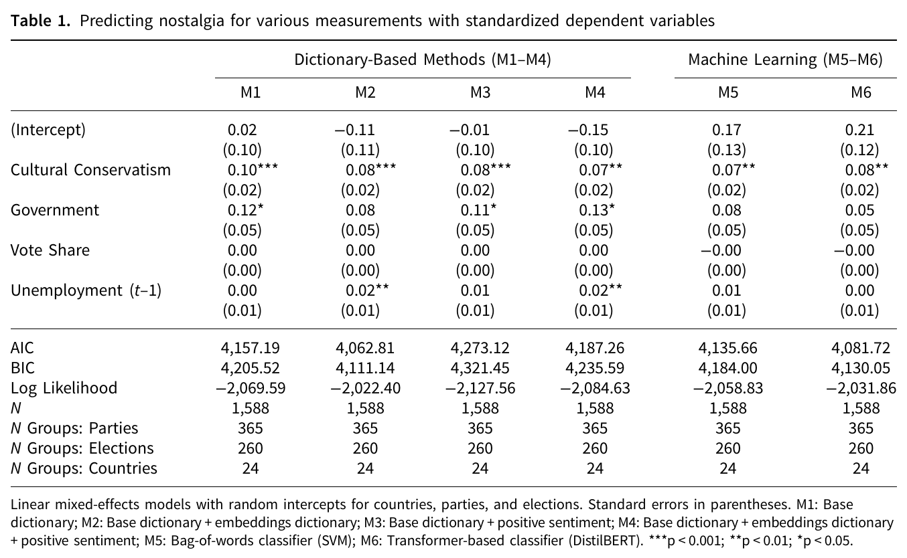 <svg aria-hidden="true" class="w9-evidence-overlay" viewbox="0 0 1354 834"> <g class="current-fragment visible w9-linear-current"> <rect class="w9-evidence-focus" height="34" rx="6" width="57" x="517" y="121"></rect> <rect class="w9-evidence-focus" height="34" rx="6" width="57" x="860" y="121"></rect> </g> </svg></p>
</div>
</div>
<div class="case-reading">
<div class="w9-reading-focus current-fragment visible w9-linear-current">
<p><strong>Columns</strong> use six standardized nostalgia scores. <strong>M2</strong> uses the expanded dictionary. <strong>M4</strong> also requires positive sentiment.</p>
</div>
<div class="w9-reading-focus visible">
<p><strong>Boxed row.</strong> We read <strong>.08</strong> in M2 and <strong>.07</strong> in M4.</p>
</div>
<div class="w9-reading-focus visible">
<p>One point higher on cultural conservatism is associated with <strong>.07–.10 SD</strong> more manifesto nostalgia across the six models, adjusting for other variables.</p>
</div>
</div>
</div>
<div class="source">
<p><a href="https://doi.org/10.1017/S0007123423000571">Müller &amp; Proksch (2024), Table 1, p. 1001</a> · <a href="https://static.cambridge.org/content/id/urn:cambridge.org:id:article:S0007123423000571/resource/name/S0007123423000571sup001.pdf">Cultural conservatism scale, Supplement §C.6</a></p>
</div>

```

## Compare parties across six measures {#compare-parties-across-six-measures-step-2 .w9-linear-slide}

```{=html}

<p class="w9-study-label">
<strong>Case 3 · Nostalgia</strong>
</p>
<div class="slide-body case-split">
<div class="case-visual">
<div class="w9-evidence-frame" style="--w9-evidence-ratio: 1354 / 834;">
<p> <svg aria-hidden="true" class="w9-evidence-overlay" viewbox="0 0 1354 834"> <g class="current-fragment visible w9-linear-current"> <rect class="w9-evidence-focus" height="30" rx="6" width="281" x="7" y="238"></rect> <rect class="w9-evidence-focus" height="32" rx="6" width="87" x="506" y="238"></rect> <rect class="w9-evidence-focus" height="32" rx="6" width="87" x="849" y="238"></rect> </g> </svg></p>
</div>
</div>
<div class="case-reading">
<div class="w9-reading-focus visible">
<p><strong>Columns</strong> use six standardized nostalgia scores. <strong>M2</strong> uses the expanded dictionary. <strong>M4</strong> also requires positive sentiment.</p>
</div>
<div class="w9-reading-focus current-fragment visible w9-linear-current">
<p><strong>Boxed row.</strong> We read <strong>.08</strong> in M2 and <strong>.07</strong> in M4.</p>
</div>
<div class="w9-reading-focus visible">
<p>One point higher on cultural conservatism is associated with <strong>.07–.10 SD</strong> more manifesto nostalgia across the six models, adjusting for other variables.</p>
</div>
</div>
</div>
<div class="source">
<p><a href="https://doi.org/10.1017/S0007123423000571">Müller &amp; Proksch (2024), Table 1, p. 1001</a> · <a href="https://static.cambridge.org/content/id/urn:cambridge.org:id:article:S0007123423000571/resource/name/S0007123423000571sup001.pdf">Cultural conservatism scale, Supplement §C.6</a></p>
</div>

```

## Compare parties across six measures {#compare-parties-across-six-measures-step-3 .w9-linear-slide}

```{=html}

<p class="w9-study-label">
<strong>Case 3 · Nostalgia</strong>
</p>
<div class="slide-body case-split">
<div class="case-visual">
<div class="w9-evidence-frame" style="--w9-evidence-ratio: 1354 / 834;">
<p> <svg aria-hidden="true" class="w9-evidence-overlay" viewbox="0 0 1354 834"> <g class="current-fragment visible w9-linear-current"> <rect class="w9-evidence-focus" height="30" rx="6" width="1338" x="7" y="238"></rect> </g> </svg></p>
</div>
</div>
<div class="case-reading">
<div class="w9-reading-focus visible">
<p><strong>Columns</strong> use six standardized nostalgia scores. <strong>M2</strong> uses the expanded dictionary. <strong>M4</strong> also requires positive sentiment.</p>
</div>
<div class="w9-reading-focus visible">
<p><strong>Boxed row.</strong> We read <strong>.08</strong> in M2 and <strong>.07</strong> in M4.</p>
</div>
<div class="w9-reading-focus current-fragment visible w9-linear-current">
<p>One point higher on cultural conservatism is associated with <strong>.07–.10 SD</strong> more manifesto nostalgia across the six models, adjusting for other variables.</p>
</div>
</div>
</div>
<div class="source">
<p><a href="https://doi.org/10.1017/S0007123423000571">Müller &amp; Proksch (2024), Table 1, p. 1001</a> · <a href="https://static.cambridge.org/content/id/urn:cambridge.org:id:article:S0007123423000571/resource/name/S0007123423000571sup001.pdf">Cultural conservatism scale, Supplement §C.6</a></p>
</div>

```

## Same word, different contexts {#case4-meaning-as-context .w9-linear-slide}

```{=html}

<p class="w9-study-label">
<strong>Case 4 · Method intuition · 1/3</strong>
</p>
<div class="slide-body compact-table case-workflow">
<table>
<colgroup>
<col style="width: 50%"/>
<col style="width: 50%"/>
</colgroup>
<thead>
<tr>
<th>The same word</th>
<th>Contextual clues and interpretation</th>
</tr>
</thead>
<tbody>
<tr>
<td><span aria-hidden="true" class="w9-row-focus current-fragment visible w9-linear-current"><svg viewbox="0 0 18 18"><path d="M 2 9 H 15 M 9 3 L 15 9 L 9 15"></path></svg></span> <strong>chips · UK use</strong></td>
<td>Ketchup, knife and fork suggest <strong>hot fries</strong>.</td>
</tr>
<tr>
<td> <strong>chips · US use</strong></td>
<td>A bag suggests <strong>potato crisps</strong>.</td>
</tr>
</tbody>
</table>
<div class="w9-lab-focus-target">
<p> <strong>Meaning here:</strong> we compare patterns of use. These are constructed examples.</p>
</div>
</div>
<div class="source">
<p><a href="https://github.com/prodriguezsosa/EmbeddingRegression/blob/main/Explainer/explainer.md#1-meaning-as-context-chips-v-crisps">Embedding Regression: Non-Technical Explainer, §1</a></p>
</div>

```

## Same word, different contexts {#case4-meaning-as-context-step-2 .w9-linear-slide}

```{=html}

<p class="w9-study-label">
<strong>Case 4 · Method intuition · 1/3</strong>
</p>
<div class="slide-body compact-table case-workflow">
<table>
<colgroup>
<col style="width: 50%"/>
<col style="width: 50%"/>
</colgroup>
<thead>
<tr>
<th>The same word</th>
<th>Contextual clues and interpretation</th>
</tr>
</thead>
<tbody>
<tr>
<td> <strong>chips · UK use</strong></td>
<td>Ketchup, knife and fork suggest <strong>hot fries</strong>.</td>
</tr>
<tr>
<td><span aria-hidden="true" class="w9-row-focus current-fragment visible w9-linear-current"><svg viewbox="0 0 18 18"><path d="M 2 9 H 15 M 9 3 L 15 9 L 9 15"></path></svg></span> <strong>chips · US use</strong></td>
<td>A bag suggests <strong>potato crisps</strong>.</td>
</tr>
</tbody>
</table>
<div class="w9-lab-focus-target">
<p> <strong>Meaning here:</strong> we compare patterns of use. These are constructed examples.</p>
</div>
</div>
<div class="source">
<p><a href="https://github.com/prodriguezsosa/EmbeddingRegression/blob/main/Explainer/explainer.md#1-meaning-as-context-chips-v-crisps">Embedding Regression: Non-Technical Explainer, §1</a></p>
</div>

```

## Same word, different contexts {#case4-meaning-as-context-step-3 .w9-linear-slide}

```{=html}

<p class="w9-study-label">
<strong>Case 4 · Method intuition · 1/3</strong>
</p>
<div class="slide-body compact-table case-workflow">
<table>
<colgroup>
<col style="width: 50%"/>
<col style="width: 50%"/>
</colgroup>
<thead>
<tr>
<th>The same word</th>
<th>Contextual clues and interpretation</th>
</tr>
</thead>
<tbody>
<tr>
<td> <strong>chips · UK use</strong></td>
<td>Ketchup, knife and fork suggest <strong>hot fries</strong>.</td>
</tr>
<tr>
<td> <strong>chips · US use</strong></td>
<td>A bag suggests <strong>potato crisps</strong>.</td>
</tr>
</tbody>
</table>
<div class="w9-lab-focus-target">
<p><span aria-hidden="true" class="w9-row-focus current-fragment visible w9-linear-current"><svg viewbox="0 0 18 18"><path d="M 2 9 H 15 M 9 3 L 15 9 L 9 15"></path></svg></span> <strong>Meaning here:</strong> we compare patterns of use. These are constructed examples.</p>
</div>
</div>
<div class="source">
<p><a href="https://github.com/prodriguezsosa/EmbeddingRegression/blob/main/Explainer/explainer.md#1-meaning-as-context-chips-v-crisps">Embedding Regression: Non-Technical Explainer, §1</a></p>
</div>

```

## A context becomes an ALC vector {#case4-context-to-alc .w9-linear-slide}

```{=html}

<p class="w9-study-label">
<strong>Case 4 · Method intuition · 2/3</strong>
</p>
<div class="slide-body compact-table case-workflow">
<table>
<colgroup>
<col style="width: 50%"/>
<col style="width: 50%"/>
</colgroup>
<thead>
<tr>
<th>Step</th>
<th>What the model uses</th>
</tr>
</thead>
<tbody>
<tr>
<td><span aria-hidden="true" class="w9-row-focus current-fragment visible w9-linear-current"><svg viewbox="0 0 18 18"><path d="M 2 9 H 15 M 9 3 L 15 9 L 9 15"></path></svg></span> <strong>1 · Look up context words</strong></td>
<td>We use their vectors from one pretrained space.</td>
</tr>
<tr>
<td> <strong>2 · Average</strong></td>
<td><math display="inline" xmlns="http://www.w3.org/1998/Math/MathML"><semantics><mrow><msub><mi>𝐮</mi><mi>i</mi></msub><mo>=</mo><mfrac><mn>1</mn><mrow><mo form="prefix" stretchy="true">|</mo><msub><mi>C</mi><mi>i</mi></msub><mo form="postfix" stretchy="true">|</mo></mrow></mfrac><msub><mo>∑</mo><mrow><mi>w</mi><mo>∈</mo><msub><mi>C</mi><mi>i</mi></msub></mrow></msub><msub><mi>𝐯</mi><mi>w</mi></msub></mrow><annotation encoding="application/x-tex">\mathbf u_i=\frac{1}{|C_i|}\sum_{w\in C_i}\mathbf v_w</annotation></semantics></math> for this occurrence’s surrounding words.</td>
</tr>
<tr>
<td> <strong>3 · Calibrate</strong></td>
<td><math display="inline" xmlns="http://www.w3.org/1998/Math/MathML"><semantics><mrow><msub><mi>𝐲</mi><mi>i</mi></msub><mo>=</mo><mi>A</mi><msub><mi>𝐮</mi><mi>i</mi></msub></mrow><annotation encoding="application/x-tex">\mathbf y_i=A\mathbf u_i</annotation></semantics></math>. A learned linear transformation corrects the context average.</td>
</tr>
</tbody>
</table>
<div class="w9-lab-focus-target">
<p> <strong>One use → one vector.</strong> Different uses can receive different representations in the same space.</p>
</div>
</div>
<div class="source">
<p><a href="https://github.com/prodriguezsosa/EmbeddingRegression/blob/main/Explainer/explainer.md#2-embeddings-as-meanings">Non-Technical Explainer, §2</a> · <a href="https://doi.org/10.1017/S0003055422001228">Rodriguez, Spirling &amp; Stewart (2023), ALC method</a></p>
</div>

```

## A context becomes an ALC vector {#case4-context-to-alc-step-2 .w9-linear-slide}

```{=html}

<p class="w9-study-label">
<strong>Case 4 · Method intuition · 2/3</strong>
</p>
<div class="slide-body compact-table case-workflow">
<table>
<colgroup>
<col style="width: 50%"/>
<col style="width: 50%"/>
</colgroup>
<thead>
<tr>
<th>Step</th>
<th>What the model uses</th>
</tr>
</thead>
<tbody>
<tr>
<td> <strong>1 · Look up context words</strong></td>
<td>We use their vectors from one pretrained space.</td>
</tr>
<tr>
<td><span aria-hidden="true" class="w9-row-focus current-fragment visible w9-linear-current"><svg viewbox="0 0 18 18"><path d="M 2 9 H 15 M 9 3 L 15 9 L 9 15"></path></svg></span> <strong>2 · Average</strong></td>
<td><math display="inline" xmlns="http://www.w3.org/1998/Math/MathML"><semantics><mrow><msub><mi>𝐮</mi><mi>i</mi></msub><mo>=</mo><mfrac><mn>1</mn><mrow><mo form="prefix" stretchy="true">|</mo><msub><mi>C</mi><mi>i</mi></msub><mo form="postfix" stretchy="true">|</mo></mrow></mfrac><msub><mo>∑</mo><mrow><mi>w</mi><mo>∈</mo><msub><mi>C</mi><mi>i</mi></msub></mrow></msub><msub><mi>𝐯</mi><mi>w</mi></msub></mrow><annotation encoding="application/x-tex">\mathbf u_i=\frac{1}{|C_i|}\sum_{w\in C_i}\mathbf v_w</annotation></semantics></math> for this occurrence’s surrounding words.</td>
</tr>
<tr>
<td> <strong>3 · Calibrate</strong></td>
<td><math display="inline" xmlns="http://www.w3.org/1998/Math/MathML"><semantics><mrow><msub><mi>𝐲</mi><mi>i</mi></msub><mo>=</mo><mi>A</mi><msub><mi>𝐮</mi><mi>i</mi></msub></mrow><annotation encoding="application/x-tex">\mathbf y_i=A\mathbf u_i</annotation></semantics></math>. A learned linear transformation corrects the context average.</td>
</tr>
</tbody>
</table>
<div class="w9-lab-focus-target">
<p> <strong>One use → one vector.</strong> Different uses can receive different representations in the same space.</p>
</div>
</div>
<div class="source">
<p><a href="https://github.com/prodriguezsosa/EmbeddingRegression/blob/main/Explainer/explainer.md#2-embeddings-as-meanings">Non-Technical Explainer, §2</a> · <a href="https://doi.org/10.1017/S0003055422001228">Rodriguez, Spirling &amp; Stewart (2023), ALC method</a></p>
</div>

```

## A context becomes an ALC vector {#case4-context-to-alc-step-3 .w9-linear-slide}

```{=html}

<p class="w9-study-label">
<strong>Case 4 · Method intuition · 2/3</strong>
</p>
<div class="slide-body compact-table case-workflow">
<table>
<colgroup>
<col style="width: 50%"/>
<col style="width: 50%"/>
</colgroup>
<thead>
<tr>
<th>Step</th>
<th>What the model uses</th>
</tr>
</thead>
<tbody>
<tr>
<td> <strong>1 · Look up context words</strong></td>
<td>We use their vectors from one pretrained space.</td>
</tr>
<tr>
<td> <strong>2 · Average</strong></td>
<td><math display="inline" xmlns="http://www.w3.org/1998/Math/MathML"><semantics><mrow><msub><mi>𝐮</mi><mi>i</mi></msub><mo>=</mo><mfrac><mn>1</mn><mrow><mo form="prefix" stretchy="true">|</mo><msub><mi>C</mi><mi>i</mi></msub><mo form="postfix" stretchy="true">|</mo></mrow></mfrac><msub><mo>∑</mo><mrow><mi>w</mi><mo>∈</mo><msub><mi>C</mi><mi>i</mi></msub></mrow></msub><msub><mi>𝐯</mi><mi>w</mi></msub></mrow><annotation encoding="application/x-tex">\mathbf u_i=\frac{1}{|C_i|}\sum_{w\in C_i}\mathbf v_w</annotation></semantics></math> for this occurrence’s surrounding words.</td>
</tr>
<tr>
<td><span aria-hidden="true" class="w9-row-focus current-fragment visible w9-linear-current"><svg viewbox="0 0 18 18"><path d="M 2 9 H 15 M 9 3 L 15 9 L 9 15"></path></svg></span> <strong>3 · Calibrate</strong></td>
<td><math display="inline" xmlns="http://www.w3.org/1998/Math/MathML"><semantics><mrow><msub><mi>𝐲</mi><mi>i</mi></msub><mo>=</mo><mi>A</mi><msub><mi>𝐮</mi><mi>i</mi></msub></mrow><annotation encoding="application/x-tex">\mathbf y_i=A\mathbf u_i</annotation></semantics></math>. A learned linear transformation corrects the context average.</td>
</tr>
</tbody>
</table>
<div class="w9-lab-focus-target">
<p> <strong>One use → one vector.</strong> Different uses can receive different representations in the same space.</p>
</div>
</div>
<div class="source">
<p><a href="https://github.com/prodriguezsosa/EmbeddingRegression/blob/main/Explainer/explainer.md#2-embeddings-as-meanings">Non-Technical Explainer, §2</a> · <a href="https://doi.org/10.1017/S0003055422001228">Rodriguez, Spirling &amp; Stewart (2023), ALC method</a></p>
</div>

```

## A context becomes an ALC vector {#case4-context-to-alc-step-4 .w9-linear-slide}

```{=html}

<p class="w9-study-label">
<strong>Case 4 · Method intuition · 2/3</strong>
</p>
<div class="slide-body compact-table case-workflow">
<table>
<colgroup>
<col style="width: 50%"/>
<col style="width: 50%"/>
</colgroup>
<thead>
<tr>
<th>Step</th>
<th>What the model uses</th>
</tr>
</thead>
<tbody>
<tr>
<td> <strong>1 · Look up context words</strong></td>
<td>We use their vectors from one pretrained space.</td>
</tr>
<tr>
<td> <strong>2 · Average</strong></td>
<td><math display="inline" xmlns="http://www.w3.org/1998/Math/MathML"><semantics><mrow><msub><mi>𝐮</mi><mi>i</mi></msub><mo>=</mo><mfrac><mn>1</mn><mrow><mo form="prefix" stretchy="true">|</mo><msub><mi>C</mi><mi>i</mi></msub><mo form="postfix" stretchy="true">|</mo></mrow></mfrac><msub><mo>∑</mo><mrow><mi>w</mi><mo>∈</mo><msub><mi>C</mi><mi>i</mi></msub></mrow></msub><msub><mi>𝐯</mi><mi>w</mi></msub></mrow><annotation encoding="application/x-tex">\mathbf u_i=\frac{1}{|C_i|}\sum_{w\in C_i}\mathbf v_w</annotation></semantics></math> for this occurrence’s surrounding words.</td>
</tr>
<tr>
<td> <strong>3 · Calibrate</strong></td>
<td><math display="inline" xmlns="http://www.w3.org/1998/Math/MathML"><semantics><mrow><msub><mi>𝐲</mi><mi>i</mi></msub><mo>=</mo><mi>A</mi><msub><mi>𝐮</mi><mi>i</mi></msub></mrow><annotation encoding="application/x-tex">\mathbf y_i=A\mathbf u_i</annotation></semantics></math>. A learned linear transformation corrects the context average.</td>
</tr>
</tbody>
</table>
<div class="w9-lab-focus-target">
<p><span aria-hidden="true" class="w9-row-focus current-fragment visible w9-linear-current"><svg viewbox="0 0 18 18"><path d="M 2 9 H 15 M 9 3 L 15 9 L 9 15"></path></svg></span> <strong>One use → one vector.</strong> Different uses can receive different representations in the same space.</p>
</div>
</div>
<div class="source">
<p><a href="https://github.com/prodriguezsosa/EmbeddingRegression/blob/main/Explainer/explainer.md#2-embeddings-as-meanings">Non-Technical Explainer, §2</a> · <a href="https://doi.org/10.1017/S0003055422001228">Rodriguez, Spirling &amp; Stewart (2023), ALC method</a></p>
</div>

```

## The context vector is the regression outcome {#case4-vector-regression .w9-linear-slide}

```{=html}

<p class="w9-study-label">
<strong>Case 4 · Method intuition · 3/3</strong>
</p>
<div class="slide-body compact-table">
<div class="w9-lab-focus-target">
<p><span aria-hidden="true" class="w9-row-focus current-fragment visible w9-linear-current"><svg viewbox="0 0 18 18"><path d="M 2 9 H 15 M 9 3 L 15 9 L 9 15"></path></svg></span> <strong>Observation:</strong> one use of chips. <strong>Outcome:</strong> its <math display="inline" xmlns="http://www.w3.org/1998/Math/MathML"><semantics><mi>D</mi><annotation encoding="application/x-tex">D</annotation></semantics></math>-coordinate context vector.</p>
</div>
<div class="w9-lab-focus-target">
<p></p>
<p><math display="block" xmlns="http://www.w3.org/1998/Math/MathML"><semantics><mrow><msub><mi>𝐲</mi><mi>i</mi></msub><mo>=</mo><msub><mi>𝛃</mi><mn>0</mn></msub><mo>+</mo><mi>U</mi><msub><mi>K</mi><mi>i</mi></msub><msub><mi>𝛃</mi><mrow><mi>U</mi><mi>K</mi></mrow></msub><mo>+</mo><msub><mi>𝛜</mi><mi>i</mi></msub><mi>.</mi></mrow><annotation encoding="application/x-tex">\mathbf y_i=\boldsymbol\beta_0+UK_i\boldsymbol\beta_{UK}+\boldsymbol\epsilon_i.</annotation></semantics></math></p>
<p><math display="inline" xmlns="http://www.w3.org/1998/Math/MathML"><semantics><mrow><mi>U</mi><msub><mi>K</mi><mi>i</mi></msub></mrow><annotation encoding="application/x-tex">UK_i</annotation></semantics></math>: US = 0, UK = 1. Both coefficients are <math display="inline" xmlns="http://www.w3.org/1998/Math/MathML"><semantics><mi>D</mi><annotation encoding="application/x-tex">D</annotation></semantics></math>-coordinate vectors.</p>
</div>
<div class="w9-lab-focus-target">
<p> <strong>Read the result:</strong> we use coefficient length for the size of the difference, then neighbours and passages to interpret it. Permutations assess uncertainty.</p>
</div>
<div class="w9-lab-focus-target">
<p> <strong>Next:</strong> we replace English variety with party labels and study immigration.</p>
</div>
</div>
<div class="source">
<p><a href="https://github.com/prodriguezsosa/EmbeddingRegression/blob/main/Explainer/explainer.md#3-embeddings-in-regression">Non-Technical Explainer, §§3–5</a></p>
</div>

```

## The context vector is the regression outcome {#case4-vector-regression-step-2 .w9-linear-slide}

```{=html}

<p class="w9-study-label">
<strong>Case 4 · Method intuition · 3/3</strong>
</p>
<div class="slide-body compact-table">
<div class="w9-lab-focus-target">
<p> <strong>Observation:</strong> one use of chips. <strong>Outcome:</strong> its <math display="inline" xmlns="http://www.w3.org/1998/Math/MathML"><semantics><mi>D</mi><annotation encoding="application/x-tex">D</annotation></semantics></math>-coordinate context vector.</p>
</div>
<div class="w9-lab-focus-target">
<p><span aria-hidden="true" class="w9-row-focus current-fragment visible w9-linear-current"><svg viewbox="0 0 18 18"><path d="M 2 9 H 15 M 9 3 L 15 9 L 9 15"></path></svg></span></p>
<p><math display="block" xmlns="http://www.w3.org/1998/Math/MathML"><semantics><mrow><msub><mi>𝐲</mi><mi>i</mi></msub><mo>=</mo><msub><mi>𝛃</mi><mn>0</mn></msub><mo>+</mo><mi>U</mi><msub><mi>K</mi><mi>i</mi></msub><msub><mi>𝛃</mi><mrow><mi>U</mi><mi>K</mi></mrow></msub><mo>+</mo><msub><mi>𝛜</mi><mi>i</mi></msub><mi>.</mi></mrow><annotation encoding="application/x-tex">\mathbf y_i=\boldsymbol\beta_0+UK_i\boldsymbol\beta_{UK}+\boldsymbol\epsilon_i.</annotation></semantics></math></p>
<p><math display="inline" xmlns="http://www.w3.org/1998/Math/MathML"><semantics><mrow><mi>U</mi><msub><mi>K</mi><mi>i</mi></msub></mrow><annotation encoding="application/x-tex">UK_i</annotation></semantics></math>: US = 0, UK = 1. Both coefficients are <math display="inline" xmlns="http://www.w3.org/1998/Math/MathML"><semantics><mi>D</mi><annotation encoding="application/x-tex">D</annotation></semantics></math>-coordinate vectors.</p>
</div>
<div class="w9-lab-focus-target">
<p> <strong>Read the result:</strong> we use coefficient length for the size of the difference, then neighbours and passages to interpret it. Permutations assess uncertainty.</p>
</div>
<div class="w9-lab-focus-target">
<p> <strong>Next:</strong> we replace English variety with party labels and study immigration.</p>
</div>
</div>
<div class="source">
<p><a href="https://github.com/prodriguezsosa/EmbeddingRegression/blob/main/Explainer/explainer.md#3-embeddings-in-regression">Non-Technical Explainer, §§3–5</a></p>
</div>

```

## The context vector is the regression outcome {#case4-vector-regression-step-3 .w9-linear-slide}

```{=html}

<p class="w9-study-label">
<strong>Case 4 · Method intuition · 3/3</strong>
</p>
<div class="slide-body compact-table">
<div class="w9-lab-focus-target">
<p> <strong>Observation:</strong> one use of chips. <strong>Outcome:</strong> its <math display="inline" xmlns="http://www.w3.org/1998/Math/MathML"><semantics><mi>D</mi><annotation encoding="application/x-tex">D</annotation></semantics></math>-coordinate context vector.</p>
</div>
<div class="w9-lab-focus-target">
<p></p>
<p><math display="block" xmlns="http://www.w3.org/1998/Math/MathML"><semantics><mrow><msub><mi>𝐲</mi><mi>i</mi></msub><mo>=</mo><msub><mi>𝛃</mi><mn>0</mn></msub><mo>+</mo><mi>U</mi><msub><mi>K</mi><mi>i</mi></msub><msub><mi>𝛃</mi><mrow><mi>U</mi><mi>K</mi></mrow></msub><mo>+</mo><msub><mi>𝛜</mi><mi>i</mi></msub><mi>.</mi></mrow><annotation encoding="application/x-tex">\mathbf y_i=\boldsymbol\beta_0+UK_i\boldsymbol\beta_{UK}+\boldsymbol\epsilon_i.</annotation></semantics></math></p>
<p><math display="inline" xmlns="http://www.w3.org/1998/Math/MathML"><semantics><mrow><mi>U</mi><msub><mi>K</mi><mi>i</mi></msub></mrow><annotation encoding="application/x-tex">UK_i</annotation></semantics></math>: US = 0, UK = 1. Both coefficients are <math display="inline" xmlns="http://www.w3.org/1998/Math/MathML"><semantics><mi>D</mi><annotation encoding="application/x-tex">D</annotation></semantics></math>-coordinate vectors.</p>
</div>
<div class="w9-lab-focus-target">
<p><span aria-hidden="true" class="w9-row-focus current-fragment visible w9-linear-current"><svg viewbox="0 0 18 18"><path d="M 2 9 H 15 M 9 3 L 15 9 L 9 15"></path></svg></span> <strong>Read the result:</strong> we use coefficient length for the size of the difference, then neighbours and passages to interpret it. Permutations assess uncertainty.</p>
</div>
<div class="w9-lab-focus-target">
<p> <strong>Next:</strong> we replace English variety with party labels and study immigration.</p>
</div>
</div>
<div class="source">
<p><a href="https://github.com/prodriguezsosa/EmbeddingRegression/blob/main/Explainer/explainer.md#3-embeddings-in-regression">Non-Technical Explainer, §§3–5</a></p>
</div>

```

## The context vector is the regression outcome {#case4-vector-regression-step-4 .w9-linear-slide}

```{=html}

<p class="w9-study-label">
<strong>Case 4 · Method intuition · 3/3</strong>
</p>
<div class="slide-body compact-table">
<div class="w9-lab-focus-target">
<p> <strong>Observation:</strong> one use of chips. <strong>Outcome:</strong> its <math display="inline" xmlns="http://www.w3.org/1998/Math/MathML"><semantics><mi>D</mi><annotation encoding="application/x-tex">D</annotation></semantics></math>-coordinate context vector.</p>
</div>
<div class="w9-lab-focus-target">
<p></p>
<p><math display="block" xmlns="http://www.w3.org/1998/Math/MathML"><semantics><mrow><msub><mi>𝐲</mi><mi>i</mi></msub><mo>=</mo><msub><mi>𝛃</mi><mn>0</mn></msub><mo>+</mo><mi>U</mi><msub><mi>K</mi><mi>i</mi></msub><msub><mi>𝛃</mi><mrow><mi>U</mi><mi>K</mi></mrow></msub><mo>+</mo><msub><mi>𝛜</mi><mi>i</mi></msub><mi>.</mi></mrow><annotation encoding="application/x-tex">\mathbf y_i=\boldsymbol\beta_0+UK_i\boldsymbol\beta_{UK}+\boldsymbol\epsilon_i.</annotation></semantics></math></p>
<p><math display="inline" xmlns="http://www.w3.org/1998/Math/MathML"><semantics><mrow><mi>U</mi><msub><mi>K</mi><mi>i</mi></msub></mrow><annotation encoding="application/x-tex">UK_i</annotation></semantics></math>: US = 0, UK = 1. Both coefficients are <math display="inline" xmlns="http://www.w3.org/1998/Math/MathML"><semantics><mi>D</mi><annotation encoding="application/x-tex">D</annotation></semantics></math>-coordinate vectors.</p>
</div>
<div class="w9-lab-focus-target">
<p> <strong>Read the result:</strong> we use coefficient length for the size of the difference, then neighbours and passages to interpret it. Permutations assess uncertainty.</p>
</div>
<div class="w9-lab-focus-target">
<p><span aria-hidden="true" class="w9-row-focus current-fragment visible w9-linear-current"><svg viewbox="0 0 18 18"><path d="M 2 9 H 15 M 9 3 L 15 9 L 9 15"></path></svg></span> <strong>Next:</strong> we replace English variety with party labels and study immigration.</p>
</div>
</div>
<div class="source">
<p><a href="https://github.com/prodriguezsosa/EmbeddingRegression/blob/main/Explainer/explainer.md#3-embeddings-in-regression">Non-Technical Explainer, §§3–5</a></p>
</div>

```

## Case 4 · How parties use immigration {#do-parties-use-immigration-in-the-same-way .w9-linear-slide}

```{=html}

<p class="w9-study-label">
<strong>Case 4 · Embedding regression</strong>
</p>
<div class="slide-body">
<div class="case-split case-intro-grid">
<div class="case-visual paper-heading">
<p>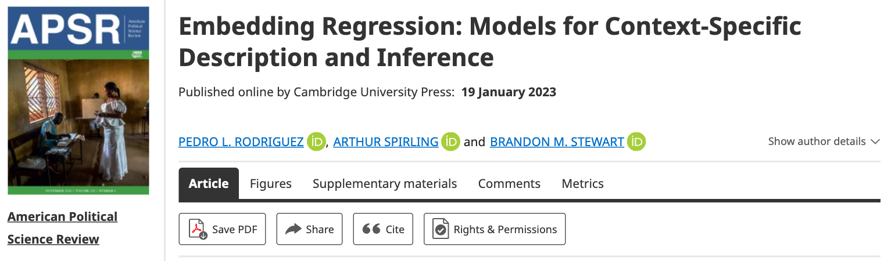</p>
<p class="case-paper-authors">
<strong>Pedro L. Rodriguez, Arthur Spirling and Brandon M. Stewart</strong>
</p>
<p class="case-paper-journal">
<em>American Political Science Review</em>, 2023 · Cambridge article page
</p>
</div>
<div class="case-reading">
<ul>
<li><strong>Background</strong> Parties can mention <em>immigration</em> equally often while using it in different contexts.</li>
<li><strong>Question</strong> How does the use of the same word vary by party and gender?</li>
<li><strong>Texts</strong> U.S. Congressional Record, 111th–114th Congresses.</li>
</ul>
</div>
</div>
</div>
<div class="source">
<p>W9 core reading · <a href="https://doi.org/10.1017/S0003055422001228">Rodriguez, Spirling &amp; Stewart (2023), <em>APSR</em> 117(4), 1255–1274</a></p>
</div>

```

## conText: from contexts to regression {#one-occurrence-and-its-surrounding-words .w9-linear-slide}

```{=html}

<p class="w9-study-label">
<strong>Case 4 · Embedding regression</strong>
</p>
<div class="slide-body w9-er-method">
<div class="w9-er-package">
<p><strong>conText · Official Quick Start</strong></p>
<div class="w9-evidence-frame" style="--w9-evidence-ratio:938 / 574;--w9-evidence-max-height:205px;">
<p>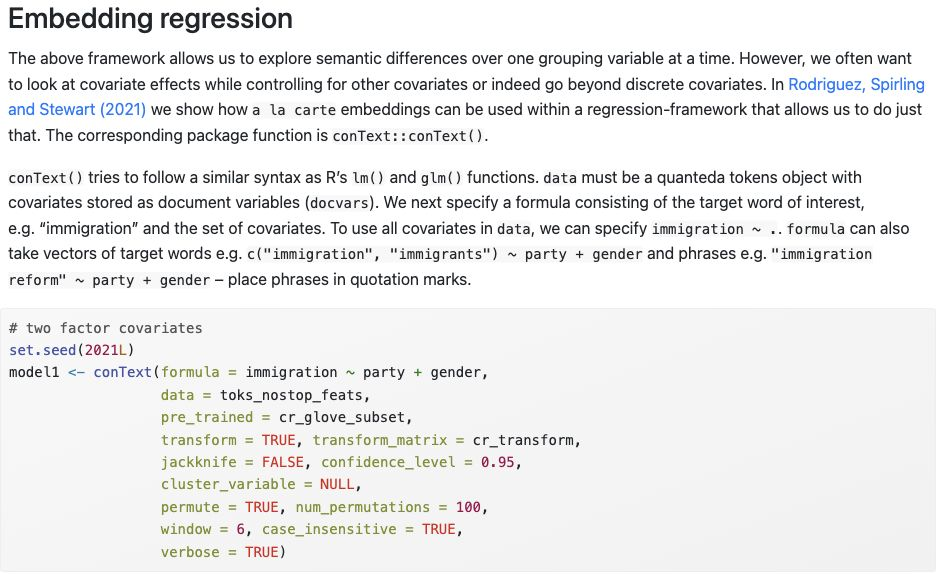 <svg aria-hidden="true" class="w9-evidence-overlay" viewbox="0 0 938 574"> <g class="current-fragment visible w9-linear-current"><rect class="w9-evidence-focus" height="53" rx="7" width="930" x="2" y="165"></rect></g> </svg></p>
</div>
<div class="sourceCode" id="one-occurrence-and-its-surrounding-words--cb1"><pre class="sourceCode r"><code class="sourceCode r"><span id="one-occurrence-and-its-surrounding-words--cb1-1"><a aria-hidden="true" href="#one-occurrence-and-its-surrounding-words--cb1-1" tabindex="-1"></a>fit <span class="ot">&lt;-</span> conText<span class="sc">::</span><span class="fu">conText</span>(</span>
<span id="one-occurrence-and-its-surrounding-words--cb1-2"><a aria-hidden="true" href="#one-occurrence-and-its-surrounding-words--cb1-2" tabindex="-1"></a>  immigration <span class="sc">~</span> party <span class="sc">+</span> gender,</span>
<span id="one-occurrence-and-its-surrounding-words--cb1-3"><a aria-hidden="true" href="#one-occurrence-and-its-surrounding-words--cb1-3" tabindex="-1"></a>  <span class="at">data =</span> toks, <span class="at">pre_trained =</span> E,</span>
<span id="one-occurrence-and-its-surrounding-words--cb1-4"><a aria-hidden="true" href="#one-occurrence-and-its-surrounding-words--cb1-4" tabindex="-1"></a>  <span class="at">transform =</span> <span class="cn">TRUE</span>,</span>
<span id="one-occurrence-and-its-surrounding-words--cb1-5"><a aria-hidden="true" href="#one-occurrence-and-its-surrounding-words--cb1-5" tabindex="-1"></a>  <span class="at">transform_matrix =</span> A)</span></code></pre></div>
<p><code>toks</code>: text + metadata. <code>E</code> and <code>A</code>: a matched pair.</p>
</div>
<div class="case-reading w9-concept-reading">
<div class="w9-reading-focus current-fragment visible w9-linear-current">
<p><strong>1 · One occurrence, one row.</strong> We keep context, party and gender. <math display="inline" xmlns="http://www.w3.org/1998/Math/MathML"><semantics><mi>n</mi><annotation encoding="application/x-tex">n</annotation></semantics></math> uses give an <math display="inline" xmlns="http://www.w3.org/1998/Math/MathML"><semantics><mrow><mi>n</mi><mo>×</mo><mi>D</mi></mrow><annotation encoding="application/x-tex">n\times D</annotation></semantics></math> outcome matrix <math display="inline" xmlns="http://www.w3.org/1998/Math/MathML"><semantics><mi>Y</mi><annotation encoding="application/x-tex">Y</annotation></semantics></math>.</p>
</div>
<div class="w9-reading-focus visible">
<p><strong>2 · Build the outcome vector.</strong> We average context-word vectors, excluding the target, then apply the common ALC transformation.</p>
<p><math display="block" xmlns="http://www.w3.org/1998/Math/MathML"><semantics><mrow><msub><mi>𝐮</mi><mi>i</mi></msub><mo>=</mo><msub><mo>mean</mo><mrow><mi>w</mi><mo>∈</mo><msub><mi>C</mi><mi>i</mi></msub></mrow></msub><msub><mi>𝐯</mi><mi>w</mi></msub><mo>,</mo><mspace width="2.0em"></mspace><msub><mi>𝐲</mi><mi>i</mi></msub><mo>=</mo><mi>A</mi><msub><mi>𝐮</mi><mi>i</mi></msub><mi>.</mi></mrow><annotation encoding="application/x-tex">\mathbf u_i=\operatorname{mean}_{w\in C_i}\mathbf v_w,\qquad \mathbf y_i=A\mathbf u_i.</annotation></semantics></math></p>
</div>
<div class="w9-reading-focus visible">
<p><strong>3 · Regress all coordinates.</strong> <math display="inline" xmlns="http://www.w3.org/1998/Math/MathML"><semantics><mi>R</mi><annotation encoding="application/x-tex">R</annotation></semantics></math>: Republican; <math display="inline" xmlns="http://www.w3.org/1998/Math/MathML"><semantics><mi>M</mi><annotation encoding="application/x-tex">M</annotation></semantics></math>: male.</p>
<p><math display="block" xmlns="http://www.w3.org/1998/Math/MathML"><semantics><mrow><msub><mi>𝐲</mi><mi>i</mi></msub><mo>=</mo><mi>𝛂</mi><mo>+</mo><msub><mi>R</mi><mi>i</mi></msub><msub><mi>𝛃</mi><mi>R</mi></msub><mo>+</mo><msub><mi>M</mi><mi>i</mi></msub><msub><mi>𝛃</mi><mi>M</mi></msub><mo>+</mo><msub><mi>𝛜</mi><mi>i</mi></msub><mi>.</mi></mrow><annotation encoding="application/x-tex">\mathbf y_i=\boldsymbol\alpha+R_i\boldsymbol\beta_R+M_i\boldsymbol\beta_M+\boldsymbol\epsilon_i.</annotation></semantics></math></p>
<p><math display="inline" xmlns="http://www.w3.org/1998/Math/MathML"><semantics><msub><mi>𝐲</mi><mi>i</mi></msub><annotation encoding="application/x-tex">\mathbf y_i</annotation></semantics></math>, <math display="inline" xmlns="http://www.w3.org/1998/Math/MathML"><semantics><mi>𝛂</mi><annotation encoding="application/x-tex">\boldsymbol\alpha</annotation></semantics></math>, <math display="inline" xmlns="http://www.w3.org/1998/Math/MathML"><semantics><msub><mi>𝛃</mi><mi>R</mi></msub><annotation encoding="application/x-tex">\boldsymbol\beta_R</annotation></semantics></math> and <math display="inline" xmlns="http://www.w3.org/1998/Math/MathML"><semantics><msub><mi>𝛃</mi><mi>M</mi></msub><annotation encoding="application/x-tex">\boldsymbol\beta_M</annotation></semantics></math> each have <math display="inline" xmlns="http://www.w3.org/1998/Math/MathML"><semantics><mi>D</mi><annotation encoding="application/x-tex">D</annotation></semantics></math> entries.</p>
</div>
<div class="w9-reading-focus visible">
<p><strong>4 · Read the coefficients.</strong> <math display="inline" xmlns="http://www.w3.org/1998/Math/MathML"><semantics><mi>𝛂</mi><annotation encoding="application/x-tex">\boldsymbol\alpha</annotation></semantics></math> (earlier <math display="inline" xmlns="http://www.w3.org/1998/Math/MathML"><semantics><msub><mi>𝛃</mi><mn>0</mn></msub><annotation encoding="application/x-tex">\boldsymbol\beta_0</annotation></semantics></math>) is the Democrat/female reference; <math display="inline" xmlns="http://www.w3.org/1998/Math/MathML"><semantics><msub><mi>𝛃</mi><mi>R</mi></msub><annotation encoding="application/x-tex">\boldsymbol\beta_R</annotation></semantics></math> compares parties at fixed gender. We plot lengths and combine coefficients for group neighbours.</p>
</div>
</div>
</div>
<div class="source">
<p><a href="https://doi.org/10.1017/S0003055422001228">Rodriguez, Spirling &amp; Stewart (2023), pp. 1258–1259, 1264–1266</a> · <a href="https://prodriguezsosa.r-universe.dev/conText/doc/quickstart.html#embedding-regression">Official conText Quick Start</a> · <a href="../lab/Embedding_Regression_W9.html">After-class R walkthrough</a></p>
</div>

```

## conText: from contexts to regression {#one-occurrence-and-its-surrounding-words-step-2 .w9-linear-slide}

```{=html}

<p class="w9-study-label">
<strong>Case 4 · Embedding regression</strong>
</p>
<div class="slide-body w9-er-method">
<div class="w9-er-package">
<p><strong>conText · Official Quick Start</strong></p>
<div class="w9-evidence-frame" style="--w9-evidence-ratio:938 / 574;--w9-evidence-max-height:205px;">
<p> <svg aria-hidden="true" class="w9-evidence-overlay" viewbox="0 0 938 574"> <g class="current-fragment visible w9-linear-current"><rect class="w9-evidence-focus" height="47" rx="7" width="620" x="150" y="405"></rect></g> </svg></p>
</div>
<div class="sourceCode" id="one-occurrence-and-its-surrounding-words-step-2--cb1"><pre class="sourceCode r"><code class="sourceCode r"><span id="one-occurrence-and-its-surrounding-words-step-2--cb1-1"><a aria-hidden="true" href="#one-occurrence-and-its-surrounding-words-step-2--cb1-1" tabindex="-1"></a>fit <span class="ot">&lt;-</span> conText<span class="sc">::</span><span class="fu">conText</span>(</span>
<span id="one-occurrence-and-its-surrounding-words-step-2--cb1-2"><a aria-hidden="true" href="#one-occurrence-and-its-surrounding-words-step-2--cb1-2" tabindex="-1"></a>  immigration <span class="sc">~</span> party <span class="sc">+</span> gender,</span>
<span id="one-occurrence-and-its-surrounding-words-step-2--cb1-3"><a aria-hidden="true" href="#one-occurrence-and-its-surrounding-words-step-2--cb1-3" tabindex="-1"></a>  <span class="at">data =</span> toks, <span class="at">pre_trained =</span> E,</span>
<span id="one-occurrence-and-its-surrounding-words-step-2--cb1-4"><a aria-hidden="true" href="#one-occurrence-and-its-surrounding-words-step-2--cb1-4" tabindex="-1"></a>  <span class="at">transform =</span> <span class="cn">TRUE</span>,</span>
<span id="one-occurrence-and-its-surrounding-words-step-2--cb1-5"><a aria-hidden="true" href="#one-occurrence-and-its-surrounding-words-step-2--cb1-5" tabindex="-1"></a>  <span class="at">transform_matrix =</span> A)</span></code></pre></div>
<p><code>toks</code>: text + metadata. <code>E</code> and <code>A</code>: a matched pair.</p>
</div>
<div class="case-reading w9-concept-reading">
<div class="w9-reading-focus visible">
<p><strong>1 · One occurrence, one row.</strong> We keep context, party and gender. <math display="inline" xmlns="http://www.w3.org/1998/Math/MathML"><semantics><mi>n</mi><annotation encoding="application/x-tex">n</annotation></semantics></math> uses give an <math display="inline" xmlns="http://www.w3.org/1998/Math/MathML"><semantics><mrow><mi>n</mi><mo>×</mo><mi>D</mi></mrow><annotation encoding="application/x-tex">n\times D</annotation></semantics></math> outcome matrix <math display="inline" xmlns="http://www.w3.org/1998/Math/MathML"><semantics><mi>Y</mi><annotation encoding="application/x-tex">Y</annotation></semantics></math>.</p>
</div>
<div class="w9-reading-focus current-fragment visible w9-linear-current">
<p><strong>2 · Build the outcome vector.</strong> We average context-word vectors, excluding the target, then apply the common ALC transformation.</p>
<p><math display="block" xmlns="http://www.w3.org/1998/Math/MathML"><semantics><mrow><msub><mi>𝐮</mi><mi>i</mi></msub><mo>=</mo><msub><mo>mean</mo><mrow><mi>w</mi><mo>∈</mo><msub><mi>C</mi><mi>i</mi></msub></mrow></msub><msub><mi>𝐯</mi><mi>w</mi></msub><mo>,</mo><mspace width="2.0em"></mspace><msub><mi>𝐲</mi><mi>i</mi></msub><mo>=</mo><mi>A</mi><msub><mi>𝐮</mi><mi>i</mi></msub><mi>.</mi></mrow><annotation encoding="application/x-tex">\mathbf u_i=\operatorname{mean}_{w\in C_i}\mathbf v_w,\qquad \mathbf y_i=A\mathbf u_i.</annotation></semantics></math></p>
</div>
<div class="w9-reading-focus visible">
<p><strong>3 · Regress all coordinates.</strong> <math display="inline" xmlns="http://www.w3.org/1998/Math/MathML"><semantics><mi>R</mi><annotation encoding="application/x-tex">R</annotation></semantics></math>: Republican; <math display="inline" xmlns="http://www.w3.org/1998/Math/MathML"><semantics><mi>M</mi><annotation encoding="application/x-tex">M</annotation></semantics></math>: male.</p>
<p><math display="block" xmlns="http://www.w3.org/1998/Math/MathML"><semantics><mrow><msub><mi>𝐲</mi><mi>i</mi></msub><mo>=</mo><mi>𝛂</mi><mo>+</mo><msub><mi>R</mi><mi>i</mi></msub><msub><mi>𝛃</mi><mi>R</mi></msub><mo>+</mo><msub><mi>M</mi><mi>i</mi></msub><msub><mi>𝛃</mi><mi>M</mi></msub><mo>+</mo><msub><mi>𝛜</mi><mi>i</mi></msub><mi>.</mi></mrow><annotation encoding="application/x-tex">\mathbf y_i=\boldsymbol\alpha+R_i\boldsymbol\beta_R+M_i\boldsymbol\beta_M+\boldsymbol\epsilon_i.</annotation></semantics></math></p>
<p><math display="inline" xmlns="http://www.w3.org/1998/Math/MathML"><semantics><msub><mi>𝐲</mi><mi>i</mi></msub><annotation encoding="application/x-tex">\mathbf y_i</annotation></semantics></math>, <math display="inline" xmlns="http://www.w3.org/1998/Math/MathML"><semantics><mi>𝛂</mi><annotation encoding="application/x-tex">\boldsymbol\alpha</annotation></semantics></math>, <math display="inline" xmlns="http://www.w3.org/1998/Math/MathML"><semantics><msub><mi>𝛃</mi><mi>R</mi></msub><annotation encoding="application/x-tex">\boldsymbol\beta_R</annotation></semantics></math> and <math display="inline" xmlns="http://www.w3.org/1998/Math/MathML"><semantics><msub><mi>𝛃</mi><mi>M</mi></msub><annotation encoding="application/x-tex">\boldsymbol\beta_M</annotation></semantics></math> each have <math display="inline" xmlns="http://www.w3.org/1998/Math/MathML"><semantics><mi>D</mi><annotation encoding="application/x-tex">D</annotation></semantics></math> entries.</p>
</div>
<div class="w9-reading-focus visible">
<p><strong>4 · Read the coefficients.</strong> <math display="inline" xmlns="http://www.w3.org/1998/Math/MathML"><semantics><mi>𝛂</mi><annotation encoding="application/x-tex">\boldsymbol\alpha</annotation></semantics></math> (earlier <math display="inline" xmlns="http://www.w3.org/1998/Math/MathML"><semantics><msub><mi>𝛃</mi><mn>0</mn></msub><annotation encoding="application/x-tex">\boldsymbol\beta_0</annotation></semantics></math>) is the Democrat/female reference; <math display="inline" xmlns="http://www.w3.org/1998/Math/MathML"><semantics><msub><mi>𝛃</mi><mi>R</mi></msub><annotation encoding="application/x-tex">\boldsymbol\beta_R</annotation></semantics></math> compares parties at fixed gender. We plot lengths and combine coefficients for group neighbours.</p>
</div>
</div>
</div>
<div class="source">
<p><a href="https://doi.org/10.1017/S0003055422001228">Rodriguez, Spirling &amp; Stewart (2023), pp. 1258–1259, 1264–1266</a> · <a href="https://prodriguezsosa.r-universe.dev/conText/doc/quickstart.html#embedding-regression">Official conText Quick Start</a> · <a href="../lab/Embedding_Regression_W9.html">After-class R walkthrough</a></p>
</div>

```

## conText: from contexts to regression {#one-occurrence-and-its-surrounding-words-step-3 .w9-linear-slide}

```{=html}

<p class="w9-study-label">
<strong>Case 4 · Embedding regression</strong>
</p>
<div class="slide-body w9-er-method">
<div class="w9-er-package">
<p><strong>conText · Official Quick Start</strong></p>
<div class="w9-evidence-frame" style="--w9-evidence-ratio:938 / 574;--w9-evidence-max-height:205px;">
<p> <svg aria-hidden="true" class="w9-evidence-overlay" viewbox="0 0 938 574"> <g class="current-fragment visible w9-linear-current"><rect class="w9-evidence-focus" height="29" rx="7" width="560" x="2" y="359"></rect></g> </svg></p>
</div>
<div class="sourceCode" id="one-occurrence-and-its-surrounding-words-step-3--cb1"><pre class="sourceCode r"><code class="sourceCode r"><span id="one-occurrence-and-its-surrounding-words-step-3--cb1-1"><a aria-hidden="true" href="#one-occurrence-and-its-surrounding-words-step-3--cb1-1" tabindex="-1"></a>fit <span class="ot">&lt;-</span> conText<span class="sc">::</span><span class="fu">conText</span>(</span>
<span id="one-occurrence-and-its-surrounding-words-step-3--cb1-2"><a aria-hidden="true" href="#one-occurrence-and-its-surrounding-words-step-3--cb1-2" tabindex="-1"></a>  immigration <span class="sc">~</span> party <span class="sc">+</span> gender,</span>
<span id="one-occurrence-and-its-surrounding-words-step-3--cb1-3"><a aria-hidden="true" href="#one-occurrence-and-its-surrounding-words-step-3--cb1-3" tabindex="-1"></a>  <span class="at">data =</span> toks, <span class="at">pre_trained =</span> E,</span>
<span id="one-occurrence-and-its-surrounding-words-step-3--cb1-4"><a aria-hidden="true" href="#one-occurrence-and-its-surrounding-words-step-3--cb1-4" tabindex="-1"></a>  <span class="at">transform =</span> <span class="cn">TRUE</span>,</span>
<span id="one-occurrence-and-its-surrounding-words-step-3--cb1-5"><a aria-hidden="true" href="#one-occurrence-and-its-surrounding-words-step-3--cb1-5" tabindex="-1"></a>  <span class="at">transform_matrix =</span> A)</span></code></pre></div>
<p><code>toks</code>: text + metadata. <code>E</code> and <code>A</code>: a matched pair.</p>
</div>
<div class="case-reading w9-concept-reading">
<div class="w9-reading-focus visible">
<p><strong>1 · One occurrence, one row.</strong> We keep context, party and gender. <math display="inline" xmlns="http://www.w3.org/1998/Math/MathML"><semantics><mi>n</mi><annotation encoding="application/x-tex">n</annotation></semantics></math> uses give an <math display="inline" xmlns="http://www.w3.org/1998/Math/MathML"><semantics><mrow><mi>n</mi><mo>×</mo><mi>D</mi></mrow><annotation encoding="application/x-tex">n\times D</annotation></semantics></math> outcome matrix <math display="inline" xmlns="http://www.w3.org/1998/Math/MathML"><semantics><mi>Y</mi><annotation encoding="application/x-tex">Y</annotation></semantics></math>.</p>
</div>
<div class="w9-reading-focus visible">
<p><strong>2 · Build the outcome vector.</strong> We average context-word vectors, excluding the target, then apply the common ALC transformation.</p>
<p><math display="block" xmlns="http://www.w3.org/1998/Math/MathML"><semantics><mrow><msub><mi>𝐮</mi><mi>i</mi></msub><mo>=</mo><msub><mo>mean</mo><mrow><mi>w</mi><mo>∈</mo><msub><mi>C</mi><mi>i</mi></msub></mrow></msub><msub><mi>𝐯</mi><mi>w</mi></msub><mo>,</mo><mspace width="2.0em"></mspace><msub><mi>𝐲</mi><mi>i</mi></msub><mo>=</mo><mi>A</mi><msub><mi>𝐮</mi><mi>i</mi></msub><mi>.</mi></mrow><annotation encoding="application/x-tex">\mathbf u_i=\operatorname{mean}_{w\in C_i}\mathbf v_w,\qquad \mathbf y_i=A\mathbf u_i.</annotation></semantics></math></p>
</div>
<div class="w9-reading-focus current-fragment visible w9-linear-current">
<p><strong>3 · Regress all coordinates.</strong> <math display="inline" xmlns="http://www.w3.org/1998/Math/MathML"><semantics><mi>R</mi><annotation encoding="application/x-tex">R</annotation></semantics></math>: Republican; <math display="inline" xmlns="http://www.w3.org/1998/Math/MathML"><semantics><mi>M</mi><annotation encoding="application/x-tex">M</annotation></semantics></math>: male.</p>
<p><math display="block" xmlns="http://www.w3.org/1998/Math/MathML"><semantics><mrow><msub><mi>𝐲</mi><mi>i</mi></msub><mo>=</mo><mi>𝛂</mi><mo>+</mo><msub><mi>R</mi><mi>i</mi></msub><msub><mi>𝛃</mi><mi>R</mi></msub><mo>+</mo><msub><mi>M</mi><mi>i</mi></msub><msub><mi>𝛃</mi><mi>M</mi></msub><mo>+</mo><msub><mi>𝛜</mi><mi>i</mi></msub><mi>.</mi></mrow><annotation encoding="application/x-tex">\mathbf y_i=\boldsymbol\alpha+R_i\boldsymbol\beta_R+M_i\boldsymbol\beta_M+\boldsymbol\epsilon_i.</annotation></semantics></math></p>
<p><math display="inline" xmlns="http://www.w3.org/1998/Math/MathML"><semantics><msub><mi>𝐲</mi><mi>i</mi></msub><annotation encoding="application/x-tex">\mathbf y_i</annotation></semantics></math>, <math display="inline" xmlns="http://www.w3.org/1998/Math/MathML"><semantics><mi>𝛂</mi><annotation encoding="application/x-tex">\boldsymbol\alpha</annotation></semantics></math>, <math display="inline" xmlns="http://www.w3.org/1998/Math/MathML"><semantics><msub><mi>𝛃</mi><mi>R</mi></msub><annotation encoding="application/x-tex">\boldsymbol\beta_R</annotation></semantics></math> and <math display="inline" xmlns="http://www.w3.org/1998/Math/MathML"><semantics><msub><mi>𝛃</mi><mi>M</mi></msub><annotation encoding="application/x-tex">\boldsymbol\beta_M</annotation></semantics></math> each have <math display="inline" xmlns="http://www.w3.org/1998/Math/MathML"><semantics><mi>D</mi><annotation encoding="application/x-tex">D</annotation></semantics></math> entries.</p>
</div>
<div class="w9-reading-focus visible">
<p><strong>4 · Read the coefficients.</strong> <math display="inline" xmlns="http://www.w3.org/1998/Math/MathML"><semantics><mi>𝛂</mi><annotation encoding="application/x-tex">\boldsymbol\alpha</annotation></semantics></math> (earlier <math display="inline" xmlns="http://www.w3.org/1998/Math/MathML"><semantics><msub><mi>𝛃</mi><mn>0</mn></msub><annotation encoding="application/x-tex">\boldsymbol\beta_0</annotation></semantics></math>) is the Democrat/female reference; <math display="inline" xmlns="http://www.w3.org/1998/Math/MathML"><semantics><msub><mi>𝛃</mi><mi>R</mi></msub><annotation encoding="application/x-tex">\boldsymbol\beta_R</annotation></semantics></math> compares parties at fixed gender. We plot lengths and combine coefficients for group neighbours.</p>
</div>
</div>
</div>
<div class="source">
<p><a href="https://doi.org/10.1017/S0003055422001228">Rodriguez, Spirling &amp; Stewart (2023), pp. 1258–1259, 1264–1266</a> · <a href="https://prodriguezsosa.r-universe.dev/conText/doc/quickstart.html#embedding-regression">Official conText Quick Start</a> · <a href="../lab/Embedding_Regression_W9.html">After-class R walkthrough</a></p>
</div>

```

## conText: from contexts to regression {#one-occurrence-and-its-surrounding-words-step-4 .w9-linear-slide}

```{=html}

<p class="w9-study-label">
<strong>Case 4 · Embedding regression</strong>
</p>
<div class="slide-body w9-er-method">
<div class="w9-er-package">
<p><strong>conText · Official Quick Start</strong></p>
<div class="w9-evidence-frame" style="--w9-evidence-ratio:938 / 574;--w9-evidence-max-height:205px;">
<p> <svg aria-hidden="true" class="w9-evidence-overlay" viewbox="0 0 938 574"> </svg></p>
</div>
<div class="sourceCode" id="one-occurrence-and-its-surrounding-words-step-4--cb1"><pre class="sourceCode r"><code class="sourceCode r"><span id="one-occurrence-and-its-surrounding-words-step-4--cb1-1"><a aria-hidden="true" href="#one-occurrence-and-its-surrounding-words-step-4--cb1-1" tabindex="-1"></a>fit <span class="ot">&lt;-</span> conText<span class="sc">::</span><span class="fu">conText</span>(</span>
<span id="one-occurrence-and-its-surrounding-words-step-4--cb1-2"><a aria-hidden="true" href="#one-occurrence-and-its-surrounding-words-step-4--cb1-2" tabindex="-1"></a>  immigration <span class="sc">~</span> party <span class="sc">+</span> gender,</span>
<span id="one-occurrence-and-its-surrounding-words-step-4--cb1-3"><a aria-hidden="true" href="#one-occurrence-and-its-surrounding-words-step-4--cb1-3" tabindex="-1"></a>  <span class="at">data =</span> toks, <span class="at">pre_trained =</span> E,</span>
<span id="one-occurrence-and-its-surrounding-words-step-4--cb1-4"><a aria-hidden="true" href="#one-occurrence-and-its-surrounding-words-step-4--cb1-4" tabindex="-1"></a>  <span class="at">transform =</span> <span class="cn">TRUE</span>,</span>
<span id="one-occurrence-and-its-surrounding-words-step-4--cb1-5"><a aria-hidden="true" href="#one-occurrence-and-its-surrounding-words-step-4--cb1-5" tabindex="-1"></a>  <span class="at">transform_matrix =</span> A)</span></code></pre></div>
<p><code>toks</code>: text + metadata. <code>E</code> and <code>A</code>: a matched pair.</p>
</div>
<div class="case-reading w9-concept-reading">
<div class="w9-reading-focus visible">
<p><strong>1 · One occurrence, one row.</strong> We keep context, party and gender. <math display="inline" xmlns="http://www.w3.org/1998/Math/MathML"><semantics><mi>n</mi><annotation encoding="application/x-tex">n</annotation></semantics></math> uses give an <math display="inline" xmlns="http://www.w3.org/1998/Math/MathML"><semantics><mrow><mi>n</mi><mo>×</mo><mi>D</mi></mrow><annotation encoding="application/x-tex">n\times D</annotation></semantics></math> outcome matrix <math display="inline" xmlns="http://www.w3.org/1998/Math/MathML"><semantics><mi>Y</mi><annotation encoding="application/x-tex">Y</annotation></semantics></math>.</p>
</div>
<div class="w9-reading-focus visible">
<p><strong>2 · Build the outcome vector.</strong> We average context-word vectors, excluding the target, then apply the common ALC transformation.</p>
<p><math display="block" xmlns="http://www.w3.org/1998/Math/MathML"><semantics><mrow><msub><mi>𝐮</mi><mi>i</mi></msub><mo>=</mo><msub><mo>mean</mo><mrow><mi>w</mi><mo>∈</mo><msub><mi>C</mi><mi>i</mi></msub></mrow></msub><msub><mi>𝐯</mi><mi>w</mi></msub><mo>,</mo><mspace width="2.0em"></mspace><msub><mi>𝐲</mi><mi>i</mi></msub><mo>=</mo><mi>A</mi><msub><mi>𝐮</mi><mi>i</mi></msub><mi>.</mi></mrow><annotation encoding="application/x-tex">\mathbf u_i=\operatorname{mean}_{w\in C_i}\mathbf v_w,\qquad \mathbf y_i=A\mathbf u_i.</annotation></semantics></math></p>
</div>
<div class="w9-reading-focus visible">
<p><strong>3 · Regress all coordinates.</strong> <math display="inline" xmlns="http://www.w3.org/1998/Math/MathML"><semantics><mi>R</mi><annotation encoding="application/x-tex">R</annotation></semantics></math>: Republican; <math display="inline" xmlns="http://www.w3.org/1998/Math/MathML"><semantics><mi>M</mi><annotation encoding="application/x-tex">M</annotation></semantics></math>: male.</p>
<p><math display="block" xmlns="http://www.w3.org/1998/Math/MathML"><semantics><mrow><msub><mi>𝐲</mi><mi>i</mi></msub><mo>=</mo><mi>𝛂</mi><mo>+</mo><msub><mi>R</mi><mi>i</mi></msub><msub><mi>𝛃</mi><mi>R</mi></msub><mo>+</mo><msub><mi>M</mi><mi>i</mi></msub><msub><mi>𝛃</mi><mi>M</mi></msub><mo>+</mo><msub><mi>𝛜</mi><mi>i</mi></msub><mi>.</mi></mrow><annotation encoding="application/x-tex">\mathbf y_i=\boldsymbol\alpha+R_i\boldsymbol\beta_R+M_i\boldsymbol\beta_M+\boldsymbol\epsilon_i.</annotation></semantics></math></p>
<p><math display="inline" xmlns="http://www.w3.org/1998/Math/MathML"><semantics><msub><mi>𝐲</mi><mi>i</mi></msub><annotation encoding="application/x-tex">\mathbf y_i</annotation></semantics></math>, <math display="inline" xmlns="http://www.w3.org/1998/Math/MathML"><semantics><mi>𝛂</mi><annotation encoding="application/x-tex">\boldsymbol\alpha</annotation></semantics></math>, <math display="inline" xmlns="http://www.w3.org/1998/Math/MathML"><semantics><msub><mi>𝛃</mi><mi>R</mi></msub><annotation encoding="application/x-tex">\boldsymbol\beta_R</annotation></semantics></math> and <math display="inline" xmlns="http://www.w3.org/1998/Math/MathML"><semantics><msub><mi>𝛃</mi><mi>M</mi></msub><annotation encoding="application/x-tex">\boldsymbol\beta_M</annotation></semantics></math> each have <math display="inline" xmlns="http://www.w3.org/1998/Math/MathML"><semantics><mi>D</mi><annotation encoding="application/x-tex">D</annotation></semantics></math> entries.</p>
</div>
<div class="w9-reading-focus current-fragment visible w9-linear-current">
<p><strong>4 · Read the coefficients.</strong> <math display="inline" xmlns="http://www.w3.org/1998/Math/MathML"><semantics><mi>𝛂</mi><annotation encoding="application/x-tex">\boldsymbol\alpha</annotation></semantics></math> (earlier <math display="inline" xmlns="http://www.w3.org/1998/Math/MathML"><semantics><msub><mi>𝛃</mi><mn>0</mn></msub><annotation encoding="application/x-tex">\boldsymbol\beta_0</annotation></semantics></math>) is the Democrat/female reference; <math display="inline" xmlns="http://www.w3.org/1998/Math/MathML"><semantics><msub><mi>𝛃</mi><mi>R</mi></msub><annotation encoding="application/x-tex">\boldsymbol\beta_R</annotation></semantics></math> compares parties at fixed gender. We plot lengths and combine coefficients for group neighbours.</p>
</div>
</div>
</div>
<div class="source">
<p><a href="https://doi.org/10.1017/S0003055422001228">Rodriguez, Spirling &amp; Stewart (2023), pp. 1258–1259, 1264–1266</a> · <a href="https://prodriguezsosa.r-universe.dev/conText/doc/quickstart.html#embedding-regression">Official conText Quick Start</a> · <a href="../lab/Embedding_Regression_W9.html">After-class R walkthrough</a></p>
</div>

```

## Compare party and gender differences {#compare-party-and-gender-differences .w9-linear-slide}

```{=html}

<p class="w9-study-label">
<strong>Case 4 · Embedding regression</strong>
</p>
<div class="slide-body case-split">
<div class="case-visual">
<div class="w9-evidence-frame" style="--w9-evidence-ratio: 1638 / 944;">
<p>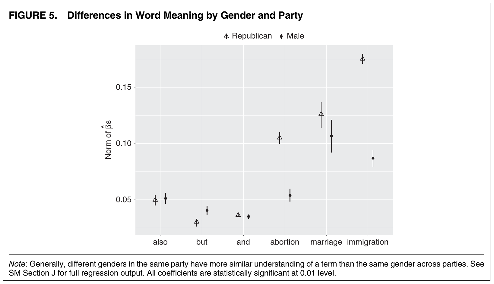 <svg aria-hidden="true" class="w9-evidence-overlay" viewbox="0 0 1638 944"> <g class="current-fragment visible w9-linear-current"> <rect class="w9-evidence-focus" height="146" rx="8" width="52" x="328" y="390"></rect> <rect class="w9-evidence-focus" height="40" rx="8" width="280" x="734" y="99"></rect> <rect class="w9-evidence-focus" height="43" rx="8" width="154" x="1143" y="785"></rect> </g> </svg></p>
</div>
</div>
<div class="case-reading">
<div class="w9-reading-focus current-fragment visible w9-linear-current">
<p><strong>Height.</strong> The adjusted difference vector’s length: <strong>0 = no vector difference</strong>. Larger = greater difference. Bars: 95% bootstrap intervals.</p>
</div>
<div class="w9-reading-focus visible">
<p><strong>Compare.</strong> For <em>immigration</em>, we read party <strong>.175</strong> at fixed gender and gender <strong>.087</strong> at fixed party. Both are vector lengths.</p>
</div>
<div class="w9-reading-focus visible">
<p><strong>Answer.</strong> We see larger estimated usage gaps by party for all three political terms.</p>
</div>
</div>
</div>
<div class="source">
<p><a href="https://doi.org/10.1017/S0003055422001228">Rodriguez, Spirling &amp; Stewart (2023), Figure 5</a> · <a href="https://static.cambridge.org/content/id/urn:cambridge.org:id:article:S0003055422001228/resource/name/S0003055422001228sup001.pdf#page=25">Supplement Table J.4</a></p>
</div>

```

## Compare party and gender differences {#compare-party-and-gender-differences-step-2 .w9-linear-slide}

```{=html}

<p class="w9-study-label">
<strong>Case 4 · Embedding regression</strong>
</p>
<div class="slide-body case-split">
<div class="case-visual">
<div class="w9-evidence-frame" style="--w9-evidence-ratio: 1638 / 944;">
<p> <svg aria-hidden="true" class="w9-evidence-overlay" viewbox="0 0 1638 944"> <g class="current-fragment visible w9-linear-current"> <circle class="w9-evidence-focus" cx="1202" cy="195" r="29"></circle> <circle class="w9-evidence-focus" cx="1237" cy="526" r="34"></circle> </g> </svg></p>
</div>
</div>
<div class="case-reading">
<div class="w9-reading-focus visible">
<p><strong>Height.</strong> The adjusted difference vector’s length: <strong>0 = no vector difference</strong>. Larger = greater difference. Bars: 95% bootstrap intervals.</p>
</div>
<div class="w9-reading-focus current-fragment visible w9-linear-current">
<p><strong>Compare.</strong> For <em>immigration</em>, we read party <strong>.175</strong> at fixed gender and gender <strong>.087</strong> at fixed party. Both are vector lengths.</p>
</div>
<div class="w9-reading-focus visible">
<p><strong>Answer.</strong> We see larger estimated usage gaps by party for all three political terms.</p>
</div>
</div>
</div>
<div class="source">
<p><a href="https://doi.org/10.1017/S0003055422001228">Rodriguez, Spirling &amp; Stewart (2023), Figure 5</a> · <a href="https://static.cambridge.org/content/id/urn:cambridge.org:id:article:S0003055422001228/resource/name/S0003055422001228sup001.pdf#page=25">Supplement Table J.4</a></p>
</div>

```

## Compare party and gender differences {#compare-party-and-gender-differences-step-3 .w9-linear-slide}

```{=html}

<p class="w9-study-label">
<strong>Case 4 · Embedding regression</strong>
</p>
<div class="slide-body case-split">
<div class="case-visual">
<div class="w9-evidence-frame" style="--w9-evidence-ratio: 1638 / 944;">
<p> <svg aria-hidden="true" class="w9-evidence-overlay" viewbox="0 0 1638 944"> <g class="current-fragment visible w9-linear-current"> <circle class="w9-evidence-focus" cx="928" cy="456" r="27"></circle> <circle class="w9-evidence-focus" cx="961" cy="650" r="25"></circle> <circle class="w9-evidence-focus" cx="1065" cy="378" r="27"></circle> <circle class="w9-evidence-focus" cx="1099" cy="452" r="27"></circle> <circle class="w9-evidence-focus" cx="1202" cy="195" r="29"></circle> <circle class="w9-evidence-focus" cx="1237" cy="526" r="34"></circle> </g> </svg></p>
</div>
</div>
<div class="case-reading">
<div class="w9-reading-focus visible">
<p><strong>Height.</strong> The adjusted difference vector’s length: <strong>0 = no vector difference</strong>. Larger = greater difference. Bars: 95% bootstrap intervals.</p>
</div>
<div class="w9-reading-focus visible">
<p><strong>Compare.</strong> For <em>immigration</em>, we read party <strong>.175</strong> at fixed gender and gender <strong>.087</strong> at fixed party. Both are vector lengths.</p>
</div>
<div class="w9-reading-focus current-fragment visible w9-linear-current">
<p><strong>Answer.</strong> We see larger estimated usage gaps by party for all three political terms.</p>
</div>
</div>
</div>
<div class="source">
<p><a href="https://doi.org/10.1017/S0003055422001228">Rodriguez, Spirling &amp; Stewart (2023), Figure 5</a> · <a href="https://static.cambridge.org/content/id/urn:cambridge.org:id:article:S0003055422001228/resource/name/S0003055422001228sup001.pdf#page=25">Supplement Table J.4</a></p>
</div>

```

## What do group differences contain? {#what-do-group-differences-contain .w9-linear-slide}

```{=html}

<p class="w9-study-label">
<strong>Case 4 · Embedding regression</strong>
</p>
<div class="slide-body case-split">
<div class="case-visual">
<div class="w9-evidence-frame" style="--w9-evidence-ratio: 797 / 380;">
<p>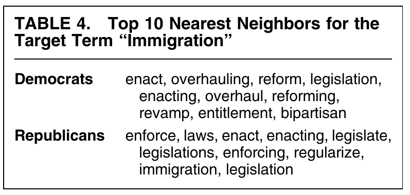 <svg aria-hidden="true" class="w9-evidence-overlay" viewbox="0 0 797 380"> <g class="current-fragment visible w9-linear-current"> <rect class="w9-evidence-focus" height="35" rx="6" width="173" x="21" y="136"></rect> <rect class="w9-evidence-focus" height="35" rx="6" width="196" x="21" y="246"></rect> </g> </svg></p>
</div>
</div>
<div class="case-reading">
<div class="w9-reading-focus current-fragment visible w9-linear-current">
<p><strong>Read each row.</strong> Each row lists the ten words closest by cosine to that party’s estimated <em>immigration</em> vector.</p>
</div>
<div class="w9-reading-focus visible">
<p><strong>Interpret the boxes.</strong> We see <strong>changing the system</strong> near Democrats and <strong>enforcing existing law</strong> near Republicans.</p>
</div>
<div class="w9-reading-focus visible">
<p>We also see <em>enact</em> and <em>legislation</em> in both rows. Next, we check the passages.</p>
</div>
</div>
</div>
<div class="source">
<p><a href="https://doi.org/10.1017/S0003055422001228">Rodriguez, Spirling &amp; Stewart (2023), Table 4, p. 1267</a></p>
</div>

```

## What do group differences contain? {#what-do-group-differences-contain-step-2 .w9-linear-slide}

```{=html}

<p class="w9-study-label">
<strong>Case 4 · Embedding regression</strong>
</p>
<div class="slide-body case-split">
<div class="case-visual">
<div class="w9-evidence-frame" style="--w9-evidence-ratio: 797 / 380;">
<p> <svg aria-hidden="true" class="w9-evidence-overlay" viewbox="0 0 797 380"> <g class="current-fragment visible w9-linear-current"> <rect class="w9-evidence-focus" height="35" rx="6" width="279" x="324" y="138"></rect> <rect class="w9-evidence-focus" height="34" rx="6" width="195" x="237" y="248"></rect> </g> </svg></p>
</div>
</div>
<div class="case-reading">
<div class="w9-reading-focus visible">
<p><strong>Read each row.</strong> Each row lists the ten words closest by cosine to that party’s estimated <em>immigration</em> vector.</p>
</div>
<div class="w9-reading-focus current-fragment visible w9-linear-current">
<p><strong>Interpret the boxes.</strong> We see <strong>changing the system</strong> near Democrats and <strong>enforcing existing law</strong> near Republicans.</p>
</div>
<div class="w9-reading-focus visible">
<p>We also see <em>enact</em> and <em>legislation</em> in both rows. Next, we check the passages.</p>
</div>
</div>
</div>
<div class="source">
<p><a href="https://doi.org/10.1017/S0003055422001228">Rodriguez, Spirling &amp; Stewart (2023), Table 4, p. 1267</a></p>
</div>

```

## What do group differences contain? {#what-do-group-differences-contain-step-3 .w9-linear-slide}

```{=html}

<p class="w9-study-label">
<strong>Case 4 · Embedding regression</strong>
</p>
<div class="slide-body case-split">
<div class="case-visual">
<div class="w9-evidence-frame" style="--w9-evidence-ratio: 797 / 380;">
<p> <svg aria-hidden="true" class="w9-evidence-overlay" viewbox="0 0 797 380"> <g class="current-fragment visible w9-linear-current"> <rect class="w9-evidence-focus" height="35" rx="6" width="84" x="238" y="138"></rect> <rect class="w9-evidence-focus" height="35" rx="6" width="145" x="598" y="138"></rect> <rect class="w9-evidence-focus" height="34" rx="6" width="87" x="424" y="248"></rect> <rect class="w9-evidence-focus" height="34" rx="6" width="164" x="422" y="314"></rect> </g> </svg></p>
</div>
</div>
<div class="case-reading">
<div class="w9-reading-focus visible">
<p><strong>Read each row.</strong> Each row lists the ten words closest by cosine to that party’s estimated <em>immigration</em> vector.</p>
</div>
<div class="w9-reading-focus visible">
<p><strong>Interpret the boxes.</strong> We see <strong>changing the system</strong> near Democrats and <strong>enforcing existing law</strong> near Republicans.</p>
</div>
<div class="w9-reading-focus current-fragment visible w9-linear-current">
<p>We also see <em>enact</em> and <em>legislation</em> in both rows. Next, we check the passages.</p>
</div>
</div>
</div>
<div class="source">
<p><a href="https://doi.org/10.1017/S0003055422001228">Rodriguez, Spirling &amp; Stewart (2023), Table 4, p. 1267</a></p>
</div>

```

## Return to the original contexts {#return-to-the-original-contexts .w9-linear-slide}

```{=html}

<p class="w9-study-label">
<strong>Case 4 · Embedding regression</strong>
</p>
<div class="slide-body case-split">
<div class="case-visual">
<div class="w9-evidence-frame" style="--w9-evidence-ratio: 797 / 544;">
<p>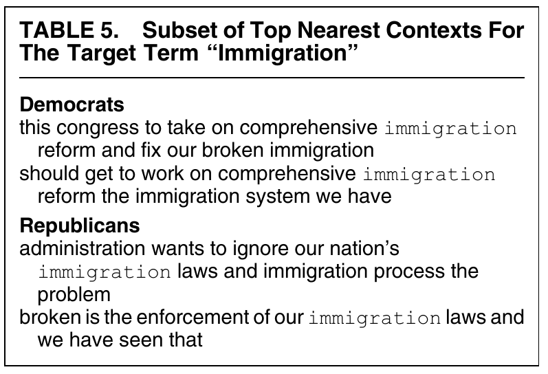 <svg aria-hidden="true" class="w9-evidence-overlay" viewbox="0 0 797 544"> <g class="current-fragment visible w9-linear-current"> <rect class="w9-evidence-focus" height="35" rx="6" width="177" x="23" y="134"></rect> <rect class="w9-evidence-focus" height="36" rx="6" width="195" x="23" y="309"></rect> </g> </svg></p>
</div>
</div>
<div class="case-reading">
<div class="w9-reading-focus current-fragment visible w9-linear-current">
<p><strong>Read the party labels.</strong> We read passages close to each party’s estimated vector.</p>
</div>
<div class="w9-reading-focus visible">
<p><strong>Answer.</strong> We see <strong>reform</strong> in the Democratic passage and <strong>enforcement</strong> in the Republican passage.</p>
</div>
<div class="w9-reading-focus visible">
<p><strong>Scope.</strong> These passages illustrate the contrast. To estimate frequency, we need a broader sample.</p>
</div>
</div>
</div>
<div class="source">
<p><a href="https://doi.org/10.1017/S0003055422001228">Rodriguez, Spirling &amp; Stewart (2023), Table 5, p. 1267</a></p>
</div>

```

## Return to the original contexts {#return-to-the-original-contexts-step-2 .w9-linear-slide}

```{=html}

<p class="w9-study-label">
<strong>Case 4 · Embedding regression</strong>
</p>
<div class="slide-body case-split">
<div class="case-visual">
<div class="w9-evidence-frame" style="--w9-evidence-ratio: 797 / 544;">
<p> <svg aria-hidden="true" class="w9-evidence-overlay" viewbox="0 0 797 544"> <g class="current-fragment visible w9-linear-current"> <rect class="w9-evidence-focus" height="69" rx="7" width="743" x="20" y="168"></rect> <rect class="w9-evidence-focus" height="69" rx="7" width="751" x="20" y="442"></rect> </g> </svg></p>
</div>
</div>
<div class="case-reading">
<div class="w9-reading-focus visible">
<p><strong>Read the party labels.</strong> We read passages close to each party’s estimated vector.</p>
</div>
<div class="w9-reading-focus current-fragment visible w9-linear-current">
<p><strong>Answer.</strong> We see <strong>reform</strong> in the Democratic passage and <strong>enforcement</strong> in the Republican passage.</p>
</div>
<div class="w9-reading-focus visible">
<p><strong>Scope.</strong> These passages illustrate the contrast. To estimate frequency, we need a broader sample.</p>
</div>
</div>
</div>
<div class="source">
<p><a href="https://doi.org/10.1017/S0003055422001228">Rodriguez, Spirling &amp; Stewart (2023), Table 5, p. 1267</a></p>
</div>

```

## Return to the original contexts {#return-to-the-original-contexts-step-3 .w9-linear-slide}

```{=html}

<p class="w9-study-label">
<strong>Case 4 · Embedding regression</strong>
</p>
<div class="slide-body case-split">
<div class="case-visual">
<div class="w9-evidence-frame" style="--w9-evidence-ratio: 797 / 544;">
<p> <svg aria-hidden="true" class="w9-evidence-overlay" viewbox="0 0 797 544"> <g class="current-fragment visible w9-linear-current"> <rect class="w9-evidence-focus" height="76" rx="8" width="754" x="20" y="24"></rect> </g> </svg></p>
</div>
</div>
<div class="case-reading">
<div class="w9-reading-focus visible">
<p><strong>Read the party labels.</strong> We read passages close to each party’s estimated vector.</p>
</div>
<div class="w9-reading-focus visible">
<p><strong>Answer.</strong> We see <strong>reform</strong> in the Democratic passage and <strong>enforcement</strong> in the Republican passage.</p>
</div>
<div class="w9-reading-focus current-fragment visible w9-linear-current">
<p><strong>Scope.</strong> These passages illustrate the contrast. To estimate frequency, we need a broader sample.</p>
</div>
</div>
</div>
<div class="source">
<p><a href="https://doi.org/10.1017/S0003055422001228">Rodriguez, Spirling &amp; Stewart (2023), Table 5, p. 1267</a></p>
</div>

```

## Embedding regression beyond English {#embeddings-for-multilingual-political-texts .w9-linear-slide}

```{=html}

<p class="w9-study-label">
<strong>Case 4 · Multilingual extension</strong>
</p>
<div class="slide-body w9-paired-paper">
<div class="w9-paired-paper-grid">
<div class="paper-page">
<p>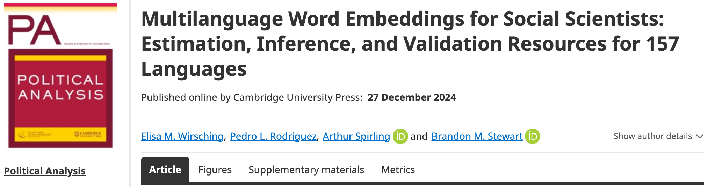</p>
</div>
<div class="reconstruction-figure">
<p></p>
</div>
</div>
<p>We compare ALC estimates with pretrained vectors within each language.</p>
</div>
<div class="source">
<p><a href="https://doi.org/10.1017/pan.2024.17">Wirsching et al. (2025), <em>Political Analysis</em>, Figure 1, p. 159</a></p>
</div>

```

## Four studies using embedding regression {#embedding-regression-applications .w9-linear-slide}

```{=html}

<p class="w9-study-label">
<strong>Case 4 · Further applications</strong>
</p>
<div class="slide-body w9-er-literature-grid">
<div class="w9-er-paper">
<div aria-hidden="true" class="w9-er-paper-focus current-fragment visible w9-linear-current">
</div>
<p><a href="https://doi.org/10.1111/spsr.12649">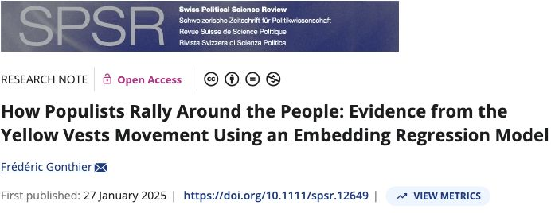</a></p>
<p><strong>Gonthier (2025) · SPSR</strong><br/>
French <em>peuple</em> across ideological groups.</p>
</div>
<div class="w9-er-paper">
<p><a href="https://doi.org/10.1177/23780231231212108">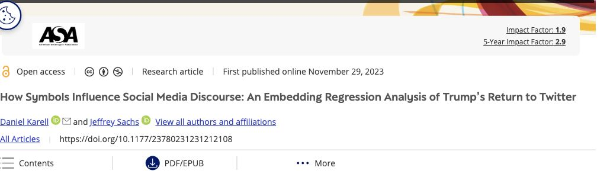</a></p>
<p><strong>Karell &amp; Sachs (2023) · Socius</strong><br/>
Minority-group language before/after a signal.</p>
</div>
<div class="w9-er-paper">
<p><a href="https://doi.org/10.1111/psj.70079">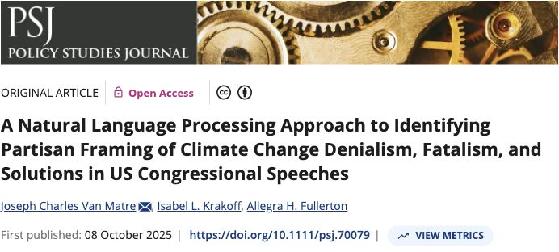</a></p>
<p><strong>Van Matre et al. (2026) · PSJ</strong><br/>
Climate frames by party and congressional term.</p>
</div>
<div class="w9-er-paper">
<p><a href="https://doi.org/10.54501/jots.v1i1.13">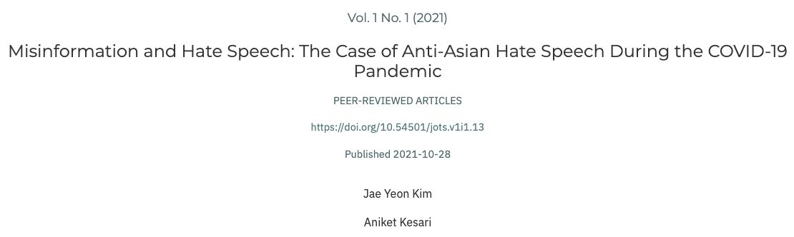</a></p>
<p><strong>Kim &amp; Kesari (2021) · JOTS</strong><br/>
“Chinese virus”: hate/counterhate and time.</p>
</div>
</div>
<div class="source">
<p><a href="../reading/README.md#applications">Study notes and DOI links</a> · W10 comparison: supplement</p>
</div>

```

## Four studies using embedding regression {#embedding-regression-applications-step-2 .w9-linear-slide}

```{=html}

<p class="w9-study-label">
<strong>Case 4 · Further applications</strong>
</p>
<div class="slide-body w9-er-literature-grid">
<div class="w9-er-paper">
<p><a href="https://doi.org/10.1111/spsr.12649"></a></p>
<p><strong>Gonthier (2025) · SPSR</strong><br/>
French <em>peuple</em> across ideological groups.</p>
</div>
<div class="w9-er-paper">
<div aria-hidden="true" class="w9-er-paper-focus current-fragment visible w9-linear-current">
</div>
<p><a href="https://doi.org/10.1177/23780231231212108"></a></p>
<p><strong>Karell &amp; Sachs (2023) · Socius</strong><br/>
Minority-group language before/after a signal.</p>
</div>
<div class="w9-er-paper">
<p><a href="https://doi.org/10.1111/psj.70079"></a></p>
<p><strong>Van Matre et al. (2026) · PSJ</strong><br/>
Climate frames by party and congressional term.</p>
</div>
<div class="w9-er-paper">
<p><a href="https://doi.org/10.54501/jots.v1i1.13"></a></p>
<p><strong>Kim &amp; Kesari (2021) · JOTS</strong><br/>
“Chinese virus”: hate/counterhate and time.</p>
</div>
</div>
<div class="source">
<p><a href="../reading/README.md#applications">Study notes and DOI links</a> · W10 comparison: supplement</p>
</div>

```

## Four studies using embedding regression {#embedding-regression-applications-step-3 .w9-linear-slide}

```{=html}

<p class="w9-study-label">
<strong>Case 4 · Further applications</strong>
</p>
<div class="slide-body w9-er-literature-grid">
<div class="w9-er-paper">
<p><a href="https://doi.org/10.1111/spsr.12649"></a></p>
<p><strong>Gonthier (2025) · SPSR</strong><br/>
French <em>peuple</em> across ideological groups.</p>
</div>
<div class="w9-er-paper">
<p><a href="https://doi.org/10.1177/23780231231212108"></a></p>
<p><strong>Karell &amp; Sachs (2023) · Socius</strong><br/>
Minority-group language before/after a signal.</p>
</div>
<div class="w9-er-paper">
<div aria-hidden="true" class="w9-er-paper-focus current-fragment visible w9-linear-current">
</div>
<p><a href="https://doi.org/10.1111/psj.70079"></a></p>
<p><strong>Van Matre et al. (2026) · PSJ</strong><br/>
Climate frames by party and congressional term.</p>
</div>
<div class="w9-er-paper">
<p><a href="https://doi.org/10.54501/jots.v1i1.13"></a></p>
<p><strong>Kim &amp; Kesari (2021) · JOTS</strong><br/>
“Chinese virus”: hate/counterhate and time.</p>
</div>
</div>
<div class="source">
<p><a href="../reading/README.md#applications">Study notes and DOI links</a> · W10 comparison: supplement</p>
</div>

```

## Four studies using embedding regression {#embedding-regression-applications-step-4 .w9-linear-slide}

```{=html}

<p class="w9-study-label">
<strong>Case 4 · Further applications</strong>
</p>
<div class="slide-body w9-er-literature-grid">
<div class="w9-er-paper">
<p><a href="https://doi.org/10.1111/spsr.12649"></a></p>
<p><strong>Gonthier (2025) · SPSR</strong><br/>
French <em>peuple</em> across ideological groups.</p>
</div>
<div class="w9-er-paper">
<p><a href="https://doi.org/10.1177/23780231231212108"></a></p>
<p><strong>Karell &amp; Sachs (2023) · Socius</strong><br/>
Minority-group language before/after a signal.</p>
</div>
<div class="w9-er-paper">
<p><a href="https://doi.org/10.1111/psj.70079"></a></p>
<p><strong>Van Matre et al. (2026) · PSJ</strong><br/>
Climate frames by party and congressional term.</p>
</div>
<div class="w9-er-paper">
<div aria-hidden="true" class="w9-er-paper-focus current-fragment visible w9-linear-current">
</div>
<p><a href="https://doi.org/10.54501/jots.v1i1.13"></a></p>
<p><strong>Kim &amp; Kesari (2021) · JOTS</strong><br/>
“Chinese virus”: hate/counterhate and time.</p>
</div>
</div>
<div class="source">
<p><a href="../reading/README.md#applications">Study notes and DOI links</a> · W10 comparison: supplement</p>
</div>

```

## Lab guide · Know the workflow before the break {#work-with-719-parliamentary-speeches .w9-linear-slide}

```{=html}

<div class="slide-body w9-lab-plan">
<div class="current-fragment visible w9-linear-current">
<p><strong>Guide 1/3 · Goal and plan · 17:31–17:32</strong></p>
<p><strong>Goal:</strong> We learn what a vector represents, how to compare it and how to check our interpretation.</p>
<table>
<colgroup>
<col style="width: 33%"/>
<col style="width: 33%"/>
<col style="width: 33%"/>
</colgroup>
<thead>
<tr>
<th>Classroom block</th>
<th>What the vector represents</th>
<th>Short Check</th>
</tr>
</thead>
<tbody>
<tr>
<td><strong>17:40–17:55 · Our 2024 Lab</strong></td>
<td>A static vector for each word type; then a PCA projection.</td>
<td><strong>E06:</strong> matrix units and identical security vectors. <strong>PCA Check:</strong> what the map leaves out.</td>
</tr>
<tr>
<td><strong>17:55–18:10 · conText</strong></td>
<td>A vector for each occurrence’s context; then a conditional group comparison.</td>
<td><strong>E04:</strong> unit → word/context evidence → party coefficient.</td>
</tr>
</tbody>
</table>
<p>We read a short Code example, examine its Output and answer a Check. The Lab includes the full runnable steps.</p>
</div>
</div>
<div class="source">
<p><a href="../lab/reference/2024_qta_lab_week_11.html">Our 2024 Lab with figures</a> · <a href="https://github.com/prodriguezsosa/conText/blob/master/vignettes/quickstart.md">conText Quick Start</a> · <a href="../lab/Lab_Session_W9.html#lab-purpose-and-plan">Lab purpose and workflow</a></p>
</div>

```

## Lab guide · Know the workflow before the break {#work-with-719-parliamentary-speeches-step-2 .w9-linear-slide}

```{=html}

<div class="slide-body w9-lab-plan">
<div class="current-fragment visible w9-linear-current">
<p><strong>Guide 2/3 · Our 2024 Flair/PCA workflow · 17:32–17:33:30</strong></p>
<table>
<colgroup>
<col style="width: 33%"/>
<col style="width: 33%"/>
<col style="width: 33%"/>
</colgroup>
<thead>
<tr>
<th>Step</th>
<th>Read the input and output</th>
<th>What it tells us</th>
</tr>
</thead>
<tbody>
<tr>
<td><strong>1 · Load</strong></td>
<td>R/Python environment + cached GloVe → <strong>100 coordinates</strong>.</td>
<td>We load a trained model.</td>
</tr>
<tr>
<td><strong>2 · Get vectors</strong></td>
<td>Eleven listed words → <strong>11 × 100</strong> matrix.</td>
<td>One row per token in the word list.</td>
</tr>
<tr>
<td><strong>3 · Compare security</strong></td>
<td>Three sentences → <strong>3 × 100</strong> security matrix; cosine <strong>1</strong>.</td>
<td>Static lookup returns the same word-type vector.</td>
</tr>
<tr>
<td><strong>4 · Read PCA</strong></td>
<td>The same eleven vectors → <strong>table + 2D + 3D</strong>; PC1/2 retain <strong>38.24%</strong>.</td>
<td>We distinguish this projection from full-space cosine.</td>
</tr>
</tbody>
</table>
<p><strong>E06:</strong> explain the two matrix sizes and cosine 1. <strong>PCA Check:</strong> does proximity on the map guarantee full-space similarity?</p>
</div>
</div>
<div class="source">
<p><a href="../lab/reference/2024_qta_lab_week_11.html">Our 2024 Lab with figures</a> · <a href="https://github.com/prodriguezsosa/conText/blob/master/vignettes/quickstart.md">conText Quick Start</a> · <a href="../lab/Lab_Session_W9.html#lab-purpose-and-plan">Lab purpose and workflow</a></p>
</div>

```

## Lab guide · Know the workflow before the break {#work-with-719-parliamentary-speeches-step-3 .w9-linear-slide}

```{=html}

<div class="slide-body w9-lab-plan">
<div class="w9-lab-guide-context current-fragment visible w9-linear-current">
<p><strong>Guide 3/3 · conText workflow · 17:33:30–17:35</strong></p>
<table>
<colgroup>
<col style="width: 50%"/>
<col style="width: 50%"/>
</colgroup>
<thead>
<tr>
<th>Step</th>
<th>Read the input and output</th>
</tr>
</thead>
<tbody>
<tr>
<td><strong>C00 · Inputs</strong></td>
<td><strong>400 texts</strong> + <strong>E: 500 × 300</strong> word vectors + matched <strong>A: 300 × 300</strong>.</td>
</tr>
<tr>
<td><strong>C01 · Contexts</strong></td>
<td>Each immigration occurrence and its metadata → <strong>924 context rows</strong>.</td>
</tr>
<tr>
<td><strong>C02 · ALC</strong></td>
<td>Surrounding words + E/A → <strong>924 × 300</strong> context vectors → <strong>2 × 300</strong> party means.</td>
</tr>
<tr>
<td><strong>C03–04 · Interpret</strong></td>
<td>We check our reading of nearby words against retrieved context words.</td>
</tr>
<tr>
<td><strong>C05 · Regression</strong></td>
<td>We return to occurrences and compare <strong>R with D, holding gender fixed</strong>.</td>
</tr>
</tbody>
</table>
<p><strong>E04:</strong> How do we connect an observation, its word/context evidence and the party coefficient? Regression adds adjustment for gender.</p>
<p><strong>Next:</strong> we take five minutes and begin Flair at <strong>17:40</strong>.</p>
</div>
</div>
<div class="source">
<p><a href="../lab/reference/2024_qta_lab_week_11.html">Our 2024 Lab with figures</a> · <a href="https://github.com/prodriguezsosa/conText/blob/master/vignettes/quickstart.md">conText Quick Start</a> · <a href="../lab/Lab_Session_W9.html#lab-purpose-and-plan">Lab purpose and workflow</a></p>
</div>

```

## Five-minute break {#five-minute-break .w9-linear-slide}

```{=html}

<div class="slide-body">
<p>We return at 17:40 for <a href="#flair-setup">Flair preparation</a>, with the Lab handout beside the slides.</p>
<p><strong>30-minute Lab:</strong> Our 2024 Flair exercise and plots (15 min) → conText Quick Start (15 min).</p>
<p>We read each core call, examine its output and answer a short Check.</p>
<p><strong>After class:</strong> full PCA computation and advanced extensions.</p>
</div>
<div class="source">
<p><a href="../classroom/W9-conText.R">conText classroom script</a> · <a href="../lab/Lab_Session_W9.html">W9 lab handout</a></p>
</div>

```

## Lab · Prepare Flair {#flair-setup .w9-tabbed-lab-slide}

```{=html}

<div class="slide-body lab-slide compact-table w9-tab-step w9-code-output-step">
<p><strong>17:40–17:42.</strong> We check the R/Python connection and cached model.</p>
<div class="w9-code-output-tabs" data-lab-step="F00"><div aria-label="Lab · Prepare Flair code and output" class="w9-code-output-tablist" role="tablist"><button aria-controls="flair-setup--code-panel" aria-selected="true" class="w9-code-output-tab" data-w9-tab="code" id="flair-setup--code-tab" role="tab" tabindex="0" type="button">Code</button><button aria-controls="flair-setup--output-panel" aria-selected="false" class="w9-code-output-tab" data-w9-tab="output" id="flair-setup--output-tab" role="tab" tabindex="-1" type="button">Output</button></div><span aria-hidden="true" class="fragment w9-tab-view-trigger" data-fragment-index="0"></span><div aria-hidden="false" aria-labelledby="flair-setup--code-tab" class="w9-tab-panel w9-tab-code" id="flair-setup--code-panel" role="tabpanel"><div class="w9-tab-view" data-w9-fragment="-1" data-w9-state="code">
<p>Before class, we prepare Python, packages and GloVe with Lab F00. From the course root:</p>
<div class="sourceCode" id="flair-setup--cb2"><pre class="sourceCode r"><code class="sourceCode r"><span id="flair-setup--cb2-1"><a aria-hidden="true" href="#flair-setup--cb2-1" tabindex="-1"></a><span class="fu">source</span>(<span class="st">"W9/lab/flair/flair_prepare.R"</span>)</span></code></pre></div>
<p>If R is unavailable, we use the Python route. Installation and downloads happen before class.</p>
</div></div><div aria-hidden="true" aria-labelledby="flair-setup--output-tab" class="w9-tab-panel w9-tab-output" id="flair-setup--output-panel" role="tabpanel"><div class="w9-tab-view" data-w9-fragment="0" data-w9-state="output-0" hidden="" id="flair-setup-output-1">
<table>
<thead>
<tr>
<th>Route</th>
<th>Passing checkpoint</th>
</tr>
</thead>
<tbody>
<tr>
<td>R</td>
<td>Import check passed; cached model path</td>
</tr>
<tr>
<td>Python</td>
<td>Imports OK. Device: CPU.; cached model path</td>
</tr>
</tbody>
</table>
<p><strong>Ready to load the model.</strong> We have checked the connection and file path.</p>
</div></div></div>
</div>
<div class="source">
<p><a href="../lab/Lab_Session_W9.html#f01-try-the-r-route">R preparation</a> · <a href="../lab/Lab_Session_W9.html#f02-python-fallback">Python preparation</a> · <a href="../lab/Lab_Session_W9.html#f00-prepare-python-and-the-model">Before-class F00</a></p>
</div>

```

## Lab · Flair 1: Load the model {#flair-r-check .w9-tabbed-lab-slide}

```{=html}

<div class="slide-body lab-slide compact-table w9-tab-step w9-code-output-step">
<p><strong>17:42–17:44.</strong> We load GloVe in R or Python and check its dimensions.</p>
<div class="w9-code-output-tabs" data-lab-step="F01"><div aria-label="Lab · Flair 1: Load the model code and output" class="w9-code-output-tablist" role="tablist"><button aria-controls="flair-r-check--code-panel" aria-selected="true" class="w9-code-output-tab" data-w9-tab="code" id="flair-r-check--code-tab" role="tab" tabindex="0" type="button">Code</button><button aria-controls="flair-r-check--output-panel" aria-selected="false" class="w9-code-output-tab" data-w9-tab="output" id="flair-r-check--output-tab" role="tab" tabindex="-1" type="button">Output</button></div><span aria-hidden="true" class="fragment w9-tab-view-trigger" data-fragment-index="0"></span><div aria-hidden="false" aria-labelledby="flair-r-check--code-tab" class="w9-tab-panel w9-tab-code" id="flair-r-check--code-panel" role="tabpanel"><div class="w9-tab-view" data-w9-fragment="-1" data-w9-state="code">
<p>We stay in the same session. <code>glove_path</code> points to the cached model file.</p>
<div class="sourceCode" id="flair-r-check--cb3"><pre class="sourceCode r"><code class="sourceCode r"><span id="flair-r-check--cb3-1"><a aria-hidden="true" href="#flair-r-check--cb3-1" tabindex="-1"></a>embedding <span class="ot">&lt;-</span> <span class="fu">WordEmbeddings</span>(glove_path)</span>
<span id="flair-r-check--cb3-2"><a aria-hidden="true" href="#flair-r-check--cb3-2" tabindex="-1"></a><span class="fu">print</span>(embedding<span class="sc">$</span>embedding_length)</span></code></pre></div>
</div></div><div aria-hidden="true" aria-labelledby="flair-r-check--output-tab" class="w9-tab-panel w9-tab-output" id="flair-r-check--output-panel" role="tabpanel"><div class="w9-tab-view" data-w9-fragment="0" data-w9-state="output-0" hidden="" id="flair-r-check-output-1">
<div class="w9-lab-focus-target">
<span aria-hidden="true" class="w9-row-focus current-fragment visible w9-linear-current"><svg viewbox="0 0 18 18"><path d="M 2 9 H 15 M 9 3 L 15 9 L 9 15"></path></svg></span>
<p>
<strong>Model loaded · 100 coordinates.</strong> <code>embedding</code> holds the pretrained GloVe model. Next, we attach its vectors to tokens.
</p>
</div>
</div></div></div>
</div>
<div class="source">
<p><a href="../lab/Lab_Session_W9.html#flair-r-load">R Step 1</a> · <a href="../lab/Lab_Session_W9.html#flair-python-load">Python Step 1</a> · <a href="https://flairnlp.github.io/docs/tutorial-embeddings/classic-word-embeddings">Flair classic embeddings</a></p>
</div>

```

## Lab · Flair 2: Get word vectors {#flair-python-route .w9-tabbed-lab-slide}

```{=html}

<div class="slide-body lab-slide compact-table w9-tab-step w9-code-output-step">
<p><strong>17:44–17:47.</strong> We create a Sentence, attach embeddings and read the coordinates. Python follows the same steps.</p>
<div class="w9-code-output-tabs" data-lab-step="F02"><div aria-label="Lab · Flair 2: Get word vectors code and output" class="w9-code-output-tablist" role="tablist"><button aria-controls="flair-python-route--code-panel" aria-selected="true" class="w9-code-output-tab" data-w9-tab="code" id="flair-python-route--code-tab" role="tab" tabindex="0" type="button">Code</button><button aria-controls="flair-python-route--output-panel" aria-selected="false" class="w9-code-output-tab" data-w9-tab="output" id="flair-python-route--output-tab" role="tab" tabindex="-1" type="button">Output</button></div><span aria-hidden="true" class="fragment w9-tab-view-trigger" data-fragment-index="0"></span><div aria-hidden="false" aria-labelledby="flair-python-route--code-tab" class="w9-tab-panel w9-tab-code" id="flair-python-route--code-panel" role="tabpanel"><div class="w9-tab-view" data-w9-fragment="-1" data-w9-state="code">
<div class="sourceCode" id="flair-python-route--cb4"><pre class="sourceCode r"><code class="sourceCode r"><span id="flair-python-route--cb4-1"><a aria-hidden="true" href="#flair-python-route--cb4-1" tabindex="-1"></a>word_list <span class="ot">&lt;-</span> <span class="fu">paste</span>(<span class="st">"King Queen man woman Paris London"</span>,</span>
<span id="flair-python-route--cb4-2"><a aria-hidden="true" href="#flair-python-route--cb4-2" tabindex="-1"></a>  <span class="st">"apple orange Taiwan Dublin Bamberg"</span>)</span>
<span id="flair-python-route--cb4-3"><a aria-hidden="true" href="#flair-python-route--cb4-3" tabindex="-1"></a>word_sentence <span class="ot">&lt;-</span> <span class="fu">Sentence</span>(word_list)</span>
<span id="flair-python-route--cb4-4"><a aria-hidden="true" href="#flair-python-route--cb4-4" tabindex="-1"></a>embedding<span class="sc">$</span><span class="fu">embed</span>(word_sentence)</span>
<span id="flair-python-route--cb4-5"><a aria-hidden="true" href="#flair-python-route--cb4-5" tabindex="-1"></a>word_vectors <span class="ot">&lt;-</span> <span class="fu">do.call</span>(rbind, <span class="fu">lapply</span>(word_sentence<span class="sc">$</span>tokens,</span>
<span id="flair-python-route--cb4-6"><a aria-hidden="true" href="#flair-python-route--cb4-6" tabindex="-1"></a>  <span class="cf">function</span>(token) <span class="fu">as.numeric</span>(token<span class="sc">$</span>embedding<span class="sc">$</span><span class="fu">tolist</span>())))</span>
<span id="flair-python-route--cb4-7"><a aria-hidden="true" href="#flair-python-route--cb4-7" tabindex="-1"></a><span class="fu">print</span>(<span class="fu">dim</span>(word_vectors))</span></code></pre></div>
</div></div><div aria-hidden="true" aria-labelledby="flair-python-route--output-tab" class="w9-tab-panel w9-tab-output" id="flair-python-route--output-panel" role="tabpanel"><div class="w9-tab-view" data-w9-fragment="0" data-w9-state="output-0" hidden="" id="flair-python-route-output-1">
<div class="w9-lab-focus-target">
<span aria-hidden="true" class="w9-row-focus current-fragment visible w9-linear-current"><svg viewbox="0 0 18 18"><path d="M 2 9 H 15 M 9 3 L 15 9 L 9 15"></path></svg></span>
<p>
<strong>Matrix · 11 × 100.</strong> Each row is one token from the displayed word list; each column is a GloVe coordinate.
</p>
</div>
<p>We use <code>Sentence()</code> to split the input, <code>embed()</code> to attach vectors and <code>tolist()</code> to read their numbers.</p>
</div></div></div>
</div>
<div class="source">
<p><a href="../lab/Lab_Session_W9.html#flair-r-vectors">R Step 2</a> · <a href="../lab/Lab_Session_W9.html#flair-python-vectors">Python Step 2</a> · <a href="../lab/Lab_Session_W9.html#f02-python-fallback">Python preparation if needed</a></p>
</div>

```

## Lab · Flair 3: Compare security {#flair-static-contexts .w9-tabbed-lab-slide}

```{=html}

<div class="slide-body lab-slide compact-table w9-tab-step w9-code-output-step">
<p><strong>17:47–17:52.</strong> We compare three occurrences, then explain the result in E06 at 17:50–17:52.</p>
<div class="w9-code-output-tabs" data-lab-step="F03"><div aria-label="Lab · Flair 3: Compare security code and output" class="w9-code-output-tablist" role="tablist"><button aria-controls="flair-static-contexts--code-panel" aria-selected="true" class="w9-code-output-tab" data-w9-tab="code" id="flair-static-contexts--code-tab" role="tab" tabindex="0" type="button">Code</button><button aria-controls="flair-static-contexts--output-panel" aria-selected="false" class="w9-code-output-tab" data-w9-tab="output" id="flair-static-contexts--output-tab" role="tab" tabindex="-1" type="button">Output</button></div><span aria-hidden="true" class="fragment w9-tab-view-trigger" data-fragment-index="0"></span><span aria-hidden="true" class="fragment w9-tab-view-trigger" data-fragment-index="1"></span><span aria-hidden="true" class="fragment w9-tab-view-trigger" data-fragment-index="2"></span><div aria-hidden="false" aria-labelledby="flair-static-contexts--code-tab" class="w9-tab-panel w9-tab-code" id="flair-static-contexts--code-panel" role="tabpanel"><div class="w9-tab-view" data-w9-fragment="-1" data-w9-state="code">
<p>We use the three sentences from the Lab. This call attaches vectors to their tokens.</p>
<div class="sourceCode" id="flair-static-contexts--cb5"><pre class="sourceCode r"><code class="sourceCode r"><span id="flair-static-contexts--cb5-1"><a aria-hidden="true" href="#flair-static-contexts--cb5-1" tabindex="-1"></a>embedding<span class="sc">$</span><span class="fu">embed</span>(sentences)</span></code></pre></div>
</div></div><div aria-hidden="true" aria-labelledby="flair-static-contexts--output-tab" class="w9-tab-panel w9-tab-output" id="flair-static-contexts--output-panel" role="tabpanel"><div class="w9-tab-view" data-w9-fragment="0" data-w9-state="output-0" hidden="" id="flair-static-contexts-output-1">
<div class="w9-lab-focus-target">
<span aria-hidden="true" class="w9-row-focus current-fragment visible w9-linear-current"><svg viewbox="0 0 18 18"><path d="M 2 9 H 15 M 9 3 L 15 9 L 9 15"></path></svg></span>
<p>
<strong>Matrix · 3 × 100.</strong> We keep one security vector from each sentence.
</p>
</div>
</div><div class="w9-tab-view" data-w9-fragment="1" data-w9-state="output-1" hidden="" id="flair-static-contexts-output-2">
<div class="w9-lab-focus-target">
<p><span aria-hidden="true" class="w9-row-focus current-fragment visible w9-linear-current"><svg viewbox="0 0 18 18"><path d="M 2 9 H 15 M 9 3 L 15 9 L 9 15"></path></svg></span></p>
<table>
<thead>
<tr>
<th>Constructed sentence</th>
<th>Static security vector</th>
</tr>
</thead>
<tbody>
<tr>
<td>Social security supports households.</td>
<td>Same 100 coordinates</td>
</tr>
<tr>
<td>The United Nations Security Council met.</td>
<td>Same 100 coordinates</td>
</tr>
<tr>
<td>Energy security matters for jobs.</td>
<td>Same 100 coordinates</td>
</tr>
</tbody>
</table>
<p>Each security-pair cosine is <strong>1</strong>.</p>
</div>
</div><div class="w9-tab-view" data-w9-fragment="2" data-w9-state="output-2" hidden="" id="flair-static-contexts-output-3">
<div class="w9-lab-focus-target">
<span aria-hidden="true" class="w9-row-focus current-fragment visible w9-linear-current"><svg viewbox="0 0 18 18"><path d="M 2 9 H 15 M 9 3 L 15 9 L 9 15"></path></svg></span>
<p>
<strong>E06 · 17:50–17:52.</strong> Explain both matrix sizes and why the security vectors are identical. If running the code, also note your route and versions.
</p>
</div>
</div></div></div>
</div>
<div class="source">
<p><a href="../lab/Lab_Session_W9.html#flair-r-security">R Step 3</a> · <a href="../lab/Lab_Session_W9.html#flair-python-security">Python Step 3</a> · <a href="../lab/Lab_Session_W9.html#flair-results">E06</a></p>
</div>

```

## Lab · PCA: Read the 2024 word-vector map {#flair-pca-after-class .w9-tabbed-lab-slide}

```{=html}

<div class="slide-body lab-slide compact-table w9-tab-step w9-code-output-step">
<p><strong>17:52–17:55.</strong> We read the 2D/3D figures now and leave the full computation for after class.</p>
<div class="w9-code-output-tabs" data-lab-step="PCA"><div aria-label="Lab · PCA: Read the 2024 word-vector map code and output" class="w9-code-output-tablist" role="tablist"><button aria-controls="flair-pca-after-class--code-panel" aria-selected="true" class="w9-code-output-tab" data-w9-tab="code" id="flair-pca-after-class--code-tab" role="tab" tabindex="0" type="button">Code</button><button aria-controls="flair-pca-after-class--output-panel" aria-selected="false" class="w9-code-output-tab" data-w9-tab="output" id="flair-pca-after-class--output-tab" role="tab" tabindex="-1" type="button">Output</button></div><span aria-hidden="true" class="fragment w9-tab-view-trigger" data-fragment-index="0"></span><div aria-hidden="false" aria-labelledby="flair-pca-after-class--code-tab" class="w9-tab-panel w9-tab-code" id="flair-pca-after-class--code-panel" role="tabpanel"><div class="w9-tab-view" data-w9-fragment="-1" data-w9-state="code">
<p><strong>Core call · full steps are in the Lab.</strong></p>
<div class="sourceCode" id="flair-pca-after-class--cb6"><pre class="sourceCode r"><code class="sourceCode r"><span id="flair-pca-after-class--cb6-1"><a aria-hidden="true" href="#flair-pca-after-class--cb6-1" tabindex="-1"></a>pca_result <span class="ot">&lt;-</span> <span class="fu">prcomp</span>(word_vectors,</span>
<span id="flair-pca-after-class--cb6-2"><a aria-hidden="true" href="#flair-pca-after-class--cb6-2" tabindex="-1"></a>  <span class="at">center =</span> <span class="cn">TRUE</span>, <span class="at">scale. =</span> <span class="cn">TRUE</span>)</span>
<span id="flair-pca-after-class--cb6-3"><a aria-hidden="true" href="#flair-pca-after-class--cb6-3" tabindex="-1"></a><span class="fu">round</span>(pca_result<span class="sc">$</span>x[<span class="dv">1</span><span class="sc">:</span><span class="dv">3</span>, <span class="dv">1</span><span class="sc">:</span><span class="dv">2</span>], <span class="dv">2</span>)</span></code></pre></div>
</div></div><div aria-hidden="true" aria-labelledby="flair-pca-after-class--output-tab" class="w9-tab-panel w9-tab-output" id="flair-pca-after-class--output-panel" role="tabpanel"><div class="w9-tab-view" data-w9-fragment="0" data-w9-state="output-0" hidden="" id="flair-pca-after-class-output-1">
<div class="w9-lab-focus-target">
<p><span aria-hidden="true" class="w9-row-focus current-fragment visible w9-linear-current"><svg viewbox="0 0 18 18"><path d="M 2 9 H 15 M 9 3 L 15 9 L 9 15"></path></svg></span></p>
<div class="case-split">
<div class="case-visual">
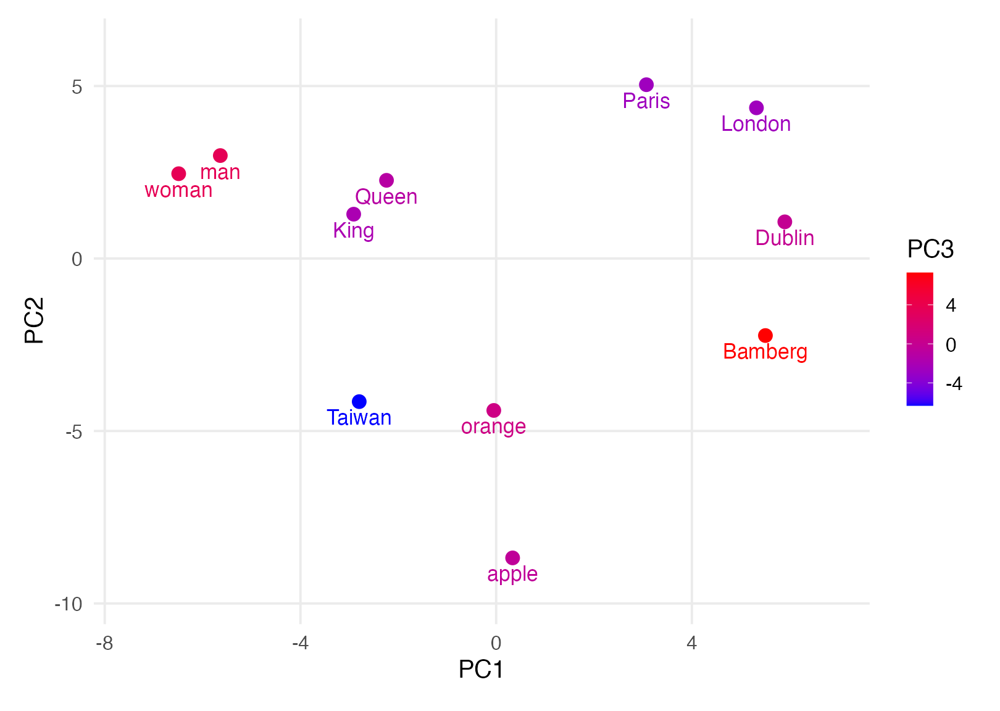
</div>
<div class="case-reading">
<p>
<strong>One point = one word.</strong>
</p>
<table style="font-size:.76em">
<thead>
<tr>
<th>
Word
</th>
<th>
PC1
</th>
<th>
PC2
</th>
</tr>
</thead>
<tbody>
<tr>
<td>
King
</td>
<td>
−2.91
</td>
<td>
1.29
</td>
</tr>
<tr>
<td>
Queen
</td>
<td>
−2.24
</td>
<td>
2.27
</td>
</tr>
<tr>
<td>
man
</td>
<td>
−5.64
</td>
<td>
2.98
</td>
</tr>
</tbody>
</table>
<p>
PC1 + PC2 retain <strong>38.24%</strong> of the standardized variance.
</p>
</div>
</div>
</div>
</div></div></div>
</div>
<div class="source">
<p><a href="../lab/reference/2024_qta_lab_week_11.html">Our 2024 Lab</a> · <a href="../lab/flair/example-output/word-pca-2024-3d.html" rel="noopener" target="_blank">Same-run 3D figure</a> · <a href="../lab/Lab_Session_W9.html#flair-after-class-pca">PCA figures and full calculation</a></p>
</div>

```

## Lab · C00: Text, vectors and a matched transformation {#context-data-and-models .w9-tabbed-lab-slide}

```{=html}

<div class="slide-body lab-slide compact-table w9-tab-step w9-code-output-step">
<p><strong>17:55–17:58.</strong> We now use conText, starting with its texts, vectors and matching transformation.</p>
<div class="w9-code-output-tabs" data-lab-step="C00"><div aria-label="Lab · C00: Text, vectors and a matched transformation code and output" class="w9-code-output-tablist" role="tablist"><button aria-controls="context-data-and-models--code-panel" aria-selected="true" class="w9-code-output-tab" data-w9-tab="code" id="context-data-and-models--code-tab" role="tab" tabindex="0" type="button">Code</button><button aria-controls="context-data-and-models--output-panel" aria-selected="false" class="w9-code-output-tab" data-w9-tab="output" id="context-data-and-models--output-tab" role="tab" tabindex="-1" type="button">Output</button></div><span aria-hidden="true" class="fragment w9-tab-view-trigger" data-fragment-index="0"></span><div aria-hidden="false" aria-labelledby="context-data-and-models--code-tab" class="w9-tab-panel w9-tab-code" id="context-data-and-models--code-panel" role="tabpanel"><div class="w9-tab-view" data-w9-fragment="-1" data-w9-state="code">
<p><strong>Core call · full steps are in the Lab.</strong></p>
<div class="sourceCode" id="context-data-and-models--cb7"><pre class="sourceCode r"><code class="sourceCode r"><span id="context-data-and-models--cb7-1"><a aria-hidden="true" href="#context-data-and-models--cb7-1" tabindex="-1"></a><span class="fu">print</span>(<span class="fu">c</span>(<span class="at">documents =</span> <span class="fu">ndoc</span>(cr_sample_corpus)))</span>
<span id="context-data-and-models--cb7-2"><a aria-hidden="true" href="#context-data-and-models--cb7-2" tabindex="-1"></a><span class="fu">print</span>(<span class="fu">rbind</span>(<span class="at">E =</span> <span class="fu">dim</span>(cr_glove_subset),</span>
<span id="context-data-and-models--cb7-3"><a aria-hidden="true" href="#context-data-and-models--cb7-3" tabindex="-1"></a>  <span class="at">A =</span> <span class="fu">dim</span>(cr_transform)))</span></code></pre></div>
</div></div><div aria-hidden="true" aria-labelledby="context-data-and-models--output-tab" class="w9-tab-panel w9-tab-output" id="context-data-and-models--output-panel" role="tabpanel"><div class="w9-tab-view" data-w9-fragment="0" data-w9-state="output-0" hidden="" id="context-data-and-models-output-1">
<div class="w9-lab-focus-target">
<p><span aria-hidden="true" class="w9-row-focus current-fragment visible w9-linear-current"><svg viewbox="0 0 18 18"><path d="M 2 9 H 15 M 9 3 L 15 9 L 9 15"></path></svg></span></p>
<table>
<thead>
<tr>
<th>Object</th>
<th>Recorded input</th>
</tr>
</thead>
<tbody>
<tr>
<td><code>cr_sample_corpus</code></td>
<td>400 speeches with metadata</td>
</tr>
<tr>
<td><code>cr_glove_subset</code></td>
<td>500 words × 300 coordinates</td>
</tr>
<tr>
<td><code>cr_transform</code></td>
<td>Matching 300 × 300 transformation</td>
</tr>
</tbody>
</table>
</div>
<p><strong>Check:</strong> Which object contains the text? Which two must be a matched pair?</p>
</div></div></div>
</div>
<div class="source">
<p><a href="../lab/Lab_Session_W9.html#ct00">Core call and full step</a> · <a href="../lab/Lab_Session_W9.html#ct00-output">Recorded output</a> · <a href="https://github.com/prodriguezsosa/conText/blob/master/vignettes/quickstart.md">Official Quick Start</a></p>
</div>

```

## Lab · C01: Keep one occurrence per row {#context-occurrences .w9-tabbed-lab-slide}

```{=html}

<div class="slide-body lab-slide compact-table w9-tab-step w9-code-output-step">
<p><strong>17:58–18:00.</strong> We extract immigration contexts and keep their party and gender labels.</p>
<div class="w9-code-output-tabs" data-lab-step="C01"><div aria-label="Lab · C01: Keep one occurrence per row code and output" class="w9-code-output-tablist" role="tablist"><button aria-controls="context-occurrences--code-panel" aria-selected="true" class="w9-code-output-tab" data-w9-tab="code" id="context-occurrences--code-tab" role="tab" tabindex="0" type="button">Code</button><button aria-controls="context-occurrences--output-panel" aria-selected="false" class="w9-code-output-tab" data-w9-tab="output" id="context-occurrences--output-tab" role="tab" tabindex="-1" type="button">Output</button></div><span aria-hidden="true" class="fragment w9-tab-view-trigger" data-fragment-index="0"></span><div aria-hidden="false" aria-labelledby="context-occurrences--code-tab" class="w9-tab-panel w9-tab-code" id="context-occurrences--code-panel" role="tabpanel"><div class="w9-tab-view" data-w9-fragment="-1" data-w9-state="code">
<p><strong>Core call · full steps are in the Lab.</strong></p>
<div class="sourceCode" id="context-occurrences--cb8"><pre class="sourceCode r"><code class="sourceCode r"><span id="context-occurrences--cb8-1"><a aria-hidden="true" href="#context-occurrences--cb8-1" tabindex="-1"></a>immig_toks <span class="ot">&lt;-</span> <span class="fu">tokens_context</span>(toks_nostop_feats,</span>
<span id="context-occurrences--cb8-2"><a aria-hidden="true" href="#context-occurrences--cb8-2" tabindex="-1"></a>  <span class="at">pattern =</span> <span class="st">"immigration"</span>, <span class="at">window =</span> <span class="dv">6</span><span class="dt">L</span>, <span class="at">valuetype =</span> <span class="st">"fixed"</span>,</span>
<span id="context-occurrences--cb8-3"><a aria-hidden="true" href="#context-occurrences--cb8-3" tabindex="-1"></a>  <span class="at">rm_keyword =</span> <span class="cn">TRUE</span>)</span></code></pre></div>
</div></div><div aria-hidden="true" aria-labelledby="context-occurrences--output-tab" class="w9-tab-panel w9-tab-output" id="context-occurrences--output-panel" role="tabpanel"><div class="w9-tab-view" data-w9-fragment="0" data-w9-state="output-0" hidden="" id="context-occurrences-output-1">
<div class="w9-lab-focus-target">
<p><span aria-hidden="true" class="w9-row-focus current-fragment visible w9-linear-current"><svg viewbox="0 0 18 18"><path d="M 2 9 H 15 M 9 3 L 15 9 L 9 15"></path></svg></span></p>
<p><strong>924 contexts</strong> · D: <strong>486</strong> · R: <strong>438</strong>.</p>
<table>
<thead>
<tr>
<th>Pattern</th>
<th>Party</th>
<th>Gender</th>
</tr>
</thead>
<tbody>
<tr>
<td>immigration</td>
<td>D</td>
<td>F</td>
</tr>
<tr>
<td>immigration</td>
<td>D</td>
<td>F</td>
</tr>
<tr>
<td>immigration</td>
<td>D</td>
<td>F</td>
</tr>
</tbody>
</table>
</div>
<p><strong>Check:</strong> One row is one use of immigration, carrying its speech metadata.</p>
</div></div></div>
</div>
<div class="source">
<p><a href="../lab/Lab_Session_W9.html#ct01">Core call and full step</a> · <a href="../lab/Lab_Session_W9.html#ct01-output">Recorded output</a> · <a href="https://github.com/prodriguezsosa/conText/blob/master/vignettes/quickstart.md">Official Quick Start</a></p>
</div>

```

## Lab · C02: Turn contexts into ALC vectors {#context-alc-vectors .w9-tabbed-lab-slide}

```{=html}

<div class="slide-body lab-slide compact-table w9-tab-step w9-code-output-step">
<p><strong>18:00–18:03.</strong> We turn each context into an ALC vector, then average by party.</p>
<div class="w9-code-output-tabs" data-lab-step="C02"><div aria-label="Lab · C02: Turn contexts into ALC vectors code and output" class="w9-code-output-tablist" role="tablist"><button aria-controls="context-alc-vectors--code-panel" aria-selected="true" class="w9-code-output-tab" data-w9-tab="code" id="context-alc-vectors--code-tab" role="tab" tabindex="0" type="button">Code</button><button aria-controls="context-alc-vectors--output-panel" aria-selected="false" class="w9-code-output-tab" data-w9-tab="output" id="context-alc-vectors--output-tab" role="tab" tabindex="-1" type="button">Output</button></div><span aria-hidden="true" class="fragment w9-tab-view-trigger" data-fragment-index="0"></span><span aria-hidden="true" class="fragment w9-tab-view-trigger" data-fragment-index="1"></span><div aria-hidden="false" aria-labelledby="context-alc-vectors--code-tab" class="w9-tab-panel w9-tab-code" id="context-alc-vectors--code-panel" role="tabpanel"><div class="w9-tab-view" data-w9-fragment="-1" data-w9-state="code">
<p><strong>Core call · full steps are in the Lab.</strong></p>
<div class="sourceCode" id="context-alc-vectors--cb9"><pre class="sourceCode r"><code class="sourceCode r"><span id="context-alc-vectors--cb9-1"><a aria-hidden="true" href="#context-alc-vectors--cb9-1" tabindex="-1"></a>immig_dfm <span class="ot">&lt;-</span> <span class="fu">dfm</span>(immig_toks)</span>
<span id="context-alc-vectors--cb9-2"><a aria-hidden="true" href="#context-alc-vectors--cb9-2" tabindex="-1"></a>immig_dem <span class="ot">&lt;-</span> <span class="fu">dem</span>(immig_dfm, <span class="at">pre_trained =</span> cr_glove_subset,</span>
<span id="context-alc-vectors--cb9-3"><a aria-hidden="true" href="#context-alc-vectors--cb9-3" tabindex="-1"></a>  <span class="at">transform =</span> <span class="cn">TRUE</span>, <span class="at">transform_matrix =</span> cr_transform,</span>
<span id="context-alc-vectors--cb9-4"><a aria-hidden="true" href="#context-alc-vectors--cb9-4" tabindex="-1"></a>  <span class="at">verbose =</span> <span class="cn">FALSE</span>)</span>
<span id="context-alc-vectors--cb9-5"><a aria-hidden="true" href="#context-alc-vectors--cb9-5" tabindex="-1"></a>immig_wv_party <span class="ot">&lt;-</span> <span class="fu">dem_group</span>(immig_dem,</span>
<span id="context-alc-vectors--cb9-6"><a aria-hidden="true" href="#context-alc-vectors--cb9-6" tabindex="-1"></a>  <span class="at">groups =</span> immig_dem<span class="sc">@</span>docvars<span class="sc">$</span>party)</span></code></pre></div>
</div></div><div aria-hidden="true" aria-labelledby="context-alc-vectors--output-tab" class="w9-tab-panel w9-tab-output" id="context-alc-vectors--output-panel" role="tabpanel"><div class="w9-tab-view" data-w9-fragment="0" data-w9-state="output-0" hidden="" id="context-alc-vectors-output-1">
<div class="w9-lab-focus-target">
<p><span aria-hidden="true" class="w9-row-focus current-fragment visible w9-linear-current"><svg viewbox="0 0 18 18"><path d="M 2 9 H 15 M 9 3 L 15 9 L 9 15"></path></svg></span></p>
<p><strong>DEM · 924 × 300.</strong> One ALC context vector per row.</p>
</div>
</div><div class="w9-tab-view" data-w9-fragment="1" data-w9-state="output-1" hidden="" id="context-alc-vectors-output-2">
<div class="w9-lab-focus-target">
<p><span aria-hidden="true" class="w9-row-focus current-fragment visible w9-linear-current"><svg viewbox="0 0 18 18"><path d="M 2 9 H 15 M 9 3 L 15 9 L 9 15"></path></svg></span></p>
<p><strong>Party means · 2 × 300.</strong> We average contexts separately for D and R.</p>
</div>
<p><strong>Check:</strong> We still have 300 coordinates. What does a row represent now?</p>
</div></div></div>
</div>
<div class="source">
<p><a href="../lab/Lab_Session_W9.html#ct02">Core call and full step</a> · <a href="../lab/Lab_Session_W9.html#ct02-output">Recorded output</a> · <a href="https://github.com/prodriguezsosa/conText/blob/master/vignettes/quickstart.md">Official Quick Start</a></p>
</div>

```

## Lab · C03: Read the nearby words {#context-neighbours .w9-tabbed-lab-slide}

```{=html}

<div class="slide-body lab-slide compact-table w9-tab-step w9-code-output-step">
<p><strong>18:03–18:05.</strong> We use nearby words to interpret the party averages.</p>
<div class="w9-code-output-tabs" data-lab-step="C03"><div aria-label="Lab · C03: Read the nearby words code and output" class="w9-code-output-tablist" role="tablist"><button aria-controls="context-neighbours--code-panel" aria-selected="true" class="w9-code-output-tab" data-w9-tab="code" id="context-neighbours--code-tab" role="tab" tabindex="0" type="button">Code</button><button aria-controls="context-neighbours--output-panel" aria-selected="false" class="w9-code-output-tab" data-w9-tab="output" id="context-neighbours--output-tab" role="tab" tabindex="-1" type="button">Output</button></div><span aria-hidden="true" class="fragment w9-tab-view-trigger" data-fragment-index="0"></span><span aria-hidden="true" class="fragment w9-tab-view-trigger" data-fragment-index="1"></span><div aria-hidden="false" aria-labelledby="context-neighbours--code-tab" class="w9-tab-panel w9-tab-code" id="context-neighbours--code-panel" role="tabpanel"><div class="w9-tab-view" data-w9-fragment="-1" data-w9-state="code">
<p><strong>Core call · full steps are in the Lab.</strong></p>
<div class="sourceCode" id="context-neighbours--cb10"><pre class="sourceCode r"><code class="sourceCode r"><span id="context-neighbours--cb10-1"><a aria-hidden="true" href="#context-neighbours--cb10-1" tabindex="-1"></a>immig_nns <span class="ot">&lt;-</span> <span class="fu">nns</span>(immig_wv_party,</span>
<span id="context-neighbours--cb10-2"><a aria-hidden="true" href="#context-neighbours--cb10-2" tabindex="-1"></a>  <span class="at">pre_trained =</span> cr_glove_subset, <span class="at">N =</span> <span class="dv">3</span>,</span>
<span id="context-neighbours--cb10-3"><a aria-hidden="true" href="#context-neighbours--cb10-3" tabindex="-1"></a>  <span class="at">candidates =</span> immig_wv_party<span class="sc">@</span>features, <span class="at">as_list =</span> <span class="cn">FALSE</span>)</span></code></pre></div>
</div></div><div aria-hidden="true" aria-labelledby="context-neighbours--output-tab" class="w9-tab-panel w9-tab-output" id="context-neighbours--output-panel" role="tabpanel"><div class="w9-tab-view" data-w9-fragment="0" data-w9-state="output-0" hidden="" id="context-neighbours-output-1">
<div class="w9-lab-focus-target">
<p><span aria-hidden="true" class="w9-row-focus current-fragment visible w9-linear-current"><svg viewbox="0 0 18 18"><path d="M 2 9 H 15 M 9 3 L 15 9 L 9 15"></path></svg></span></p>
<p><strong>D · cosine neighbours</strong></p>
<p>immigration (0.848), broken (0.680), comprehensive (0.661)</p>
</div>
</div><div class="w9-tab-view" data-w9-fragment="1" data-w9-state="output-1" hidden="" id="context-neighbours-output-2">
<div class="w9-lab-focus-target">
<p><span aria-hidden="true" class="w9-row-focus current-fragment visible w9-linear-current"><svg viewbox="0 0 18 18"><path d="M 2 9 H 15 M 9 3 L 15 9 L 9 15"></path></svg></span></p>
<p><strong>R · cosine neighbours</strong></p>
<p>immigration (0.875), illegal (0.708), enforcement (0.645)</p>
</div>
<p><strong>Check:</strong> What difference in emphasis do we see? Next, we check a context.</p>
</div></div></div>
</div>
<div class="source">
<p><a href="../lab/Lab_Session_W9.html#ct03">Core call and full step</a> · <a href="../lab/Lab_Session_W9.html#ct03-output">Recorded output</a> · <a href="https://github.com/prodriguezsosa/conText/blob/master/vignettes/quickstart.md">Official Quick Start</a></p>
</div>

```

## Lab · C04: Read the nearby contexts {#context-nearest-passages .w9-tabbed-lab-slide}

```{=html}

<div class="slide-body lab-slide compact-table w9-tab-step w9-code-output-step">
<p><strong>18:05–18:07.</strong> We check that interpretation against the nearby contexts.</p>
<div class="w9-code-output-tabs" data-lab-step="C04"><div aria-label="Lab · C04: Read the nearby contexts code and output" class="w9-code-output-tablist" role="tablist"><button aria-controls="context-nearest-passages--code-panel" aria-selected="true" class="w9-code-output-tab" data-w9-tab="code" id="context-nearest-passages--code-tab" role="tab" tabindex="0" type="button">Code</button><button aria-controls="context-nearest-passages--output-panel" aria-selected="false" class="w9-code-output-tab" data-w9-tab="output" id="context-nearest-passages--output-tab" role="tab" tabindex="-1" type="button">Output</button></div><span aria-hidden="true" class="fragment w9-tab-view-trigger" data-fragment-index="0"></span><span aria-hidden="true" class="fragment w9-tab-view-trigger" data-fragment-index="1"></span><div aria-hidden="false" aria-labelledby="context-nearest-passages--code-tab" class="w9-tab-panel w9-tab-code" id="context-nearest-passages--code-panel" role="tabpanel"><div class="w9-tab-view" data-w9-fragment="-1" data-w9-state="code">
<p><strong>Core call · full steps are in the Lab.</strong></p>
<div class="sourceCode" id="context-nearest-passages--cb11"><pre class="sourceCode r"><code class="sourceCode r"><span id="context-nearest-passages--cb11-1"><a aria-hidden="true" href="#context-nearest-passages--cb11-1" tabindex="-1"></a>immig_ncs <span class="ot">&lt;-</span> <span class="fu">ncs</span>(immig_wv_party, <span class="at">contexts_dem =</span> immig_dem,</span>
<span id="context-nearest-passages--cb11-2"><a aria-hidden="true" href="#context-nearest-passages--cb11-2" tabindex="-1"></a>  <span class="at">contexts =</span> immig_toks, <span class="at">N =</span> <span class="dv">1</span>, <span class="at">as_list =</span> <span class="cn">FALSE</span>)</span></code></pre></div>
</div></div><div aria-hidden="true" aria-labelledby="context-nearest-passages--output-tab" class="w9-tab-panel w9-tab-output" id="context-nearest-passages--output-panel" role="tabpanel"><div class="w9-tab-view" data-w9-fragment="0" data-w9-state="output-0" hidden="" id="context-nearest-passages-output-1">
<div class="w9-lab-focus-target">
<p><span aria-hidden="true" class="w9-row-focus current-fragment visible w9-linear-current"><svg viewbox="0 0 18 18"><path d="M 2 9 H 15 M 9 3 L 15 9 L 9 15"></path></svg></span></p>
<p><strong>Near the D mean · cosine 0.802</strong></p>
<p>end conversation passed immigration bill comprehensive bill clean broken immigration system year</p>
</div>
</div><div class="w9-tab-view" data-w9-fragment="1" data-w9-state="output-1" hidden="" id="context-nearest-passages-output-2">
<div class="w9-lab-focus-target">
<p><span aria-hidden="true" class="w9-row-focus current-fragment visible w9-linear-current"><svg viewbox="0 0 18 18"><path d="M 2 9 H 15 M 9 3 L 15 9 L 9 15"></path></svg></span></p>
<p><strong>Near the R mean · cosine 0.798</strong></p>
<p>america suggest immigration can good thing illegal immigration legal immigration mean means</p>
</div>
<p><strong>Check:</strong> We retrieved processed context words from a pool containing both parties.</p>
</div></div></div>
</div>
<div class="source">
<p><a href="../lab/Lab_Session_W9.html#ct04">Core call and full step</a> · <a href="../lab/Lab_Session_W9.html#ct04-output">Recorded output</a> · <a href="https://github.com/prodriguezsosa/conText/blob/master/vignettes/quickstart.md">Official Quick Start</a></p>
</div>

```

## Lab · C05: Introduce embedding regression {#context-embedding-regression .w9-tabbed-lab-slide}

```{=html}

<div class="slide-body lab-slide compact-table w9-tab-step w9-code-output-step">
<p><strong>18:07–18:10.</strong> We return to occurrences and compare parties while holding gender fixed.</p>
<div class="w9-code-output-tabs" data-lab-step="C05"><div aria-label="Lab · C05: Introduce embedding regression code and output" class="w9-code-output-tablist" role="tablist"><button aria-controls="context-embedding-regression--code-panel" aria-selected="true" class="w9-code-output-tab" data-w9-tab="code" id="context-embedding-regression--code-tab" role="tab" tabindex="0" type="button">Code</button><button aria-controls="context-embedding-regression--output-panel" aria-selected="false" class="w9-code-output-tab" data-w9-tab="output" id="context-embedding-regression--output-tab" role="tab" tabindex="-1" type="button">Output</button></div><span aria-hidden="true" class="fragment w9-tab-view-trigger" data-fragment-index="0"></span><span aria-hidden="true" class="fragment w9-tab-view-trigger" data-fragment-index="1"></span><span aria-hidden="true" class="fragment w9-tab-view-trigger" data-fragment-index="2"></span><div aria-hidden="false" aria-labelledby="context-embedding-regression--code-tab" class="w9-tab-panel w9-tab-code" id="context-embedding-regression--code-panel" role="tabpanel"><div class="w9-tab-view" data-w9-fragment="-1" data-w9-state="code">
<p><strong>Core call · full steps are in the Lab.</strong></p>
<div class="sourceCode" id="context-embedding-regression--cb12"><pre class="sourceCode r"><code class="sourceCode r"><span id="context-embedding-regression--cb12-1"><a aria-hidden="true" href="#context-embedding-regression--cb12-1" tabindex="-1"></a><span class="fu">set.seed</span>(<span class="dv">2021</span><span class="dt">L</span>)</span>
<span id="context-embedding-regression--cb12-2"><a aria-hidden="true" href="#context-embedding-regression--cb12-2" tabindex="-1"></a>fit <span class="ot">&lt;-</span> <span class="fu">conText</span>(immigration <span class="sc">~</span> party <span class="sc">+</span> gender,</span>
<span id="context-embedding-regression--cb12-3"><a aria-hidden="true" href="#context-embedding-regression--cb12-3" tabindex="-1"></a>  <span class="at">data =</span> toks_nostop_feats, <span class="at">pre_trained =</span> cr_glove_subset,</span>
<span id="context-embedding-regression--cb12-4"><a aria-hidden="true" href="#context-embedding-regression--cb12-4" tabindex="-1"></a>  <span class="at">transform =</span> <span class="cn">TRUE</span>, <span class="at">transform_matrix =</span> cr_transform,</span>
<span id="context-embedding-regression--cb12-5"><a aria-hidden="true" href="#context-embedding-regression--cb12-5" tabindex="-1"></a>  <span class="at">jackknife =</span> <span class="cn">FALSE</span>, <span class="at">permute =</span> <span class="cn">TRUE</span>,</span>
<span id="context-embedding-regression--cb12-6"><a aria-hidden="true" href="#context-embedding-regression--cb12-6" tabindex="-1"></a>  <span class="at">num_permutations =</span> <span class="dv">100</span>, <span class="at">window =</span> <span class="dv">6</span><span class="dt">L</span>,</span>
<span id="context-embedding-regression--cb12-7"><a aria-hidden="true" href="#context-embedding-regression--cb12-7" tabindex="-1"></a>  <span class="at">valuetype =</span> <span class="st">"fixed"</span>, <span class="at">verbose =</span> <span class="cn">FALSE</span>)</span></code></pre></div>
</div></div><div aria-hidden="true" aria-labelledby="context-embedding-regression--output-tab" class="w9-tab-panel w9-tab-output" id="context-embedding-regression--output-panel" role="tabpanel"><div class="w9-tab-view" data-w9-fragment="0" data-w9-state="output-0" hidden="" id="context-embedding-regression-output-1">
<div class="w9-lab-focus-target">
<p><span aria-hidden="true" class="w9-row-focus current-fragment visible w9-linear-current"><svg viewbox="0 0 18 18"><path d="M 2 9 H 15 M 9 3 L 15 9 L 9 15"></path></svg></span></p>
<p><strong>Coefficients · 3 × 300.</strong> Intercept, party_R and gender_M. Unlike the earlier party means, <code>party_R</code> adjusts for gender.</p>
</div>
</div><div class="w9-tab-view" data-w9-fragment="1" data-w9-state="output-1" hidden="" id="context-embedding-regression-output-2">
<div class="w9-lab-focus-target">
<p><span aria-hidden="true" class="w9-row-focus current-fragment visible w9-linear-current"><svg viewbox="0 0 18 18"><path d="M 2 9 H 15 M 9 3 L 15 9 L 9 15"></path></svg></span></p>
<table>
<thead>
<tr>
<th>Coefficient</th>
<th style="text-align: right;">Debiased squared norm</th>
<th style="text-align: right;">Permutation p</th>
</tr>
</thead>
<tbody>
<tr>
<td><code>party_R</code></td>
<td style="text-align: right;">8.668</td>
<td style="text-align: right;">0</td>
</tr>
<tr>
<td><code>gender_M</code></td>
<td style="text-align: right;">5.155</td>
<td style="text-align: right;">0</td>
</tr>
</tbody>
</table>
<p><code>0</code> records 0 exceedances in 100 permutations.</p>
</div>
</div><div class="w9-tab-view" data-w9-fragment="2" data-w9-state="output-2" hidden="" id="context-embedding-regression-output-3">
<div class="w9-lab-focus-target">
<p><span aria-hidden="true" class="w9-row-focus current-fragment visible w9-linear-current"><svg viewbox="0 0 18 18"><path d="M 2 9 H 15 M 9 3 L 15 9 L 9 15"></path></svg></span></p>
<p><strong>E04 · Check:</strong> What does party_R compare at fixed gender? How can we explain the result using a neighbour and a context?</p>
</div>
</div></div></div>
</div>
<div class="source">
<p><a href="../lab/Lab_Session_W9.html#ct05">Core call and full step</a> · <a href="../lab/Lab_Session_W9.html#ct05-output">Recorded output</a> · <a href="https://github.com/prodriguezsosa/conText/blob/master/vignettes/quickstart.md">Official Quick Start</a></p>
</div>

```

## Design an embedding study in one paragraph {#design-an-embedding-study-in-one-paragraph .w9-linear-slide}

```{=html}

<div class="slide-body">
<ol type="1">
<li>We start with a political question and the <strong>unit</strong> that receives a vector.</li>
<li>We choose the corpus, representation and comparison for that question.</li>
<li>We identify evidence that could change our interpretation.</li>
</ol>
<p><strong>Our design.</strong> How might we compare a policy term across parties, periods or legislative settings?</p>
</div>
<div class="source">
<p><a href="https://press.princeton.edu/books/hardcover/9780691207544/text-as-data">Text as Data, §§8.2 and 8.4</a> · <a href="../reading/README.md#cases">W9 case guide</a></p>
</div>

```

## Readings and classroom materials {#readings-and-classroom-materials .w9-linear-slide}

```{=html}

<div class="slide-body reading-list">
<p><strong>Concepts and demonstrations</strong></p>
<ul>
<li>Grimmer, Roberts &amp; Stewart (2022), <em>Text as Data</em>, Ch. 8. Ch. 7 covers similarity and TF–IDF.</li>
<li>Schoonvelde (2026), ESS Day 3, <em>Comparing Representations</em>.</li>
</ul>
<p><strong>Assigned studies</strong></p>
<ul>
<li>Bischof &amp; Senninger (2018), campaign language and political knowledge.</li>
<li>Rodriguez &amp; Spirling (2022), evaluating word embeddings.</li>
<li>Rodriguez, Spirling &amp; Stewart (2023), embedding regression.</li>
</ul>
</div>
<div class="source">
<p><a href="../reading/README.md">Reading guide</a> · <a href="../reading/README.md#book-and-course-materials">Book and ESS crosswalk</a> · <a href="../lab/Lab_Session_W9.html">W9 lab</a> · <a href="../handout/Word_Embeddings_Supplement.html">Supplement</a> · <a href="../lab/After_Class_W9.html">After-class lab</a></p>
</div>

```

## References {#references .w9-linear-slide}

```{=html}

<div class="slide-body w9-ref-grid">
<div class="w9-ref-column">
<div class="level3" id="references--w9-assigned-readings">
<h3>W9 assigned readings</h3>
<p><strong>Bischof &amp; Senninger (2018)</strong> · <em>EJPR</em> · <a href="https://doi.org/10.1111/1475-6765.12235">DOI</a><br/>
Simple Politics for the People? Complexity in Campaign Messages and Political Knowledge</p>
<p><strong>Rodriguez &amp; Spirling (2022)</strong> · <em>JOP</em> · <a href="https://doi.org/10.1086/715162">DOI</a><br/>
Word Embeddings: What Works, What Doesn’t, and How to Tell the Difference for Applied Research</p>
<p><strong>Rodriguez, Spirling &amp; Stewart (2023)</strong> · <em>APSR</em> · Case 4 · <a href="https://doi.org/10.1017/S0003055422001228">DOI</a><br/>
Embedding Regression: Models for Context-Specific Description and Inference</p>
</div>
<div class="level3" id="references--w9-optional-reading">
<h3>W9 optional reading</h3>
<p><strong>Wirsching et al. (2025)</strong> · <em>Political Analysis</em> · <a href="https://doi.org/10.1017/pan.2024.17">DOI</a><br/>
Multilanguage Word Embeddings for Social Scientists: Estimation, Inference, and Validation Resources for 157 Languages</p>
</div>
</div>
<div class="w9-ref-column">
<div class="level3" id="references--additional-w9-cases">
<h3>Additional W9 cases</h3>
<p><strong>Rheault &amp; Cochrane (2020)</strong> · <em>Political Analysis</em> · Case 1 · <a href="https://doi.org/10.1017/pan.2019.26">DOI</a><br/>
Word Embeddings for the Analysis of Ideological Placement in Parliamentary Corpora</p>
<p><strong>Rodman (2020)</strong> · <em>Political Analysis</em> · Case 2 · <a href="https://doi.org/10.1017/pan.2019.23">DOI</a><br/>
A Timely Intervention: Tracking the Changing Meanings of Political Concepts with Word Vectors</p>
</div>
<div class="level3" id="references--w10-optional-readings-used-in-w9">
<h3>W10 optional readings used in W9</h3>
<p><strong>Müller &amp; Proksch (2024)</strong> · <em>BJPS</em> · Case 3 · <a href="https://doi.org/10.1017/S0007123423000571">DOI</a><br/>
Nostalgia in European Party Politics: A Text-Based Measurement Approach</p>
<p><strong>Widmann &amp; Wich (2023)</strong> · <em>Political Analysis</em> · W10 comparison · <a href="https://doi.org/10.1017/pan.2022.15">DOI</a><br/>
Creating and Comparing Dictionary, Word Embedding, and Transformer-Based Models to Measure Discrete Emotions in German Political Text</p>
</div>
</div>
</div>
<div class="source">
<p><a href="../reading/README.md#applications">Four ER applications and DOI links</a> · <a href="../reading/README.md">W9 reading guide</a> · <a href="../reading/README.md#cases">W9 case guide</a></p>
</div>

```

## Learn coordinates by predicting words {#prediction-training .w9-linear-slide .w9-linear-optional}

```{=html}

<div class="slide-body case-split">
<div class="case-visual">
<div class="w9-evidence-frame" style="--w9-evidence-ratio:1800 / 1002;">
<p>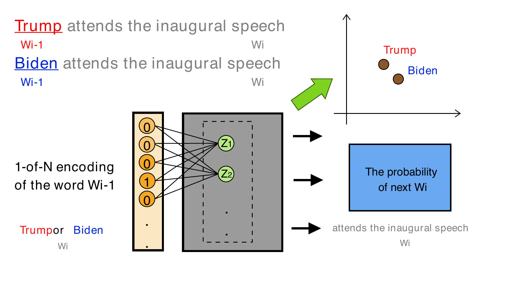 <svg aria-hidden="true" class="w9-evidence-overlay" viewbox="0 0 1800 1002"> <g class="current-fragment visible w9-linear-current"> <rect class="w9-evidence-focus" height="510" rx="10" width="130" x="452" y="382"></rect> <circle class="w9-evidence-focus" cx="514" cy="635" r="39"></circle> <rect class="w9-evidence-focus" height="54" rx="8" width="320" x="57" y="779"></rect> <path class="w9-evidence-pointer" d="M 364 747 H 417 L 470 651"></path><polygon class="w9-evidence-pointer-head" points="455,654 477,639 474,666"></polygon> </g> </svg></p>
</div>
</div>
<div class="case-reading w9-concept-reading">
<div class="w9-reading-focus current-fragment visible w9-linear-current">
<p><strong>Input</strong> One active vocabulary position.</p>
</div>
<div class="w9-reading-focus visible">
<p><strong>Hidden</strong> Learned coordinates <math display="inline" xmlns="http://www.w3.org/1998/Math/MathML"><semantics><mrow><msub><mi>z</mi><mn>1</mn></msub><mo>,</mo><msub><mi>z</mi><mn>2</mn></msub></mrow><annotation encoding="application/x-tex">z_1,z_2</annotation></semantics></math>.</p>
</div>
<div class="w9-reading-focus visible">
<p><strong>Output</strong> Next-word probabilities; target: <em>attends</em>.</p>
</div>
<div class="w9-reading-focus visible">
<p><strong>Update</strong> Error updates the connection weights.</p>
</div>
<p>The plotted positions are a teaching illustration.</p>
</div>
</div>
<div class="source">
<p><a href="../lab/Lab_Session_W9.html#f01-try-the-r-route">Flair token extraction</a></p>
</div>

```

## Learn coordinates by predicting words {#prediction-training-step-2 .w9-linear-slide .w9-linear-optional}

```{=html}

<div class="slide-body case-split">
<div class="case-visual">
<div class="w9-evidence-frame" style="--w9-evidence-ratio:1800 / 1002;">
<p> <svg aria-hidden="true" class="w9-evidence-overlay" viewbox="0 0 1800 1002"> <g class="current-fragment visible w9-linear-current"> <rect class="w9-evidence-focus" height="443" rx="10" width="188" x="704" y="416"></rect> <path class="w9-evidence-pointer" d="M 583 634 H 685 L 755 610"></path><polygon class="w9-evidence-pointer-head" points="740,605 741,621 762,607"></polygon> </g> </svg></p>
</div>
</div>
<div class="case-reading w9-concept-reading">
<div class="w9-reading-focus visible">
<p><strong>Input</strong> One active vocabulary position.</p>
</div>
<div class="w9-reading-focus current-fragment visible w9-linear-current">
<p><strong>Hidden</strong> Learned coordinates <math display="inline" xmlns="http://www.w3.org/1998/Math/MathML"><semantics><mrow><msub><mi>z</mi><mn>1</mn></msub><mo>,</mo><msub><mi>z</mi><mn>2</mn></msub></mrow><annotation encoding="application/x-tex">z_1,z_2</annotation></semantics></math>.</p>
</div>
<div class="w9-reading-focus visible">
<p><strong>Output</strong> Next-word probabilities; target: <em>attends</em>.</p>
</div>
<div class="w9-reading-focus visible">
<p><strong>Update</strong> Error updates the connection weights.</p>
</div>
<p>The plotted positions are a teaching illustration.</p>
</div>
</div>
<div class="source">
<p><a href="../lab/Lab_Session_W9.html#f01-try-the-r-route">Flair token extraction</a></p>
</div>

```

## Learn coordinates by predicting words {#prediction-training-step-3 .w9-linear-slide .w9-linear-optional}

```{=html}

<div class="slide-body case-split">
<div class="case-visual">
<div class="w9-evidence-frame" style="--w9-evidence-ratio:1800 / 1002;">
<p> <svg aria-hidden="true" class="w9-evidence-overlay" viewbox="0 0 1800 1002"> <g class="current-fragment visible w9-linear-current"> <rect class="w9-evidence-focus" height="256" rx="10" width="380" x="1212" y="495"></rect> <rect class="w9-evidence-focus" height="44" rx="8" width="145" x="1154" y="779"></rect> <path class="w9-evidence-pointer" d="M 996 578 H 1115 L 1210 610"></path><polygon class="w9-evidence-pointer-head" points="1194,596 1190,612 1218,613"></polygon> </g> </svg></p>
</div>
</div>
<div class="case-reading w9-concept-reading">
<div class="w9-reading-focus visible">
<p><strong>Input</strong> One active vocabulary position.</p>
</div>
<div class="w9-reading-focus visible">
<p><strong>Hidden</strong> Learned coordinates <math display="inline" xmlns="http://www.w3.org/1998/Math/MathML"><semantics><mrow><msub><mi>z</mi><mn>1</mn></msub><mo>,</mo><msub><mi>z</mi><mn>2</mn></msub></mrow><annotation encoding="application/x-tex">z_1,z_2</annotation></semantics></math>.</p>
</div>
<div class="w9-reading-focus current-fragment visible w9-linear-current">
<p><strong>Output</strong> Next-word probabilities; target: <em>attends</em>.</p>
</div>
<div class="w9-reading-focus visible">
<p><strong>Update</strong> Error updates the connection weights.</p>
</div>
<p>The plotted positions are a teaching illustration.</p>
</div>
</div>
<div class="source">
<p><a href="../lab/Lab_Session_W9.html#f01-try-the-r-route">Flair token extraction</a></p>
</div>

```

## Learn coordinates by predicting words {#prediction-training-step-4 .w9-linear-slide .w9-linear-optional}

```{=html}

<div class="slide-body case-split">
<div class="case-visual">
<div class="w9-evidence-frame" style="--w9-evidence-ratio:1800 / 1002;">
<p> <svg aria-hidden="true" class="w9-evidence-overlay" viewbox="0 0 1800 1002"> <g class="current-fragment visible w9-linear-current"> <rect class="w9-evidence-focus" height="294" rx="10" width="174" x="582" y="426"></rect> <rect class="w9-evidence-focus" height="400" rx="10" width="150" x="1010" y="435"></rect> <path class="w9-evidence-pointer" d="M 1400 752 V 935 H 1090 V 650"></path><polygon class="w9-evidence-pointer-head" points="1080,658 1100,658 1090,635"></polygon> <path class="w9-evidence-pointer" d="M 1090 935 H 650 V 642"></path><polygon class="w9-evidence-pointer-head" points="640,650 660,650 650,627"></polygon> <rect class="w9-evidence-focus" height="171" rx="12" width="261" x="1309" y="147"></rect> </g> </svg></p>
</div>
</div>
<div class="case-reading w9-concept-reading">
<div class="w9-reading-focus visible">
<p><strong>Input</strong> One active vocabulary position.</p>
</div>
<div class="w9-reading-focus visible">
<p><strong>Hidden</strong> Learned coordinates <math display="inline" xmlns="http://www.w3.org/1998/Math/MathML"><semantics><mrow><msub><mi>z</mi><mn>1</mn></msub><mo>,</mo><msub><mi>z</mi><mn>2</mn></msub></mrow><annotation encoding="application/x-tex">z_1,z_2</annotation></semantics></math>.</p>
</div>
<div class="w9-reading-focus visible">
<p><strong>Output</strong> Next-word probabilities; target: <em>attends</em>.</p>
</div>
<div class="w9-reading-focus current-fragment visible w9-linear-current">
<p><strong>Update</strong> Error updates the connection weights.</p>
</div>
<p>The plotted positions are a teaching illustration.</p>
</div>
</div>
<div class="source">
<p><a href="../lab/Lab_Session_W9.html#f01-try-the-r-route">Flair token extraction</a></p>
</div>

```

## Related words in prediction {#appendix-related-words-in-prediction .w9-linear-slide .w9-linear-optional}

```{=html}

<div class="slide-body">
<p><strong>The book’s movie review example</strong></p>
<p>We train a classifier on labeled reviews that use <strong>great</strong>.</p>
<p>A new review uses <strong>fantastic</strong>. What can we carry over if the two words have related vectors?</p>
<p>We can predict using word similarities learned from the training corpus.</p>
</div>
<div class="source">
<p><a href="https://books.google.com.tw/books?id=dL40EAAAQBAJ&amp;pg=PA80">Grimmer, Roberts &amp; Stewart (2022), §8.1, p. 80</a>.</p>
</div>

```

## What does each row represent? {#what-does-each-row-represent .w9-linear-slide .w9-linear-optional}

```{=html}

<div class="slide-body case-split">
<div class="case-visual">
<p>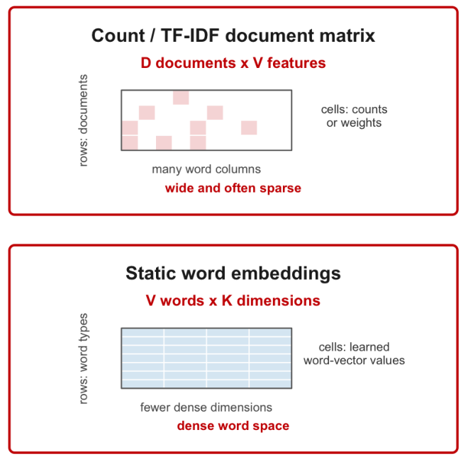</p>
</div>
<div class="case-reading">
<p><strong>Document counts</strong> give each speech a row of feature counts.</p>
<p><strong>Static word embeddings</strong> give each word type a row of learned coordinates.</p>
<p>Which rows do we compare for two speeches? For two words?</p>
</div>
</div>
<div class="source">
<p>Schoonvelde (2026), <em>Comparing Representations</em>, ESS Day 3, original p. 6, document and word panels. <a href="../reading/README.md#book-and-course-materials">ESS materials and page map</a></p>
</div>

```

## Compute cosine for two speeches {#compute-cosine-for-two-speeches .w9-linear-slide .w9-linear-optional}

```{=html}

<div class="slide-body">
<table>
<thead>
<tr>
<th>Speech</th>
<th style="text-align: center;">security</th>
<th style="text-align: center;">forces</th>
<th style="text-align: center;">energy</th>
</tr>
</thead>
<tbody>
<tr>
<td>Defence</td>
<td style="text-align: center;">1</td>
<td style="text-align: center;">1</td>
<td style="text-align: center;">0</td>
</tr>
<tr>
<td>Energy</td>
<td style="text-align: center;">1</td>
<td style="text-align: center;">0</td>
<td style="text-align: center;">1</td>
</tr>
</tbody>
</table>
<p><math display="block" xmlns="http://www.w3.org/1998/Math/MathML"><semantics><mrow><mo>cos</mo><mrow><mo form="prefix" stretchy="true">(</mo><mi>𝐚</mi><mo>,</mo><mi>𝐛</mi><mo form="postfix" stretchy="true">)</mo></mrow><mo>=</mo><mfrac><mrow><mi>𝐚</mi><mo>⋅</mo><mi>𝐛</mi></mrow><mrow><mo form="prefix" stretchy="false">∥</mo><mi>𝐚</mi><mo form="postfix" stretchy="false">∥</mo><mo form="prefix" stretchy="false">∥</mo><mi>𝐛</mi><mo form="postfix" stretchy="false">∥</mo></mrow></mfrac><mo>=</mo><mfrac><mn>1</mn><mrow><msqrt><mn>2</mn></msqrt><msqrt><mn>2</mn></msqrt></mrow></mfrac><mo>=</mo><mn>0.50</mn></mrow><annotation encoding="application/x-tex">\cos(\mathbf{a},\mathbf{b})=\frac{\mathbf{a}\cdot\mathbf{b}}{\lVert\mathbf{a}\rVert\lVert\mathbf{b}\rVert}=\frac{1}{\sqrt{2}\sqrt{2}}=0.50</annotation></semantics></math></p>
<p>Both speeches contain <em>security</em>. Each also contains a different feature.</p>
</div>
<div class="source">
<p>Schoonvelde (2026), ESS Day 3, numerical example from original p. 10. <a href="../reading/README.md#book-and-course-materials">ESS materials and page map</a></p>
</div>

```

## Average word vectors to represent a document {#average-word-vectors-to-represent-a-document .w9-linear-slide .w9-linear-optional}

```{=html}

<div class="slide-body compact-table">
<p>We average the available token vectors one coordinate at a time.</p>
<table>
<thead>
<tr>
<th>Token</th>
<th style="text-align: right;">Coordinate 1</th>
<th style="text-align: right;">Coordinate 2</th>
</tr>
</thead>
<tbody>
<tr>
<td>first token</td>
<td style="text-align: right;">1</td>
<td style="text-align: right;">0</td>
</tr>
<tr>
<td>second token</td>
<td style="text-align: right;">0</td>
<td style="text-align: right;">2</td>
</tr>
<tr>
<td><strong>document mean</strong></td>
<td style="text-align: right;"><strong>0.5</strong></td>
<td style="text-align: right;"><strong>1.0</strong></td>
</tr>
</tbody>
</table>
<p>Repeated tokens contribute repeatedly to the simple average. The resulting vector summarizes the document.</p>
</div>
<div class="source">
<p><a href="https://books.google.com.tw/books?id=dL40EAAAQBAJ&amp;pg=PA86">Grimmer, Roberts &amp; Stewart (2022), §8.3, pp. 86–87</a>. Two-coordinate arithmetic constructed for W9.</p>
</div>

```

## The PCA map changes the nearest words {#ess-security-pca .w9-linear-slide .w9-linear-optional}

```{=html}

<div class="slide-body case-split">
<div class="case-visual">
<p>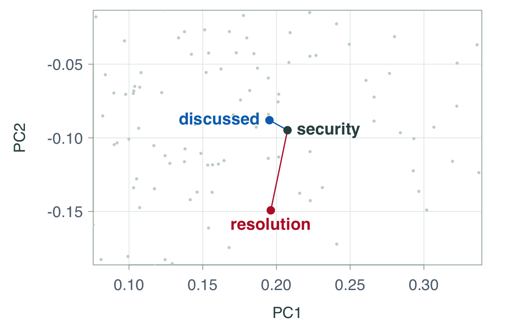</p>
</div>
<div class="case-reading">
<p>On the <strong>two-dimensional map</strong>, <em>discussed</em> is closest to <em>security</em>.</p>
<p>Across all <strong>30 dimensions</strong>, <em>resolution</em> has the highest cosine with <em>security</em> (0.661).</p>
<p>PC1 and PC2 retain <strong>9.54%</strong> of the variance in this model’s unit vectors.</p>
</div>
</div>
<div class="source">
<p>W9 teaching GloVe vectors · ESS Day 3, p. 19 · <a href="../lab/Lab_Session_W9_earlier.html#r05-pca-check">R05 PCA check</a> · <a href="../scripts/plot_ess_security_pca.R">Plot source</a></p>
</div>

```

## How did presidents talk about manufacturing? {#how-did-presidents-talk-about-manufacturing .w9-linear-slide .w9-linear-optional}

```{=html}

<div class="slide-body compact-table">
<p><strong>U.S. State of the Union addresses</strong></p>
<p>The book compares <strong>1900–1959</strong> with <strong>1960–2016</strong>. It finds 53 mentions of <em>manufacturing</em> across the two periods.</p>
<ol type="1">
<li>Collect the words around each mention.</li>
<li>Represent those words with pretrained embeddings.</li>
<li>Average the context word vectors within each period and apply a learned linear transform to each average.</li>
</ol>
<p>This à la carte procedure gives one <strong>300-dimensional vector</strong> for <em>manufacturing</em> per period.</p>
</div>
<div class="source">
<p><a href="https://books.google.com.tw/books?id=dL40EAAAQBAJ&amp;pg=PA85">Grimmer, Roberts &amp; Stewart (2022), <em>Text as Data</em>, §8.2.7, p. 85</a></p>
</div>

```

## The neighbours of manufacturing change over time {#the-neighbours-of-manufacturing-change-over-time .w9-linear-slide .w9-linear-optional}

```{=html}

<div class="slide-body compact-table">
<p>Cosine distance ranks other words by their proximity to each period’s <em>manufacturing</em> vector.</p>
<table>
<thead>
<tr>
<th>1900–1959</th>
<th>1960–2016</th>
</tr>
</thead>
<tbody>
<tr>
<td><code>exportation</code></td>
<td><code>retooling</code></td>
</tr>
<tr>
<td><code>oil-related</code></td>
<td><code>jobs</code></td>
</tr>
<tr>
<td><code>energy-intensive</code></td>
<td><code>offshoring</code></td>
</tr>
</tbody>
</table>
<p>The selected neighbours associate the term with trade and energy in the earlier period and restructuring and employment in the later one.</p>
</div>
<div class="source">
<p>Selected reported neighbours from <a href="https://books.google.com.tw/books?id=dL40EAAAQBAJ&amp;pg=PA85">Grimmer, Roberts &amp; Stewart (2022), <em>Text as Data</em>, §8.2.7, p. 85</a> and <a href="https://books.google.com.tw/books?id=dL40EAAAQBAJ&amp;pg=PA86">p. 86</a>.</p>
</div>

```

## Validate the representation for its use {#validate-the-representation-for-its-use .w9-linear-slide .w9-linear-optional}

```{=html}

<div class="slide-body compact-table">
<table>
<colgroup>
<col style="width: 50%"/>
<col style="width: 50%"/>
</colgroup>
<thead>
<tr>
<th>Evaluation</th>
<th>Question</th>
</tr>
</thead>
<tbody>
<tr>
<td>Intrinsic</td>
<td>Do vector relationships agree with an external judgment about words?</td>
</tr>
<tr>
<td>Extrinsic</td>
<td>Do the vectors help on a downstream task, such as predicting labels?</td>
</tr>
<tr>
<td>Substantive</td>
<td>Does the comparison support the interpretation required by the research question?</td>
</tr>
</tbody>
</table>
<p>For <em>manufacturing</em>, which passages could we read to check the period contrast?</p>
</div>
<div class="source">
<p><a href="https://books.google.com.tw/books?id=dL40EAAAQBAJ&amp;pg=PA87">Grimmer, Roberts &amp; Stewart (2022), §8.4, p. 87</a>.</p>
</div>

```

## W10 comparison: emotion measurement {#embeddings-support-two-measurement-routes .w9-linear-slide .w9-linear-optional}

```{=html}

<p class="w9-study-label">
<strong>W10 · Optional comparison</strong>
</p>
<div class="slide-body case-split">
<div class="case-visual">
<p>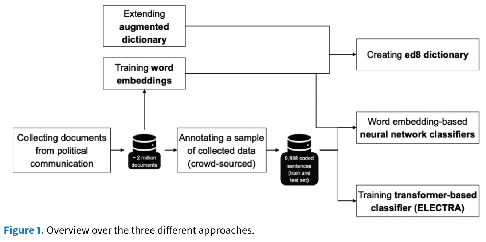</p>
</div>
<div class="case-reading">
<p><strong>Question</strong> Which models distinguish eight emotional appeals in German political text?</p>
<p><strong>Data</strong> 9,898 annotated sentences from parliamentary speeches and party Facebook posts.</p>
<p><strong>Routes</strong> Neighbours expand ed8; word2vec sentence averages feed a neural network. ELECTRA is fine-tuned on annotated sentences.</p>
</div>
</div>
<div class="source">
<p>W10 optional comparison reading · <a href="https://doi.org/10.1017/pan.2022.15">Widmann &amp; Wich (2023), Figure 1, pp. 629–632</a> · <a href="../assets/cases/widmann-wich-title.png">Journal article heading</a></p>
</div>

```

## Test predictions against human coding {#test-predictions-against-human-coding .w9-linear-slide .w9-linear-optional}

```{=html}

<p class="w9-study-label">
<strong>W10 · Optional comparison</strong>
</p>
<div class="slide-body case-split">
<div class="case-visual">
<p>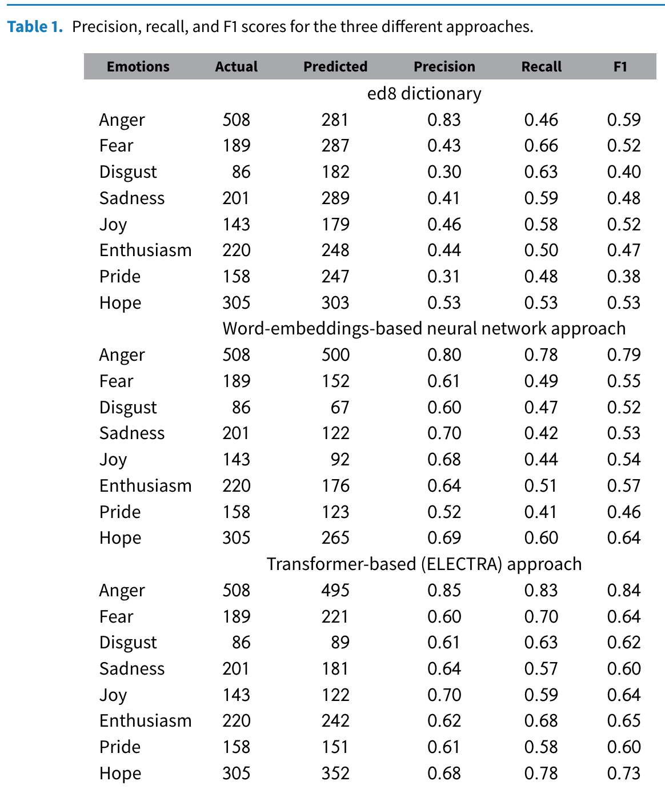</p>
</div>
<div class="case-reading">
<p><strong>F1 in the held-out sentences</strong></p>
<table>
<thead>
<tr>
<th>Model</th>
<th style="text-align: right;">Anger</th>
<th style="text-align: right;">Fear</th>
</tr>
</thead>
<tbody>
<tr>
<td>ed8</td>
<td style="text-align: right;">.59</td>
<td style="text-align: right;">.52</td>
</tr>
<tr>
<td>word2vec + NN</td>
<td style="text-align: right;">.79</td>
<td style="text-align: right;">.55</td>
</tr>
<tr>
<td>ELECTRA</td>
<td style="text-align: right;">.84</td>
<td style="text-align: right;">.64</td>
</tr>
</tbody>
</table>
<p>The authors also tested a new random sample of sentences.</p>
</div>
</div>
<div class="source">
<p><a href="https://doi.org/10.1017/pan.2022.15">Widmann &amp; Wich (2023), Table 1, p. 634. Robustness checks on pp. 635–638.</a></p>
</div>

```

## Four ways embeddings support an answer {#the-research-question-determines-the-comparison .w9-linear-slide .w9-linear-optional}

```{=html}

<div class="slide-body compact-table">
<table>
<colgroup>
<col style="width: 33%"/>
<col style="width: 33%"/>
<col style="width: 33%"/>
</colgroup>
<thead>
<tr>
<th>Research goal</th>
<th>What gets a vector</th>
<th>How the study answers</th>
</tr>
</thead>
<tbody>
<tr>
<td><strong>1 · Locate parties</strong></td>
<td>A party in a legislative term</td>
<td>PC1 gives a speech scale. Voteview helps interpret it.</td>
</tr>
<tr>
<td><strong>2 · Track meaning</strong></td>
<td>A word in a historical period</td>
<td>Cosine tracks associations. News passages show what changed.</td>
</tr>
<tr>
<td><strong>3 · Measure nostalgia</strong></td>
<td>A seed term or candidate term</td>
<td>Neighbours expand the dictionary. Its scores enter a regression.</td>
</tr>
<tr>
<td><strong>4 · Compare word use</strong></td>
<td>One use of a target word</td>
<td>Regression estimates the gap. Neighbours and passages explain it.</td>
</tr>
</tbody>
</table>
</div>
<div class="source">
<p><a href="https://doi.org/10.1017/pan.2019.26">Rheault &amp; Cochrane (2020)</a> · <a href="https://doi.org/10.1017/pan.2019.23">Rodman (2020)</a> · <a href="https://doi.org/10.1017/S0003055422001228">Rodriguez et al. (2023)</a> · <a href="https://doi.org/10.1017/S0007123423000571">Müller &amp; Proksch (2024)</a></p>
</div>

```

## Evaluate embeddings for the task {#evaluate-embeddings-for-the-task .w9-linear-slide .w9-linear-optional}

```{=html}

<div class="slide-body compact-table">
<table>
<colgroup>
<col style="width: 50%"/>
<col style="width: 50%"/>
</colgroup>
<thead>
<tr>
<th>Use of the vectors</th>
<th>What to check</th>
</tr>
</thead>
<tbody>
<tr>
<td>Features for prediction</td>
<td>Performance on held-out texts or a new corpus</td>
</tr>
<tr>
<td>Measures of political language</td>
<td>Human judgments, original passages and appropriate benchmarks</td>
</tr>
<tr>
<td>Comparisons across corpora</td>
<td>Domain, vocabulary coverage and stability across model settings</td>
</tr>
<tr>
<td>Social associations</td>
<td>Target and attribute sets, source-corpus composition and sensitivity of the comparison</td>
</tr>
</tbody>
</table>
<p>Rodriguez and Spirling compare window sizes, dimensions, training runs and human judgments of word associations.</p>
</div>
<div class="source">
<p><a href="https://doi.org/10.1086/715162">Rodriguez &amp; Spirling (2022), pp. 105–108, 112–113</a> · <a href="https://press.princeton.edu/books/hardcover/9780691207544/text-as-data">Text as Data, §8.4</a></p>
</div>

```

## Campaign language and political knowledge {#campaign-language-and-political-knowledge .w9-linear-slide .w9-linear-optional}

```{=html}

<div class="slide-body">
<p><strong>Question.</strong> Are voters closer to expert placements when parties use simpler manifestos?</p>
<ul>
<li>Bischof and Senninger compare German and Austrian manifestos using <strong>LIX</strong>.</li>
<li>They compare voters’ left–right placements of parties with expert placements.</li>
<li>Simpler manifestos are associated with smaller placement gaps.</li>
</ul>
</div>
<div class="source">
<p><a href="https://doi.org/10.1111/1475-6765.12235">Bischof &amp; Senninger (2018), pp. 477–481 and 486–490</a></p>
</div>

```

## LIX and Flesch score text in opposite directions {#lix-and-flesch-score-text-in-opposite-directions .w9-linear-slide .w9-linear-optional}

```{=html}

<div class="slide-body compact-table">
<table>
<colgroup>
<col style="width: 33%"/>
<col style="width: 33%"/>
<col style="width: 33%"/>
</colgroup>
<thead>
<tr>
<th>Measure</th>
<th>What it uses</th>
<th>Higher score</th>
</tr>
</thead>
<tbody>
<tr>
<td>LIX</td>
<td>Mean words per sentence + percentage of long words</td>
<td>More complex</td>
</tr>
<tr>
<td>Flesch Reading Ease</td>
<td>Words per sentence and syllables per word</td>
<td>Easier to read</td>
</tr>
</tbody>
</table>
<p>A sentence split can change both scores while the policy proposal stays the same.</p>
</div>
<div class="source">
<p><a href="https://doi.org/10.1111/1475-6765.12235">Bischof &amp; Senninger (2018), p. 479</a> · <a href="https://quanteda.io/reference/textstat_readability.html">quanteda readability reference</a></p>
</div>

```
